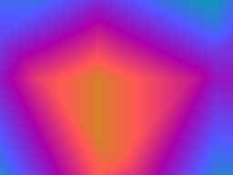
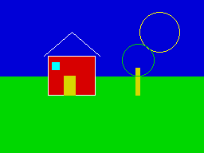
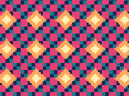
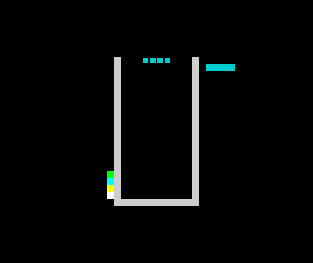
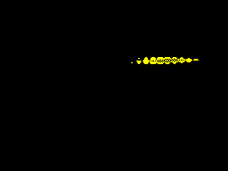
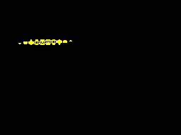
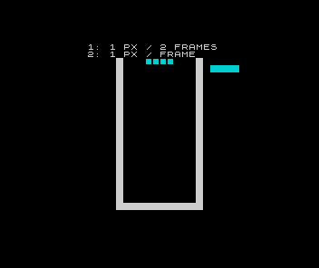
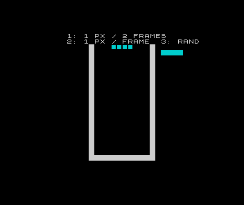

<p align="center">
  
</p>

## Play native Z80 demos

[Download for Linux, macOS or Windows — MinZ demos 0.25.4](https://github.com/oisee/minz/releases/tag/v0.25.4): **six platforms**, Intel/AMD x64 and ARM64 for each OS. Unpack and launch `mzx`, `MinZ Demos.app` on macOS, or `mzx.exe` on Windows. [Choose your package](reports/advanced-demos/release-0.25.4.md). Choose **Zork I/II, Spectrum Tetris, the 32×48 rotozoomer, or SMC sprites** with Up/Down and Enter. Escape returns to the menu. Separate SNA/TRD images and one-click launchers are included.

SAVE files live outside the download in your user configuration directory, so upgrades preserve them. Zork I resumes the session after a clean exit; Zork II uses disk SAVE/RESTORE. [Release verification](reports/zmachine-spectrum128/release/verified.md) · [Full Z-machine status](reports/zmachine-spectrum128/current-status.md).

# MinZ

MinZ is an experimental compiler toolchain for writing programs for Z80 machines with modern language features. **Nanz** is its main source language; Frill, C, Pascal, ABAP and other frontends also feed the shared HIR → MIR2 pipeline. The repository includes a Z80 assembler and emulators, so a small program can go from source to execution here.

The project is active research: examples and targets have different levels of maturity. Start with a runnable program below; use the [current handover](docs/project/HANDOVER-2026-10-01.md), [ranked backlog](docs/project/BACKLOG.md), and [dated technical audit](reports/2026-09-19-Deep-Technical-Audit-RU.md) for measured status.

## Nanz + C for system code

[Source imports, target ABI, supported subset and runnable examples](docs/Nanz_C_Interop.md) · [FAT12 disk-image reader](examples/system-c/fat12/README.md). Implementation, supported scope and verification are recorded in [PR #162](https://github.com/oisee/minz/pull/162) and the [integration report](reports/system-c-z80/integration-readiness.md).

[C/Nanz aggregate ABI admission audit](reports/2026-10-16-c89-nanz-aggregate-abi-audit.md): real scalar argument/return contracts, source-copy versus shared-object semantics, native boundary tests, and the corrected four-byte storage budget.

[C89 practical coverage matrix](reports/c89-good-enough/feature-matrix.md): small struct input/return decomposition, linked aggregate ABI, switch lowering and caller-owned struct-return buffers are integrated. The four-byte scalar ABI is integrated through [PR #170](https://github.com/oisee/minz/pull/170). Independent raw/final VM and assembled Z80 tests cover field order, signed values, copying, volatile accesses and live caller values. [Completion audit](reports/c89-good-enough/completion-audit.md) records the practical scope, measured call costs and integration checks; full ISO C89 conformance is not claimed.

[C99/C11/C23 and Objective-C claim audit](reports/2026-10-16-c-standards-objc-audit.md): current executable coverage, 26 directed probes, preserved semantic and diagnostic failures, and the boundary between syntax extensions and ISO conformance.

[**C and every frontend: supported scope and next hardening**](reports/2026-10-16-c-and-frontends-hardening.md): current C ABI and C99+ admission, fresh frontend tests, two new ABAP/Frill counterexamples, and a pinned abapiti/OSG plan for a native Go ABAP parser.

[**ABAP: native Go parser and checked Z80 subset**](examples/abap/README.md): no Node/npm, signed i32 and owned text, actual-object FORM references, complete-program VM/Z80 gates and guarded numeric CP/M commands. General SAP/TUI/ALV support remains separate.

[**Native ABAP evidence and limits**](reports/native-abap/2026-10-17-main-readiness.md): the original goal mapped to parser parity, unchanged whole reports, native memory/PC/SP checks and current integration status.

[Practical C on Z80: real libraries and honest diagnostics](reports/2026-10-16-system-c-hardening.md): unchanged inih/heatshrink sources, VM/Z80 validation, and fixes found by real system code.

[Direct word stores on Z80](reports/2026-10-16-c89-direct-word-store.md): unchanged C/Nanz abs_diff reaches 27 bytes / 220,904 T. All six C families improve; measured PFCCO interactions and remaining losses are recorded. Integration and required checks are tracked in [PR #181](https://github.com/oisee/minz/pull/181).

[C89/Nanz optimization completion audit](reports/2026-10-16-c89-optimization-completion-audit.md): frozen inputs, exact final compiler tree, primary and heldout VM/Z80 evidence, remaining losses and integration criteria.

[Current full C/Nanz Z80 benchmark — all sources and ASM](reports/2026-10-16-c89-nanz-full-benchmark.md): all 69 builds, MinZ C and idiomatic Nanz, SDCC 4.2/4.5 Size and Speed, sccz80. Every result links to its source, generated ASM and measurements; optimization milestones and remaining losses are retained.

[Copy and packed-data optimization](reports/2026-10-16-copy-fat12-results.md): bounded pointer walks and bit-mask facts improve unchanged C and Nanz. Copy now measures 182 bytes / 301,600 Z80 T-states; additional workloads retain both gains and SDCC losses.

[Learning from SDCC's own tests](reports/2026-10-16-sdcc-upstream-black-box.md): two unchanged upstream regression programs, ten passing builds, and concrete remaining byte-operation and signed-loop costs in the generated ASM.

[Original identical-C Z80 baseline](reports/2026-10-16-c89-identical-c-benchmark.md): six frozen C inputs, MinZ / SDCC / sccz80, real T-states and independent oracles. SDCC wins speed and size on the five common examples; MinZ also supports the tested struct-by-value case. No overall compiler superiority is claimed.

[From C promotions to CP: before/after Z80 ASM](reports/2026-10-16-c89-byte-compare-asm.md): unchanged C abs_diff and sum_array, exact code and timing, safe byte-range proof and heldout verification.

[Byte arithmetic after C promotions](reports/2026-10-16-c89-byte-arithmetic.md): unchanged C abs_diff now matches idiomatic Nanz at 38 bytes / 305,750 T; all compiler profiles and remaining SDCC losses are retained.

[C output pointers as scalar returns](reports/2026-10-16-c89-output-contracts.md): three unchanged C programs preserve results and global effects on raw/final MIR VM and Z80 while using smaller, faster internal contracts. The separate feature branch passes core packages and all 432 fast pipeline checks; integrated through PR #177.

[Direct byte loads in C and Nanz](reports/2026-10-16-c89-byte-load-fusion.md): the complete 69-build matrix was repeated; abs_diff reaches 36 bytes / 289,366 T by removing caller-side moves. Core packages and all 432 fast pipeline checks pass. This stage is integrated through PR #176; the CFG follow-up below improves abs_diff further.

[Old claims, new evidence](reports/2026-10-16-old-claims-new-evidence.md): automatic five-byte abs_diff and a fresh replay of all eleven historical C examples. All 88 builds pass native and VM checks; constant folding and tailcalls are real, while full-module sizes and remaining SDCC losses correct the old advertising.

[Original extended C/Nanz baseline with SDCC 4.5](reports/c89-optimization/baseline.md): same frozen C, separate idiomatic Nanz and tuple variants, all profiles retained. SDCC 4.5 supports the tested aggregate ABI; MinZ C wins that case. The five other common C cases favor SDCC. [Optimization milestones](reports/c89-optimization/objective.md) track the next verified work.

## 🎉 Zork, compiled from Nanz to banked Z80!

**The Spectrum 128K milestone is reached.** Our Z-machine V3 interpreter,
written in Nanz, runs complete Zork adventures as assembled Z80 in the
Spectrum emulator:

- **Zork I: 350/350 on ordinary 128K**, including a late SAVE/RESTORE and
  completion of the game. All 37,194 bytes of that run's output match the MIR2 VM.
- **Zork II: 400/400 on ordinary 128K** with compressed banked story storage.
  The Scorpion memory variant also restores a late disk SAVE in a fresh machine
  and reaches the ending again.
- **CZECH V3: 349 assertions passed, 0 failed**, plus 19 print checks.
  Full game routes check stack restoration, paging and immutable story memory;
  Frotz independently confirms both endings.

[**Results, launch instructions and limits →**](reports/zmachine-spectrum128/current-status.md)
[**Requirement-by-requirement evidence →**](reports/zmachine-spectrum128/goal-audit.md)

These results are in `feat/zmachine-spectrum128`. They cover specific stories
and routes in the emulator; physical Spectrum hardware and compatibility with
all V3 stories remain future work. Disk SAVE uses the emulator's TR-DOS API.

## 🎉 Typed hardware DSL + measured Z80 optimization, now in main!

Nanz metafunctions now build typed HIR for fills, copies and masked sprites.
Generated names preserve caller references, and generated loops retain their
source origins for profiling. Checked register-allocation fragments, PBQP/PFCCO
and Grace work together in a bounded search with no external solver required
for ordinary compilation.

Two verified results:

- **256-byte fill:** 30 → 22 bytes and 34,901 → 23,889 Z80 T-states
  against the saved text-generator baseline. [Fill report](reports/structured-hardware-emit/README.md).
- **Runtime masked sprite, complete caller module:** 97 → 89 bytes;
  heldout workload 2,553 → 2,372 T-states. This Speed search uses the current
  size-admitted table domain (`OptSize=true`). [Sprite report](reports/runtime-sprite-measured-composition/README.md).

Independent VM/Z80 oracles check memory, access order and stack restoration.
The sprite winner is replayed as the exact selected ASM/BIN on inputs that did
not participate in selection. [**Full compiler overview →**](reports/2026-10-11-092-grace-vm-z80-status.md)

## Compiler progress — October 2026

[**Full report: MinZ today — Nanz, the other frontends, compiler layers, and verified Z80**](reports/2026-10-11-092-grace-vm-z80-status.md) (Russian). A tour of the shared pipeline, Grace, PFCCO/PBQP and register-allocation tables, separating integrated changes from research checkpoints. **Updated October 15:** whole baked sprites, direct pixel-smooth Tetris, typed wave/noise effects and measured Size/Speed/frame-budget specialization are in `main`. Automatic line progression uses an 8-pixel colour gauge and no in-game text. [The 0.25.4 checkpoint](reports/advanced-demos/release-0.25.4.md) explains the Nanz API, six verified native packages and long 50-Hz recordings. All 800 pipeline roots are accounted for: **707 PASS, 93 SKIP, 0 FAIL**. The corrected full source-assertion audit preserves all 4,809 assertions per compiler and finds no new regressions; existing failures remain reported. [Demos 0.25.4 is published](https://github.com/oisee/minz/releases/tag/v0.25.4): all 14 public downloads and their shared copies have matching SHA256. The release tag passed all 18 jobs; the CI-only harness fix is tracked separately. [Published demos 0.25.3](https://github.com/oisee/minz/releases/tag/v0.25.3) retain the previous three-mode game; [their verified results and limits](reports/advanced-demos/release-0.25.3.md) remain available.

[Measured runtime sprites](reports/runtime-sprite-measured-composition/README.md): compose checked register-assignment fragments, retain a live base, and select tables plus conditional layouts on training inputs; replay the exact winner on heldout buffers.

[Runtime-base structural sprites](reports/structured-sprite-runtime-base/README.md): specialize mask/data and screen offsets while taking a checked caller pointer at runtime; independent VM/Z80 full-memory checks include pointer wrap.

[Measured build selection CLI](reports/conditional-layout-cli/README.md): choose compiler modes and a conditional layout by native Z80 timing or size, then replay the saved winner on heldout inputs. Includes complete artifacts and independent tokenizer checks.

[**Nanz close to hardware: declarative arrays, compile-time interfaces and Antique Toy techniques**](reports/2026-10-12-131-nanz-hardware-api-roadmap.md) (Russian). A proposed library design for fills, copies, masks, sprites and texture walks, with a [full Astra review](reports/2026-10-12-130-nanz-hardware-arrays-astra.md). Existing features and measured research results are distinguished from planned APIs.

[**Структурный masked sprite**](reports/structured-hardware-sprite/README.md): третий потребитель typed HIR, побитовые операции и сравнение с сохранённым ASM baseline.

[**Композиция shape-таблиц из CLI**](reports/composition-cli/README.md): пул фрагментов → проверенная таблица текущего Nanz → меньший Z80 BIN, без Z3.

[**Автоматическая композиция shape-таблиц**](reports/composition-auto/README.md): подготовка для модуля без ручного выбора границ и без внешнего solver.

[**Пересылки между фрагментами shape-таблиц**](reports/composition-move-bridges/README.md): явные мостики с учётом стоимости, ABI и native-проверкой регистров/flags/стека.

[**Constraint propagation for register candidates**](reports/composition-domain-propagation/README.md): preserving every complete solution while pruning unsupported fragment placements, with exhaustive oracle checks and measured preparation cost.

[**Composition of checked register assignments**](reports/checked-table-composition/README.md): bounded reuse of allocation fragments, full MIR/ABI readmission, native PFCCO/Grace callers and heldout limits.

[**Structured emit: typed HIR from Nanz metafunctions**](reports/structured-hardware-emit/README.md) (Russian). The first migrated hardware generator builds pointer-fill loops without source-string assembly; includes independent VM/Z80 checks and a measured 256-byte fill comparison. The [second consumer, hardware copy](reports/structured-hardware-copy/README.md), adds canonical byte loads and documents the register-order tradeoff. The [caller-reference hygiene fix](reports/structured-emit-hygiene/README.md) prevents generated locals from capturing user variables, with full-memory VM/Z80 regressions. [Generated-loop provenance](reports/structured-emit-provenance/README.md) makes typed fill loops observable and reloadable by the strict profiler.

[**How Nanz hardware generators work**](reports/2026-10-13-133-nanz-hardware-library-how-it-works.md) (Russian). From declarative blocks to specialized Z80: compile-time execution, fill/copy/masks/texture walks, measured tradeoffs, independent proofs, and library ideas.

[**Hardware-near Nanz library and ZX Spectrum demo**](stdlib/hw/README.md): declarative fills, row copies, masked sprites and affine texture walks, with measured pointer/LDIR/compiled variants. The [32×48 rotozoomer](reports/zx-rotozoomer-library/README.md) runs in the Spectrum emulator with the 48K ROM, ULA contention and interrupts; independent tests verify complete screens and stack/register restoration. Run `scripts/play_zx_rotozoomer.sh` to open it.

[**A sprite as a program: SMC, mutable row chains and PUSH**](reports/2026-10-13-134-moving-sprites-smc-push.md) (Russian). Nanz examples alongside generated Z80, moving and relinking rows, stack/IRQ contracts and measured full move + draw costs.

[**Z-machine V3 on Spectrum: current verified status**](reports/zmachine-spectrum128/current-status.md) (Russian). Nanz interpreter compiled to banked Z80: full Zork I on ordinary 128K, full Zork II with compressed banked storage, and late Zork II disk SAVE/RESTORE through the Scorpion memory profile, including a fresh-machine replay to the ending. Includes launch paths, measured limits and the distinction between emulator API disk support and physical hardware.

[**Moving compiled sprites and PUSH drawing**](reports/hardware-sprite-chain/README.md): mutable row destinations and continuations, measured move + draw costs, and a ROM/IRQ-verified Spectrum animation. Run `scripts/play_zx_sprite_chain.sh` or add `--push`.

[**Pixel-step Tetris with baked Nanz sprites**](reports/advanced-demos/tetris/smooth-gameplay.md) (Russian, research checkpoint). Three native Spectrum game runs, independent physics and 1,077 complete fetched field frames. Updated embedded demo candidate; preparation tuning and release integration remain in progress.

[**How a million Tetris checks test the compiler**](reports/2026-10-12-132-tetris-million-case-testing.md) (Russian). Six builds, independent game logic, raw/final MIR2 VM and assembled Z80; what full-memory, access-order and PC/SP checks establish, and their limits.

## Run a program

Install [Go](https://go.dev/doc/install), then from the repository root:

```sh
git clone https://github.com/oisee/minz.git
cd minz
make -C minzc mz mza mze
mkdir -p build
minzc/mz examples/nanz/hello_cpm.nanz --target cpm -o build/hello.a80
minzc/mza build/hello.a80 -o build/hello.com
minzc/mze build/hello.com -t cpm
```

The emulator prints `Hello!`. The [Nanz source](examples/nanz/hello_cpm.nanz) is small enough to modify and rerun. For more programs, see [fun](fun/README.md) and [examples](examples/).

## What you can make

| ObjC plasma | Nanz canvas | Nanz rotozoomer |
| :---: | :---: | :---: |
|  |  |  |
| [ObjC source](examples/objc/plasma.m) | [Nanz source](examples/nanz/canvas_house.nanz) | [Nanz source](examples/nanz/rotozoomer.nanz) |

These images are current MIR2 VM canvas renders. Build `mzv` with `make -C minzc mzv`, then run `python3 scripts/build_rotozoomer_gif.py` to regenerate the GIF (requires Pillow). Run `cd minzc && go test ./pkg/c89 ./pkg/nanz -run '^(TestPlasmaRender|TestCanvasImplShowcase|TestRotozoomerGallery)$' -count=1` to compare the gallery with the current source. The CP/M example above exercises the Z80 path. [Gallery verification](reports/2026-10-01-README-Gallery-Verification-RU.md) · [Rotozoomer details](reports/2026-10-01-Nanz-Rotozoomer-RU.md).

**Spectrum Tetris: a complete short game with baked Nanz sprites**



This preview shows **260 consecutive actual Z80/ULA frames: 5.2 seconds at
50 Hz**, through game over. No interpolation or speedup. The new game starts
without a difficulty menu: cleared lines grow an 8-pixel colour gauge and
unlock faster descent, occasional then continuous shake, and smooth or abrupt
random speed. The preview seeds the stage/gauge at 32 lines; subsequent play
executes the real main with independent physics and full-screen checks.

One Nanz description bakes the whole sprite and its paired draw/erase kernels.
Addresses are patched before HALT; publication writes directly to the screen.
The current candidate passes three complete main sessions, 15 steady high-stage
sessions, 27 threshold/clear sessions and 4890 native Z80 physics scenarios.
Ordinary motion meets its tested one-IRQ budget; some heavy actions take two
or three frames. [Source, full verification and capture provenance](reports/advanced-demos/tetris/line-progression/README.md).

The whole-sprite API, automatic line progression and this image are in main
and [published demos 0.25.4](https://github.com/oisee/minz/releases/tag/v0.25.4).
[Six-platform downloads, controls and verified results](reports/advanced-demos/release-0.25.4.md).
The older [0.25.3 packages](https://github.com/oisee/minz/releases/tag/v0.25.3) remain available.
[Earlier renderer and measurements](reports/advanced-demos/tetris/direct-renderer.md).

[Typed sprite scene](reports/advanced-demos/typed-sprite-scene/README.md):
one Nanz description bakes the whole sprite and its erase mask.
`mzx --demo sprites` runs the scene; placement precedes HALT and publication
writes directly to the screen. [Nanz source](reports/advanced-demos/typed-sprite-scene/source.nanz).

**Typed TV wave: baked sprites with a Nanz effect object**

[](reports/advanced-demos/typed-sprite-effects/README.md)

These are **64 consecutive actual Z80/ULA frames at 50 Hz**, without
interpolation. A typed `ByteWave` object shifts sprite rows by whole byte
columns; addresses are staged before HALT, then paired erase/draw kernels
publish directly to the screen. The implementation is now in main
([PR #137](https://github.com/oisee/minz/pull/137)); it is included in [demos 0.25.2](https://github.com/oisee/minz/releases/tag/v0.25.2). Run `mzx --demo sprite-wave` with a build from current main.
[Implementation, Nanz source, and verification](reports/advanced-demos/typed-sprite-effects/README.md).

**Wave + noise: a composed Nanz effect**

[](reports/advanced-demos/meta-specialization/product.md)

A concrete `TVSignal` composes wave and noise in Nanz. This GIF records
**256 consecutive actual Z80/ULA frames at 50 Hz: 5.12 seconds**, four times
the earlier preview. Every pixel and GIF duration is checked against an
independent oracle, with no interpolation; the loop boundary continues the
next phase. This recording uses the measured compact candidate from main.
Addresses are patched before HALT; paired erase/draw kernels then publish
directly to the screen. Try `mzx --demo sprite-tv` in [demos 0.25.2](https://github.com/oisee/minz/releases/tag/v0.25.2).
[Source and timing](reports/advanced-demos/meta-specialization/product.md)
· [Extended capture provenance](reports/advanced-demos/meta-specialization/tv-long-capture.json).

**Pixel-wave Tetris: a baked visual effect**

[](reports/advanced-demos/tetris/pixel-wobble/README.md)

A typed Nanz `ByteWave` shifts the falling figure by one pixel inside its cells.
Paired baked kernels erase and draw directly to the screen; physics stays in
game coordinates. Both difficulty levels and 1/2/4-line clears pass independent
native Z80/ULA checks. Heavy actions still take multiple frames.
[Source, measurements, verified capture, and limits](reports/advanced-demos/tetris/pixel-wobble/README.md).

**Smooth random fall speed**

[](reports/advanced-demos/tetris/variable-speed/README.md)

Choose **3** for a slowly changing random fall rate. A small typed Nanz
controller integrates every elapsed frame before input; each pixel of motion
still checks contact. Piece randomness is independent. Levels 1 and 2 keep
their fixed speeds. Available in [six-platform demos 0.25.3](https://github.com/oisee/minz/releases/tag/v0.25.3). [Code, native/VM checks, capture and limits](reports/advanced-demos/tetris/variable-speed/README.md).

## Explore

- [Nanz language book](docs/Nanz_Language_Book_v7.md) and [Frill guide](docs/Frill_Language_Guide.md)
- [Compiler architecture](docs/minz-compiler-architecture.md) and [MIR2 guide](docs/MIR_Architecture_Guide.md)
- [Installation](docs/INSTALLATION.md), [contributing](.github/CONTRIBUTING.md), and [documentation catalog](docs/Book_Catalog.md)
- [Reports](reports/), [research](research/), and [project backlog](docs/project/BACKLOG.md)

MinZ is released under the [MIT license](LICENSE).
