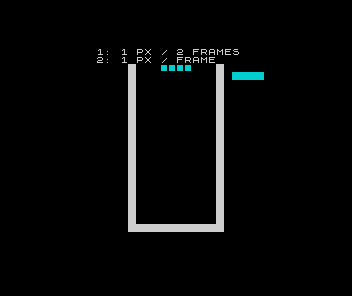

<p align="center">
  
</p>

## Play native Z80 demos

[Download for Linux, macOS or Windows — MinZ 0.25.1](https://github.com/oisee/minz/releases/tag/v0.25.1): **six platforms**, Intel/AMD x64 and ARM64 for each OS. Unpack and launch `mzx`, `MinZ Demos.app` on macOS, or `mzx.exe` on Windows. [Choose your package](reports/advanced-demos/tetris/release-0.25.1.md). Choose **Zork I/II, Spectrum Tetris, the 32×48 rotozoomer, or SMC sprites** with Up/Down and Enter. Escape returns to the menu. Separate SNA/TRD images and one-click launchers are included.

SAVE files live outside the download in your user configuration directory, so upgrades preserve them. Zork I resumes the session after a clean exit; Zork II uses disk SAVE/RESTORE. [Release verification](reports/zmachine-spectrum128/release/verified.md) · [Full Z-machine status](reports/zmachine-spectrum128/current-status.md).

# MinZ

MinZ is an experimental compiler toolchain for writing programs for Z80 machines with modern language features. **Nanz** is its main source language; Frill, C, Pascal, ABAP and other frontends also feed the shared HIR → MIR2 pipeline. The repository includes a Z80 assembler and emulators, so a small program can go from source to execution here.

The project is active research: examples and targets have different levels of maturity. Start with a runnable program below; use the [current handover](docs/project/HANDOVER-2026-10-01.md), [ranked backlog](docs/project/BACKLOG.md), and [dated technical audit](reports/2026-09-19-Deep-Technical-Audit-RU.md) for measured status.

## 🎉 Zork, compiled from Nanz to banked Z80!

**The Spectrum 128K milestone is reached.** Our Z-machine V3 interpreter,
written in Nanz, runs complete Zork adventures as assembled Z80 in the
Spectrum emulator:

- **Zork I: 350/350 on ordinary 128K**, including a late SAVE/RESTORE and
  completion of the game. All 37,194 bytes of that run's output match the MIR2 VM.
- **Zork II: 400/400 on ordinary 128K** with compressed banked story storage.
  The Scorpion memory variant also restores a late disk SAVE in a fresh machine
  and reaches the ending again.
- **CZECH V3: 349 assertions passed, 0 failed**, plus 19 print checks.
  Full game routes check stack restoration, paging and immutable story memory;
  Frotz independently confirms both endings.

[**Results, launch instructions and limits →**](reports/zmachine-spectrum128/current-status.md)
[**Requirement-by-requirement evidence →**](reports/zmachine-spectrum128/goal-audit.md)

These results are in `feat/zmachine-spectrum128`. They cover specific stories
and routes in the emulator; physical Spectrum hardware and compatibility with
all V3 stories remain future work. Disk SAVE uses the emulator's TR-DOS API.

## 🎉 Typed hardware DSL + measured Z80 optimization, now in main!

Nanz metafunctions now build typed HIR for fills, copies and masked sprites.
Generated names preserve caller references, and generated loops retain their
source origins for profiling. Checked register-allocation fragments, PBQP/PFCCO
and Grace work together in a bounded search with no external solver required
for ordinary compilation.

Two verified results:

- **256-byte fill:** 30 → 22 bytes and 34,901 → 23,889 Z80 T-states
  against the saved text-generator baseline. [Fill report](reports/structured-hardware-emit/README.md).
- **Runtime masked sprite, complete caller module:** 97 → 89 bytes;
  heldout workload 2,553 → 2,372 T-states. This Speed search uses the current
  size-admitted table domain (`OptSize=true`). [Sprite report](reports/runtime-sprite-measured-composition/README.md).

Independent VM/Z80 oracles check memory, access order and stack restoration.
The sprite winner is replayed as the exact selected ASM/BIN on inputs that did
not participate in selection. [**Full compiler overview →**](reports/2026-10-11-092-grace-vm-z80-status.md)

## Compiler progress — October 2026

[**Full report: MinZ today — Nanz, the other frontends, compiler layers, and verified Z80**](reports/2026-10-11-092-grace-vm-z80-status.md) (Russian). A readable tour of the shared pipeline, Grace, PFCCO/PBQP and register-allocation tables, with measured results and remaining gaps. Research-branch results are identified separately from what is available in `main`. **Updated October 14:** typed hardware emit, caller-reference hygiene, generated-loop provenance and measured composition are integrated in `main` through PR #125. The overview also covers the shared hardware library, ROM/IRQ-verified Spectrum demos and parallel deep checks on release tags, nightly and manual runs.

[Measured runtime sprites](reports/runtime-sprite-measured-composition/README.md): compose checked register-assignment fragments, retain a live base, and select tables plus conditional layouts on training inputs; replay the exact winner on heldout buffers.

[Runtime-base structural sprites](reports/structured-sprite-runtime-base/README.md): specialize mask/data and screen offsets while taking a checked caller pointer at runtime; independent VM/Z80 full-memory checks include pointer wrap.

[Measured build selection CLI](reports/conditional-layout-cli/README.md): choose compiler modes and a conditional layout by native Z80 timing or size, then replay the saved winner on heldout inputs. Includes complete artifacts and independent tokenizer checks.

[**Nanz close to hardware: declarative arrays, compile-time interfaces and Antique Toy techniques**](reports/2026-10-12-131-nanz-hardware-api-roadmap.md) (Russian). A proposed library design for fills, copies, masks, sprites and texture walks, with a [full Astra review](reports/2026-10-12-130-nanz-hardware-arrays-astra.md). Existing features and measured research results are distinguished from planned APIs.

[**Структурный masked sprite**](reports/structured-hardware-sprite/README.md): третий потребитель typed HIR, побитовые операции и сравнение с сохранённым ASM baseline.

[**Композиция shape-таблиц из CLI**](reports/composition-cli/README.md): пул фрагментов → проверенная таблица текущего Nanz → меньший Z80 BIN, без Z3.

[**Автоматическая композиция shape-таблиц**](reports/composition-auto/README.md): подготовка для модуля без ручного выбора границ и без внешнего solver.

[**Пересылки между фрагментами shape-таблиц**](reports/composition-move-bridges/README.md): явные мостики с учётом стоимости, ABI и native-проверкой регистров/flags/стека.

[**Constraint propagation for register candidates**](reports/composition-domain-propagation/README.md): preserving every complete solution while pruning unsupported fragment placements, with exhaustive oracle checks and measured preparation cost.

[**Composition of checked register assignments**](reports/checked-table-composition/README.md): bounded reuse of allocation fragments, full MIR/ABI readmission, native PFCCO/Grace callers and heldout limits.

[**Structured emit: typed HIR from Nanz metafunctions**](reports/structured-hardware-emit/README.md) (Russian). The first migrated hardware generator builds pointer-fill loops without source-string assembly; includes independent VM/Z80 checks and a measured 256-byte fill comparison. The [second consumer, hardware copy](reports/structured-hardware-copy/README.md), adds canonical byte loads and documents the register-order tradeoff. The [caller-reference hygiene fix](reports/structured-emit-hygiene/README.md) prevents generated locals from capturing user variables, with full-memory VM/Z80 regressions. [Generated-loop provenance](reports/structured-emit-provenance/README.md) makes typed fill loops observable and reloadable by the strict profiler.

[**How Nanz hardware generators work**](reports/2026-10-13-133-nanz-hardware-library-how-it-works.md) (Russian). From declarative blocks to specialized Z80: compile-time execution, fill/copy/masks/texture walks, measured tradeoffs, independent proofs, and library ideas.

[**Hardware-near Nanz library and ZX Spectrum demo**](stdlib/hw/README.md): declarative fills, row copies, masked sprites and affine texture walks, with measured pointer/LDIR/compiled variants. The [32×48 rotozoomer](reports/zx-rotozoomer-library/README.md) runs in the Spectrum emulator with the 48K ROM, ULA contention and interrupts; independent tests verify complete screens and stack/register restoration. Run `scripts/play_zx_rotozoomer.sh` to open it.

[**A sprite as a program: SMC, mutable row chains and PUSH**](reports/2026-10-13-134-moving-sprites-smc-push.md) (Russian). Nanz examples alongside generated Z80, moving and relinking rows, stack/IRQ contracts and measured full move + draw costs.

[**Z-machine V3 on Spectrum: current verified status**](reports/zmachine-spectrum128/current-status.md) (Russian). Nanz interpreter compiled to banked Z80: full Zork I on ordinary 128K, full Zork II with compressed banked storage, and late Zork II disk SAVE/RESTORE through the Scorpion memory profile, including a fresh-machine replay to the ending. Includes launch paths, measured limits and the distinction between emulator API disk support and physical hardware.

[**Moving compiled sprites and PUSH drawing**](reports/hardware-sprite-chain/README.md): mutable row destinations and continuations, measured move + draw costs, and a ROM/IRQ-verified Spectrum animation. Run `scripts/play_zx_sprite_chain.sh` or add `--push`.

[**Pixel-step Tetris with baked Nanz sprites**](reports/advanced-demos/tetris/smooth-gameplay.md) (Russian, research checkpoint). Three native Spectrum game runs, independent physics and 1,077 complete fetched field frames. Updated embedded demo candidate; preparation tuning and release integration remain in progress.

[**How a million Tetris checks test the compiler**](reports/2026-10-12-132-tetris-million-case-testing.md) (Russian). Six builds, independent game logic, raw/final MIR2 VM and assembled Z80; what full-memory, access-order and PC/SP checks establish, and their limits.

## Run a program

Install [Go](https://go.dev/doc/install), then from the repository root:

```sh
git clone https://github.com/oisee/minz.git
cd minz
make -C minzc mz mza mze
mkdir -p build
minzc/mz examples/nanz/hello_cpm.nanz --target cpm -o build/hello.a80
minzc/mza build/hello.a80 -o build/hello.com
minzc/mze build/hello.com -t cpm
```

The emulator prints `Hello!`. The [Nanz source](examples/nanz/hello_cpm.nanz) is small enough to modify and rerun. For more programs, see [fun](fun/README.md) and [examples](examples/).

## What you can make

| ObjC plasma | Nanz canvas | Nanz rotozoomer |
| :---: | :---: | :---: |
|  |  |  |
| [ObjC source](examples/objc/plasma.m) | [Nanz source](examples/nanz/canvas_house.nanz) | [Nanz source](examples/nanz/rotozoomer.nanz) |

These images are current MIR2 VM canvas renders. Build `mzv` with `make -C minzc mzv`, then run `python3 scripts/build_rotozoomer_gif.py` to regenerate the GIF (requires Pillow). Run `cd minzc && go test ./pkg/c89 ./pkg/nanz -run '^(TestPlasmaRender|TestCanvasImplShowcase|TestRotozoomerGallery)$' -count=1` to compare the gallery with the current source. The CP/M example above exercises the Z80 path. [Gallery verification](reports/2026-10-01-README-Gallery-Verification-RU.md) · [Rotozoomer details](reports/2026-10-01-Nanz-Rotozoomer-RU.md).

**Spectrum Tetris: pixel-by-pixel descent with baked Nanz sprites**



This preview records **78 consecutive actual Z80/ULA frames at 50 Hz**:
77 one-pixel steps, with no interpolation or speedup. The GIF loops back to
its first frame. Sprite code is baked at compile time; screen addresses are
patched before HALT, then paired draw/erase kernels write directly to the
screen. Quiet descent meets its frame budget; some heavy actions still take
two frames. The whole-sprite API and direct-screen game are **now in main**
([PR #128](https://github.com/oisee/minz/pull/128), `a284fafc`). [Six-platform 0.25.1 packages](https://github.com/oisee/minz/releases/tag/v0.25.1)
are published from that integrated commit. The smaller dirty-span/preview
follow-up is also in main ([#130](https://github.com/oisee/minz/pull/130));
it will enter the next package build.
[Implementation and verification](reports/advanced-demos/tetris/direct-renderer.md)
· [Capture provenance](media/tetris-direct-50hz.json).

[Typed sprite scene](reports/advanced-demos/typed-sprite-scene/README.md):
one Nanz description bakes the whole sprite and its erase mask.
`mzx --demo sprites` runs the scene; placement precedes HALT and publication
writes directly to the screen. [Nanz source](reports/advanced-demos/typed-sprite-scene/source.nanz).
[Typed TV wave](reports/advanced-demos/typed-sprite-effects/README.md) adds a render-only
`ByteWave` object and shows actual 50 Hz captures; `mzx --demo sprite-wave`.
[Typed wave + noise](reports/advanced-demos/sprite-effect-composition/README.md)
composes a concrete Nanz effect type and validates every displayed ULA frame;
`mzx --demo sprite-tv` in a build containing this candidate.

## Explore

- [Nanz language book](docs/Nanz_Language_Book_v7.md) and [Frill guide](docs/Frill_Language_Guide.md)
- [Compiler architecture](docs/minz-compiler-architecture.md) and [MIR2 guide](docs/MIR_Architecture_Guide.md)
- [Installation](docs/INSTALLATION.md), [contributing](.github/CONTRIBUTING.md), and [documentation catalog](docs/Book_Catalog.md)
- [Reports](reports/), [research](research/), and [project backlog](docs/project/BACKLOG.md)

MinZ is released under the [MIT license](LICENSE).
