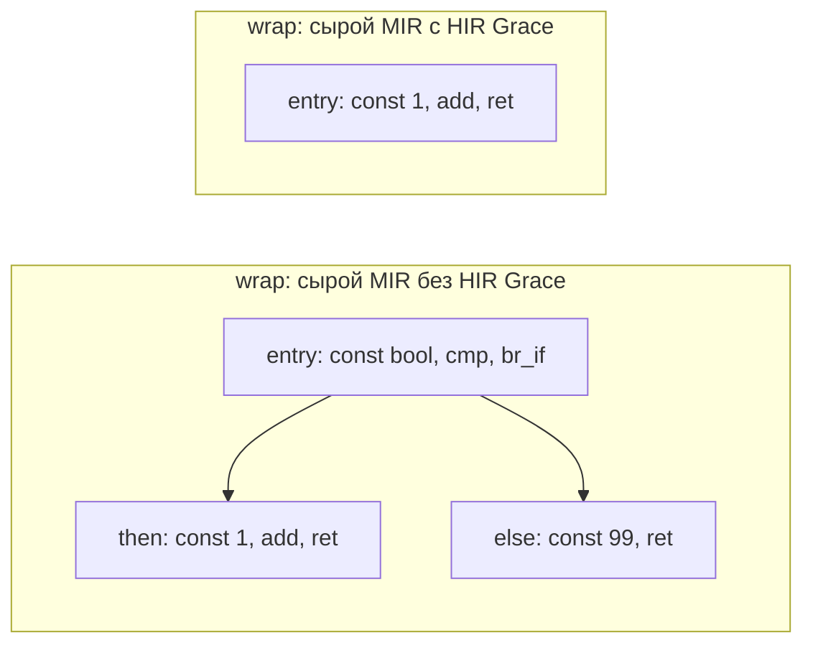

# Grace на HIR и MIR: сквозной эксперимент с проверкой на VM

**Дата:** 10 октября 2026. **Ветка:** `feat/grace-hir-vm`.
**База:** `origin/main`, `4743cb7c`. **Статус:** эксперимент реализован,
включается флагом `--hir-grace`; перенос остальных преобразований в беклоге.

Замеры разделов 7/11 зафиксированы на этапе `c3bbfec7`, до pointer-walk.
Новый этап и его отдельные замеры: [диапазоны и pointer-walk](grace-pointer-walk-e2e.md).

На двух небольших функциях раннее переписывание HIR уменьшило число исполняемых
инструкций VM после обычной MIR-оптимизации на **60%**, а время VM-прогона — на
**9,1%**. Это измерение данного примера, а не прогноз для всех программ MinZ
или скорости Z80. Терминаторы в счётчик инструкций VM не входят.

## 1. Что проверяем


На этапе HIR движок выбирает ветку с буквальным `true` или `false`. На этапе
MIR сравниваем результат и до, и после существующих оптимизаций. Это позволяет
отделить пользу раннего преобразования от того, что умеют поздние проходы.
В этих замерах конец маршрута — MIR2 VM, без генерации машинного кода.
В исходниках пакет ещё называется `mir2`; здесь это наш действующий MIR.

## 2. Исходная программа

```text
// First HIR Grace experiment: check width and overflow through MIR2 VM.
fun wrap(x: u8) -> u8 {
    if true { return x + 1 } else { return 99 }
}

fun choose(x: u8) -> u8 {
    if false { return 99 }
    return x
}

assert wrap(0) == 1 via mir2
assert wrap(127) == 128 via mir2
assert wrap(255) == 0 via mir2
assert choose(42) == 42 via mir2
```

`wrap` демонстрирует сложение с переполнением `u8`, `choose` — ветку без `else`.
Ассерты исполняются на VM. Например, `wrap(255)` должен вернуть 0.
Сохраняем этот исходник одинаковым для всех маршрутов.

## 3. HIR до и после Grace

### HIR₀: без переписывания

```text
; HIR module: ../examples/nanz/grace_hir_constant_if.nanz
fun @wrap(x: u8) -> u8
  if true:bool
    return ((x:u8) + 1:u8):u8
  else
    return 99:u8

fun @choose(x: u8) -> u8
  if false:bool
    return 99:u8
  return (x:u8)
```

### HIR₁: после `--hir-grace`

```text
; HIR module: ../examples/nanz/grace_hir_constant_if.nanz
fun @wrap(x: u8) -> u8
  return ((x:u8) + 1:u8):u8

fun @choose(x: u8) -> u8
  return (x:u8)
```

| Видимый элемент HIR | До | После |
|---|---:|---:|
| Функции | 2 | 2 |
| `if` | 2 | 0 |
| Константные условия `bool` | 2 | 0 |
| `return` во всех ветках | 4 | 2 |

Grace убрал ветвление и недостижимые `return 99`. Типы `u8`, сложение и сами
функции сохранились. В памяти HIR выбранная ветка остаётся узлом `Block`;
дамп печатает его содержимое без отдельной обёртки. Это не полная статистика
всех внутренних HIR-узлов.

### Само правило

```lisp
(grace hir-constant-if 10
  (match (block ?b (term-kind "hir.block")))
  (where (hir-has-constant-if ?b))
  (action (custom "hirSelectBranch" ?b)))
```

Общий движок Grace уже был в MinZ. Новый адаптер показывает ему структурные
HIR-блоки, а предикат и действие работают с типизированными узлами HIR.
Это не импорт движка abapiti и пока не реализация его рекурсивного Datalog.

Предикат требует буквальное логическое условие. Функции с `goto`/метками не
переписываются: метка могла бы сделать отброшенную ветку достижимой. Выбранные
ветки с объявлениями локальных переменных, tuple-bindings и переменных циклов
также пока исключены: lowerer по-разному обрабатывает окружения `if` и `Block`.
Динамическое условие с вызовом функции не удаляется.

## 4. Сырой MIR после lowering

### Без HIR Grace

```text
; MIR2 module: ../examples/nanz/grace_hir_constant_if.nanz
fun @wrap(%r1: u8 [acc]) -> u8 [acc]
  block @entry:
    %r2 = const 1 : bool [general]
    %r3 = const 0 : bool [general]
    %r4 = cmp.ne %r2, %r3 : bool [flag]
    br_if %r4, @if_then1(), @if_else3()
  block @if_then1:
    %r5 = const 1 : u8 [general]
    %r6 = add %r1, %r5 : u8 [acc]
    ret %r6
  block @if_else3:
    %r7 = const 99 : u8 [general]
    ret %r7

fun @choose(%r8: u8 [acc]) -> u8 [acc]
  block @entry:
    %r9 = const 0 : bool [general]
    %r10 = const 0 : bool [general]
    %r11 = cmp.ne %r9, %r10 : bool [flag]
    br_if %r11, @if_then1(), @if_join2()
  block @if_then1:
    %r12 = const 99 : u8 [general]
    ret %r12
  block @if_join2:
    ret %r8
```

### С HIR Grace

```text
; MIR2 module: ../examples/nanz/grace_hir_constant_if.nanz
fun @wrap(%r1: u8 [acc]) -> u8 [acc]
  block @entry:
    %r2 = const 1 : u8 [general]
    %r3 = add %r1, %r2 : u8 [acc]
    ret %r3

fun @choose(%r4: u8 [acc]) -> u8 [acc]
  block @entry:
    ret %r4
```

Lowering больше не создаёт условия, сравнения, переходы и блоки мёртвых веток.
Для `wrap` остаются константа 1, сложение и возврат. Для `choose` — возврат
параметра. Регистры перенумерованы: их номера не являются наблюдаемым
результатом программы.



## 5. MIR после обычных оптимизаций

### Без HIR Grace

```text
; MIR2 module: ../examples/nanz/grace_hir_constant_if.nanz
fun @wrap(%r1: u8 [acc]) -> u8 [acc]
  block @entry:
    %r4 = const 1 : bool [flag]
    %r7 = const 99 : u8 [general]
    cond_ret %r4, [%r7], @if_then1()
  block @if_then1:
    %r5 = const 1 : u8 [general]
    %r6 = add %r1, %r5 : u8 [acc]
    ret %r6

fun @choose(%r8: u8 [acc]) -> u8 [acc]
  block @entry:
    %r11 = const 0 : bool [flag]
    cond_ret %r11, [%r8], @if_then1()
  block @if_then1:
    %r12 = const 99 : u8 [general]
    ret %r12
```

### С HIR Grace

```text
; MIR2 module: ../examples/nanz/grace_hir_constant_if.nanz
fun @wrap(%r1: u8 [acc]) -> u8 [acc]
  block @entry:
    %r2 = const 1 : u8 [general]
    %r3 = add %r1, %r2 : u8 [acc]
    ret %r3

fun @choose(%r4: u8 [acc]) -> u8 [acc]
  block @entry:
    ret %r4
```

Обычные проходы уже сокращают исходный MIR, но в этом примере сохраняют
константные условия, `cond_ret` и альтернативные блоки. HIR Grace удаляет
ненужную структуру до её появления на MIR. Проверка с включённым MIR Grace
(`--grace`) дала ту же статистику исходного маршрута: 4 блока, 6 инструкций.
Это конкретный пробел позднего упрощения, а не принципиальная невозможность
получить такой же результат правилом на MIR.

## 6. Точные счётчики

| Метрика для двух функций | Без HIR Grace | С HIR Grace | Изменение |
|---|---:|---:|---:|
| Блоки сырого MIR | 6 | 2 | −66,7% |
| Инструкции сырого MIR | 10 | 2 | −80% |
| Инструкции VM на сыром MIR, 512 вызовов | 2048 | 512 | −75% |
| Блоки оптимизированного MIR | 4 | 2 | −50% |
| Инструкции оптимизированного MIR | 6 | 2 | −66,7% |
| Инструкции VM на оптимизированном MIR, 512 вызовов | 1280 | 512 | **−60%** |

Статические инструкции считаются без терминаторов; блоки включают мёртвые,
если они ещё присутствуют в соответствующем дампе. Динамический счётчик
`VM.StepsExecuted()` считает исполнения инструкций, но не переходы и возвраты.
512 вызовов — `wrap(x)` и `choose(x)` для каждого `x` от 0 до 255.
Каждый результат сравнивается с независимым вычислением на Go `uint8`.

## 7. Время и цена компиляции

Машина: Ryzen 7 5800X, Linux amd64. Go 1.26.8. Один поток (`-cpu=1`).
Пять прогонов по 2000 итераций; в таблице медианы.

| Измерение | Без HIR Grace | С HIR Grace | Изменение |
|---|---:|---:|---:|
| Lowering; с Grace включает проход и проверку после каждого переписывания | 5,81 мкс | 41,91 мкс | +36,10 мкс |
| MIR-пайплайн, без парсинга и Z80, с 4 VM-ассертами | 137,71 мкс | 144,90 мкс | +5,2% |
| Аллоцированные байты на MIR-пайплайн | 148784 | 147602 | −0,8% |
| VM: 512 вызовов на сыром MIR | 217,62 мкс | 173,21 мкс | −20,4% |
| VM: 512 вызовов на оптимизированном MIR | 190,88 мкс | 173,52 мкс | **−9,4%** |

Проход не бесплатный: вместе с проверками он замедляет само раннее lowering.
После добавления анализа фактов полный MIR-пайплайн этого малого примера
стал дороже на 5,2%. Ранее, с одним правилом и без анализа, он выигрывал 10,7%;
таблица обновлена повторным замером кода этапа `c3bbfec7`. Аллокации VM практически одинаковы: меньше исполняемых инструкций
не означает пропорционально меньше затрат на вызовы, кадры и создание VM.
Поэтому −60% инструкций не превращаются в −60% времени.

VM-бенчмарк включает создание свежей VM и проверку результатов в каждом
пакете из 512 вызовов. Цифры описывают этот harness, а не чистую стоимость
одной арифметической инструкции. [Сырые результаты](grace-hir-vm-artifacts/benchmark.txt)
сохраняют все пять прогонов, включая разброс.

## 8. Как проверяли корректность

После каждого срабатывания строится MIR и запускается его структурный
верификатор. При ошибке возвращается исходный `if` данного срабатывания.
Полного верификатора HIR пока нет. Структурная проверка не доказывает
эквивалентность; это задача отдельных VM-тестов.

| Проверка | Объём / результат |
|---|---|
| Исходный CLI-пример | 4/4 ассерта, без Grace / HIR Grace / HIR+MIR Grace |
| Возврат, глобальная память, порядок host-вызовов | 2 варианта ветки × 256 входов, совпали |
| Сложение `u8` | Включая 255+1; независимый ожидаемый результат |
| Вложенные условия в цикле | Проверены 0, 1, 2, 127, 255 итераций |
| Деление на ноль | Выбранная ветка сохраняет ошибку; отброшенная её не вызывает |
| Бюджет и повторный запуск | Лимит срабатываний соблюдается; достигнутый результат идемпотентен |
| Защитные условия | Динамическое условие, локальный binding, goto: переписываний нет |
| Сочетания флагов | Все 4 сочетания HIR Grace / MIR Grace |
| Ошибочный assert | Продолжает падать при всех сочетаниях флагов |

Ошибки сравниваются по причине, поскольку названия MIR-блоков меняются.
Незавершение здесь не доказано: достижение лимита шагов означало бы
неопределённый результат проверки, а не доказанную эквивалентность.

Широкий существующий `TestGraceVerify` имеет четыре падения:
`18_tail_recursion.nanz`, `hello_cpm_fib.nanz`, `screen_customer.nanz`,
`screen_report.nanz`. Те же четыре падения воспроизведены на чистой базе
`4743cb7c`, без этого изменения. Это известные ограничения старого MIR Grace /
бэкенда; данный эксперимент их не исправляет. Все новые точечные проверки
проходят. [Лог точечных проверок](grace-hir-vm-artifacts/focused-tests.txt).

## 9. Что это даёт архитектуре

Доказано работой эксперимента: один движок может обслуживать наш HIR и MIR
через разные адаптеры; результат HIR-переписывания можно проверить на MIR VM,
не полагаясь на машинный бэкенд. Два переключателя независимы:

```text
--hir-grace: HIR₀ → HIR₁
--grace:     MIR₀ → MIR₁
```

Анализ эффектов и вызовов теперь реализован: отдельная таблица фактов,
распространение эффектов по графу вызовов до неподвижной точки и отметка
рекурсивных функций. Декларативный рекурсивный язык фактов и вложенные шаблоны
остаются следующими задачами. Предел числа переписываний гарантирует остановку прохода,
но не его корректность и не наилучший результат. Хвостовая рекурсия движка
и устранение хвостовых вызовов в пользовательской программе — разные задачи.

У этого первого правила ещё нет показанной пользы на реальном корпусе:
поиск буквальных `if true/false` в существующих `.nanz`-примерах нашёл только
новый демонстрационный файл. Теперь добавлено второе правило с подтверждённым срабатыванием в реальной
программе — подробности ниже. Проценты демонстрации не переносим на весь MinZ.

ISLE не является обязательной зависимостью текущего production-пути.
Исследовательский LIR использует ISLE для term rewriting; его тесты сейчас
подтверждают 8→2 операции для `load16_le` и 3→1 для identity simplification.
Это локальный выигрыш, не отдельный замер ускорения основного компилятора.
Native LIR codegen отключён; production использует PBQP. В VIR одноимённый
`ISLECombine` выполняет преобразования на Go, а не разбирает набор правил.
Полезные правила переносим в общий путь через Grace, по отдельным задачам
[беклога миграции LIR](lir-retirement-backlog.md).

## 10. Воспроизведение и файлы

Из `minzc/` в этой рабочей копии:

```sh
go build -buildvcs=false -o /tmp/mz-grace ./cmd/minzc
/tmp/mz-grace ../examples/nanz/grace_hir_constant_if.nanz --emit=hir -o /tmp/before.hir
/tmp/mz-grace ../examples/nanz/grace_hir_constant_if.nanz --hir-grace --emit=hir -o /tmp/after.hir
/tmp/mz-grace ../examples/nanz/grace_hir_constant_if.nanz --emit=mir2-raw -o /tmp/before.mir
/tmp/mz-grace ../examples/nanz/grace_hir_constant_if.nanz --hir-grace --emit=mir2-raw -o /tmp/after.mir
/tmp/mz-grace ../examples/nanz/grace_hir_constant_if.nanz --emit=mir2 -o /tmp/before-opt.mir
/tmp/mz-grace ../examples/nanz/grace_hir_constant_if.nanz --hir-grace --grace --emit=mir2 --assert-receipt -o /tmp/after-opt.mir
go test ./pkg/hir ./pkg/pipeline -run '^(TestGraceHIR|TestHIRGrace)' -count=1
go test ./pkg/pipeline -run '^TestHIRGraceMeasurements$' -v -count=1
go test ./pkg/pipeline -run '^$' -bench '^BenchmarkHIRGrace' -benchtime=2000x -count=5 -cpu=1
```

[Исходник и полные дампы](grace-hir-vm-artifacts/) сохранены рядом с отчётом.
[Правило](../minzc/pkg/hir/rules/constant_if.grace),
[адаптер и запуск](../minzc/pkg/hir/grace.go),
[дифференциальные тесты](../minzc/pkg/hir/grace_test.go),
[измерения](../minzc/pkg/pipeline/hir_grace_measure_test.go).


## 11. Реальное правило: неизменная база адреса в цикле

В полном `examples/nanz/irc_client.nanz` анализ нашёл 49 функций, 80 рёбер
прямых вызовов и 22 структурных цикла (включая импорт). Правило
`hir-invariant-base` срабатывает один раз — в `region_match`. `print_region`
пока исключён, поскольку первый вариант правила не допускает вызовы в цикле:
iterator-callback может изменять захваченные локальные переменные.

Из исходного `region_match` извлечён неизменённый фрагмент:

```text
fun region_match(buf: ^u8, offset: u16, target: ^u8, len: u8) -> u8 {
 var i: u8 = 0
 while i < len {
  let p: ^u8 = buf + offset + i
  if p^ != target[i] { return 0 }
  i = i + 1
 }
 return 1
}
```

В HIR₁ точное подвыражение `buf + offset` вычисляется перед `while`, в свежую
локальную переменную. Её тип сохраняется: для этого Nanz-выражения это `u16`.
В цикле остаётся `__grace_base_0 + i`, затем те же два чтения памяти и сравнение.
В MIR одно сложение из тела переходит в entry. Обычные MIR-проходы и MIR Grace
сами этого преобразования здесь не выполняют.

| Проверка 200 совпадающих байтов | Без HIR Grace | С HIR Grace | Изменение |
|---|---:|---:|---:|
| Инструкции VM, сырой MIR | 2203 | 2004 | −9,0% |
| Инструкции VM, обычная MIR-оптимизация | 2403 | 2204 | **−8,3%** |
| Инструкции VM, MIR Grace | 2403 | 2204 | **−8,3%** |
| Время VM-вызова, медиана 5×2000 | 75,575 мкс | 66,765 мкс | **−11,7%** |
| Аллоцированные байты на вызов | 10848 | 7632 | −29,6% |

Здесь VM и её 64-КБ память создаются до таймера; внутри таймера один вызов
`region_match` на 200 байтах. Это другой harness, чем пакет 512 вызовов выше.
Измерено время функции, а не всей сетевой программы или машинного кода Z80.
На нулевых/коротких циклах дополнительное сложение перед циклом может стоить
дороже: правило ориентировано на повторяющуюся работу.

Условия применения: обычный `+` с результатом `u16`/pointer, операнды —
неизменённые скалярные параметры/литералы, хотя бы один pointer-параметр.
Отбрасываем затенение/ребиндинг параметров, их address-taking, asm, goto/label,
вызовы и вложенные циклы. Имена проверяются по всей функции и символам модуля;
изменяемые пути дерева копируются. После каждого срабатывания факты строятся
заново, бюджет общий для обоих правил, структурная проверка MIR сохраняется.

VM-тесты покрывают zero-trip, первый/последний несовпадающий байт, 16-байтную
и 64-КБ память, переполнение `(65535,1)`, `(1,65535)`, `(65535,65535)`,
ошибку второго чтения `target[1]` за пределами памяти и захваченные переменные.
Сравниваются возврат, причина ошибки и память; успешные случаи имеют отдельный
ожидаемый результат. Все четыре маршрута raw/final × MIR Grace выключен/включён
проверяются. Это проверенная область поведения, не универсальное доказательство.

Отдельная опасность: indexed `ptr[i]` lowering использует `OpPtrAdd` без
усечения в VM. Замена его на loop-carried pointer может превратить trap на
адресе 65536 в чтение адреса 0. Поэтому pointer-walk для динамической базы
не включён: ему понадобится доказанный диапазон адресов или иной контракт VM.
Правило invariant-base переносит только `OpAdd`, у которого усечение уже существовало.
Следующий этап добавил runtime guard и исходный fallback для безопасного
pointer-walk: [полный отчёт](grace-pointer-walk-e2e.md).

`hir.AnalyzeFacts` предоставляет read/write/IO/trap/unknown, direct calls,
recursive и loop-факты. Эффекты сходятся монотонно по конечной битовой решётке.
Extern/неизвестный вызов/asm остаются unknown; `IsIO=false` не доказывает чистоту.
Рекурсивность отмечается отдельно; отсутствие эффектов не доказывает завершение.
Эти данные принадлежат снимку HIR и не требуют менять узлы HIR. Grace выбирает
новое правило по `hir-invariant-base` из этой таблицы; сам proof пока написан на Go.

[Исходник](grace-hir-vm-artifacts/region-source.nanz),
[HIR₀](grace-hir-vm-artifacts/region-hir-before.hir),
[HIR₁](grace-hir-vm-artifacts/region-hir-after.hir),
[MIR₀](grace-hir-vm-artifacts/region-mir-before.mir),
[MIR₁](grace-hir-vm-artifacts/region-mir-after.mir),
[бенчмарк](grace-hir-vm-artifacts/region-benchmark.txt),
[тесты](grace-hir-vm-artifacts/region-tests.txt).

```sh
go test ./pkg/pipeline -run '^TestHIRGrace' -v -count=1
go test ./pkg/pipeline -run '^$' -bench '^BenchmarkHIRGraceInvariantBaseVM$' -benchtime=2000x -count=5 -cpu=1
```


## 12. Следующий этап: диапазоны и guarded pointer-walk

[План развития](grace-roadmap.md) записан; первый этап завершён.
На реальном `sum_array` с 255 байтами: 1788→1285 инструкций VM (−28,1%),
время вызова −20,0%. На коротких циклах возможен проигрыш, а компиляция и IR
становятся дороже из-за двух путей.
[Исходник, guard, HIR/MIR, проверки и все замеры](grace-pointer-walk-e2e.md).
