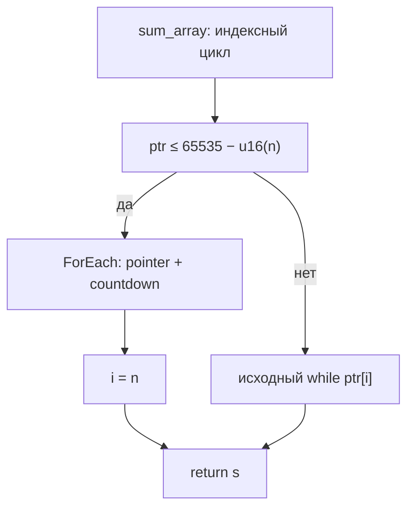

# Grace: диапазоны и безопасный pointer-walk на HIR

**Обновление после аудита:** [исправления HIR/MIR и замеры Z80](grace-hir-mir-audit.md).
Старые VM-замеры ниже относятся к указанным снимкам кода; constant-if теперь
сворачивается и обычным MIR, а Z80-проверки дополнены исправлением живого HL.


Дата: 10 октября 2026. Ветка `feat/grace-hir-vm`. Первый этап
[общего плана](grace-roadmap.md) реализован. Проход включается `--hir-grace`;
`--grace` независимо выбирает MIR Grace. По умолчанию правило выключено.

На функции из `examples/nanz/01_sum_array.nanz` при 255 элементах получено
**1788 → 1285 инструкций VM (−28,1%)**, **64,433 → 51,533 мкс (−20,0%)**.
Это замер одного вызова функции на MIR2 VM, не всей программы и не тактов Z80.
Короткие циклы, стоимость компиляции и увеличение IR показаны ниже.

## Исходник и факты

Полная [программа](grace-pointer-walk-artifacts/program.nanz) не менялась.
Для замеров выделена её функция, с тем же телом:

```text
fun sum_array(ptr: ^u8, n: u8) -> u8 {
 var s: u8 = 0
 var i: u8 = 0
 while i < n {
  s = s + ptr[i]
  i = i + 1
 }
 return s
}
```

`hir.AnalyzeFacts` теперь выдаёт `PointerWalks` и три предиката:

```text
hir-index-range(site, i, 0, n, exclusive)
hir-address-nowrap-guard(site, ptr, n, 1, 65535)
hir-guarded-pointer-walk(function-root)
```

В исполняемом теле `0 ≤ i < n`; поскольку `n:u8`, максимум индекса — 254.
При `n=0` тело не исполняется. Это факты формы цикла и условие безопасности,
а не доказательство, что любой переданный адрес допустим или память выделена.

## Переписывание HIR



HIR₁ содержит две ветки:

```text
var s:u8 = 0
var i:u8 = 0
if u16(ptr) <= 65535 - u16(n) {
 foreach __grace_element_0:u8 in ptr[0..n] {
  s = s + __grace_element_0
 }
 i = n
} else {
 while i < n {
  s = s + ptr[i]
  i = i + 1
 }
}
return s
```

Элементное имя свежее по параметрам, bindings, ссылкам и символам модуля.
Пока распознаётся только точная форма: две нулевые u8-локальные переменные,
корневой `while i < n`, сложение с единственным `ptr[i]:u8`, последующий
`i=i+1` и возврат. Счётчик/параметры не меняются иначе; stride равен 1.
Вложенные циклы, эффекты в теле, затенение и совпадения с globals не подходят.
Факты перестраиваются после срабатывания, общий бюджет Grace сохраняется.
Исходный fallback вложен в `else`, поэтому правило не версионирует его снова.

## Почему сохраняются переполнение и ошибки

В нынешней VM `OpPtrAdd` не усекает адрес. Исходный `ptr=65535,n=2` читает
65535, затем падает на адресе 65536. Обычный loop-carried pointer усекался бы
при передаче в следующий блок и читал 0. Такое безусловное переписывание неверно.

Защитное условие проверяется вычитанием в u16. `n` не превышает 255,
поэтому `65535-n` не переполняется; проверка через u16 `ptr+n` была бы неверна.
Условие обеспечивает `ptr+n≤65535`: помещаются все чтения и последний bump.
Оно достаточно, но не необходимо: `(65535,1)` и `(65534,2)` успешно идут
через исходную ветку. Ни семантика адресов VM, ни её предел памяти не изменены.
Память может быть меньше диапазона адресов: быстрый цикл сохраняет те же
ошибки первого недопустимого чтения. При нулевой длине чтений нет.

Оригинальный индекс после успешного цикла равен `n`; явное `i=n` сохраняет
это наблюдение, в том числе для возврата `(s,i)` вместо одного `s`.

## MIR и сопутствующие исправления

В быстром теле остаются:

```text
load walking_ptr
add sum, element : u8
ptr_bump walking_ptr, +1
sub remaining, one : u8
jmp head(next_ptr, next_remaining, next_sum)
```

Используется существующий lowering `ForEach`, с двумя улучшениями общего пути:
константы 0/1 определяются один раз перед циклом; обычное fall-through тело
переходит сразу в head, без промежуточного fe_cont с повторным связыванием
параметров. При continue и других явных transfers прежний trampoline сохраняется.
Чтения и запись `MutateInPlace` сохраняют своё место; классы pointer/counter
и последнее вычитание счётчика сохранены. Проверены обычная сумма и continue.

Проверки нового CFG обнаружили старую ошибку `split-join-ret`: два разных
предшественника получали одинаковое имя return-блока, и cleanup оставлял
возврат чужого значения. Исправлены Go и Grace реализации общей генерацией
свободного label. Отдельный тест проверяет два разных значения, существующее
совпадение label, структурную проверку до cleanup и VM после cleanup.

Обычные MIR-проходы и MIR Grace не выполняют версионирование этого исходного
pointer-параметра. Полученный выигрыш добавляется к обоим маршрутам.

| Статический MIR функции | Без HIR Grace | С HIR Grace |
|---|---:|---:|
| Raw: блоки / инструкции | 4 / 9 | 10 / 22 |
| Обычные MIR-проходы: блоки / инструкции | 3 / 9 | 9 / 21 |
| MIR Grace: блоки / инструкции | 3 / 9 | 6 / 21 |

Версионирование увеличивает IR: оба цикла остаются. Это цена универсального
вызова с неизвестной базой; правило не является оптимизацией размера кода.

## Измерения

Ryzen 7 5800X, linux/amd64, Go 1.26.8, `-cpu=1`. VM и 64-КБ память с
неравномерными байтами создаются до таймера. База — 1024. В таймере один
вызов `sum_array` и проверка суммы. Медианы пяти прогонов по 20000 вызовов.
Счётчик VM не включает терминаторы; время включает обработку переходов.

| n | Инструкции VM до → после | Время до → после, мкс | Изменение времени |
|---|---:|---:|---:|
| 0 | 3 → 10 | 0,5094 → 0,6999 | +37,4% |
| 1 | 10 → 15 | 0,7712 → 0,9045 | +17,3% |
| 5 | 38 → 35 | 1,778 → 1,738 | −2,2% |
| 16 | 115 → 90 | 4,569 → 3,952 | −13,5% |
| 64 | 451 → 330 | 16,519 → 13,484 | −18,4% |
| 255 | 1788 → 1285 | 64,433 → 51,533 | **−20,0%** |

Это оптимизированный MIR; MIR Grace даёт те же динамические instruction counts.
У raw MIR на одну дополнительную инструкцию setup больше (для n255: 1788→1286).
Выигрыш на пяти элементах мал, его не следует считать устойчивым ускорением
всей исходной программы. На 0–1 элементах guard/setup проигрывают. На
неподходящих адресах исполняется исходный цикл с дополнительной ценой guard.

Цена компиляции функции без parsing, asserts и Z80; пять прогонов по 2000:

| Метрика | Без HIR Grace | С HIR Grace |
|---|---:|---:|
| Время MIR-пайплайна | 200,092 мкс | 523,090 мкс |
| Аллоцированные байты | 144625 | 376479 |

Рост примерно в 2,6 раза связан с дополнительным проходом/проверкой и двумя
CFG вместо одного. Это аргумент за специализацию доказанных call sites,
профилирование стоимости и пересчёт фактов по функциям из дальнейшего плана.
Сейчас сохраняем явное opt-in включение.

## Проверки и пределы результата

VM differential matrix: **15360 сценариев**, каждый на отдельно построенных
исходном и преобразованном модулях. Все n=0..255, память 16/65536 байт,
базы 0/15/65535−n/65536−n/65535, scalar/tuple-return, raw/обычный MIR/MIR Grace.
Проверяются сумма по независимому byte oracle, итоговый индекс, первый ошибочный
адрес/причина ошибки и неизменность всей памяти. Имена блоков в ошибке удаляются,
потому что новый CFG меняет labels. Газовый лимит не достигается в этих тестах.

Дополнительно: срабатывание на полной исходной программе, результат 15 для
[1,2,3,4,5], freshness, budget/idempotence, отказы неподдержанных форм,
обычный ForEach/continue, регрессия return-labels. Три source-level asserts
(n0/n1/n5) прошли на MIR VM **и Z80** при всех четырёх комбинациях HIR/MIR Grace.
Это 24 backend assertion checks; проверки времени/диапазона остаются VM-проверками.

Дополнительный Z80-пробник обычного ForEach со статическим global-address
даёт `got2,want1` и на чистой базе `4743cb7c`, и после изменения.
[Пробник](grace-pointer-walk-artifacts/foreach-z80-probe.txt) и
[результат](grace-pointer-walk-artifacts/foreach-z80-probe-results.txt) сохранены.
Это старое ограничение backend, не исправленное данным этапом. Не заявляем
общую корректность Z80 или ускорение машинного кода.

Пакеты HIR/MIR2/rewrite и новые pipeline-проверки проходят. Широкий
`TestGraceVerify`: 52 файла, 48 успешных, те же четыре старых падения
(18_tail_recursion, hello_cpm_fib, screen_customer, screen_report).
Новых падений в этом gate не появилось.

## Файлы и воспроизведение

[Исходник](grace-pointer-walk-artifacts/source.nanz),
[HIR₀](grace-pointer-walk-artifacts/hir-before.hir),
[HIR₁](grace-pointer-walk-artifacts/hir-after.hir),
[raw MIR₀](grace-pointer-walk-artifacts/raw-before.mir),
[raw MIR₁](grace-pointer-walk-artifacts/raw-after.mir),
[оптимизированный MIR₀](grace-pointer-walk-artifacts/optimized-before.mir),
[оптимизированный MIR₁](grace-pointer-walk-artifacts/optimized-after.mir),
[MIR Grace после HIR](grace-pointer-walk-artifacts/optimized-mir-grace-after.mir),
[VM-бенчмарк](grace-pointer-walk-artifacts/vm-benchmark.txt),
[компиляция](grace-pointer-walk-artifacts/compile-benchmark.txt),
[тесты](grace-pointer-walk-artifacts/tests.txt).

Из `minzc/`:

```sh
go test ./pkg/hir ./pkg/mir2 ./pkg/rewrite/...
go test ./pkg/pipeline -run 'TestHIRGrace|TestForEachPreheader' -v -count=1
go test ./pkg/mir2 -run '^TestSplitJoinRetDistinct' -v -count=1
go test ./pkg/pipeline -run '^$' -bench '^BenchmarkHIRGracePointerWalkVM$' -benchtime=20000x -count=5 -cpu=1
go test ./pkg/pipeline -run '^$' -bench '^BenchmarkHIRGracePointerWalkCompile$' -benchtime=2000x -count=5 -cpu=1
```

Бенчмарк VM явно повышает cumulative gas budget для серии вызовов; тесты
корректности используют обычный лимит. Данные исходной пробы с исчерпанным
бюджетом не использовались в итоговых timing tables.
