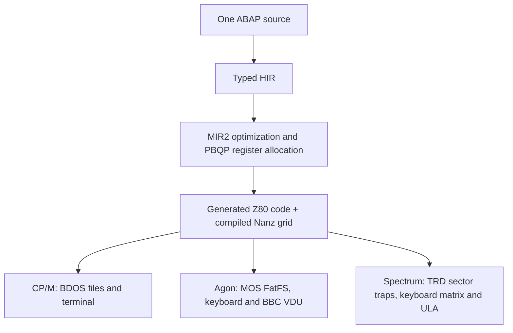
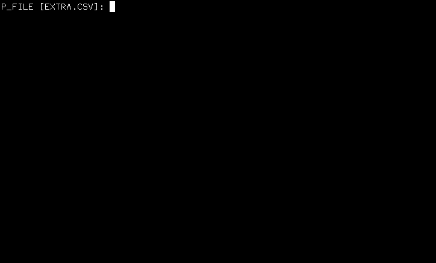

# My ABAP Escaped from the Server

*One ABAP report, three native targets: CP/M, Agon and ZX Spectrum.*

Request value help, choose a CSV file, load its rows into a typed internal table, and open
an ALV grid. This familiar ABAP workflow now runs as compiled native code in
MinZ's CP/M, Agon and ZX Spectrum emulators. The same 1,875-byte source builds for all three.


*FLEET.COM · ABAP → MinZ HIR → MIR2 → Z80 · real capture.*

## From file picker to table

The [complete report](../examples/abap/zfleet_csv_alv.abap) connects
`CL_GUI_FRONTEND_SERVICES=>FILE_OPEN_DIALOG` and `GUI_UPLOAD` to ordinary ABAP
table operations. Here is the row-processing and display portion, unchanged:

```abap
  LOOP AT lt_lines INTO line.
    SPLIT line AT ',' INTO flight-name flight-route seats_text.
    seats = seats_text.
    flight-seats = seats.
    APPEND flight TO fleet.
    total = total + seats.
    WRITE / |{ flight-name } { flight-route } { flight-seats }|.
  ENDLOOP.
  WRITE / |Total seats: { total }|.
  cl_salv_table=>factory( IMPORTING r_salv_table = lo_alv CHANGING t_table = fleet ).
  lo_alv->display( ).
```

[FLEET.CSV](../examples/abap/fleet/FLEET.CSV) supplies Atlas/North/40 and
Beacon/South/32: two rows and 72 seats. The factory binds the live internal
table; display formats its current contents using a grid compiled from Nanz.



The frontend recognizes a bounded set of these APIs and lowers them into typed
operations and platform runtime calls. It supports this declared subset;
it does not supply a general SAP GUI or ABAP object runtime.

## Watch the actual sessions

### CP/M on Z80



*Actual MZE CP/M execution, captured from the X11 terminal. About eight seconds
at nominal 10 fps; retained frames and original timing, with no intentional
speed-up. FLEET.COM is 40,257 bytes.*

### Agon on eZ80


*FLEET.BIN · ABAP → MinZ HIR → MIR2 → Z80-mode code on eZ80, with native 24-bit
MOS bridges · real capture. Fab eZ80 runs pinned MOS/full VDP and raw SD SPI;
host filesystem interception is disabled. The binary is 45,652 bytes.*

The Agon animation retains 156 samples over approximately 15.76 seconds,
including actual debugger pauses. Identical adjacent frames merge losslessly;
the final frame has a minimal 10 ms hold because its end timestamp is unknown.
The 80×24 grid uses the top 640×192 of the untouched 640×480 framebuffer.
Neither clip is a performance benchmark or a physical-hardware demonstration.

### ZX Spectrum, with no DOS ROM


*MZX headless framebuffer capture, Pentagon 128K with a blank ROM. Ten seconds
of emulated time, sampled uniformly from 500 original frames; pixels are
unchanged. The white border at the end marks return to the native launcher.*

F invokes value help on the Spectrum keyboard, 2 chooses FLEET.CSV, and Enter
accepts it; another Enter runs the report. The Z80 code reads the actual TRD
catalogue and file sectors through emulator traps. Directory parsing, CSV
conversion and grid rendering execute in the guest. No external DOS was added.
The three-letter extension uses the conventional TRD load-address bytes, so the
filename and ABAP source stay unchanged.

The image is 34,847 bytes with a 1 KiB resident stack; this workload used 94 bytes
of that stack. Both 48K and 128K execution are verified. Character display
columns narrow to eight cells while their full values remain stored. The
[ZX technical report](../reports/native-abap/2026-10-18-zx-trdos-csv-alv.md)
records pixel checks, crossing a disk-track boundary, error cases and memory
limits; [build and run the example](../examples/abap/fleet-zx/README.md).

## What was checked

The runs verify the selected CSV, typed rows and total, native rendering, and
return to the host OS. Separate VM and assembled Z80 tests cover live table
bindings, numeric endpoints, text sanitization, scrolling and bounded failures.
The two-row Agon clip itself stays at viewport zero. Independent checks compare
the grid with a retro project model and actual VDP font pixels; this is not
SAP GUI pixel equivalence.

| Final product | File size | Resident short stack | Space to tested image bound |
|---|---:|---:|---:|
| CP/M FLEET.COM | 40,257 bytes | 1,024 bytes | 24,511 bytes to measured TPA top FE00 |
| Agon FLEET.BIN | 45,652 bytes | 1,024 bytes | 15,788 bytes to bank offset F000 |
| Spectrum native image | 34,847 bytes | 1,024 bytes | 2,017 bytes to admitted image bound F000 |

Agon also requires the pinned MOS long-stack contract. These are image budgets,
not guarantees for arbitrary firmware or input. The [technical report](../reports/native-abap/2026-10-18-f4-csv-alv-e2e.md)
records exact binary hashes, memory boundaries, negative-test identities and
verification limits. The [capture manifest and provenance](../reports/native-abap/media/f4-csv-alv/README.md)
identify the original PNGs and GIFs; all four are committed without image edits.

## Build the same report

With a built `mz` on PATH, from the repository root:

```sh
mz examples/abap/zfleet_csv_alv.abap -t cpm --asserts=none -o FLEET.COM
mz examples/abap/zfleet_csv_alv.abap -t agon -b z80 --runtime=agon-z80 --asserts=none -o FLEET.BIN
```

Use the supplied [CSV fixtures](../examples/abap/fleet/). Running the interactive
Agon product requires the MOS/VDP/SD setup described in the technical evidence;
MZE's Agon stub is not the native execution oracle used here.
