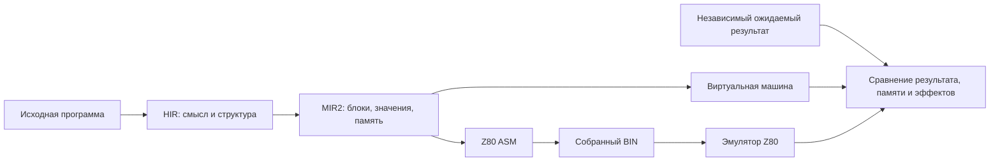

# MinZ сегодня: языки, компилятор и проверенный Z80

**Обзор от 11 октября, обновлён 15 октября 2026 года.** Интеграционная ветка компилятора, аппаратная библиотека и Spectrum-демо уже в `main`: [PR #85](https://github.com/oisee/minz/pull/85), merge-коммит `26cc879e`. Исследовательская ветка [`feat/grace-hir-vm`](https://github.com/oisee/minz/tree/feat/grace-hir-vm) и архивы сохраняются. Новейший раздел ниже описывает текущий статус; датированные разделы 11–12 октября сохраняют результаты и незавершённые работы своих checkpoint.

## Интегрировано 15 октября: целый спрайт и прямой Tetris

[PR #128](https://github.com/oisee/minz/pull/128), main `a284fafc`: описание
`@zx_sprite`/`@zx_sprite_instances` задаёт размер, пиксели и маску. Генератор
проверяет форму при компиляции, создаёт типизированный объект и парные
процедуры draw/erase. Строки, setters, адреса Spectrum и SMC скрыты в библиотеке.

Spectrum Tetris использует эти пары прямо на экране; bitmap shadow и полный
копирующий LDIR на движении убраны. Два уровня дают пиксель за два кадра
или за кадр. Адреса и атрибуты готовятся до HALT, затем обновляется нужная
область. Native Z80, независимая игровая модель, raw/final VM для физики,
полная RAM/PC/SP/INT и реальные fetched ULA кадры подтверждают ограниченные
сценарии. Шесть обязательных gate-проверок интеграции прошли.

[50-Гц GIF в README](../README.md#what-you-can-make) содержит 78 настоящих
последовательных кадров, без интерполяции. Спокойное падение укладывается
в кадр; тяжёлые действия пока занимают 2–3. Это ограничение сохранено явно.
[API, main-проверки и измерения](advanced-demos/tetris/direct-renderer.md).

Шесть пакетов-кандидатов Linux/macOS/Windows × amd64/arm64 на `0571a4f4`
прошли native сборку и запуск; SHA256 и девять экранов совпали между платформами.
[Релиз 0.25.1](https://github.com/oisee/minz/releases/tag/v0.25.1) опубликован:
шесть native-пакетов из `a284fafc` и отдельный ZIP образов прошли сверку SHA256.
[Состав, запуск и доказательства](advanced-demos/tetris/release-0.25.1.md).
Дополнительное ускорение подготовки — короткий helper клетки и pointer walk
preview — уже в main через [#130](https://github.com/oisee/minz/pull/130), `b4cb44d7`: обычный модуль 24 868 → 24 560 байт,
все проверенные soft-drop шаги по одному INT. В готовые пакеты 0.25.1 оно ещё не включено; [подробности и границы](advanced-demos/tetris/span-helper.md).

## Дополнение 14 октября: профиль сгенерированных циклов

Структурные циклы теперь имеют явное происхождение от вызова метафункции и
отпечаток её определения. Строгий профиль настоящего `hw.fill` видит
1 вход / 256 итераций и загружается обратно; прежний ASM сохранён.
[Контракт, карты и проверки](structured-emit-provenance/README.md).
Исправление привязки имён уже в main: [#124](https://github.com/oisee/minz/pull/124),
`4f0b1fe2`. Новый раздел публикуется вместе с исправлением атрибуции; это
проверка связи DSL с профилем, без заявления нового ускорения.

## Исправление 14 октября: привязка имён в структурном emit

Генератор теперь получает приватные локальные имена: `hir_caller_ref` не
перехватывается одноимённым объявлением внутри сгенерированного блока.
Ошибка воспроизведена на main `1f12221c`; исправление проверено на 576 native
и 1152 raw/final VM случаях с полной памятью, а прежние ASM baseline сохранены.
[Контракт, пример и результаты](structured-emit-hygiene/README.md).
Этот раздел публикуется вместе с исправлением, отдельного ускорения не заявляем.

## Интегрировано 14 октября: runtime DSL + таблицы + измерение

Runtime masked sprite теперь работает с именованными workload-буферами. Совместный
API сравнивает восемь compiler/table режимов и три раскладки условного caller-helper:
Speed 97→89 байт, heldout 2553→2372 T; Size 97→88 байт, heldout 2553→2383 T.
Базовый ASM/BIN отдельно сверен с предыдущим компилятором. Новый допуск constant
pointer ADD, доказательство равенства живых копий и out-of-place address patterns
позволяют держать базу в DE, результат в HL и masked byte в A.
[Полный отчёт, исходник и ограничения](runtime-sprite-measured-composition/README.md).

Этот checkpoint уже в main: [#123](https://github.com/oisee/minz/pull/123),
`943f9a28`. Дополнительного
вклада PFCCO или Grace на данном примере нет; pinned таблицы пока подключаются
через API, а не через новый CLI. Отложенные descriptor проверки уже в main через
[#120](https://github.com/oisee/minz/pull/120), bounded отсев разбиений — через
[#121](https://github.com/oisee/minz/pull/121). Широкая цель переноса полезных
VIR/WFC решений этим отдельным результатом ещё не объявляется завершённой.

## Дополнение 14 октября: байтовые shape-кандидаты и runtime DSL

Byte LOAD/STORE и canonical pointer expressions теперь допускаются в ограниченном
checked leaf-контракте: [PR #119](https://github.com/oisee/minz/pull/119), main
`d8dea3bb`. Шестибайтовый masked sprite улучшился 46→43 байта и 198→186 тактов
в четырёх режимах greedy/PBQP × HIR+MIR Grace off/on. Native проверка указателей
покрывает все 65536 баз при фиксированном offset=1; это не полный домен пар адресов.
[Допуск, измерения и ограничения](checked-local-byte-memory/README.md).

Новый этап этой публикации — `hw.sprite` с runtime-базой и заранее вычисленными
смещениями. `hir_caller_ref` проверяет существующее объявление и запрошенный тип;
отдельный `hir_ref` остаётся для переменных генератора. 288 native и 576 raw/final
VM запусков сверяют полную RAM, маски и возврат, включая wrap в режиме полной RAM.
Прежние фиксированные структурные спрайты сохранили baseline ASM.
[Примеры и точная область проверки](structured-sprite-runtime-base/README.md).
Этот раздел публикуется вместе с новым DSL-кодом; отдельного выигрыша shape-поиска
на runtime sprite и подключения его к measured CLI пока не заявляем.

## Последнее обновление 13 октября: структурные библиотеки и выбор сборки

**Типизированный emit уже используется в аппаратной библиотеке main.** Fill,
copy и masked sprite строят HIR без склейки строк. Условный sprite добавляет
типизированные ветки через `hir_if`: [PR #109](https://github.com/oisee/minz/pull/109).
Исходный ASM предыдущих девяти sprite-вариантов сохранён, новые условные
варианты проверены по независимым оракулам на VM и собранном Z80. Это улучшение
выразительности и проверяемости библиотеки, а не обещание ускорения каждого
спрайта. [Отчёт](structured-conditional/README.md).

**Полезные ограниченные кандидаты VIR переходят в основной backend без Z3.**
Проверка теперь связывает записанные инструкции с полным текущим MIR/ABI,
а не только с предложенным назначением: [#110](https://github.com/oisee/minz/pull/110).
Уже интегрированы dying-pair `EX DE,HL` в обычном codegen
([#108](https://github.com/oisee/minz/pull/108)), допуск линейного CFG с
параллельными edge copies ([#111](https://github.com/oisee/minz/pull/111)) и
общие хвосты константных возвратов только при Size
([#112](https://github.com/oisee/minz/pull/112)). Допуск CFG ограничен и пока
не дал новых совпадений на проверенном реальном корпусе; его нельзя считать
универсальной оптимизацией многоблочных функций.

**В main уже есть проверенная раскладка условных функций по реальной нагрузке:**
контракт [#113](https://github.com/oisee/minz/pull/113), до четырёх порядков
блоков [#114](https://github.com/oisee/minz/pull/114) и измерение полного caller
workload [#115](https://github.com/oisee/minz/pull/115). Меняется порядок CP,
переходов и возвратов чистой u8-функции; scratch/ABI и исходное поведение
проверяются. На tokenizer раскладка `is_space` добавляет небольшой выигрыш
57 T на heldout; на отдельном self-Lanz classifier есть и отрицательный
heldout результат. Обучающий выигрыш сам по себе не доказывает перенос.

Матрица [#116](https://github.com/oisee/minz/pull/116) и общий API
[#117](https://github.com/oisee/minz/pull/117) уже в main (`8bbfd14c`,
`1fc92f0c`). CLI [#118](https://github.com/oisee/minz/pull/118) добавляет
команды collect/replay и публикуется вместе с этим обновлением через
обязательный CI.
Они сравнивают greedy/PBQP контрактов × HIR Grace × MIR Grace и допустимые
раскладки, возвращая точный измеренный ASM/BIN. CLI сохраняет полный collect
и воспроизводит тот же winner на heldout без нового выбора по heldout.

| Standalone CLI на неизменённом tokenizer | Байты ordinary → selected | Heldout, T ordinary → selected |
|---|---:|---:|
| Speed, OptSize=false | 4201 → 4138 | 289757 → 283909 |
| Size, OptSize=true | 4186 → 4120 | 289789 → 284072 |

Оба победителя — greedy + HIR Grace. MIR Grace и PBQP контрактов в этой
матрице не добавили выигрыша; часть сочетаний проиграла. Эти отрицательные
результаты сохранены, selector не включает такие режимы по названию.
Все 56 обучающих кандидатов и selected/reference heldout прошли независимый
Go-tokenizer: tokens, полная arena/token memory, globals и точные byte-access
counts. Collect/replay работали отдельными процессами одного CLI; `-o`
побайтно совпал с сохранённым победителем. [Команды, результаты и границы](conditional-layout-cli/README.md).

Speed по-прежнему вправе тратить байты ради тактов. Size минимизирует BIN.
Replay первой версии полностью повторяет training для строгой проверки,
поэтому пока не сокращает время поиска. Новые поисковые режимы опциональны.
Checked shape-таблицы ещё не подключены к этому CLI, хотя underlying API
принимает их заданные pinned-конфигурации. Полный deep-релизный корпус для
этого этапа не повторён; направленные native/CLI проверки и mandatory CI
имеют собственные результаты.

**Основная цель остаётся открытой:** новые адаптеры композиции, полезные CFG
на реальных программах и совместное применение таблиц с измеренным выбором
ещё требуют работы. Структурная библиотека и ограниченные кандидаты уже
дают основу для следующих шагов. Полные новые артефакты сохранены на шаре
`/mnt/safe/minz/grace/2026-10-13/conditional-layout-cli/manifest.json`.

## Предыдущее обновление 13 октября: спрайты перемещаются патчами кода

**`@sprite_chain` уже в main**, [PR #90](https://github.com/oisee/minz/pull/90), merge `201146cf`. Декларация на Nanz создаёт runtime-рисовалку и setters для адресов строк, entry и JP-продолжений. Можно перемещать один экземпляр картинки, переставлять порядок исполнения, пропускать строки или сделать пустую цепочку. Это SMC реальных Z80-operands в writable RAM; дополнительный слой IR не добавлен.

`via "compiled"` поддерживает известные keep-masks и обычный SP. `via "push"` пишет непрозрачные пары через временный экранный SP, затем восстанавливает normal SP и регистры. PUSH требует even byte width и `irq "disabled"`; DI/EI задаёт caller. Динамические raw setters не проверяют clipping, владение RAM и корректность графа переходов. Экземпляр должен завершаться в своей done-секции; NMI/reentry не поддержаны.

| Новое подтверждение | Результат | Граница |
|---|---|---|
| Позиции, порядок, subsets | **108 native-исполнений** | Точный PC trace секций, RAM, регистры и return PC/SP |
| Повторные маски/патчи | **768 native-вызовов**, 17 отказных случаев | Один экземпляр кода, все 256 byte-фоны, три режима |
| Actual Spectrum main | **384 completed screens** | 64 × два примитива × три режима; 189 ROM IRQ в каждом прогоне; ULA, PC/SP и IRQ-регистры |
| Чистый main `201146cf` | **Chain suite PASS 4,487 с** | Полная новая серия; это не новый полный 583-entry pipeline |
| Launcher из чистого main | **exit 0, 100 video frames** | PUSH snapshot; completed-screen oracle проверяется отдельно |

**Стоимость move + draw:** для восьми строк по 16 B, ordinary, runtime x/y: pointer **3884 + 2138 = 6022 T**, PUSH **4091 + 1638 = 5729 T** (~−4,9%). Модули — 1155 / 1168 B. Сам draw быстрее примерно на 23,4%, но патчинг end-адресов дороже. На ширине 4 и 8 B полная цена проигрывает pointer. Compiled-цепочка здесь тоже не быстрее простых непрозрачных stores. Примитивы выбираются явно; целевая Speed вправе тратить байты, универсального ускорения не заявляем.

Замеры включают RET, исключают внешний CALL, DI/EI, ROM IRQ и ULA; исходники и одинаковый runtime workload сохранены. Это 81 cost-check с natural traversal; цена relinking подтверждена отдельно. [Статья с Nanz/ASM и анимацией](2026-10-13-134-moving-sprites-smc-push.md) · [Полные таблицы и API](hardware-sprite-chain/README.md).

```sh
scripts/play_zx_sprite_chain.sh
scripts/play_zx_sprite_chain.sh --push
```

Пройден весь Nanz/HIR/MIR2 checkpoint перед последними trace/error-check усилениями: 20,735 / 33,953 / 99,807 с. Финальный PR прошёл обязательный CI и lint с нулём новых замечаний. Логи, 509 machine и 82 cost SHA entries, snapshots/GIF и final completion audit находятся в `/mnt/safe/minz/grace/2026-10-13/hardware-sprite-chain-*`. Физическое железо, NMI и tear-free rendering не подтверждены.

Следующая согласованная цель — **Z-machine V3 на Spectrum 128K, сначала Zork I с историей в банковой памяти**. Host VM с большими globals не является 128K Z80-портом. Нужны banked story reader, resident memory budget, экран/клавиатура, загрузчик и независимое сравнение команд. Другие V3-истории допускаются только после отдельных проверок. [План следующего этапа](2026-10-13-135-zmachine-v3-spectrum-128k-plan.md).

## Обновление 13 октября: интеграция в main и работающая аппаратная библиотека

**Теперь это код основного компилятора, а не только опубликованный обзор.** PR #85 объединяет проверенные compiler/frontend/backend изменения и сопутствующие доказательства. Все шесть обязательных CI-контекстов на финальной интеграционной сборке `01f5df59` завершились успешно. Это не отменяет ограничений отдельных путей: advisory lint/output sweep и report-only fuzz findings остаются отдельными результатами; green CI не означает отсутствие всех miscompile.

### Что стало доступно

| Компонент | Состояние в main | Что подтверждено / граница |
|---|---|---|
| HIR → MIR2 → Z80 | Интегрирован production-путь и исправления | Замеры и native-проверки относятся к своим исходникам и входам |
| Frontend-контракты | Перенесены исправления Nanz, C89, Lizp, PL/M и других путей интеграции | Lizp last-form и PL/M Hello закрыты; полная поддержка каждого языка не заявлена |
| Grace / PFCCO / checked tables | Интегрированы код, проверенные альтернативы и fixtures | Прежние heldout и table-выигрыши сохраняют свои baseline; нового универсального выигрыша не заявляем |
| LIR / VIR | Отдельный пакет LIR удалён; VIR сохранён как исследовательский путь | Обычная компиляция не требует Z3; offline-кандидат проходит текущий admission |
| `stdlib/hw` | Пять импортируемых генераторов на Nanz | Fill, copy, fixed masked sprites, mutable compiled/PUSH chains, affine texture walk |
| Spectrum showcase | 32×48 PAPER/INK rotozoomer и launcher | Actual main с ROM/IRQ/ULA; физическое железо и tear-free ещё не проверены |
| CP/M showcase | Playable Tetris и статья о миллионных проверках | Runtime-игра и исчерпывающие семейства механики — разные проверки |

Путь библиотеки: декларативный metablock → генератор на Nanz → compile-time MIR2 VM → Nanz/ASM → HIR/MIR2 → Z80. Адреса и известные маски вычисляются при компиляции; текстура, setup и фон остаются runtime-данными. Новый слой IR для этого не понадобился. [Подробная статья с кодом](2026-10-13-133-nanz-hardware-library-how-it-works.md) · [API](../stdlib/hw/README.md).

**Измеренные альтернативы библиотеки:** полный bitmap fill pointer → preserving LDIR: **835 669 → 129 132 T**, **30 → 22 B**; линейный raster upload → ZX: **411 391 → 149 962 T**, **5183 → 3649 B**. Это focused native ordinary-вызовы с setup, сохранением регистров и RET, без внешнего CALL, IRQ и ULA. Compiled sprite может уменьшать размер и проигрывать в тактах на маленьком рисунке. Примитивы и unroll выбираются явно; автоматического Grace-поиска внутри `hw` пока нет. **Speed по-прежнему может тратить байты; Size остаётся отдельной целью.**

### Какие проверки завершены

| Checkpoint / проверка | Терминальный результат | Что входит |
|---|---|---|
| Полный integration pipeline `154e0a05` | **546 PASS, 37 SKIP, 0 FAIL** | Все 583 записи исполнены ровно один раз; предшествует последней host-address правке |
| Финальный integration head `01f5df59` | **Все 6 обязательных CI-контекстов SUCCESS** | PR gate, judge builds, asserts, judge self-tests, short fuzz, direct-call findings; policy каждого workflow сохраняется |
| Чистый main `26cc879e`, hardware operations | **PASS, 107,317 с** | Позитивные матрицы, invalid descriptors, live values для четырёх операций |
| Чистый main `26cc879e`, full Spectrum main | **PASS, 4,309 с** | 64 completed screens × 3 режима; 315 ROM IRQ, 252 во время рисования |
| Чистый main `26cc879e`, headless launcher | **exit 0, 200 video frames** | 160 разных screen dumps по 6912 B и валидный PNG |

Полный 583-entry PASS относится именно к `154e0a05`. Позднее `01f5df59` исправил адреса globals для host VM: TargetMZV допускает широкие адреса хранения, обычный pointer ABI и явное усечение остаются 16-битными. Специальные регрессии и полный Z-machine fixture smoke прошли отдельно, включая final CI. [Описание границы](hardware-host-global-addresses/README.md). Zork с большим host-массивом не становится от этого 128-КБ Z80-программой: память банков Spectrum — отдельная задача.

У full-machine rotozoomer каждый completed экран совпадает с независимой математикой, проверяется порядок 32 кадров дважды, return PC/SP и сохранение основных/альтернативных регистров через ROM IRQ. Скорость повторной отрисовки около 10 fps. 323 video frames для 64 завершённых draw — другой счётчик. [Исходник, snapshot, ASM/BIN и результаты](zx-rotozoomer-library/README.md).

Статья [«Как миллион проверок Tetris тестирует компилятор»](2026-10-12-132-tetris-million-case-testing.md) теперь тоже в main. Ускорение её harness достигается повторным использованием scratch и организации независимых проверок; это не ускорение самой игры и не переход игры на аппаратный DSL.

### CI больше не повторяет весь глубокий корпус на каждом PR

Fast/deep профили явно разбивают compiled inventory, проверяют отсутствие неизвестных, дублированных и потерянных записей. PR запускает core/frontend checks, быстрый pipeline и короткие регрессии; полные hardware matrices и дорогие домены уходят в deep. Неверные descriptors и реальные Spectrum ROM/IRQ demos остаются в fast.

Deep pipeline исполняется **в 12 независимых jobs** по тегам `v*`, ночью в 03:23 UTC и вручную. Release/manual добавляют full assertion matrix и fuzz; для nightly используется также существующий compiler audit. Неполный прогон не получает статус общего PASS. [Точная политика и команды](../scripts/ci/TESTING.md) · [Workflow](../.github/workflows/deep-compiler-tests.yml).

### Где смотреть и что дальше

```sh
scripts/play_zx_rotozoomer.sh
```

Нужны SDL development libraries и display; `--headless --frames 200` даёт windowless запуск. Launcher возобновляет проверенный ROM-initialized snapshot. Периодический dump может попасть посередине следующей отрисовки; это не completed-screen оракул.

Закрыта конкретная цель аппаратной библиотеки: выразительное описание, независимый native-контракт, измеренные альтернативы, полный Spectrum-demo, main и копии на шаре. Это не завершение всего проекта MinZ. Следующие полезные направления — удобнее структурно строить метакод, расширять динамические screen-операции и получать новые heldout-выигрыши на реальных программах. Банковая память Spectrum 128K/Scorpion/Profi сохранена в backlog; её контракт переключения и IRQ ещё предстоит реализовать.

Main-проверки и CI-пакеты: `/mnt/safe/minz/grace/2026-10-13/`. Десять operation/demo/checkpoint manifests — **1530 записей**, сверенных с репозиторием и шарой без расхождений. Основные пакеты библиотеки: `/mnt/safe/minz/grace/2026-10-12/`; статья и этот обзор: `/mnt/safe/minz/grace/2026-10-13/hardware-library-article/`. Сайт ниже сохранён целиком, но его старую публикацию не следует считать новейшим статусом main.

---

## История checkpoint до интеграции

Разделы ниже описывают состояние на указанную дату. Формулировки «ещё выполняется», «код пока в исследовательской ветке» и прежние числа корпуса относятся к тому времени; текущий статус приведён выше.

## Обновление 12 октября: интерактивный Tetris и последние frontend-контракты

**CP/M Tetris теперь проверен и интерактивно:** Alice запустила игру в нашем `mze`, набрала 165 очков и очистила строку. Исправленная playable-сборка стирает прошлое положение фигуры, рисует закреплённые клетки, рамку, счёт и строки. Фигура падает автоматически; клавиши не печатаются поверх поля. Три режима сборки проходят отдельную проверку фактического ANSI-экрана на Z80. [Исходник, COM, ASM и тесты](https://github.com/oisee/minz/tree/fe8ea7ff/reports/tetris-playable).

```sh
bash /mnt/safe/minz/grace/2026-10-12/play-tetris/play.sh
```

Таймер предоставляет опциональный режим `mze --cpm-input-tick-ms 100 --cpm-no-echo`: одна игровая итерация каждые 100 мс, начальное падение — каждые восемь итераций. Это рабочий showcase в эмуляторе; COM без такого таймера сохраняет блокирующий ввод. Настоящий CP/M wall clock здесь не заявлен. Исходная тестовая программа и её прежние доказательства сохранены отдельно от playable-варианта.

**Два последних случая без независимого оракула закрыты.** В Lizp закреплён возврат последнего значения из `defun`/`define`, включая вложенные блоки и явные ранние returns. Неизменённый `cond_test.lizp` проходит все 256 byte-входов и исходный main в трёх режимах; отдельный тест проверяет порядок побочных эффектов. [Lizp: контракт и доказательства](https://github.com/oisee/minz/tree/36c07cd1/reports/lizp-last-form).

PL/M Hello получил явный NUL и консольный вызов `BDOS(2, BYTE)`. Raw/final VM и полный native COM проходят три режима и вариант с разрушением регистров BDOS: точный вывод, PC/SP и память. **1183 байта COM включают 1024 байта стека; 14 135 T исключают стоимость host BDOS.** Это проверка runtime, без заявленного Grace-выигрыша. [PL/M: источник и доказательства](https://github.com/oisee/minz/tree/36c07cd1/reports/plm-hello-runtime).

Свежий каталог содержит те же **194 пути**, теперь **0 pending-independent-oracle**. Статусы различаются: 82 bounded VM/native, 70 independent VM/Z80, 2 independent bounded, 21 native ASM, 11 CP/M runtime, 5 Agon MOS, 2 SMC и 1 host-only. Нулевой pending не означает всех возможных входов или полной поддержки языка. [Каталог](https://github.com/oisee/minz/blob/69d1e654/docs/grace-integration-338/catalog.json).

Все восемь core-пакетов прошли после frontend-изменений. Полный pipeline из frozen executable `36c07cd1` ещё выполняется: прежние полные PASS ниже остаются результатами своих checkpoint. [Новые core-логи и команда полного gate](https://github.com/oisee/minz/tree/923e4e14/reports/last-frontend-contracts). Готовится отдельный перенос кода в main; исследовательский архив и результаты остаются сохранены на шаре. Код пока находится в `feat/grace-hir-vm`.

## Обновление 12 октября, 16:45 UTC: полные прогоны завершены

**Свежий production pipeline `cbf01110` завершился: 548 PASS, 0 FAIL, 17 SKIP, exit 0.** Он включает поздние исправления Agon, деления и C89. Прошли большие семейства Tetris, tokenizer и self-parser, полный 16-битный домен десятичного вывода Pascal, структуры, исходные алгоритмы и измеренный выбор преобразований. Пропуски остаются пропусками; результат относится к зафиксированному executable и моделям эмулятора. [Полный лог, команда и SHA256](https://github.com/oisee/minz/tree/c68ddb35/reports/pipeline-cbf01110-terminal).

| Завершённый прогон | Результат | Граница |
|---|---|---|
| Production pipeline `cbf01110` | **548 PASS, 0 FAIL, 17 SKIP** | Поздние VIR-адаптеры проверены отдельно |
| CLI `1d56e49c` | **74 PASS, 0 FAIL, 0 SKIP** | Collect/replay, отдельная цель Size, сохранение выбранных ASM/BIN |
| Исследовательский VIR `c1744a23` | **134 PASS, 0 FAIL, 4 SKIP** | Включает смешанные пересылки, циклы и точную метку входа; допуск корпуса не доказывает native-поведение каждой функции |

[CLI: терминальный результат](https://github.com/oisee/minz/tree/6cc14377/reports/cli-1d56e49c-terminal) · [VIR: терминальный результат](https://github.com/oisee/minz/tree/9cd6fe67/reports/vir-c1744a23-terminal). Новейшие основные пакеты HIR, MIR2 и пяти фронтендов также завершились PASS: [core checkpoint](https://github.com/oisee/minz/tree/c1744a23/reports/core-and-vir-7bfe4476-terminal).

**Измеренная польза сохранилась на свежей сборке.** На прежних заранее отложенных входах parser повторил **2 195 027 → 2 137 641 T (−2,61%)**, hashmap — **258 962 → 237 948 T (−8,11%)**. Выбранный BIN одинаков на обучении и heldout; входы и модели не менялись. Это повтор известных результатов, не новое слепое исследование. [Исходники, решения и ASM/BIN](https://github.com/oisee/minz/tree/a7ffb886/reports/heldout-current-1d56e49c).

PFCCO повторил **6252 → 5568 T** при прежних **52 байтах**. Отдельный аудитор без импортов компилятора сверяет арифметику, состояние, обращения к памяти, суммы тактов, выбор и идентичность BIN; пять намеренно испорченных пакетов отвергаются. Это аудит сохранённых результатов, дополняющий native-исполнение. [Независимый аудит](https://github.com/oisee/minz/tree/02abd4ad/reports/pfcco-independent-current-audit). Production replay таблиц сохраняет **44 → 20 байт**, caller **238 → 142 T**, теперь с дополнительной проверкой точного завершения: [пакет replay](https://github.com/oisee/minz/tree/1d56e49c/reports/production-table-exact-return).

**Поздние пробелы стекового адаптера закрыты в проверенной области.** Перекрывающиеся назначения аргументов отвергаются, смешанные byte/word-пересылки сохраняют живой A. Проверены 3 618 560 native-копирований и 2 949 120 смешанных циклов; это описанные домены, а не все возможные карты регистров. Для 24-байтового кадра проверены записи и память снаружи, затем девять положений SP, включая переход через 65535, × 256 шаблонов состояния — **2304 исполнения**. Проверяются регистры, flags и точный PC/SP. [Обновлённый разбор адаптеров](2026-10-12-093-vir-register-adapters.md).

Все новые пакеты отправлены в исследовательскую ветку и сохранены на `/mnt/safe/minz/grace/2026-10-12/compiler-updates/`. Консолидированная копия 521 файла проверена с SHA256, последующие терминальные пакеты сохранены отдельно. [Аудит копии](https://github.com/oisee/minz/tree/f53dc3f6/reports/latest-evidence-shared-119dece1).

**Общая цель остаётся открытой.** Большой gate теперь закрыт; остаются решения по Lizp implicit return и исходному учебному PL/M Hello. Произвольный CFG в исследовательском VIR и физическое железо не объявлены доказанными. Код компилятора остаётся в `feat/grace-hir-vm`; в main публикуются документы. **Speed сохраняется без штрафа за байты, Size — отдельная цель.** Разделы ниже сохраняют историю предыдущих checkpoint.

## Предыдущее обновление 12 октября: VIR и безопасные назначения регистров

**После прошлого обновления завершился ещё один полный исследовательский VIR checkpoint: 116 PASS, 0 FAIL, 4 SKIP.** Это `27aa1f7c`, до поздних исправлений CALL и адаптеров. Он проверяет полный набор исследовательских тестов; успешный допуск функций корпуса не равен независимому native-доказательству каждой функции. [Терминальный лог и границы](https://github.com/oisee/minz/tree/ced33bd1/reports/vir-index-alias-full-terminal).

Последующие проверки закрыли прежний контрпример индексирования и позволили вернуть компактный `Double16ThenDec`: **3 вместо 6 байт**, с независимым исполнением на всех 65 536 word-входах. Исправлены пересылки через индексные половинки, сохранение IX/IY через CALL, ширина входных аргументов и согласование caller ABI. Недоказанные многоблочные линейные/island fallback теперь отвергаются: функция продолжает через настоящий CFG solver или обычный MIR2 backend.

**Плотная перестановка аргументов теперь возможна даже без свободного регистра.** Две стековые копии сохраняют исходное состояние и собирают новые назначения; временно нужны 24 байта. Цикл шести занятых регистров и смешанный byte/word-цикл независимо проверены на 65 536 входах каждый, включая flags и точный PC/SP. Это исправление корректности исследовательского VIR, не новое ускорение production. Противоречивые перекрывающиеся назначения и границы памяти кадра ещё требуют проверки. [Отдельный разбор с примером и сравнением с прошлым обзором](2026-10-12-093-vir-register-adapters.md).

HIR, MIR2 и пять фронтендов (Nanz, C89, Lanz, Lizp, PL/M) завершились PASS на отдельном checkpoint `97266570`. Production-повтор таблиц сохраняет **44 → 20 байт**, **238 → 142 такта** реального caller; новых heldout-выигрышей эта серия не заявляет.

На **14:48:18 UTC** более свежие полные прогоны ещё шли: production `cbf01110` — **278 PASS, 0 FAIL, 10 SKIP**; research `ced33bd1` — **123 PASS, 0 FAIL, 4 SKIP**. Это промежуточные наблюдения, оба checkpoint предшествуют последним адаптерам. [Машиночитаемый снимок](2026-10-12-vir-adapter-progress/observation.json). Общая цель остаётся открытой; compiler changes пока находятся в исследовательской ветке. **Speed без штрафа за байты сохраняется, Size остаётся отдельной целью.**

## Предыдущее обновление 12 октября: первый полный production PASS

**Мы приблизились к цели: полный pipeline checkpoint `b6b4e0c7` завершился успешно — 547 верхнеуровневых PASS, 0 FAIL, 17 SKIP.** Это первый терминальный результат этого большого прогона, а не промежуточный счётчик. Он включает большие семейства Tetris и графики, parser/tokenizer и полный 16-битный домен печати Pascal. Пропущенные проверки остаются пропущенными; PASS не доказывает поддержку всех сочетаний языка или работу на настоящем железе. [Полный лог, версия исполняемого теста и контрольные суммы](https://github.com/oisee/minz/tree/cbf01110/reports/pipeline-b6b4e0c7-terminal).

**Общая цель ещё открыта.** Этот checkpoint предшествует поздним Agon-правкам, исправлению деления и новым исправлениям C89. Для них запущен следующий полный production gate `cbf01110`; его результат пока не получен. Исследовательские compiler changes находятся в `feat/grace-hir-vm`; публикация этого отчёта в `main` не переносит их в основной компилятор.

### C89: структуры теперь сохраняют контракт при возврате

Найдены и исправлены два конкретных разрыва между фронтендом и HIR:

- При возврате структуры преобразование меняло сигнатуру функции на несколько результатов, но вызов сохранял прежний тип указателя. Теперь согласуются тип вызова и весь список результатов; verifier отвергает неверные типы, число результатов и аргументы. Девять функций чтения полей из неизменённого `c99_designated.c` проверены по независимым ожидаемым значениям в исходном/итоговом MIR VM и собранном Z80, в обычном режиме и Grace Speed/Size. [Исправление, HIR/MIR и ASM](https://github.com/oisee/minz/tree/81c2b61b/reports/c89-struct-return-contract).
- Обход вложенных блоков пропускал `return` структуры в `minmax_pair.c`. После исправления **39 из 39 C89-примеров** проходят разбор, HIR verifier и lowering. Это проверка входного контракта, а не native-поведения всех 39 программ. Для исходного min/max отдельно проверены все 65 536 byte-пар в VM и 49 граничных word-пар × две функции × три режима на Z80: **294 native-проверки**. [Аудит и границы проверки](https://github.com/oisee/minz/tree/c86bfcd5/reports/c89-nested-block-contracts).

### VIR на момент предыдущего обновления: открытые контрпримеры

VIR остаётся офлайн-исследованием совместного выбора инструкций и регистров с Z3. Обычная компиляция идёт **HIR → MIR2 → Z80** и не требует внешнего solver.

Повтор полного VIR-прогона после исправлений C89: **105 PASS, 1 FAIL, 4 SKIP**. Прежний panic устранён. Единственное верхнеуровневое падение — качество `Double16ThenDec`: лишние пересылки через DE вместо `DEC HL`. Арифметика именно этого шестибайтного результата независимо подтверждена собранным BIN на всех **65 536 word-входах**, включая точный адрес возврата и восстановление SP. Ожидание теста качества не ослаблено. [Терминальный VIR-прогон](https://github.com/oisee/minz/tree/4eb2c23a/reports/vir-current-c86bfcd5) · [Полный native-домен арифметики](https://github.com/oisee/minz/tree/cc8023a2/reports/vir-word-return-native).

После этого исправлен преждевременный возврат посреди участка оптимизации и добавлена явная передача живых значений между двумя участками внутри одного MIR-блока. Автоматическое разделение подтверждено на всех 256 byte-входах с проверкой PC/SP. Это шаг к надёжному VIR, **не доказательство произвольного CFG**: путь с несколькими блоками ещё требует согласования контрактов на рёбрах. [Реализация и native-проверка](https://github.com/oisee/minz/tree/f3237623/reports/vir-automatic-island-contract).

Попытка убрать лишние word-пересылки обнаружила контрпример в индексировании массива и пока не допущена. Прямой запуск выделенных Z80-функций показал: правильный возврат и стек сами по себе не гарантируют правильный адрес элемента. Дальнейшая работа проверяет сохранение живого аккумулятора при пересылках через регистры IX/IY. [Сохранённый контрпример](https://github.com/oisee/minz/tree/2ca834a6/reports/vir-indexed-helper-isolation).

### Польза оптимизаций и следующий шаг

Ранее подтверждённые результаты сохраняются после production-исправления деления: parser на заранее отложенных входах — **2 195 027 → 2 137 641 T (−2,61%)**, hashmap — **258 962 → 237 948 T (−8,11%)**. На обучении и отложенных входах используется один выбранный BIN; модели и входы не менялись. **Speed по-прежнему без штрафа за байты**, Size — отдельная цель. [Повтор с решениями и ASM/BIN](https://github.com/oisee/minz/tree/32f637bc/reports/heldout-after-byte-neighbor).

Полный CLI ранее завершился **74 PASS, 0 FAIL, 0 SKIP за 374,868 с**: проверены collect/replay, Size и сохранение выбранных ASM/BIN. Этот запуск предшествует позднему исправлению деления. [Checkpoint CLI](https://github.com/oisee/minz/tree/25b05f69/reports/cli-current-9fc083c1). Все **4952 файла** предыдущего пакета доказательств сохранены с SHA256 на `/mnt/safe/minz/grace/2026-10-12/corpus-evidence-4df8b2f9/`; новые пакеты сохраняются отдельно в `compiler-updates/`. [Аудит сохранности](https://github.com/oisee/minz/tree/1ab9527b/reports/corpus-shared-copy).

Ближайшие условия завершения — терминальный gate с поздними production-правками и закрытие оставшихся семантических случаев. Lizp implicit return и контракт вывода учебного PL/M Hello пока требуют решения о языке. Число **194 исходных пути** и уровни покрытия не изменились; новый PASS усиливает доказательства, а не превращает их в процент готовности. Настоящий CP/M/Agon и физический Z80 остаются следующим уровнем проверки.

Состояние следующего полного gate на момент публикации: **2026-10-12T14:02:45 UTC, 189 PASS, 0 FAIL, 8 SKIP; выполняется `TestMemoryHostArenaSelectorStaleHostsAndWorkload/workload`**. Это промежуточное наблюдение. [Машиночитаемый снимок и терминальные результаты](2026-10-12-status-terminal-followup/observation.json).

## Предыдущее обновление 12 октября: контекст и измерения

Общая цель ещё открыта, но доказательства стали заметно шире: теперь это несколько реальных программ, заранее отложенные входы и исполнение собранного Z80 с проверкой памяти, вывода и стека. Все результаты ниже относятся к исследовательской ветке; публикация отчёта в main не включает её compiler changes в main.

**Корпус сохраняет все 194 пути.** У 153 есть независимое или ограниченное VM/Z80 покрытие, у 21 — native ASM bounded, у 10 — CP/M runtime, у 2 — SMC bounded. Отдельно остаются 5 Agon MOS runtime, 1 host-only memory model и 2 случая без независимого оракула. Это разные уровни проверки, поэтому 153/194 не является процентом готовности всего компилятора. [Точный каталог](https://github.com/oisee/minz/blob/b6b4e0c7/docs/grace-integration-338/catalog.json).

| Новое подтверждение | Измеренный результат | Что именно доказано |
|---|---:|---|
| Frozen self-Lanz parser, Speed heldout | 2 195 027 → 2 137 641 T (−2,61%); 2377 → 2478 B | Тот же выбранный BIN на train/heldout, независимая модель событий и памяти |
| Hashmap, 48 отложенных вызовов | 258 962 → 237 948 T (−8,11%); 996 → 976 B | Польза сохраняется на входах вне выбора; Speed и Size выбирают оба преобразования |
| Checked allocation table × PFCCO × Grace | 44 → 20 B; caller 238 → 142 T | Все 12 сочетаний и все byte inputs; стоимость пересылок и сохранений включена |
| Self-tokenizer, PBQP Size | 5533 → 5513 B после удаления перезаписанных literal loads | −20 B, но greedy всё ещё меньше: 5465 B; здесь нет нового измерения T |

[Полный пакет heldout, решения, ASM/BIN и независимые проверки](https://github.com/oisee/minz/blob/3ebed86e/reports/heldout-after-literal-overwrite/README.md). Таблицы полезны на подходящих формах, но PBQP пока не лучше greedy на tokenizer по Size. Инвентаризация охватывает 981 запись по 72 Nanz-исходникам; текущий checked bridge допускает 36 локальных задач. Это граница admission, а не размер исторической ENRT базы. [Разбор](https://github.com/oisee/minz/blob/55c8f222/reports/table-inventory-5d90b7aa/README.md).

**Исходные parser/tokenizer main выполняются в защищённом CP/M runtime.** При резерве стека 1024 B: parser — 419 878 T / 3984 B, tokenizer — 411 987 T / 7051 B; фактически затронуто 46 и 30 B resident stack. Проверены stdout, области памяти, globals, stack guards и завершение. Это абсолютные показатели текущей конфигурации, не дополнительный выигрыш Grace и не аппаратный замер. [Артефакты](https://github.com/oisee/minz/blob/95fb99ec/reports/cpm-main-after-literal-overwrite/README.md).

На предыдущем checkpoint прошли полный MIR2, HIR и 11 пакетов фронтендов/инструментов, полный CLI (74 PASS, 0 FAIL, 0 SKIP) и showcase compile/assemble (193 PASS, 1 capacity SKIP). Они предшествуют позднему исправлению деления; MIR2 после него прошёл за 68,001 с. Compile/assemble не заменяет проверку поведения. [Свежий checkpoint с логами](https://github.com/oisee/minz/blob/b6b4e0c7/reports/2026-10-12-grace-current-checkpoint.md).

**Историческое наблюдение до завершения pipeline b6b4e0c7.** На тот момент: 12 октября в 12:40 UTC: 287 верхнеуровневых PASS, 0 FAIL, 10 SKIP; выполняется `TestOriginalTetrisSpawnHoldAndSequences`. Матрица механики CP/M и TUI уже завершилась во всех трёх режимах. Это промежуточный результат, не общий PASS. Сборка включает последнюю literal-overwrite правку и лимит 360 минут; поздние Agon-изменения проверены отдельно и не входят в этот immutable executable. [Команда, executable SHA256 и checkpoint](https://github.com/oisee/minz/blob/f0312aa0/reports/pipeline-b6b4e0c7-checkpoint/job.json).

Предыдущий полный запуск 5d90b7aa завершился exit 2 по лимиту 180 минут во время SHA split helpers: 493 PASS, 0 верхнеуровневых FAIL, 14 SKIP. Он подтвердил большие семейства Tetris, графики, Pascal и self-parser, но timeout не означает общий PASS; оставшиеся тесты не подтверждены. [Терминальный результат и полный лог](https://github.com/oisee/minz/tree/514a54e9/reports/pipeline-5d90b7aa-terminal).

Оставшиеся условия закрытия: полный gate актуального кода, явная политика Lizp return и исправление учебного PL/M Hello с пустым PRINTCHAR/чтением за literal bytes, оставшиеся ограничения моделей устройств и проверка на настоящем железе. Top-level entry PL/M уже исправлен, но это не исправляет семантику Hello целиком. Живой LIR удалён; VIR остаётся исследовательским путём, обычная компиляция не требует Z3. Speed по-прежнему выбирает минимум T без штрафа за байты; Size — самостоятельная цель.

Свежие пакеты сохранены на шаре в `/mnt/safe/minz/grace/2026-10-12/compiler-updates/<commit>/` с manifests SHA256. Полная копия сайта: `/mnt/safe/minz/grace/2026-10-12/site-and-artifacts/site/index.html`; опубликованный сайт старше этого обновления. Разделы ниже сохраняют исторический контекст 11 октября, включая прежние размеры каталога и checkpoints.

## Ещё один шаг 12 октября: Tetris можно попробовать

**Tetris уже исполняется как штатный защищённый CP/M COM в Z80-эмуляторе.** Свежий повтор `TestPublicCPMTetrisNative` прошёл в ordinary, Grace Size и Grace Speed. Выпускается именно образ RuntimeCPM с 1024 B resident stack; игровой loader не подменяет runtime. Независимый сценарий `z,q,a` проверяет два кадра, поворот, выход и финальное подтверждение, 326 B ANSI/текста, globals, board и окружающую RAM. На каждом BDOS 1/2 намеренно портятся flags и BC/DE/HL/IX/IY; игра возвращает управление окружению с восстановленным SP и runtime status=0. Ordinary: 5796 B / 168 311 T; Grace Size/Speed: 5800 B / 168 263 T. Это короткий сценарий, а не замер произвольной игровой сессии. [COM, ASM, модели и лог](https://github.com/oisee/minz/tree/f9d06718/reports/tetris-public-runtime-69ce1022).

Большая матрица механики отдельно прошла по 238 456 вызовов на режим для CP/M и TUI, а spawn/hold sequences — по 4592. Так подтверждается гораздо больше состояний игры, чем в коротком whole-main сценарии. Старые документы об отказе RuntimeCPM относятся к историческому checkpoint: текущий исходник уже исправлен под NUL API, admission и исполнение публичного runtime проходят. Настоящая установленная CP/M и аппаратный Z80 остаются отдельным уровнем проверки.

**Как попробовать на этой машине:** `bash /mnt/safe/minz/grace/2026-10-12/play-tetris/play.sh` в ANSI/VT100 терминале. Стрелки — движение, Z — поворот, X — сброс, C — hold, Q — выход, затем любая клавиша. Wrapper включает посимвольный ввод и восстанавливает терминал после выхода. Пока это пошаговая версия: игровое время продвигается по клавишам. Свежий `mze` с вводом `zqa` завершился exit 0; stdout 329 B включает три эха ввода BDOS. [Запускатель и воспроизведение](https://github.com/oisee/minz/tree/2dc6d47d/reports/tetris-mze-play-f9d06718).

**Self-parser прошёл полный native main** во всех трёх режимах; отдельная whole-main VM проверяет независимую модель файлов, AST, токенов и stdout. Это другая программа, чем self-Lanz parser из таблицы heldout, и результаты не смешиваются. В предыдущем полном запуске также завершились модель стоимости полного u8 domain, конкуренция правил за бюджет, bool/return-flags (198 912 вызовов на режим) и C89 string/memory. Итоги обоих gate приведены выше; старые промежуточные счётчики не используются как текущий статус.

## Новое: Agon рисует интерфейс и возвращается в MOS

**Теперь проверен не только текстовый Hello, но и графический интерфейс.** Неизменённые примеры TUI Hello, TUI Demo и Mini NC собраны публичной CLI и выполнены в ordinary mode одновременно с eZ80 CPU, Console8 MOS 2.3.3 и полным VDP 2.16.0 в Fab Agon Emulator 1.2.5. Кадры показывают окна, цвета, текст и выделение выбранной строки. Клавиши поступают через штатный путь SDL → PS/2 → MOS; после выхода выполняется следующая команда MOS и появляется приглашение.

| Программа / сценарий | Что наблюдали | Доказательства |
|---|---|---|
| TUI Hello | Окно и приветствие; клавиша A; возврат в MOS | [Кадры, исходник и BIN](https://github.com/oisee/minz/tree/77e0bffb/reports/agon-native-vdu-fix) |
| TUI Demo и Mini NC | Отрисовка обоих интерфейсов; выход A / Escape | [Полный пакет](https://github.com/oisee/minz/tree/9084e512/reports/agon-full-vdp-demo-nc) |
| Mini NC: Down, Enter, Escape | Выделение второй строки; `Selected: NC_AGON.BIN`; возврат в MOS | [Последовательность и кадры](https://github.com/oisee/minz/tree/21770ce7/reports/agon-full-vdp-nc-navigation) |
| Mini NC: нижняя граница списка и Up | Девять Down оставляют выбор на последней, восьмой строке; Enter показывает PLASMA.BIN; Up выбирает каталог EXAMPLES; Escape возвращает в MOS | [Кадры и точный ввод](https://github.com/oisee/minz/tree/7ba37c5c/reports/agon-full-vdp-nc-boundary) |


**Проверки нашли два настоящих препятствия.** Во-первых, приложение могло затереть IY, используемый MOS, а void main заканчивался HALT. Agon entry теперь сохраняет и восстанавливает IY, вызывает main и возвращает status 0 в MOS. [Исправление и регрессии](https://github.com/oisee/minz/tree/31030f07/reports/agon-entry-fix). Во-вторых, прежняя TUI-библиотека отправляла ANSI escape sequences, которые обычный графический VDP показывал как текст. Библиотека теперь использует собственные VDU-команды Agon для позиции курсора, цветов, очистки и видимости курсора; сами примеры не переписаны. [Исправление VDU](https://github.com/oisee/minz/tree/77e0bffb/reports/agon-native-vdu-fix).

**Теперь все пять примеров проверены в ordinary, Grace Size и Grace Speed.** Для трёх графических программ выполнены девять запусков с независимой моделью полного потока VDU-команд и текста; для двух console Hello — ещё шесть с точным ожидаемым текстом. Mini NC включает переход к границе списка, Enter, Up и Escape. Проверяется весь поток приложения, затем следующая команда и приглашение MOS. [Графическая матрица, 9/9](https://github.com/oisee/minz/tree/8228a5ad/reports/agon-native-vdu-matrix-d071b99c) · [Console, 6/6](https://github.com/oisee/minz/tree/cd326f57/reports/agon-console-full-vdp).

**«Восстановление стека» проверено непосредственно в eZ80 debugger.** В отдельных запусках тех же BIN сохранены регистры и 24 байта вызывающего кадра перед входом и перед RET. После программы SP, IY, IX и кадр должны совпасть с исходными; HL содержит status 0, ADL остаётся включён. Сам RET обязан перейти по сохранённому трёхбайтовому адресу и поднять SP ровно на три байта. Все 15 сочетаний программа × режим прошли. Это проверяет, что приложение не потеряло адрес возврата и не испортило проверяемую часть состояния MOS. [Графические программы, 9/9](https://github.com/oisee/minz/tree/ac2af8f4/reports/agon-debug-return-matrix-d071b99c) · [Console, 6/6 и повторный разбор исходных логов](https://github.com/oisee/minz/tree/a5519093/reports/agon-console-debug-return).

Независимый аудит повторно разобрал сохранённые потоки и debugger logs; намеренно повреждённые адрес возврата, SP, status, кадр и вывод отвергаются. [Аудит и отрицательные проверки](https://github.com/oisee/minz/tree/bc940415/reports/agon-independent-evidence-audit).

**Граница доказательства:** точный поток VDU и bounded return contract подтверждены; независимого pixel-оракула, проверки всей RAM и аппаратного запуска пока нет. Debugger проверяет отдельный сценарий выхода, а навигация проверяется в stream-матрице на том же BIN. Незакрашенные внутренние области окон остаются чёрными; динамические размеры экрана и все TUI-примитивы не подтверждены. Каталог сохраняет отдельную категорию Agon MOS runtime. Таймаут наблюдателя останавливает продолжающий работать MOS; возврат приложения подтверждается следующей командой и приглашением. Размеры BIN одинаковы во всех трёх режимах: эти проверки расширяют доказательство корректности, не заявляют выигрыш Grace.

Исторический отказ загрузки относился к исследовательскому BIN без MOS-заголовка; публичная CLI уже добавляла его правильно. [Ранняя проба](https://github.com/oisee/minz/tree/99ab4b54/reports/agon-mos-first-execution). Все новые пакеты, изображения, ASM/BIN, логи и manifests SHA256 сохранены на шаре в `/mnt/safe/minz/grace/2026-10-12/compiler-updates/<commit>/reports/`.

## Что осталось от LIR — и что уже работает без него

**Живой LIR удалён из исследовательской ветки.** Исходники сохранены в проверенном архиве; полезные преобразования и ограничения машинных инструкций перенесены в рабочие слои и регрессионные тесты. VIR остаётся офлайн-исследовательским механизмом. Это ещё не обещание универсального оптимального распределения регистров по произвольному CFG. [Сверка переноса с текущим кодом](https://github.com/oisee/minz/blob/61c77abe/docs/lir-retirement-backlog.md).

Свежая проверка композиции локальных арифметических форм охватывает **162 домена и 10 616 832 вызова каждого слоя: final MIR VM и собранного Z80**, в ordinary, Grace Size и Grace Speed. Ожидания вычисляет независимая модель по модулю 256. На каждом native-вызове проверяются точный адрес продолжения CALL, SP, неизменность байтов кода и две 16-байтовые границы стека. Нарочно повреждающие код или границы программы отвергаются даже при правильном результате и возврате. [VM/Z80 и сохранённые MIR/ASM/BIN](https://github.com/oisee/minz/tree/8e71372b/reports/composition-vm-native) · [Границы памяти и отрицательные проверки](https://github.com/oisee/minz/tree/af12e61b/reports/composition-code-stack-guards).

Это ограниченные домены дополнительных аргументов, а не полный перебор всех функций или доказательство новой экономии тактов. Вместе с heldout-замерами выше они показывают две разные стороны цели: перенесённая польза остаётся корректной, а выбранные оптимизации дают измеряемый эффект. [Состояние всех условий цели и оставшаяся работа](https://github.com/oisee/minz/tree/60476eaa/reports/2026-10-12-goal-state).

## Что такое MinZ сейчас

MinZ — экспериментальный набор инструментов для программирования Z80: языковые фронтенды, общий оптимизирующий компилятор, ассемблер и эмуляторы. **Nanz — основной исходный язык современного пути.** Имя MinZ также обозначает проект и его исторический язык; принимать `.minz` нынешним Nanz-парсером не означает поддерживать весь старый синтаксис.

Главная ценность общей архитектуры: исправление работы с памятью, вызовами или регистрами может помочь сразу нескольким языкам. Но каждый фронтенд отдельно обязан правильно перевести собственную семантику: одинаковый backend не доказывает одинаковую зрелость языков.

## Языки и фронтенды

Таблица описывает маршруты текущей исследовательской ветки, проверенные по CLI dispatch. Наличие маршрута означает возможность компиляции поддержанного подмножества, не полноту языкового стандарта.

| Вход | Роль и возможности | Текущая граница |
|---|---|---|
| **Nanz** `.nanz`, `.minz` | Основной структурный язык: типы, указатели, структуры, enum/ADT, методы, итераторы, fold, pipe, imports, метапрограммирование и assertions | Полный ABI замыканий и все сочетания возможностей не доказаны; старый MinZ-синтаксис не равен Nanz |
| **Lanz** `.lanz` | S-expression представление, переводимое в общий HIR; удобно для генерации и анализа программ | Есть независимые проверки конкретных исходников; собственный Lanz-парсер на Nanz — отдельная программа, не замена всего compiler frontend |
| **Lizp** `.lizp` | Lisp-подобный фронтенд с формами управления и макросами | Возврат последнего значения закреплён и проверен на cond_test и вложенных формах; полная совместимость с Lisp не заявлена |
| **Pascal** `.pas` | Процедуры, функции, массивы, records и учебные алгоритмы | SORT и другие вычислительные примеры имеют native-доказательства; библиотечный вывод/CP/M проверяется отдельно |
| **PL/M** `.plm` | Исторический системный язык: процедуры и byte-ориентированные программы | Top-level entry и Hello исправлены; полный Hello проверен с CP/M console runtime и явным NUL |
| **C89 / Objective-C** `.c`, `.m` | C-подмножество и ObjC-конструкции через общий HIR; реальные FAT12 и графические примеры | Это не полная совместимость с C/ObjC экосистемой. VM canvas render не означает native Z80 renderer |
| **ABAP** `.abap` | ABAP-конструкции и сценарии с библиотечными/SQL связями | Parser bridge и runtime имеют свои зависимости; общий Z80-корпус не подтверждает весь ABAP/SQL |
| **Frill** `.frl` | Дополнительный фронтенд общего HIR, с отдельным руководством и примерами | Его зрелость требует собственного корпуса; числа 121/194 нельзя распространять на все Frill программы |
| **HIR** `.hir` | Прямой вход общего промежуточного представления | Полезен для инструментов и редукций; это не самостоятельное доказательство корректности frontend |

Другие исторические парсеры и инструменты в репозитории не объявлены полноценными участниками нынешнего CLI только по наличию файлов. [Dispatch маршрутов](https://github.com/oisee/minz/blob/cc7a8aad/minzc/cmd/minzc/main.go).

## Слои: зачем их несколько

| Слой | Что он выражает | Где полезен |
|---|---|---|
| **HIR** | Типы, структурные циклы, вызовы, поля и высокоуровневые операции | Общая семантика фронтендов, преобразования Grace, привязка профиля к исходнику |
| **MIR2** | SSA-значения, явные блоки и рёбра, память и контракты вызовов | Проверка оптимизаций, VM, PFCCO и подготовка Z80 |
| **VIR** | Операции с учётом Z80, ещё виртуальные регистры | Офлайн-совместный поиск инструкции и назначения регистров |
| **PIR** | Конкретные машинные операции и физические регистры | Результат исследовательского решения, перед выпуском ASM; типы живут внутри pkg/vir |
| **ASM / BIN** | Ассемблерный текст и исполняемые байты | Окончательное измерение размера, тактов и поведения |

Обычный рабочий путь — **HIR → MIR2 → Z80**. VIR/PIR пока не обязательные ступени production-компиляции. На историческом checkpoint LIR был удалён в исследовательской ветке после переноса полезных возможностей. Эта интеграция затем вошла в main через PR #85; см. обновление 13 октября. Имя MIR2 пока сохраняется, переименование отложено.

Больше слоёв полезно только при ясных обязанностях. Например, совместный выбор инструкции и регистров важен на Z80: размещение значения в A или HL меняет доступные операции. Дополнительный переход без такой задачи лишь увеличивает риск потери семантики.

## Что нового и интересного

- **Grace выбирает преобразования по измерениям.** Есть сбор профиля, привязка к исходнику/контексту, replay и отдельные Speed/Size цели; кандидаты проверяются, измеряются на собранном Z80 и сохраняются с артефактами.
- **PFCCO согласует вызовы между функциями.** Per-Function Calling Convention Optimization выбирает размещение аргументов и результатов с учётом caller/callee. Польза оценивается вместе с пересылками и сохранениями через CALL.
- **PBQP распределяет регистры.** Это решатель дискретной задачи стоимости и совместимости назначений. Проверенные shape-таблицы дают ему или selector готовые допустимые альтернативы; историческая таблица сначала проходит проверку текущих MIR/ABI ограничений.
- **Машинные ограничения становятся явными.** Живые flags, перекрывающиеся пары/половинки регистров, clobbers, stack и memory effects входят в проверки. Дифференциальные тесты нашли реальные miscompile, поэтому эта работа приносит пользу независимо от Grace.
- **Есть программы на самом Nanz.** Self-Lanz parser и tokenizer — реальные примеры с persistent состоянием, независимыми моделями и отдельными native/runtime опытами. Это шаг к самохостингу компонентов, не самохостинг всего компилятора.
- **Библиотеки и метафункции позволяют выразительные программы.** Типизированный вывод, арены, iterators, pipes, методы и compile-time конструкции делят общий backend. Поддержанное сочетание проверяется на конкретном исходнике, а не обещается по списку возможностей.

WFC, GPU/CUDA enumeration и Z3 интересны как средства исследования и получения хороших кандидатов. Их наличие не доказывает, что production compiler автоматически использует все исторические GPU-таблицы или выигрывает на каждой форме. Внешний Z3 не нужен обычной компиляции; WFC пока не заменяет PBQP. [Архитектурная граница VIR](https://github.com/oisee/minz/blob/cc7a8aad/docs/adr/0047-mir-native-candidates-and-offline-vir.md).

## Что мы проверяем

Компилятор может правильно выполнять программу в своей виртуальной машине и при этом выпускать неверный машинный код. Поэтому одного зелёного VM-теста недостаточно.

Наш маршрут проверки:



Ожидаемый результат вычисляет отдельная модель: например, обычная арифметика, сортировка, лексический анализ или модель размещения полей структуры. Мы сравниваем исходный и оптимизированный MIR, а затем настоящий собранный Z80-код. Для соответствующих тестов проверяем также порядок чтений и записей, неизменность соседней памяти и возврат на правильный адрес с восстановленным стеком.

**Это проверка машинного кода в эмуляторе. Настоящее железо остаётся следующим уровнем.**

## Что означают «121 из 194»

Числа относятся к [зафиксированному каталогу](https://github.com/oisee/minz/blob/45140dc0/docs/grace-integration-203/catalog.json), а не к проценту готовности компилятора. Единица учёта — точный путь исходного файла; среди них есть побайтно одинаковые архивные копии. Функции и независимые приложения — другие единицы измерения.

| Статус на этом checkpoint | Файлов | Что известно |
|---|---:|---|
| Независимое или явно ограниченное VM/Z80 покрытие | **121** | Проверены указанные функции и входы; границы описаны для каждого файла |
| Ожидают независимого оракула | **16** | Компиляция или отдельные asserts не дают достаточного доказательства поведения |
| Inline ASM требует аудита | 32 | Нужна модель машинных инструкций и их эффектов |
| Внешний runtime требует аудита | 18 | Нужны обоснованные связи с окружением и библиотечными вызовами |
| Agon MOS/eZ80 | 5 | Обычный Z80-эмулятор не подтверждает весь контракт платформы |
| Native CP/M runtime | 1 | Есть явно ограниченная проверка COM с моделью BDOS |
| Только host-модель памяти | 1 | Это не native-доказательство |
| **Всего** | **194** | Все исходные пути сохранены |

«Ограниченное покрытие» означает именно перечисленный диапазон. Например, рекурсивный Fibonacci проверен на 0–20, а некоторые арифметические функции — на всех 256 byte-входах или всех 65 536 byte-парах. Мы не переносим доказательство одного диапазона на все возможные входы.

Каталог теперь воспроизводится: registry сверяет SHA256 исходника и файлов доказательств, прежде чем присвоить явно заданный статус. Сама генерация каталога не запускает весь CPU-корпус заново. [Root replay и границы](https://github.com/oisee/minz/blob/cf1ab8a3/docs/grace-integration-201/README.md).

## Manhattan: что именно исправили

Manhattan — расстояние между двумя точками:

`abs(x₁ − x₂) + abs(y₁ − y₂)`

В исходном примере координаты и результат имеют тип `u8`, поэтому итоговая сумма заворачивается по модулю 256. Проверка охватывает **3 856 входов в каждом из трёх режимов**, всего **11 568 native-вызовов**, с независимой моделью расстояния.

Сам сгенерированный код оказался корректным. Старый тест ожидал фиксированное число обращений к байтам локального объекта. После безопасного сохранения живого аккумулятора появился дополнительный `PUSH AF` / `POP AF`: эти инструкции временно используют байты стека, которые позже занимает объект `q`. Поэтому физический счётчик памяти стал показывать три чтения/записи вместо двух.

Мы не просто заменили число 2 на 3. Новый оракул отдельно проверяет:

- записи координат и чтения полей в исходном порядке, с точными адресами и значениями;
- фактические сохранения на стеке и записанные слова;
- итоговые байты объектов, результат, return PC/SP и границы памяти.

Это **исправление тестового оракула**, не новый backend-fix. [Разбор и сохранённый контрпример](https://github.com/oisee/minz/blob/29df08bb/reports/manhattan-object-oracle/REPORT.md).

## Что добавилось после каталога 121/194

Эти результаты сохранены отдельно; число 121 выше не увеличено задним числом.

| Пакет | Результат | Ограничение |
|---|---|---|
| Исходный `z80_compute_verify.nanz` | **1 840 989** реальных CALL, три режима, VM/Z80 PASS | Полные byte-домены; word-пары и clamp имеют описанные границы |
| Fibonacci и pipe/fold | **417 189** native-исполнений, VM/Z80 PASS | Включает три прямых `main` с HALT; остальные — реальные CALL |
| Строки и pointer-cast | **5 412** native-вызовов исходных функций, VM/Z80 PASS | Вывод проверен через явную модель runtime |
| Assert / SMC-спрайт / hello | **50 725 719** native CALL в пакете подагента | На момент этой исторической записи root повтор ещё выполнялся; VM PatchSlot и физический SMC имеют разные модели |

Для `z80_compute_verify` вновь проверены полные unary-домены `count_bits` и `is_power_of_2`, дополнительные ожидания которых были закомментированы в исходнике. Сам исходник не переписан ради прохождения тестов. `sum_to(255)` не получает выдуманного численного результата: исходный byte-счётчик заворачивается и цикл не завершается, что проверено ограниченными VM/native пробами.

[Compute verification](https://github.com/oisee/minz/blob/86d8fb62/reports/original-compute-verify-native/REPORT.md) · [Fib/pipe](https://github.com/oisee/minz/blob/6d583fc7/reports/fib-pipe-native/REPORT.md) · [Строки и указатели](https://github.com/oisee/minz/blob/6d583fc7/reports/strings-pointer-plm-native/REPORT.md).

## Что это даёт оптимизациям

Корректность — обязательная часть работы. Но цель также требует измеряемой пользы на Z80.

Проверенные таблицы назначения регистров уже дали на подходящем `weighted` примере **44 → 20 байт** полного модуля и **238 → 142 такта** реального caller. В стоимость включены пересылки и сохранение живого аргумента через CALL. Это таблицы распределения значений по регистрам, не таблицы арифметических ответов. [Доказательство и границы](https://github.com/oisee/minz/blob/cc7a8aad/docs/grace-integration-095/README.md).

Grace также проверяется на заранее отложенных нагрузках. Например, для исходного Pascal SORT обучение выбрало вариант, который на восьми отложенных массивах сохранил выигрыш: **164 671 → 164 275 T**, **488 → 486 байт**. Выигрыш небольшой, но измерен на входах, не участвовавших в выборе. Это SORT-функция, не выполнение всего CP/M-приложения. [Протокол heldout](https://github.com/oisee/minz/blob/cc7a8aad/docs/grace-integration-131/README.md).

**Speed сохраняется без штрафа за байты. Size — отдельная цель.** Малый выигрыш скорости при росте размера может быть правильным выбором для Speed; пользователь должен иметь возможность предпочесть размер.

## Что ещё не было закрыто на историческом checkpoint

- **Полный gate после frontend-изменений.** Core прошёл; новый pipeline `36c07cd1` ещё выполняется. Прежний cbf01110 завершился: 548 PASS, 0 FAIL, 17 SKIP.
- **Перенос кода в main.** В main опубликованы документы. Исследовательская ветка содержит код и большой архив доказательств; подготовка интеграции должна сохранять необходимые тестовые fixtures и проверенные таблицы.
- **Границы доказательств.** Каталог больше не содержит pending-оракулов, но явно ограниченные входы, модели ASM/SMC/CP/M/ZX/Agon и host-only случаи остаются отдельными уровнями. Произвольный CFG VIR и физическое железо не объявлены доказанными.

Следующая работа: завершить свежий полный gate и подготовить обозримую интеграцию компилятора в main. LIR удалён из исследовательского рабочего пути; VIR остаётся офлайн-исследовательским механизмом. Обычная компиляция не требует Z3. Speed сохраняется без штрафа за байты; Size — отдельная цель.

## Исторические ссылки и сохранённые публикации

- [Исследовательская ветка](https://github.com/oisee/minz/tree/feat/grace-hir-vm) — код, тесты и сохранённые доказательства.
- [Каталог с точными статусами](https://github.com/oisee/minz/blob/b6b4e0c7/docs/grace-integration-338/catalog.json) — текущие 194 пути; таблица 121/194 выше сохранена как история.
- [Завершённый полный pipeline: лог, executable SHA и команда](https://github.com/oisee/minz/tree/c68ddb35/reports/pipeline-cbf01110-terminal) — 548 PASS, 0 FAIL, 17 SKIP с поздними production-правками.
- [Приватный сайт](https://minz-grace-hir-mir-report.grittysnipe3.chatgpt.site/current-state.html) — опубликованная версия v68; она старше этого отчёта.

Локальная полная копия опубликованного сайта: `/home/alice/dev/minz-artifacts/grace-reports/2026-10-12/site/index.html`.

На шаре сайт лежит в `/mnt/safe/minz/grace/2026-10-12/site-and-artifacts/site/index.html`. Новые пакеты доказательств — в соседних `compiler-reports/` и `compiler-docs/`; там сохранены исходники, профили/решения для соответствующих экспериментов, ASM/BIN, логи, manifests и SHA256. Retained test executables — в `compiler-checkpoints/` или внутри своего пакета. Каждый результат следует читать вместе с его исходником, входами и checkpoint: исторические числа разных сборок не смешиваются.


## Структурный emit: следующая проверенная ступень, 13 октября

В отдельных PR [#95](https://github.com/oisee/minz/pull/95) и
[#96](https://github.com/oisee/minz/pull/96) Nanz-метафункции получили
построение типизированного HIR без форматирования и повторного разбора текста.
Pointer-ветки hw.fill и hw.copy стали первыми потребителями. Оба PR уже слиты в main; текстовый emit и LDIR остаются доступны.

| Сохранённый старый генератор → новый | Байты | Такты Z80 |
|---|---|---|
| Заполнение 256 байт | 30 → 22 | 34 901 → 23 889 |
| Копирование 256 байт | 48 → 30 | 45 708 → 30 559 |

Это результаты конкретных функций и входов, одинаковые в обычном режиме,
Grace Speed и Grace Size. Их нельзя считать дополнительной общей победой
Grace: здесь изменилось построение HIR и назначение регистров. Независимые
оракулы проверяют всю память и возврат PC/SP на VM и собранном Z80;
динамические значения проверены через два вызова генератора.
Локально 343 fast теста первого checkpoint и 345 второго прошли в четырёх
процессах; глубокий релизный корпус целиком не повторялся.

Копирование выявило чувствительность allocator к порядку объявления двух
указателей. В первом варианте короткие циклы замедлялись; destination-first
снял регрессию в проверенных примерах. Учёт стоимости
byte-copy store и scratch при выборе HL/DE уже интегрирован PR #97
(`14f3b261`). На независимой матрице 120 native-вариантов u8-счётчики
сохраняют результат, а u16-счётчики с живым байтом выигрывают при обоих
порядках объявления. Это ограниченная эвристика PBQP, не полная модель
стоимости памяти. [Замеры и изменившиеся программы](pbqp-byte-copy-cost/README.md).

[API, доказательства и ограничения fill](structured-hardware-emit/README.md) ·
[Copy, измерения и зависимость от порядка](structured-hardware-copy/README.md).


### Композиция checked-table назначений

[PR #98](https://github.com/oisee/minz/pull/98), уже в main (`083d90a9`), добавил ограниченную
подготовку составного назначения для одной прямолинейной функции. Части
предлагают регистры; полное назначение заново проверяется по текущему MIR,
ABI, live-through значениям и scratch. Стоимость частей не суммируется:
полный результат измеряется обычным компилятором. Несовпадающие размещения
на границах пока отклоняются; CFG и явные адаптеры ещё впереди.

На weighted воспроизведено 44→20 байт и 238→142T реального caller во всех
четырёх сочетаниях PFCCO greedy/PBQP и Grace off/on. Это перенос прежнего
выигрыша цельной записи на композицию, не дополнительное ускорение.
Heldout +19/-11/XOR90 сохраняет результат; такты caller не улучшаются,
для XOR selector сохраняет PBQP. Подробные границы и логи — в
[отчёте композиции](checked-table-composition/README.md).

Структурный emit, pointer-copy, стоимость byte-copy в PBQP и композиция
уже в main: PR #95 (`4c992b14`), #96 (`b6d0b6b8`), #97 (`14f3b261`),
#98 (`083d90a9`).

[PR #99](https://github.com/oisee/minz/pull/99), уже в main (`c154ef94`), добавляет отсеивание
несовместимых назначений до перебора. Независимый полный оракул проверил
сохранение всех решений на 343 конфигурациях; парная совместимость сама
по себе не доказывает существование общего решения. Это часть идеи WFC
в подготовке кандидатов, без случайного collapse и внешнего solver.

[PR #100](https://github.com/oisee/minz/pull/100) достраивает назначения
для существующих move/RET-мостиков. C/D/E→A проверены на всех байтах flags
и PC/SP; add5 и weighted воспроизводят прежние выигрыши с меньшим набором
табличных фрагментов. Нового ускорения поверх цельных таблиц здесь нет.
PR #100 уже в main (`ec39c4b1`), все CI-проверки прошли.
[Как устроен мостик](composition-move-bridges/README.md).

[PR #101](https://github.com/oisee/minz/pull/101) уже в main (`c547793e`):
границы фрагментов можно находить автоматически по размерам проверенных
записей и существующим пересылкам. Подготовка ограничивает число частей,
разбиений и назначений; полный результат проходит прежний допуск по MIR/ABI.
Независимый оракул проверил разбиения на 144 конфигурациях.
На weighted и heldout воспроизведены прежние результаты; нового ускорения
поверх цельной таблицы не заявляем. [Как работает подготовка](composition-auto/README.md).

CLI и структурный генератор спрайтов уже интегрированы:

- [CLI #102](https://github.com/oisee/minz/pull/102), уже в main (`7292b6e9`), позволяет подготовить
  таблицу из пула фрагментов и применить её двумя командами. На add5
  воспроизведено 5→3 байта; все 256 входов собранного Z80 проверены по
  независимому оракулу, включая возврат PC/SP. Это Nanz/Z80/Size без Z3;
  выход защищён от перезаписи исходника и импортов, включая symlink/hardlink.
- [Структурный sprite #103](https://github.com/oisee/minz/pull/103), main `814aa136`, переводит
  pointer-ветку masked sprite с текстового emit на типизированные load,
  побитовые операции и store. Во всех девяти сравнениях прежний ASM сохранён.
  Полный sprite-набор прошёл за 9,467 с; 352 fast pipeline-теста — PASS.
  Отдельная совместная проверка после интеграции main с #101 тоже прошла.
  Изменение улучшает построение генератора; нового выигрыша тактов не заявляем.

Артефакты новых этапов сохранены в
`/mnt/safe/minz/grace/2026-10-13/`: `composition-auto`, `composition-cli`,
`structured-hardware-sprite` и `composition-move-bridges`.
В каждом пакете есть manifest с SHA256; native-логи и быстрые checkpoint
относятся к указанной сборке. Глубокий релизный корпус в этом этапе не повторён.

[Постоянные word-сдвиги #106](https://github.com/oisee/minz/pull/106) пока
проходят отдельный CI. Кандидат раскрывает сдвиг 1..15 в явные MOVE/удвоения,
сохраняя привязку к оригинальному MIR/ABI. Четыре сдвига × PFCCO greedy/PBQP ×
Grace off/on проверены на всех 65536 входах собранного Z80 для baseline,
сырого кандидата и выбранной сборки. Для <<1/4/15 выигрыш — один байт и 4 T;
для <<8 selector сохраняет PBQP. Внешний настоящий CALL с сохранением x
также выигрывает: 88→84 T для <<1 и 121→117 T для <<4. Nanz-caller встроен
компилятором и своих тактов не улучшает. Это результаты небольших функций,
не измерение полного FAT12. [Кандидаты](checked-word-shift/README.md) ·
[CALL и границы выводов](checked-shift-caller/README.md).

Основная цель ещё открыта: композиция с новыми адаптерами и CFG, польза
на большем наборе реальных библиотек и выразительность генераторов требуют
дальнейшей работы. Проверенные части уже пригодны для последующих шагов.
