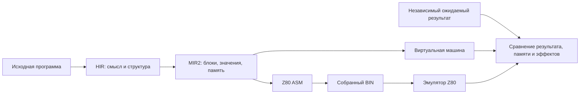

# MinZ сегодня: языки, компилятор и проверенный Z80

**Обзор от 11 октября, обновлён 12 октября 2026 года.** Работа ведётся в исследовательской ветке [`feat/grace-hir-vm`](https://github.com/oisee/minz/tree/feat/grace-hir-vm). Этот отчёт публикуется отдельно в `main`: он не означает, что исследовательские изменения уже интегрированы в основной компилятор.

## Обновление 12 октября: VIR и безопасные назначения регистров

**После прошлого обновления завершился ещё один полный исследовательский VIR checkpoint: 116 PASS, 0 FAIL, 4 SKIP.** Это `27aa1f7c`, до поздних исправлений CALL и адаптеров. Он проверяет полный набор исследовательских тестов; успешный допуск функций корпуса не равен независимому native-доказательству каждой функции. [Терминальный лог и границы](https://github.com/oisee/minz/tree/ced33bd1/reports/vir-index-alias-full-terminal).

Последующие проверки закрыли прежний контрпример индексирования и позволили вернуть компактный `Double16ThenDec`: **3 вместо 6 байт**, с независимым исполнением на всех 65 536 word-входах. Исправлены пересылки через индексные половинки, сохранение IX/IY через CALL, ширина входных аргументов и согласование caller ABI. Недоказанные многоблочные линейные/island fallback теперь отвергаются: функция продолжает через настоящий CFG solver или обычный MIR2 backend.

**Плотная перестановка аргументов теперь возможна даже без свободного регистра.** Две стековые копии сохраняют исходное состояние и собирают новые назначения; временно нужны 24 байта. Цикл шести занятых регистров и смешанный byte/word-цикл независимо проверены на 65 536 входах каждый, включая flags и точный PC/SP. Это исправление корректности исследовательского VIR, не новое ускорение production. Противоречивые перекрывающиеся назначения и границы памяти кадра ещё требуют проверки. [Отдельный разбор с примером и сравнением с прошлым обзором](2026-10-12-093-vir-register-adapters.md).

HIR, MIR2 и пять фронтендов (Nanz, C89, Lanz, Lizp, PL/M) завершились PASS на отдельном checkpoint `97266570`. Production-повтор таблиц сохраняет **44 → 20 байт**, **238 → 142 такта** реального caller; новых heldout-выигрышей эта серия не заявляет.

На **14:48:18 UTC** более свежие полные прогоны ещё шли: production `cbf01110` — **278 PASS, 0 FAIL, 10 SKIP**; research `ced33bd1` — **123 PASS, 0 FAIL, 4 SKIP**. Это промежуточные наблюдения, оба checkpoint предшествуют последним адаптерам. [Машиночитаемый снимок](2026-10-12-vir-adapter-progress/observation.json). Общая цель остаётся открытой; compiler changes пока находятся в исследовательской ветке. **Speed без штрафа за байты сохраняется, Size остаётся отдельной целью.**

## Предыдущее обновление 12 октября: первый полный production PASS

**Мы приблизились к цели: полный pipeline checkpoint `b6b4e0c7` завершился успешно — 547 верхнеуровневых PASS, 0 FAIL, 17 SKIP.** Это первый терминальный результат этого большого прогона, а не промежуточный счётчик. Он включает большие семейства Tetris и графики, parser/tokenizer и полный 16-битный домен печати Pascal. Пропущенные проверки остаются пропущенными; PASS не доказывает поддержку всех сочетаний языка или работу на настоящем железе. [Полный лог, версия исполняемого теста и контрольные суммы](https://github.com/oisee/minz/tree/cbf01110/reports/pipeline-b6b4e0c7-terminal).

**Общая цель ещё открыта.** Этот checkpoint предшествует поздним Agon-правкам, исправлению деления и новым исправлениям C89. Для них запущен следующий полный production gate `cbf01110`; его результат пока не получен. Исследовательские compiler changes находятся в `feat/grace-hir-vm`; публикация этого отчёта в `main` не переносит их в основной компилятор.

### C89: структуры теперь сохраняют контракт при возврате

Найдены и исправлены два конкретных разрыва между фронтендом и HIR:

- При возврате структуры преобразование меняло сигнатуру функции на несколько результатов, но вызов сохранял прежний тип указателя. Теперь согласуются тип вызова и весь список результатов; verifier отвергает неверные типы, число результатов и аргументы. Девять функций чтения полей из неизменённого `c99_designated.c` проверены по независимым ожидаемым значениям в исходном/итоговом MIR VM и собранном Z80, в обычном режиме и Grace Speed/Size. [Исправление, HIR/MIR и ASM](https://github.com/oisee/minz/tree/81c2b61b/reports/c89-struct-return-contract).
- Обход вложенных блоков пропускал `return` структуры в `minmax_pair.c`. После исправления **39 из 39 C89-примеров** проходят разбор, HIR verifier и lowering. Это проверка входного контракта, а не native-поведения всех 39 программ. Для исходного min/max отдельно проверены все 65 536 byte-пар в VM и 49 граничных word-пар × две функции × три режима на Z80: **294 native-проверки**. [Аудит и границы проверки](https://github.com/oisee/minz/tree/c86bfcd5/reports/c89-nested-block-contracts).

### VIR на момент предыдущего обновления: открытые контрпримеры

VIR остаётся офлайн-исследованием совместного выбора инструкций и регистров с Z3. Обычная компиляция идёт **HIR → MIR2 → Z80** и не требует внешнего solver.

Повтор полного VIR-прогона после исправлений C89: **105 PASS, 1 FAIL, 4 SKIP**. Прежний panic устранён. Единственное верхнеуровневое падение — качество `Double16ThenDec`: лишние пересылки через DE вместо `DEC HL`. Арифметика именно этого шестибайтного результата независимо подтверждена собранным BIN на всех **65 536 word-входах**, включая точный адрес возврата и восстановление SP. Ожидание теста качества не ослаблено. [Терминальный VIR-прогон](https://github.com/oisee/minz/tree/4eb2c23a/reports/vir-current-c86bfcd5) · [Полный native-домен арифметики](https://github.com/oisee/minz/tree/cc8023a2/reports/vir-word-return-native).

После этого исправлен преждевременный возврат посреди участка оптимизации и добавлена явная передача живых значений между двумя участками внутри одного MIR-блока. Автоматическое разделение подтверждено на всех 256 byte-входах с проверкой PC/SP. Это шаг к надёжному VIR, **не доказательство произвольного CFG**: путь с несколькими блоками ещё требует согласования контрактов на рёбрах. [Реализация и native-проверка](https://github.com/oisee/minz/tree/f3237623/reports/vir-automatic-island-contract).

Попытка убрать лишние word-пересылки обнаружила контрпример в индексировании массива и пока не допущена. Прямой запуск выделенных Z80-функций показал: правильный возврат и стек сами по себе не гарантируют правильный адрес элемента. Дальнейшая работа проверяет сохранение живого аккумулятора при пересылках через регистры IX/IY. [Сохранённый контрпример](https://github.com/oisee/minz/tree/2ca834a6/reports/vir-indexed-helper-isolation).

### Польза оптимизаций и следующий шаг

Ранее подтверждённые результаты сохраняются после production-исправления деления: parser на заранее отложенных входах — **2 195 027 → 2 137 641 T (−2,61%)**, hashmap — **258 962 → 237 948 T (−8,11%)**. На обучении и отложенных входах используется один выбранный BIN; модели и входы не менялись. **Speed по-прежнему без штрафа за байты**, Size — отдельная цель. [Повтор с решениями и ASM/BIN](https://github.com/oisee/minz/tree/32f637bc/reports/heldout-after-byte-neighbor).

Полный CLI ранее завершился **74 PASS, 0 FAIL, 0 SKIP за 374,868 с**: проверены collect/replay, Size и сохранение выбранных ASM/BIN. Этот запуск предшествует позднему исправлению деления. [Checkpoint CLI](https://github.com/oisee/minz/tree/25b05f69/reports/cli-current-9fc083c1). Все **4952 файла** предыдущего пакета доказательств сохранены с SHA256 на `/mnt/safe/minz/grace/2026-10-12/corpus-evidence-4df8b2f9/`; новые пакеты сохраняются отдельно в `compiler-updates/`. [Аудит сохранности](https://github.com/oisee/minz/tree/1ab9527b/reports/corpus-shared-copy).

Ближайшие условия завершения — терминальный gate с поздними production-правками и закрытие оставшихся семантических случаев. Lizp implicit return и контракт вывода учебного PL/M Hello пока требуют решения о языке. Число **194 исходных пути** и уровни покрытия не изменились; новый PASS усиливает доказательства, а не превращает их в процент готовности. Настоящий CP/M/Agon и физический Z80 остаются следующим уровнем проверки.

Состояние следующего полного gate на момент публикации: **2026-10-12T14:02:45 UTC, 189 PASS, 0 FAIL, 8 SKIP; выполняется `TestMemoryHostArenaSelectorStaleHostsAndWorkload/workload`**. Это промежуточное наблюдение. [Машиночитаемый снимок и терминальные результаты](2026-10-12-status-terminal-followup/observation.json).

## Предыдущее обновление 12 октября: контекст и измерения

Общая цель ещё открыта, но доказательства стали заметно шире: теперь это несколько реальных программ, заранее отложенные входы и исполнение собранного Z80 с проверкой памяти, вывода и стека. Все результаты ниже относятся к исследовательской ветке; публикация отчёта в main не включает её compiler changes в main.

**Корпус сохраняет все 194 пути.** У 153 есть независимое или ограниченное VM/Z80 покрытие, у 21 — native ASM bounded, у 10 — CP/M runtime, у 2 — SMC bounded. Отдельно остаются 5 Agon MOS runtime, 1 host-only memory model и 2 случая без независимого оракула. Это разные уровни проверки, поэтому 153/194 не является процентом готовности всего компилятора. [Точный каталог](https://github.com/oisee/minz/blob/b6b4e0c7/docs/grace-integration-338/catalog.json).

| Новое подтверждение | Измеренный результат | Что именно доказано |
|---|---:|---|
| Frozen self-Lanz parser, Speed heldout | 2 195 027 → 2 137 641 T (−2,61%); 2377 → 2478 B | Тот же выбранный BIN на train/heldout, независимая модель событий и памяти |
| Hashmap, 48 отложенных вызовов | 258 962 → 237 948 T (−8,11%); 996 → 976 B | Польза сохраняется на входах вне выбора; Speed и Size выбирают оба преобразования |
| Checked allocation table × PFCCO × Grace | 44 → 20 B; caller 238 → 142 T | Все 12 сочетаний и все byte inputs; стоимость пересылок и сохранений включена |
| Self-tokenizer, PBQP Size | 5533 → 5513 B после удаления перезаписанных literal loads | −20 B, но greedy всё ещё меньше: 5465 B; здесь нет нового измерения T |

[Полный пакет heldout, решения, ASM/BIN и независимые проверки](https://github.com/oisee/minz/blob/3ebed86e/reports/heldout-after-literal-overwrite/README.md). Таблицы полезны на подходящих формах, но PBQP пока не лучше greedy на tokenizer по Size. Инвентаризация охватывает 981 запись по 72 Nanz-исходникам; текущий checked bridge допускает 36 локальных задач. Это граница admission, а не размер исторической ENRT базы. [Разбор](https://github.com/oisee/minz/blob/55c8f222/reports/table-inventory-5d90b7aa/README.md).

**Исходные parser/tokenizer main выполняются в защищённом CP/M runtime.** При резерве стека 1024 B: parser — 419 878 T / 3984 B, tokenizer — 411 987 T / 7051 B; фактически затронуто 46 и 30 B resident stack. Проверены stdout, области памяти, globals, stack guards и завершение. Это абсолютные показатели текущей конфигурации, не дополнительный выигрыш Grace и не аппаратный замер. [Артефакты](https://github.com/oisee/minz/blob/95fb99ec/reports/cpm-main-after-literal-overwrite/README.md).

На предыдущем checkpoint прошли полный MIR2, HIR и 11 пакетов фронтендов/инструментов, полный CLI (74 PASS, 0 FAIL, 0 SKIP) и showcase compile/assemble (193 PASS, 1 capacity SKIP). Они предшествуют позднему исправлению деления; MIR2 после него прошёл за 68,001 с. Compile/assemble не заменяет проверку поведения. [Свежий checkpoint с логами](https://github.com/oisee/minz/blob/b6b4e0c7/reports/2026-10-12-grace-current-checkpoint.md).

**Историческое наблюдение до завершения pipeline b6b4e0c7.** На тот момент: 12 октября в 12:40 UTC: 287 верхнеуровневых PASS, 0 FAIL, 10 SKIP; выполняется `TestOriginalTetrisSpawnHoldAndSequences`. Матрица механики CP/M и TUI уже завершилась во всех трёх режимах. Это промежуточный результат, не общий PASS. Сборка включает последнюю literal-overwrite правку и лимит 360 минут; поздние Agon-изменения проверены отдельно и не входят в этот immutable executable. [Команда, executable SHA256 и checkpoint](https://github.com/oisee/minz/blob/f0312aa0/reports/pipeline-b6b4e0c7-checkpoint/job.json).

Предыдущий полный запуск 5d90b7aa завершился exit 2 по лимиту 180 минут во время SHA split helpers: 493 PASS, 0 верхнеуровневых FAIL, 14 SKIP. Он подтвердил большие семейства Tetris, графики, Pascal и self-parser, но timeout не означает общий PASS; оставшиеся тесты не подтверждены. [Терминальный результат и полный лог](https://github.com/oisee/minz/tree/514a54e9/reports/pipeline-5d90b7aa-terminal).

Оставшиеся условия закрытия: полный gate актуального кода, явная политика Lizp return и исправление учебного PL/M Hello с пустым PRINTCHAR/чтением за literal bytes, оставшиеся ограничения моделей устройств и проверка на настоящем железе. Top-level entry PL/M уже исправлен, но это не исправляет семантику Hello целиком. Живой LIR удалён; VIR остаётся исследовательским путём, обычная компиляция не требует Z3. Speed по-прежнему выбирает минимум T без штрафа за байты; Size — самостоятельная цель.

Свежие пакеты сохранены на шаре в `/mnt/safe/minz/grace/2026-10-12/compiler-updates/<commit>/` с manifests SHA256. Полная копия сайта: `/mnt/safe/minz/grace/2026-10-12/site-and-artifacts/site/index.html`; опубликованный сайт старше этого обновления. Разделы ниже сохраняют исторический контекст 11 октября, включая прежние размеры каталога и checkpoints.

## Ещё один шаг 12 октября: Tetris можно попробовать

**Tetris уже исполняется как штатный защищённый CP/M COM в Z80-эмуляторе.** Свежий повтор `TestPublicCPMTetrisNative` прошёл в ordinary, Grace Size и Grace Speed. Выпускается именно образ RuntimeCPM с 1024 B resident stack; игровой loader не подменяет runtime. Независимый сценарий `z,q,a` проверяет два кадра, поворот, выход и финальное подтверждение, 326 B ANSI/текста, globals, board и окружающую RAM. На каждом BDOS 1/2 намеренно портятся flags и BC/DE/HL/IX/IY; игра возвращает управление окружению с восстановленным SP и runtime status=0. Ordinary: 5796 B / 168 311 T; Grace Size/Speed: 5800 B / 168 263 T. Это короткий сценарий, а не замер произвольной игровой сессии. [COM, ASM, модели и лог](https://github.com/oisee/minz/tree/f9d06718/reports/tetris-public-runtime-69ce1022).

Большая матрица механики отдельно прошла по 238 456 вызовов на режим для CP/M и TUI, а spawn/hold sequences — по 4592. Так подтверждается гораздо больше состояний игры, чем в коротком whole-main сценарии. Старые документы об отказе RuntimeCPM относятся к историческому checkpoint: текущий исходник уже исправлен под NUL API, admission и исполнение публичного runtime проходят. Настоящая установленная CP/M и аппаратный Z80 остаются отдельным уровнем проверки.

**Как попробовать на этой машине:** `bash /mnt/safe/minz/grace/2026-10-12/play-tetris/play.sh` в ANSI/VT100 терминале. Стрелки — движение, Z — поворот, X — сброс, C — hold, Q — выход, затем любая клавиша. Wrapper включает посимвольный ввод и восстанавливает терминал после выхода. Пока это пошаговая версия: игровое время продвигается по клавишам. Свежий `mze` с вводом `zqa` завершился exit 0; stdout 329 B включает три эха ввода BDOS. [Запускатель и воспроизведение](https://github.com/oisee/minz/tree/2dc6d47d/reports/tetris-mze-play-f9d06718).

**Self-parser прошёл полный native main** во всех трёх режимах; отдельная whole-main VM проверяет независимую модель файлов, AST, токенов и stdout. Это другая программа, чем self-Lanz parser из таблицы heldout, и результаты не смешиваются. В предыдущем полном запуске также завершились модель стоимости полного u8 domain, конкуренция правил за бюджет, bool/return-flags (198 912 вызовов на режим) и C89 string/memory. Итоги обоих gate приведены выше; старые промежуточные счётчики не используются как текущий статус.

## Новое: Agon рисует интерфейс и возвращается в MOS

**Теперь проверен не только текстовый Hello, но и графический интерфейс.** Неизменённые примеры TUI Hello, TUI Demo и Mini NC собраны публичной CLI и выполнены в ordinary mode одновременно с eZ80 CPU, Console8 MOS 2.3.3 и полным VDP 2.16.0 в Fab Agon Emulator 1.2.5. Кадры показывают окна, цвета, текст и выделение выбранной строки. Клавиши поступают через штатный путь SDL → PS/2 → MOS; после выхода выполняется следующая команда MOS и появляется приглашение.

| Программа / сценарий | Что наблюдали | Доказательства |
|---|---|---|
| TUI Hello | Окно и приветствие; клавиша A; возврат в MOS | [Кадры, исходник и BIN](https://github.com/oisee/minz/tree/77e0bffb/reports/agon-native-vdu-fix) |
| TUI Demo и Mini NC | Отрисовка обоих интерфейсов; выход A / Escape | [Полный пакет](https://github.com/oisee/minz/tree/9084e512/reports/agon-full-vdp-demo-nc) |
| Mini NC: Down, Enter, Escape | Выделение второй строки; `Selected: NC_AGON.BIN`; возврат в MOS | [Последовательность и кадры](https://github.com/oisee/minz/tree/21770ce7/reports/agon-full-vdp-nc-navigation) |
| Mini NC: нижняя граница списка и Up | Девять Down оставляют выбор на последней, восьмой строке; Enter показывает PLASMA.BIN; Up выбирает каталог EXAMPLES; Escape возвращает в MOS | [Кадры и точный ввод](https://github.com/oisee/minz/tree/7ba37c5c/reports/agon-full-vdp-nc-boundary) |

**Проверки нашли два настоящих препятствия.** Во-первых, приложение могло затереть IY, используемый MOS, а void main заканчивался HALT. Agon entry теперь сохраняет и восстанавливает IY, вызывает main и возвращает status 0 в MOS. [Исправление и регрессии](https://github.com/oisee/minz/tree/31030f07/reports/agon-entry-fix). Во-вторых, прежняя TUI-библиотека отправляла ANSI escape sequences, которые обычный графический VDP показывал как текст. Библиотека теперь использует собственные VDU-команды Agon для позиции курсора, цветов, очистки и видимости курсора; сами примеры не переписаны. [Исправление VDU](https://github.com/oisee/minz/tree/77e0bffb/reports/agon-native-vdu-fix).

**Теперь все пять примеров проверены в ordinary, Grace Size и Grace Speed.** Для трёх графических программ выполнены девять запусков с независимой моделью полного потока VDU-команд и текста; для двух console Hello — ещё шесть с точным ожидаемым текстом. Mini NC включает переход к границе списка, Enter, Up и Escape. Проверяется весь поток приложения, затем следующая команда и приглашение MOS. [Графическая матрица, 9/9](https://github.com/oisee/minz/tree/8228a5ad/reports/agon-native-vdu-matrix-d071b99c) · [Console, 6/6](https://github.com/oisee/minz/tree/cd326f57/reports/agon-console-full-vdp).

**«Восстановление стека» проверено непосредственно в eZ80 debugger.** В отдельных запусках тех же BIN сохранены регистры и 24 байта вызывающего кадра перед входом и перед RET. После программы SP, IY, IX и кадр должны совпасть с исходными; HL содержит status 0, ADL остаётся включён. Сам RET обязан перейти по сохранённому трёхбайтовому адресу и поднять SP ровно на три байта. Все 15 сочетаний программа × режим прошли. Это проверяет, что приложение не потеряло адрес возврата и не испортило проверяемую часть состояния MOS. [Графические программы, 9/9](https://github.com/oisee/minz/tree/ac2af8f4/reports/agon-debug-return-matrix-d071b99c) · [Console, 6/6 и повторный разбор исходных логов](https://github.com/oisee/minz/tree/a5519093/reports/agon-console-debug-return).

Независимый аудит повторно разобрал сохранённые потоки и debugger logs; намеренно повреждённые адрес возврата, SP, status, кадр и вывод отвергаются. [Аудит и отрицательные проверки](https://github.com/oisee/minz/tree/bc940415/reports/agon-independent-evidence-audit).

**Граница доказательства:** точный поток VDU и bounded return contract подтверждены; независимого pixel-оракула, проверки всей RAM и аппаратного запуска пока нет. Debugger проверяет отдельный сценарий выхода, а навигация проверяется в stream-матрице на том же BIN. Незакрашенные внутренние области окон остаются чёрными; динамические размеры экрана и все TUI-примитивы не подтверждены. Каталог сохраняет отдельную категорию Agon MOS runtime. Таймаут наблюдателя останавливает продолжающий работать MOS; возврат приложения подтверждается следующей командой и приглашением. Размеры BIN одинаковы во всех трёх режимах: эти проверки расширяют доказательство корректности, не заявляют выигрыш Grace.

Исторический отказ загрузки относился к исследовательскому BIN без MOS-заголовка; публичная CLI уже добавляла его правильно. [Ранняя проба](https://github.com/oisee/minz/tree/99ab4b54/reports/agon-mos-first-execution). Все новые пакеты, изображения, ASM/BIN, логи и manifests SHA256 сохранены на шаре в `/mnt/safe/minz/grace/2026-10-12/compiler-updates/<commit>/reports/`.

## Что осталось от LIR — и что уже работает без него

**Живой LIR удалён из исследовательской ветки.** Исходники сохранены в проверенном архиве; полезные преобразования и ограничения машинных инструкций перенесены в рабочие слои и регрессионные тесты. VIR остаётся офлайн-исследовательским механизмом. Это ещё не обещание универсального оптимального распределения регистров по произвольному CFG. [Сверка переноса с текущим кодом](https://github.com/oisee/minz/blob/61c77abe/docs/lir-retirement-backlog.md).

Свежая проверка композиции локальных арифметических форм охватывает **162 домена и 10 616 832 вызова каждого слоя: final MIR VM и собранного Z80**, в ordinary, Grace Size и Grace Speed. Ожидания вычисляет независимая модель по модулю 256. На каждом native-вызове проверяются точный адрес продолжения CALL, SP, неизменность байтов кода и две 16-байтовые границы стека. Нарочно повреждающие код или границы программы отвергаются даже при правильном результате и возврате. [VM/Z80 и сохранённые MIR/ASM/BIN](https://github.com/oisee/minz/tree/8e71372b/reports/composition-vm-native) · [Границы памяти и отрицательные проверки](https://github.com/oisee/minz/tree/af12e61b/reports/composition-code-stack-guards).

Это ограниченные домены дополнительных аргументов, а не полный перебор всех функций или доказательство новой экономии тактов. Вместе с heldout-замерами выше они показывают две разные стороны цели: перенесённая польза остаётся корректной, а выбранные оптимизации дают измеряемый эффект. [Состояние всех условий цели и оставшаяся работа](https://github.com/oisee/minz/tree/60476eaa/reports/2026-10-12-goal-state).

## Что такое MinZ сейчас

MinZ — экспериментальный набор инструментов для программирования Z80: языковые фронтенды, общий оптимизирующий компилятор, ассемблер и эмуляторы. **Nanz — основной исходный язык современного пути.** Имя MinZ также обозначает проект и его исторический язык; принимать `.minz` нынешним Nanz-парсером не означает поддерживать весь старый синтаксис.

Главная ценность общей архитектуры: исправление работы с памятью, вызовами или регистрами может помочь сразу нескольким языкам. Но каждый фронтенд отдельно обязан правильно перевести собственную семантику: одинаковый backend не доказывает одинаковую зрелость языков.

## Языки и фронтенды

Таблица описывает маршруты текущей исследовательской ветки, проверенные по CLI dispatch. Наличие маршрута означает возможность компиляции поддержанного подмножества, не полноту языкового стандарта.

| Вход | Роль и возможности | Текущая граница |
|---|---|---|
| **Nanz** `.nanz`, `.minz` | Основной структурный язык: типы, указатели, структуры, enum/ADT, методы, итераторы, fold, pipe, imports, метапрограммирование и assertions | Полный ABI замыканий и все сочетания возможностей не доказаны; старый MinZ-синтаксис не равен Nanz |
| **Lanz** `.lanz` | S-expression представление, переводимое в общий HIR; удобно для генерации и анализа программ | Есть независимые проверки конкретных исходников; собственный Lanz-парсер на Nanz — отдельная программа, не замена всего compiler frontend |
| **Lizp** `.lizp` | Lisp-подобный фронтенд с формами управления и макросами | Проверены арифметика, функции и отдельные приложения; implicit-return в cond_test остаётся пробелом |
| **Pascal** `.pas` | Процедуры, функции, массивы, records и учебные алгоритмы | SORT и другие вычислительные примеры имеют native-доказательства; библиотечный вывод/CP/M проверяется отдельно |
| **PL/M** `.plm` | Исторический системный язык: процедуры и byte-ориентированные программы | Арифметические примеры работают; top-level entry исправлен, но Hello имеет пустой PRINTCHAR и чтение за literal bytes |
| **C89 / Objective-C** `.c`, `.m` | C-подмножество и ObjC-конструкции через общий HIR; реальные FAT12 и графические примеры | Это не полная совместимость с C/ObjC экосистемой. VM canvas render не означает native Z80 renderer |
| **ABAP** `.abap` | ABAP-конструкции и сценарии с библиотечными/SQL связями | Parser bridge и runtime имеют свои зависимости; общий Z80-корпус не подтверждает весь ABAP/SQL |
| **Frill** `.frl` | Дополнительный фронтенд общего HIR, с отдельным руководством и примерами | Его зрелость требует собственного корпуса; числа 121/194 нельзя распространять на все Frill программы |
| **HIR** `.hir` | Прямой вход общего промежуточного представления | Полезен для инструментов и редукций; это не самостоятельное доказательство корректности frontend |

Другие исторические парсеры и инструменты в репозитории не объявлены полноценными участниками нынешнего CLI только по наличию файлов. [Dispatch маршрутов](https://github.com/oisee/minz/blob/cc7a8aad/minzc/cmd/minzc/main.go).

## Слои: зачем их несколько

| Слой | Что он выражает | Где полезен |
|---|---|---|
| **HIR** | Типы, структурные циклы, вызовы, поля и высокоуровневые операции | Общая семантика фронтендов, преобразования Grace, привязка профиля к исходнику |
| **MIR2** | SSA-значения, явные блоки и рёбра, память и контракты вызовов | Проверка оптимизаций, VM, PFCCO и подготовка Z80 |
| **VIR** | Операции с учётом Z80, ещё виртуальные регистры | Офлайн-совместный поиск инструкции и назначения регистров |
| **PIR** | Конкретные машинные операции и физические регистры | Результат исследовательского решения, перед выпуском ASM; типы живут внутри pkg/vir |
| **ASM / BIN** | Ассемблерный текст и исполняемые байты | Окончательное измерение размера, тактов и поведения |

Обычный рабочий путь — **HIR → MIR2 → Z80**. VIR/PIR пока не обязательные ступени production-компиляции. LIR удалён в исследовательской ветке после переноса полезных возможностей; это не утверждение, что main уже содержит все эти изменения. Имя MIR2 пока сохраняется, переименование отложено.

Больше слоёв полезно только при ясных обязанностях. Например, совместный выбор инструкции и регистров важен на Z80: размещение значения в A или HL меняет доступные операции. Дополнительный переход без такой задачи лишь увеличивает риск потери семантики.

## Что нового и интересного

- **Grace выбирает преобразования по измерениям.** Есть сбор профиля, привязка к исходнику/контексту, replay и отдельные Speed/Size цели; кандидаты проверяются, измеряются на собранном Z80 и сохраняются с артефактами.
- **PFCCO согласует вызовы между функциями.** Per-Function Calling Convention Optimization выбирает размещение аргументов и результатов с учётом caller/callee. Польза оценивается вместе с пересылками и сохранениями через CALL.
- **PBQP распределяет регистры.** Это решатель дискретной задачи стоимости и совместимости назначений. Проверенные shape-таблицы дают ему или selector готовые допустимые альтернативы; историческая таблица сначала проходит проверку текущих MIR/ABI ограничений.
- **Машинные ограничения становятся явными.** Живые flags, перекрывающиеся пары/половинки регистров, clobbers, stack и memory effects входят в проверки. Дифференциальные тесты нашли реальные miscompile, поэтому эта работа приносит пользу независимо от Grace.
- **Есть программы на самом Nanz.** Self-Lanz parser и tokenizer — реальные примеры с persistent состоянием, независимыми моделями и отдельными native/runtime опытами. Это шаг к самохостингу компонентов, не самохостинг всего компилятора.
- **Библиотеки и метафункции позволяют выразительные программы.** Типизированный вывод, арены, iterators, pipes, методы и compile-time конструкции делят общий backend. Поддержанное сочетание проверяется на конкретном исходнике, а не обещается по списку возможностей.

WFC, GPU/CUDA enumeration и Z3 интересны как средства исследования и получения хороших кандидатов. Их наличие не доказывает, что production compiler автоматически использует все исторические GPU-таблицы или выигрывает на каждой форме. Внешний Z3 не нужен обычной компиляции; WFC пока не заменяет PBQP. [Архитектурная граница VIR](https://github.com/oisee/minz/blob/cc7a8aad/docs/adr/0047-mir-native-candidates-and-offline-vir.md).

## Что мы проверяем

Компилятор может правильно выполнять программу в своей виртуальной машине и при этом выпускать неверный машинный код. Поэтому одного зелёного VM-теста недостаточно.

Наш маршрут проверки:

Ожидаемый результат вычисляет отдельная модель: например, обычная арифметика, сортировка, лексический анализ или модель размещения полей структуры. Мы сравниваем исходный и оптимизированный MIR, а затем настоящий собранный Z80-код. Для соответствующих тестов проверяем также порядок чтений и записей, неизменность соседней памяти и возврат на правильный адрес с восстановленным стеком.

**Это проверка машинного кода в эмуляторе. Настоящее железо остаётся следующим уровнем.**

## Что означают «121 из 194»

Числа относятся к [зафиксированному каталогу](https://github.com/oisee/minz/blob/45140dc0/docs/grace-integration-203/catalog.json), а не к проценту готовности компилятора. Единица учёта — точный путь исходного файла; среди них есть побайтно одинаковые архивные копии. Функции и независимые приложения — другие единицы измерения.

| Статус на этом checkpoint | Файлов | Что известно |
|---|---:|---|
| Независимое или явно ограниченное VM/Z80 покрытие | **121** | Проверены указанные функции и входы; границы описаны для каждого файла |
| Ожидают независимого оракула | **16** | Компиляция или отдельные asserts не дают достаточного доказательства поведения |
| Inline ASM требует аудита | 32 | Нужна модель машинных инструкций и их эффектов |
| Внешний runtime требует аудита | 18 | Нужны обоснованные связи с окружением и библиотечными вызовами |
| Agon MOS/eZ80 | 5 | Обычный Z80-эмулятор не подтверждает весь контракт платформы |
| Native CP/M runtime | 1 | Есть явно ограниченная проверка COM с моделью BDOS |
| Только host-модель памяти | 1 | Это не native-доказательство |
| **Всего** | **194** | Все исходные пути сохранены |

«Ограниченное покрытие» означает именно перечисленный диапазон. Например, рекурсивный Fibonacci проверен на 0–20, а некоторые арифметические функции — на всех 256 byte-входах или всех 65 536 byte-парах. Мы не переносим доказательство одного диапазона на все возможные входы.

Каталог теперь воспроизводится: registry сверяет SHA256 исходника и файлов доказательств, прежде чем присвоить явно заданный статус. Сама генерация каталога не запускает весь CPU-корпус заново. [Root replay и границы](https://github.com/oisee/minz/blob/cf1ab8a3/docs/grace-integration-201/README.md).

## Manhattan: что именно исправили

Manhattan — расстояние между двумя точками:

`abs(x₁ − x₂) + abs(y₁ − y₂)`

В исходном примере координаты и результат имеют тип `u8`, поэтому итоговая сумма заворачивается по модулю 256. Проверка охватывает **3 856 входов в каждом из трёх режимов**, всего **11 568 native-вызовов**, с независимой моделью расстояния.

Сам сгенерированный код оказался корректным. Старый тест ожидал фиксированное число обращений к байтам локального объекта. После безопасного сохранения живого аккумулятора появился дополнительный `PUSH AF` / `POP AF`: эти инструкции временно используют байты стека, которые позже занимает объект `q`. Поэтому физический счётчик памяти стал показывать три чтения/записи вместо двух.

Мы не просто заменили число 2 на 3. Новый оракул отдельно проверяет:

- записи координат и чтения полей в исходном порядке, с точными адресами и значениями;
- фактические сохранения на стеке и записанные слова;
- итоговые байты объектов, результат, return PC/SP и границы памяти.

Это **исправление тестового оракула**, не новый backend-fix. [Разбор и сохранённый контрпример](https://github.com/oisee/minz/blob/29df08bb/reports/manhattan-object-oracle/REPORT.md).

## Что добавилось после каталога 121/194

Эти результаты сохранены отдельно; число 121 выше не увеличено задним числом.

| Пакет | Результат | Ограничение |
|---|---|---|
| Исходный `z80_compute_verify.nanz` | **1 840 989** реальных CALL, три режима, VM/Z80 PASS | Полные byte-домены; word-пары и clamp имеют описанные границы |
| Fibonacci и pipe/fold | **417 189** native-исполнений, VM/Z80 PASS | Включает три прямых `main` с HALT; остальные — реальные CALL |
| Строки и pointer-cast | **5 412** native-вызовов исходных функций, VM/Z80 PASS | Вывод проверен через явную модель runtime |
| Assert / SMC-спрайт / hello | **50 725 719** native CALL в пакете подагента | На момент этой исторической записи root повтор ещё выполнялся; VM PatchSlot и физический SMC имеют разные модели |

Для `z80_compute_verify` вновь проверены полные unary-домены `count_bits` и `is_power_of_2`, дополнительные ожидания которых были закомментированы в исходнике. Сам исходник не переписан ради прохождения тестов. `sum_to(255)` не получает выдуманного численного результата: исходный byte-счётчик заворачивается и цикл не завершается, что проверено ограниченными VM/native пробами.

[Compute verification](https://github.com/oisee/minz/blob/86d8fb62/reports/original-compute-verify-native/REPORT.md) · [Fib/pipe](https://github.com/oisee/minz/blob/6d583fc7/reports/fib-pipe-native/REPORT.md) · [Строки и указатели](https://github.com/oisee/minz/blob/6d583fc7/reports/strings-pointer-plm-native/REPORT.md).

## Что это даёт оптимизациям

Корректность — обязательная часть работы. Но цель также требует измеряемой пользы на Z80.

Проверенные таблицы назначения регистров уже дали на подходящем `weighted` примере **44 → 20 байт** полного модуля и **238 → 142 такта** реального caller. В стоимость включены пересылки и сохранение живого аргумента через CALL. Это таблицы распределения значений по регистрам, не таблицы арифметических ответов. [Доказательство и границы](https://github.com/oisee/minz/blob/cc7a8aad/docs/grace-integration-095/README.md).

Grace также проверяется на заранее отложенных нагрузках. Например, для исходного Pascal SORT обучение выбрало вариант, который на восьми отложенных массивах сохранил выигрыш: **164 671 → 164 275 T**, **488 → 486 байт**. Выигрыш небольшой, но измерен на входах, не участвовавших в выборе. Это SORT-функция, не выполнение всего CP/M-приложения. [Протокол heldout](https://github.com/oisee/minz/blob/cc7a8aad/docs/grace-integration-131/README.md).

**Speed сохраняется без штрафа за байты. Size — отдельная цель.** Малый выигрыш скорости при росте размера может быть правильным выбором для Speed; пользователь должен иметь возможность предпочесть размер.

## Что ещё не закрыто

- **Gate поздних production-правок.** b6b4e0c7 завершился: 547 PASS, 0 FAIL, 17 SKIP. Более свежий cbf01110 ещё выполняется; его общий PASS пока не получен.
- **Lizp `cond_test`.** Объявленный результат отсутствует в VM, native оставляет прежний A. Правило implicit return не подтверждено спецификацией. Diagnostic PASS сохраняет этот пробел, не делает программу корректной.
- **PL/M Hello.** Top-level calls уже формируют entry, но исходный `PRINTCHAR` пустой, а PRINTMSG читает за literal bytes. Исходное приложение целиком не объявлено рабочим.
- **Машинное окружение.** ASM, SMC, CP/M, ZX и Agon требуют собственных моделей. Проверка арифметического helper не доказывает работу устройства или целой игры.

Следующая работа: закончить независимые проверки оставшихся исходников, получить свежий полный gate, затем пересмотреть итоговый каталог и готовность заявленных программ. LIR уже удалён из исследовательского рабочего пути; VIR остаётся офлайн-исследовательским механизмом. Обычная компиляция не требует Z3.

## Где смотреть и воспроизводить

- [Исследовательская ветка](https://github.com/oisee/minz/tree/feat/grace-hir-vm) — код, тесты и сохранённые доказательства.
- [Каталог с точными статусами](https://github.com/oisee/minz/blob/b6b4e0c7/docs/grace-integration-338/catalog.json) — текущие 194 пути; таблица 121/194 выше сохранена как история.
- [Следующий полный pipeline: executable SHA и команда](https://github.com/oisee/minz/blob/635069b7/reports/pipeline-cbf01110-checkpoint/job.json) — включает поздние production-правки; результат ещё ожидается.
- [Приватный сайт](https://minz-grace-hir-mir-report.grittysnipe3.chatgpt.site/current-state.html) — опубликованная версия v68; она старше этого отчёта.

Локальная полная копия опубликованного сайта: `/home/alice/dev/minz-artifacts/grace-reports/2026-10-12/site/index.html`.

На шаре сайт лежит в `/mnt/safe/minz/grace/2026-10-12/site-and-artifacts/site/index.html`. Новые пакеты доказательств — в соседних `compiler-reports/` и `compiler-docs/`; там сохранены исходники, профили/решения для соответствующих экспериментов, ASM/BIN, логи, manifests и SHA256. Retained test executables — в `compiler-checkpoints/` или внутри своего пакета. Каждый результат следует читать вместе с его исходником, входами и checkpoint: исторические числа разных сборок не смешиваются.
