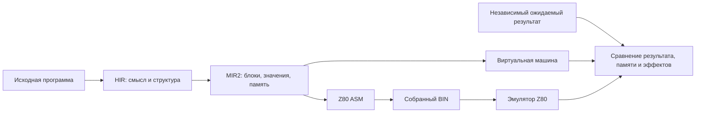

# Grace: от красивого MIR к проверенному Z80

**Состояние на 11 октября 2026 года.** Работа ведётся в исследовательской ветке [`feat/grace-hir-vm`](https://github.com/oisee/minz/tree/feat/grace-hir-vm). Этот отчёт публикуется отдельно в `main`: он не означает, что исследовательские изменения уже интегрированы в основной компилятор.

## Что мы проверяем

Компилятор может правильно выполнять программу в своей виртуальной машине и при этом выпускать неверный машинный код. Поэтому одного зелёного VM-теста недостаточно.

Наш маршрут проверки:

Ожидаемый результат вычисляет отдельная модель: например, обычная арифметика, сортировка, лексический анализ или модель размещения полей структуры. Мы сравниваем исходный и оптимизированный MIR, а затем настоящий собранный Z80-код. Для соответствующих тестов проверяем также порядок чтений и записей, неизменность соседней памяти и возврат на правильный адрес с восстановленным стеком.

**Это проверка машинного кода в эмуляторе. Настоящее железо остаётся следующим уровнем.**

## Что означают «121 из 194»

Числа относятся к [зафиксированному каталогу](https://github.com/oisee/minz/blob/45140dc0/docs/grace-integration-203/catalog.json), а не к проценту готовности компилятора. Единица учёта — точный путь исходного файла; среди них есть побайтно одинаковые архивные копии. Функции и независимые приложения — другие единицы измерения.

| Статус на этом checkpoint | Файлов | Что известно |
|---|---:|---|
| Независимое или явно ограниченное VM/Z80 покрытие | **121** | Проверены указанные функции и входы; границы описаны для каждого файла |
| Ожидают независимого оракула | **16** | Компиляция или отдельные asserts не дают достаточного доказательства поведения |
| Inline ASM требует аудита | 32 | Нужна модель машинных инструкций и их эффектов |
| Внешний runtime требует аудита | 18 | Нужны обоснованные связи с окружением и библиотечными вызовами |
| Agon MOS/eZ80 | 5 | Обычный Z80-эмулятор не подтверждает весь контракт платформы |
| Native CP/M runtime | 1 | Есть явно ограниченная проверка COM с моделью BDOS |
| Только host-модель памяти | 1 | Это не native-доказательство |
| **Всего** | **194** | Все исходные пути сохранены |

«Ограниченное покрытие» означает именно перечисленный диапазон. Например, рекурсивный Fibonacci проверен на 0–20, а некоторые арифметические функции — на всех 256 byte-входах или всех 65 536 byte-парах. Мы не переносим доказательство одного диапазона на все возможные входы.

Каталог теперь воспроизводится: registry сверяет SHA256 исходника и файлов доказательств, прежде чем присвоить явно заданный статус. Сама генерация каталога не запускает весь CPU-корпус заново. [Root replay и границы](https://github.com/oisee/minz/blob/cf1ab8a3/docs/grace-integration-201/README.md).

## Manhattan: что именно исправили

Manhattan — расстояние между двумя точками:

`abs(x₁ − x₂) + abs(y₁ − y₂)`

В исходном примере координаты и результат имеют тип `u8`, поэтому итоговая сумма заворачивается по модулю 256. Проверка охватывает **3 856 входов в каждом из трёх режимов**, всего **11 568 native-вызовов**, с независимой моделью расстояния.

Сам сгенерированный код оказался корректным. Старый тест ожидал фиксированное число обращений к байтам локального объекта. После безопасного сохранения живого аккумулятора появился дополнительный `PUSH AF` / `POP AF`: эти инструкции временно используют байты стека, которые позже занимает объект `q`. Поэтому физический счётчик памяти стал показывать три чтения/записи вместо двух.

Мы не просто заменили число 2 на 3. Новый оракул отдельно проверяет:

- записи координат и чтения полей в исходном порядке, с точными адресами и значениями;
- фактические сохранения на стеке и записанные слова;
- итоговые байты объектов, результат, return PC/SP и границы памяти.

Это **исправление тестового оракула**, не новый backend-fix. [Разбор и сохранённый контрпример](https://github.com/oisee/minz/blob/29df08bb/reports/manhattan-object-oracle/REPORT.md).

## Что добавилось после каталога 121/194

Эти результаты сохранены отдельно; число 121 выше не увеличено задним числом.

| Пакет | Результат | Ограничение |
|---|---|---|
| Исходный `z80_compute_verify.nanz` | **1 840 989** реальных CALL, три режима, VM/Z80 PASS | Полные byte-домены; word-пары и clamp имеют описанные границы |
| Fibonacci и pipe/fold | **417 189** native-исполнений, VM/Z80 PASS | Включает три прямых `main` с HALT; остальные — реальные CALL |
| Строки и pointer-cast | **5 412** native-вызовов исходных функций, VM/Z80 PASS | Вывод проверен через явную модель runtime |
| Assert / SMC-спрайт / hello | **50 725 719** native CALL в пакете подагента | Root повтор полного assert-домена ещё выполняется; VM PatchSlot и физический SMC имеют разные модели |

Для `z80_compute_verify` вновь проверены полные unary-домены `count_bits` и `is_power_of_2`, дополнительные ожидания которых были закомментированы в исходнике. Сам исходник не переписан ради прохождения тестов. `sum_to(255)` не получает выдуманного численного результата: исходный byte-счётчик заворачивается и цикл не завершается, что проверено ограниченными VM/native пробами.

[Compute verification](https://github.com/oisee/minz/blob/86d8fb62/reports/original-compute-verify-native/REPORT.md) · [Fib/pipe](https://github.com/oisee/minz/blob/6d583fc7/reports/fib-pipe-native/REPORT.md) · [Строки и указатели](https://github.com/oisee/minz/blob/6d583fc7/reports/strings-pointer-plm-native/REPORT.md).

## Что это даёт оптимизациям

Корректность — обязательная часть работы. Но цель также требует измеряемой пользы на Z80.

Проверенные таблицы назначения регистров уже дали на подходящем `weighted` примере **44 → 20 байт** полного модуля и **238 → 142 такта** реального caller. В стоимость включены пересылки и сохранение живого аргумента через CALL. Это таблицы распределения значений по регистрам, не таблицы арифметических ответов. [Доказательство и границы](https://github.com/oisee/minz/blob/cc7a8aad/docs/grace-integration-095/README.md).

Grace также проверяется на заранее отложенных нагрузках. Например, для исходного Pascal SORT обучение выбрало вариант, который на восьми отложенных массивах сохранил выигрыш: **164 671 → 164 275 T**, **488 → 486 байт**. Выигрыш небольшой, но измерен на входах, не участвовавших в выборе. Это SORT-функция, не выполнение всего CP/M-приложения. [Протокол heldout](https://github.com/oisee/minz/blob/cc7a8aad/docs/grace-integration-131/README.md).

**Speed сохраняется без штрафа за байты. Size — отдельная цель.** Малый выигрыш скорости при росте размера может быть правильным выбором для Speed; пользователь должен иметь возможность предпочесть размер.

## Что ещё не закрыто

- **Полный pipeline.** Старый запуск `cfaa7777` завершился с восемью падениями: семь устаревших эталонов стоимости и Manhattan observer. Они исправлены позже. Новый полный запуск на `29df08bb` выполняется; общего свежего PASS пока нет.
- **Lizp `cond_test`.** Объявленный результат отсутствует в VM, native оставляет прежний A. Правило implicit return не подтверждено спецификацией. Diagnostic PASS сохраняет этот пробел, не делает программу корректной.
- **PL/M Hello.** Исходный `PRINTCHAR` пустой, а top-level calls не формируют `main`. Есть проверка библиотеки с явным адаптером; исходное приложение целиком не объявлено рабочим.
- **Машинное окружение.** ASM, SMC, CP/M, ZX и Agon требуют собственных моделей. Проверка арифметического helper не доказывает работу устройства или целой игры.

Следующая работа: закончить независимые проверки оставшихся исходников, получить свежий полный gate, затем пересмотреть итоговый каталог и готовность заявленных программ. LIR уже удалён из исследовательского рабочего пути; VIR остаётся офлайн-исследовательским механизмом. Обычная компиляция не требует Z3.

## Где смотреть и воспроизводить

- [Исследовательская ветка](https://github.com/oisee/minz/tree/feat/grace-hir-vm) — код, тесты и сохранённые доказательства.
- [Каталог с точными статусами](https://github.com/oisee/minz/blob/45140dc0/docs/grace-integration-203/catalog.json) — состояние 121/194.
- [Полный pipeline: executable SHA и команда](https://github.com/oisee/minz/blob/025ce7bb/docs/grace-integration-202/pipeline-start.json) — checkpoint отдельно от поздних проверок.
- [Приватный сайт](https://minz-grace-hir-mir-report.grittysnipe3.chatgpt.site/current-state.html) — опубликованная версия v68; она старше этого отчёта.

Локальная полная копия опубликованного сайта: `/home/alice/dev/minz-artifacts/grace-reports/2026-10-11/site/index.html`.

На шаре сайт лежит в `/mnt/safe/minz/grace/2026-10-11/site-and-artifacts/site/index.html`. Новые пакеты доказательств — в соседних `compiler-reports/` и `compiler-docs/`; там сохранены исходники, профили/решения для соответствующих экспериментов, ASM/BIN, логи, manifests и SHA256. Retained test executables — в `compiler-checkpoints/` или внутри своего пакета. Каждый результат следует читать вместе с его исходником, входами и checkpoint: исторические числа разных сборок не смешиваются.
