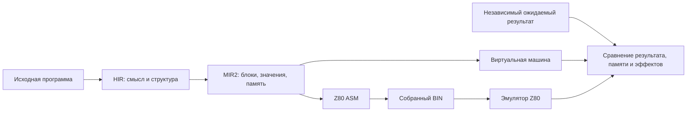

# MinZ сегодня: языки, компилятор и проверенный Z80

**Обзор от 11 октября, обновлён 12 октября 2026 года.** Работа ведётся в исследовательской ветке [`feat/grace-hir-vm`](https://github.com/oisee/minz/tree/feat/grace-hir-vm). Этот отчёт публикуется отдельно в `main`: он не означает, что исследовательские изменения уже интегрированы в основной компилятор.

## Обновление 12 октября: насколько приблизились к цели

Общая цель ещё открыта, но доказательства стали заметно шире: теперь это несколько реальных программ, заранее отложенные входы и исполнение собранного Z80 с проверкой памяти, вывода и стека. Все результаты ниже относятся к исследовательской ветке; публикация отчёта в main не включает её compiler changes в main.

**Корпус сохраняет все 194 пути.** У 153 есть независимое или ограниченное VM/Z80 покрытие, у 21 — native ASM bounded, у 10 — CP/M runtime, у 2 — SMC bounded. Отдельно остаются 5 Agon MOS runtime, 1 host-only memory model и 2 случая без независимого оракула. Это разные уровни проверки, поэтому 153/194 не является процентом готовности всего компилятора. [Точный каталог](https://github.com/oisee/minz/blob/b6b4e0c7/docs/grace-integration-338/catalog.json).

| Новое подтверждение | Измеренный результат | Что именно доказано |
|---|---:|---|
| Frozen self-Lanz parser, Speed heldout | 2 195 027 → 2 137 641 T (−2,61%); 2377 → 2478 B | Тот же выбранный BIN на train/heldout, независимая модель событий и памяти |
| Hashmap, 48 отложенных вызовов | 258 962 → 237 948 T (−8,11%); 996 → 976 B | Польза сохраняется на входах вне выбора; Speed и Size выбирают оба преобразования |
| Checked allocation table × PFCCO × Grace | 44 → 20 B; caller 238 → 142 T | Все 12 сочетаний и все byte inputs; стоимость пересылок и сохранений включена |
| Self-tokenizer, PBQP Size | 5533 → 5513 B после удаления перезаписанных literal loads | −20 B, но greedy всё ещё меньше: 5465 B; здесь нет нового измерения T |

[Полный пакет heldout, решения, ASM/BIN и независимые проверки](https://github.com/oisee/minz/blob/3ebed86e/reports/heldout-after-literal-overwrite/README.md). Таблицы полезны на подходящих формах, но PBQP пока не лучше greedy на tokenizer по Size. Инвентаризация охватывает 981 запись по 72 Nanz-исходникам; текущий checked bridge допускает 36 локальных задач. Это граница admission, а не размер исторической ENRT базы. [Разбор](https://github.com/oisee/minz/blob/55c8f222/reports/table-inventory-5d90b7aa/README.md).

**Исходные parser/tokenizer main выполняются в защищённом CP/M runtime.** При резерве стека 1024 B: parser — 419 878 T / 3984 B, tokenizer — 411 987 T / 7051 B; фактически затронуто 46 и 30 B resident stack. Проверены stdout, области памяти, globals, stack guards и завершение. Это абсолютные показатели текущей конфигурации, не дополнительный выигрыш Grace и не аппаратный замер. [Артефакты](https://github.com/oisee/minz/blob/95fb99ec/reports/cpm-main-after-literal-overwrite/README.md).

После последней production правки прошли полный MIR2, HIR и 11 пакетов фронтендов/инструментов, полный CLI (74 PASS, 0 FAIL, 0 SKIP) и showcase compile/assemble (193 PASS, 1 capacity SKIP). Compile/assemble не заменяет проверку поведения. [Свежий checkpoint с логами](https://github.com/oisee/minz/blob/b6b4e0c7/reports/2026-10-12-grace-current-checkpoint.md).

**Полный pipeline ещё выполняется.** В наблюдении 12 октября после двух часов работы: 322 верхнеуровневых теста PASS, 0 FAIL, 11 SKIP; выполняется полный 16-битный домен десятичной печати Pascal. Уже завершились большой assert-домен, Tetris mechanics (CP/M и TUI, три режима, по 238 456 вызовов), spawn/hold sequences, полный rotozoomer main (32 кадра во всех трёх режимах), ZX Tetris сценарии и parser heldout. Это промежуточный результат живого процесса, не общий PASS. Бинарник 5d90b7aa собран до последней literal-overwrite правки; после него требуется полный gate актуального backend. [Команда, checkpoint и SHA256](https://github.com/oisee/minz/blob/541db881/reports/pipeline-5d90b7aa-checkpoint/job.json).

Оставшиеся условия закрытия: полный gate актуального кода, явная политика Lizp return и исправление учебного PL/M Hello с пустым PRINTCHAR/чтением за literal bytes, проверка обещанных runtime границ Agon. Top-level entry PL/M уже исправлен, но это не исправляет семантику Hello целиком. Живой LIR удалён; VIR остаётся исследовательским путём, обычная компиляция не требует Z3. Speed по-прежнему выбирает минимум T без штрафа за байты; Size — самостоятельная цель.

Свежие пакеты сохранены на шаре в `/mnt/safe/minz/grace/2026-10-12/compiler-updates/<commit>/` с manifests SHA256. Полная копия сайта: `/mnt/safe/minz/grace/2026-10-12/site-and-artifacts/site/index.html`; опубликованный сайт старше этого обновления. Разделы ниже сохраняют исторический контекст 11 октября, включая прежние размеры каталога и checkpoints.

## Ещё один шаг 12 октября: Tetris можно попробовать

**Tetris уже исполняется как штатный защищённый CP/M COM в Z80-эмуляторе.** Свежий повтор `TestPublicCPMTetrisNative` прошёл в ordinary, Grace Size и Grace Speed. Выпускается именно образ RuntimeCPM с 1024 B resident stack; игровой loader не подменяет runtime. Независимый сценарий `z,q,a` проверяет два кадра, поворот, выход и финальное подтверждение, 326 B ANSI/текста, globals, board и окружающую RAM. На каждом BDOS 1/2 намеренно портятся flags и BC/DE/HL/IX/IY; игра возвращает управление окружению с восстановленным SP и runtime status=0. Ordinary: 5796 B / 168 311 T; Grace Size/Speed: 5800 B / 168 263 T. Это короткий сценарий, а не замер произвольной игровой сессии. [COM, ASM, модели и лог](https://github.com/oisee/minz/tree/f9d06718/reports/tetris-public-runtime-69ce1022).

Большая матрица механики отдельно прошла по 238 456 вызовов на режим для CP/M и TUI, а spawn/hold sequences — по 4592. Так подтверждается гораздо больше состояний игры, чем в коротком whole-main сценарии. Старые документы об отказе RuntimeCPM относятся к историческому checkpoint: текущий исходник уже исправлен под NUL API, admission и исполнение публичного runtime проходят. Настоящая установленная CP/M и аппаратный Z80 остаются отдельным уровнем проверки.

**Как попробовать на этой машине:** `bash /mnt/safe/minz/grace/2026-10-12/play-tetris/play.sh` в ANSI/VT100 терминале. Стрелки — движение, Z — поворот, X — сброс, C — hold, Q — выход, затем любая клавиша. Wrapper включает посимвольный ввод и восстанавливает терминал после выхода. Пока это пошаговая версия: игровое время продвигается по клавишам. Свежий `mze` с вводом `zqa` завершился exit 0; stdout 329 B включает три эха ввода BDOS. [Запускатель и воспроизведение](https://github.com/oisee/minz/tree/2dc6d47d/reports/tetris-mze-play-f9d06718).

**Self-parser прошёл полный native main** во всех трёх режимах; отдельная whole-main VM проверяет независимую модель файлов, AST, токенов и stdout. Это другая программа, чем self-Lanz parser из таблицы heldout, и результаты не смешиваются. Полный pipeline-5d90b7aa всё ещё выполняется: в наблюдении после 2 ч 53 мин — 469 верхнеуровневых PASS, 0 FAIL, 14 SKIP. Уже завершились модель стоимости полного u8 domain, конкуренция правил за бюджет, bool/return-flags (198 912 вызовов на режим) и C89 string/memory. Это промежуточные результаты; полный gate актуального backend по-прежнему требуется. [Checkpoint и команда](https://github.com/oisee/minz/blob/541db881/reports/pipeline-5d90b7aa-checkpoint/job.json).

**Итог предыдущего gate:** pipeline-5d90b7aa достиг 493 PASS, 0 верхнеуровневых FAIL, 14 SKIP и завершился exit 2 по лимиту 180 минут во время SHA split helpers. Это timeout, не общий PASS; оставшиеся тесты не подтверждены. [Полный лог и итог](https://github.com/oisee/minz/tree/514a54e9/reports/pipeline-5d90b7aa-terminal). Подготовленный gate актуального backend b6b4e0c7 запущен с полным корпусом и лимитом 360 минут. [Новый checkpoint](https://github.com/oisee/minz/blob/f0312aa0/reports/pipeline-b6b4e0c7-checkpoint/job.json).

## Что такое MinZ сейчас

MinZ — экспериментальный набор инструментов для программирования Z80: языковые фронтенды, общий оптимизирующий компилятор, ассемблер и эмуляторы. **Nanz — основной исходный язык современного пути.** Имя MinZ также обозначает проект и его исторический язык; принимать `.minz` нынешним Nanz-парсером не означает поддерживать весь старый синтаксис.

Главная ценность общей архитектуры: исправление работы с памятью, вызовами или регистрами может помочь сразу нескольким языкам. Но каждый фронтенд отдельно обязан правильно перевести собственную семантику: одинаковый backend не доказывает одинаковую зрелость языков.

## Языки и фронтенды

Таблица описывает маршруты текущей исследовательской ветки, проверенные по CLI dispatch. Наличие маршрута означает возможность компиляции поддержанного подмножества, не полноту языкового стандарта.

| Вход | Роль и возможности | Текущая граница |
|---|---|---|
| **Nanz** `.nanz`, `.minz` | Основной структурный язык: типы, указатели, структуры, enum/ADT, методы, итераторы, fold, pipe, imports, метапрограммирование и assertions | Полный ABI замыканий и все сочетания возможностей не доказаны; старый MinZ-синтаксис не равен Nanz |
| **Lanz** `.lanz` | S-expression представление, переводимое в общий HIR; удобно для генерации и анализа программ | Есть независимые проверки конкретных исходников; собственный Lanz-парсер на Nanz — отдельная программа, не замена всего compiler frontend |
| **Lizp** `.lizp` | Lisp-подобный фронтенд с формами управления и макросами | Проверены арифметика, функции и отдельные приложения; implicit-return в cond_test остаётся пробелом |
| **Pascal** `.pas` | Процедуры, функции, массивы, records и учебные алгоритмы | SORT и другие вычислительные примеры имеют native-доказательства; библиотечный вывод/CP/M проверяется отдельно |
| **PL/M** `.plm` | Исторический системный язык: процедуры и byte-ориентированные программы | Арифметические примеры работают; Hello имеет пустой PRINTCHAR и проблему top-level entry |
| **C89 / Objective-C** `.c`, `.m` | C-подмножество и ObjC-конструкции через общий HIR; реальные FAT12 и графические примеры | Это не полная совместимость с C/ObjC экосистемой. VM canvas render не означает native Z80 renderer |
| **ABAP** `.abap` | ABAP-конструкции и сценарии с библиотечными/SQL связями | Parser bridge и runtime имеют свои зависимости; общий Z80-корпус не подтверждает весь ABAP/SQL |
| **Frill** `.frl` | Дополнительный фронтенд общего HIR, с отдельным руководством и примерами | Его зрелость требует собственного корпуса; числа 121/194 нельзя распространять на все Frill программы |
| **HIR** `.hir` | Прямой вход общего промежуточного представления | Полезен для инструментов и редукций; это не самостоятельное доказательство корректности frontend |

Другие исторические парсеры и инструменты в репозитории не объявлены полноценными участниками нынешнего CLI только по наличию файлов. [Dispatch маршрутов](https://github.com/oisee/minz/blob/cc7a8aad/minzc/cmd/minzc/main.go).

## Слои: зачем их несколько

| Слой | Что он выражает | Где полезен |
|---|---|---|
| **HIR** | Типы, структурные циклы, вызовы, поля и высокоуровневые операции | Общая семантика фронтендов, преобразования Grace, привязка профиля к исходнику |
| **MIR2** | SSA-значения, явные блоки и рёбра, память и контракты вызовов | Проверка оптимизаций, VM, PFCCO и подготовка Z80 |
| **VIR** | Операции с учётом Z80, ещё виртуальные регистры | Офлайн-совместный поиск инструкции и назначения регистров |
| **PIR** | Конкретные машинные операции и физические регистры | Результат исследовательского решения, перед выпуском ASM; типы живут внутри pkg/vir |
| **ASM / BIN** | Ассемблерный текст и исполняемые байты | Окончательное измерение размера, тактов и поведения |

Обычный рабочий путь — **HIR → MIR2 → Z80**. VIR/PIR пока не обязательные ступени production-компиляции. LIR удалён в исследовательской ветке после переноса полезных возможностей; это не утверждение, что main уже содержит все эти изменения. Имя MIR2 пока сохраняется, переименование отложено.

Больше слоёв полезно только при ясных обязанностях. Например, совместный выбор инструкции и регистров важен на Z80: размещение значения в A или HL меняет доступные операции. Дополнительный переход без такой задачи лишь увеличивает риск потери семантики.

## Что нового и интересного

- **Grace выбирает преобразования по измерениям.** Есть сбор профиля, привязка к исходнику/контексту, replay и отдельные Speed/Size цели; кандидаты проверяются, измеряются на собранном Z80 и сохраняются с артефактами.
- **PFCCO согласует вызовы между функциями.** Per-Function Calling Convention Optimization выбирает размещение аргументов и результатов с учётом caller/callee. Польза оценивается вместе с пересылками и сохранениями через CALL.
- **PBQP распределяет регистры.** Это решатель дискретной задачи стоимости и совместимости назначений. Проверенные shape-таблицы дают ему или selector готовые допустимые альтернативы; историческая таблица сначала проходит проверку текущих MIR/ABI ограничений.
- **Машинные ограничения становятся явными.** Живые flags, перекрывающиеся пары/половинки регистров, clobbers, stack и memory effects входят в проверки. Дифференциальные тесты нашли реальные miscompile, поэтому эта работа приносит пользу независимо от Grace.
- **Есть программы на самом Nanz.** Self-Lanz parser и tokenizer — реальные примеры с persistent состоянием, независимыми моделями и отдельными native/runtime опытами. Это шаг к самохостингу компонентов, не самохостинг всего компилятора.
- **Библиотеки и метафункции позволяют выразительные программы.** Типизированный вывод, арены, iterators, pipes, методы и compile-time конструкции делят общий backend. Поддержанное сочетание проверяется на конкретном исходнике, а не обещается по списку возможностей.

WFC, GPU/CUDA enumeration и Z3 интересны как средства исследования и получения хороших кандидатов. Их наличие не доказывает, что production compiler автоматически использует все исторические GPU-таблицы или выигрывает на каждой форме. Внешний Z3 не нужен обычной компиляции; WFC пока не заменяет PBQP. [Архитектурная граница VIR](https://github.com/oisee/minz/blob/cc7a8aad/docs/adr/0047-mir-native-candidates-and-offline-vir.md).

## Что мы проверяем

Компилятор может правильно выполнять программу в своей виртуальной машине и при этом выпускать неверный машинный код. Поэтому одного зелёного VM-теста недостаточно.

Наш маршрут проверки:

Ожидаемый результат вычисляет отдельная модель: например, обычная арифметика, сортировка, лексический анализ или модель размещения полей структуры. Мы сравниваем исходный и оптимизированный MIR, а затем настоящий собранный Z80-код. Для соответствующих тестов проверяем также порядок чтений и записей, неизменность соседней памяти и возврат на правильный адрес с восстановленным стеком.

**Это проверка машинного кода в эмуляторе. Настоящее железо остаётся следующим уровнем.**

## Что означают «121 из 194»

Числа относятся к [зафиксированному каталогу](https://github.com/oisee/minz/blob/45140dc0/docs/grace-integration-203/catalog.json), а не к проценту готовности компилятора. Единица учёта — точный путь исходного файла; среди них есть побайтно одинаковые архивные копии. Функции и независимые приложения — другие единицы измерения.

| Статус на этом checkpoint | Файлов | Что известно |
|---|---:|---|
| Независимое или явно ограниченное VM/Z80 покрытие | **121** | Проверены указанные функции и входы; границы описаны для каждого файла |
| Ожидают независимого оракула | **16** | Компиляция или отдельные asserts не дают достаточного доказательства поведения |
| Inline ASM требует аудита | 32 | Нужна модель машинных инструкций и их эффектов |
| Внешний runtime требует аудита | 18 | Нужны обоснованные связи с окружением и библиотечными вызовами |
| Agon MOS/eZ80 | 5 | Обычный Z80-эмулятор не подтверждает весь контракт платформы |
| Native CP/M runtime | 1 | Есть явно ограниченная проверка COM с моделью BDOS |
| Только host-модель памяти | 1 | Это не native-доказательство |
| **Всего** | **194** | Все исходные пути сохранены |

«Ограниченное покрытие» означает именно перечисленный диапазон. Например, рекурсивный Fibonacci проверен на 0–20, а некоторые арифметические функции — на всех 256 byte-входах или всех 65 536 byte-парах. Мы не переносим доказательство одного диапазона на все возможные входы.

Каталог теперь воспроизводится: registry сверяет SHA256 исходника и файлов доказательств, прежде чем присвоить явно заданный статус. Сама генерация каталога не запускает весь CPU-корпус заново. [Root replay и границы](https://github.com/oisee/minz/blob/cf1ab8a3/docs/grace-integration-201/README.md).

## Manhattan: что именно исправили

Manhattan — расстояние между двумя точками:

`abs(x₁ − x₂) + abs(y₁ − y₂)`

В исходном примере координаты и результат имеют тип `u8`, поэтому итоговая сумма заворачивается по модулю 256. Проверка охватывает **3 856 входов в каждом из трёх режимов**, всего **11 568 native-вызовов**, с независимой моделью расстояния.

Сам сгенерированный код оказался корректным. Старый тест ожидал фиксированное число обращений к байтам локального объекта. После безопасного сохранения живого аккумулятора появился дополнительный `PUSH AF` / `POP AF`: эти инструкции временно используют байты стека, которые позже занимает объект `q`. Поэтому физический счётчик памяти стал показывать три чтения/записи вместо двух.

Мы не просто заменили число 2 на 3. Новый оракул отдельно проверяет:

- записи координат и чтения полей в исходном порядке, с точными адресами и значениями;
- фактические сохранения на стеке и записанные слова;
- итоговые байты объектов, результат, return PC/SP и границы памяти.

Это **исправление тестового оракула**, не новый backend-fix. [Разбор и сохранённый контрпример](https://github.com/oisee/minz/blob/29df08bb/reports/manhattan-object-oracle/REPORT.md).

## Что добавилось после каталога 121/194

Эти результаты сохранены отдельно; число 121 выше не увеличено задним числом.

| Пакет | Результат | Ограничение |
|---|---|---|
| Исходный `z80_compute_verify.nanz` | **1 840 989** реальных CALL, три режима, VM/Z80 PASS | Полные byte-домены; word-пары и clamp имеют описанные границы |
| Fibonacci и pipe/fold | **417 189** native-исполнений, VM/Z80 PASS | Включает три прямых `main` с HALT; остальные — реальные CALL |
| Строки и pointer-cast | **5 412** native-вызовов исходных функций, VM/Z80 PASS | Вывод проверен через явную модель runtime |
| Assert / SMC-спрайт / hello | **50 725 719** native CALL в пакете подагента | Root повтор полного assert-домена ещё выполняется; VM PatchSlot и физический SMC имеют разные модели |

Для `z80_compute_verify` вновь проверены полные unary-домены `count_bits` и `is_power_of_2`, дополнительные ожидания которых были закомментированы в исходнике. Сам исходник не переписан ради прохождения тестов. `sum_to(255)` не получает выдуманного численного результата: исходный byte-счётчик заворачивается и цикл не завершается, что проверено ограниченными VM/native пробами.

[Compute verification](https://github.com/oisee/minz/blob/86d8fb62/reports/original-compute-verify-native/REPORT.md) · [Fib/pipe](https://github.com/oisee/minz/blob/6d583fc7/reports/fib-pipe-native/REPORT.md) · [Строки и указатели](https://github.com/oisee/minz/blob/6d583fc7/reports/strings-pointer-plm-native/REPORT.md).

## Что это даёт оптимизациям

Корректность — обязательная часть работы. Но цель также требует измеряемой пользы на Z80.

Проверенные таблицы назначения регистров уже дали на подходящем `weighted` примере **44 → 20 байт** полного модуля и **238 → 142 такта** реального caller. В стоимость включены пересылки и сохранение живого аргумента через CALL. Это таблицы распределения значений по регистрам, не таблицы арифметических ответов. [Доказательство и границы](https://github.com/oisee/minz/blob/cc7a8aad/docs/grace-integration-095/README.md).

Grace также проверяется на заранее отложенных нагрузках. Например, для исходного Pascal SORT обучение выбрало вариант, который на восьми отложенных массивах сохранил выигрыш: **164 671 → 164 275 T**, **488 → 486 байт**. Выигрыш небольшой, но измерен на входах, не участвовавших в выборе. Это SORT-функция, не выполнение всего CP/M-приложения. [Протокол heldout](https://github.com/oisee/minz/blob/cc7a8aad/docs/grace-integration-131/README.md).

**Speed сохраняется без штрафа за байты. Size — отдельная цель.** Малый выигрыш скорости при росте размера может быть правильным выбором для Speed; пользователь должен иметь возможность предпочесть размер.

## Что ещё не закрыто

- **Полный pipeline.** Старый запуск `cfaa7777` завершился с восемью падениями: семь устаревших эталонов стоимости и Manhattan observer. Они исправлены позже. Новый полный запуск на `29df08bb` выполняется; общего свежего PASS пока нет.
- **Lizp `cond_test`.** Объявленный результат отсутствует в VM, native оставляет прежний A. Правило implicit return не подтверждено спецификацией. Diagnostic PASS сохраняет этот пробел, не делает программу корректной.
- **PL/M Hello.** Исходный `PRINTCHAR` пустой, а top-level calls не формируют `main`. Есть проверка библиотеки с явным адаптером; исходное приложение целиком не объявлено рабочим.
- **Машинное окружение.** ASM, SMC, CP/M, ZX и Agon требуют собственных моделей. Проверка арифметического helper не доказывает работу устройства или целой игры.

Следующая работа: закончить независимые проверки оставшихся исходников, получить свежий полный gate, затем пересмотреть итоговый каталог и готовность заявленных программ. LIR уже удалён из исследовательского рабочего пути; VIR остаётся офлайн-исследовательским механизмом. Обычная компиляция не требует Z3.

## Где смотреть и воспроизводить

- [Исследовательская ветка](https://github.com/oisee/minz/tree/feat/grace-hir-vm) — код, тесты и сохранённые доказательства.
- [Каталог с точными статусами](https://github.com/oisee/minz/blob/45140dc0/docs/grace-integration-203/catalog.json) — состояние 121/194.
- [Полный pipeline: executable SHA и команда](https://github.com/oisee/minz/blob/025ce7bb/docs/grace-integration-202/pipeline-start.json) — checkpoint отдельно от поздних проверок.
- [Приватный сайт](https://minz-grace-hir-mir-report.grittysnipe3.chatgpt.site/current-state.html) — опубликованная версия v68; она старше этого отчёта.

Локальная полная копия опубликованного сайта: `/home/alice/dev/minz-artifacts/grace-reports/2026-10-11/site/index.html`.

На шаре сайт лежит в `/mnt/safe/minz/grace/2026-10-11/site-and-artifacts/site/index.html`. Новые пакеты доказательств — в соседних `compiler-reports/` и `compiler-docs/`; там сохранены исходники, профили/решения для соответствующих экспериментов, ASM/BIN, логи, manifests и SHA256. Retained test executables — в `compiler-checkpoints/` или внутри своего пакета. Каждый результат следует читать вместе с его исходником, входами и checkpoint: исторические числа разных сборок не смешиваются.
