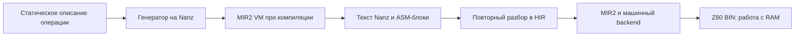

# Nanz рядом с железом: библиотека, которая пишет специализированный Z80

**13 октября 2026 года.** Библиотека `stdlib/hw`, Spectrum-ротозумер и их проверки уже в `main`: [PR #85](https://github.com/oisee/minz/pull/85), merge-коммит `26cc879e`. Эта статья описывает реализованный код. Идеи расширения в конце ещё требуют реализации и собственного измерения.

Можно описать прямоугольник, раскладку памяти и способ записи — и получить код, в котором адреса уже вычислены. Можно задать маску спрайта — и вообще не выпускать инструкции для прозрачных байтов. Можно описать проход по текстуре — и получить Z80-ядро с фиксированной степенью развёртки, сохранив координаты и саму текстуру изменяемыми во время работы.

Так устроена наша новая библиотека. Её генераторы написаны на самом Nanz. Пользователь описывает задачу, библиотека специализирует её под известные параметры, а компилятор собирает итоговую программу.

## Два времени исполнения

Возьмём настоящую заливку из API:

```nanz
import hw.fill

fun clear_panel() {
    @fill() {
        layout "linear" 0x5800 32 24 32
        region 4 3 20 16
        value 0x47
    }
}
```

`layout` задаёт базовый адрес, число байтов в строке, число строк и шаг строки. `region` — начальные x/y и ширину/высоту. Здесь все эти числа известны при компиляции. Содержимое RAM меняется, когда программа вызывает `clear_panel()`.

Определение генератора начинается с `fun @fill() -> void`. Это Nanz-функция с переменными, циклами, условиями и арифметикой. [Реальный исполнитель метафункций](../minzc/pkg/nanz/meta.go) разбирает её в HIR, понижает в MIR2 и запускает на VM. Host-функции дают ей доступ к полям блока: `block_len`, `node_keyword`, `node_arg_int`, `node_arg_str`. `meta_error` останавливает ошибочное описание; `emit` добавляет строку генерируемого исходника.



Сгенерированный текст снова разбирается компилятором и вставляется в программу. Определение метафункции в исполняемый модуль не попадает. В BIN остаются её результат и необходимые runtime-данные.

Это позволяет переносить работу между двумя временами: вычисление адресов строк выполняется на компьютере сборки, а запись байтов — на Spectrum. В runtime не нужен разбор декларативного блока.

Сейчас генерация текстовая. Внутри библиотек есть ручной разбор полей и `str_concat`; прямой typed-HIR builder или встроенное структурное макросенианство Lanz/Lizp этот API пока не предоставляет. Пользовательская запись уже компактная, внутренности генератора ещё можно сделать удобнее.

## Четыре операции одной библиотеки

| Генератор | Известно при сборке | Остаётся во время исполнения | Доступный выбор |
|---|---|---|---|
| `@fill` | Раскладка, область, значение | Запись в RAM | Nanz pointer-loop / Z80 LDIR |
| `@copy` | Две раскладки и область | Чтение изменяемого источника, запись | Pointer-loop / LDIR по строкам |
| `@sprite` | Позиция, маска, рисунок | Смешивание с текущим фоном | Nanz записи / специализированный ASM |
| `@texture_walk` | Раскладка, страница текстуры, символы setup, развёртка | Координаты, шаги, текстура, кадры | Развёртка 1/2/4/8/16/32 |

[Общий API](../stdlib/hw/README.md) и реализации: [fill](../stdlib/hw/fill.nanz), [copy](../stdlib/hw/copy.nanz), [sprite](../stdlib/hw/sprite.nanz), [texture](../stdlib/hw/texture.nanz).

### Заливка: одна декларация, разные примитивы

Spectrum bitmap имеет неудобный порядок строк. Библиотека знает раскладку `zx_bitmap_bytes`; для координат байта x и строки y адрес вычисляется так:

```text
base + ((y & 192) << 5) + ((y & 7) << 8) + ((y & 56) << 2) + x
```

Для фиксированной области эти вычисления выполняет генератор. Пользователь пишет:

```nanz
@fill() {
    layout "zx_bitmap_bytes" 0x4000
    value 0
    via "ldir"
}
```

Вся область заполняется одним значением, поэтому полный bitmap можно пройти как непрерывные 6144 байта. Сначала записывается ноль, затем `LDIR` размножает его из уже заполненного префикса. Середина фактически выпускаемого блока выглядит так:

```asm
LD HL, 16384
LD (HL), 0
LD DE, 16385
LD BC, 6143
LDIR
```

Вокруг этих инструкций генератор сохраняет и восстанавливает AF/BC/DE/HL. Это входит в измеренную цену. Нулевая область ничего не выпускает; один байт записывается отдельно, чтобы не выполнить `LDIR` с BC=0.

По умолчанию остаётся `via "pointer"`: обычный Nanz-цикл, который также проверяется на VM. Выбор LDIR явный; автоматического выбора примитива здесь пока нет.

### Копирование: раскладка меняется, пиксели остаются живыми

```nanz
import hw.copy

@copy() {
    source "linear" 0xc000 32 192 32
    destination "zx_bitmap_bytes" 0x4000
    region 0 0 0 0 32 192
    via "ldir"
}
```

Линейный raster upload попадает в переставленные строки Spectrum. Адреса подготовлены при сборке, но байты читаются из текущего содержимого буфера. Можно менять изображение между вызовами.

Контракт консервативный: непустое копирование требует непересекающихся bounding extents двух раскладок, включая промежутки между строками. Даже некоторые безопасные частичные копии будут отвергнуты. Это API копирования между отдельными буферами; memmove требует другого контракта и направления обхода.

### Спрайт: прозрачность исчезает из кода

```nanz
import hw.sprite

@sprite() {
    destination "zx_bitmap_bytes" 0x4000
    region 10 63 3 2
    row "ff00f0" "007f05"
    row "00ff0f" "aa0050"
    via "compiled"
}
```

Каждая строка содержит hex-байты keep-mask и графики. Операция определена точно:

```text
new = (old & keep_mask) | graphics
```

Генератор декодирует строки и специализирует каждый байт:

- `ff / 00` прозрачен: чтение и запись отсутствуют;
- маска `00` допускает прямую запись рисунка;
- смешанная маска требует чтения, AND, OR и записи.

Компилированный вариант объединяет работу строки в ASM-блок, вычисляет первый адрес и двигает HL через `INC HL`. Он сохраняет AF/HL. Текущая версия требует известной позиции и выравнивания по байту; динамическая позиция, пиксельные сдвиги и clipping ещё не реализованы.

### Текстура: статический план, динамическая математика

```nanz
import hw.texture

@texture_walk("render_kernel") {
    destination "zx_halfcells" 0x5800 32 24
    texture "page16x16" 0xc000
    setup "origin_u" "origin_v" "step_a" "step_minus_b" "step_half_a" "step_half_b" "row_step_u" "row_step_v"
    unroll 4
}
```

Это объявление создаёт именованную runtime-функцию `render_kernel()`. Восемь setup-символов — существующие word-переменные программы, а не константы генератора. Перед кадром программа обновляет их и вызывает ядро. Страница текстуры тоже изменяема и содержит 256 цветовых индексов 0..7.

Координаты имеют формат 8.8 и заворачиваются как 16-битные слова. Старшие байты задают целую часть; младшие сохраняют дробную. Из двух координат получается индекс в текстуре 16×16. Выровненная 256-байтовая страница позволяет собирать адрес из номера страницы и двух nibble-координат.

На пикселях используются сложения шагов. Цикловые счётчики размещаются в другом наборе регистров через `EXX`; заданная развёртка тиражирует тело при компиляции. Runtime-код выполняет настоящее семплирование, а не проигрывает заранее сохранённые экраны.

## Как из Spectrum получается 32×48 цветных ячеек

Идея Alice: внутри каждого знакоместа 8×8 верхние четыре строки bitmap равны нулю, нижние — `0xff`. Верхняя половина показывает PAPER, нижняя INK. Один attribute-byte несёт два цвета для двух ячеек 8×4:

```text
attribute = 64 | (top_colour << 3) | bottom_colour
```

Получается 32×48 цветных отсчётов при обновлении всего 768 байтов атрибутов. BRIGHT общий для двух половинок; FLASH не используется. Это цветовая сетка с заданным bitmap, а не произвольный framebuffer такой же размерности.

В [исходнике демо](zx-rotozoomer-library/source.nanz) шесть декларативных `@fill` готовят bitmap. Собственная `@roto_tables` на Nanz строит восемь таблиц setup для 32 положений из заданных массивов осей. Общая `@texture_walk` выпускает рисующее ядро. Main меняет setup, рисует и выполняет `EI / HALT`; кадры и прерывания предоставляет Spectrum.

Из [Antique Toy](https://github.com/oisee/antique-toy), главы 7, здесь применены fixed-point affine walk, адресация через страницу/полубайты и осмысленная развёртка. Аппаратное разделение регистров через EXX встроено в ядро. Borrowing SP, SMC и автоматический подбор всех демосценовых трюков этой библиотеке пока не приписываем.

## Быстрее — сколько именно?

| Конкретная задача | До | Выбранный вариант | Что измерено |
|---|---:|---:|---|
| Заливка bitmap 6144 B | 835 669 T / 30 B | LDIR: 129 132 T / 22 B | Около 6,47× быстрее |
| Линейный raster → ZX, 6144 B | 411 391 T / 5183 B | LDIR: 149 962 T / 3649 B | Около 2,74× быстрее |
| Patterned sprite 128×16 px | 6666 T / 1601 B | Compiled: 6458 T / 1241 B | −3,12% T и −22,5% B |
| Малый mixed sprite | 198 T / 46 B | Compiled: 208 T / 38 B | Меньше код, больше тактов |

Это focused native-вызовы. Заливка, копирование и спрайт включают setup, сохранения регистров и RET; внешний CALL, ROM IRQ и ULA contention исключены. «До» означает pointer-вариант той же операции в ordinary-режиме, а не другую программу. [Fill/LDIR](hardware-fill-ldir/README.md), [copy](hardware-copy/README.md), [sprite](hardware-sprite/README.md) содержат точные пакеты.

Для texture kernel отдельно измерены 323 907 T при unroll 1, 311 235 T при 4 и 307 539 T при 32. Минимальный ordinary-модуль растёт со 143 до 371 и 2499 байтов соответственно. Эти числа исключают wrapper/setup и не являются размером всего демо. Развёртка 4 — явный выбор демо; желающий максимальной скорости может потратить больше памяти. Grace Size иногда выделяет helper для вращений: это уменьшает код и увеличивает такты и глубину стека. [Полная таблица](hardware-texture/README.md).

Примитивы и развёртка выбираются явно. Эта библиотека не запускает автоматически Grace-поиск за пользователя. Speed и Size остаются разными целями, включая возможность предпочесть скорость без штрафа за байты.

## Проверяется не только красивый экран

Pointer-варианты сравниваются с независимым оракулом на raw/final MIR2 VM и собранном Z80. ASM-варианты проверяются непосредственно на Z80: VM не исполняет эти ASM-блоки и не служит для них подтверждением.

Оракулы вычисляют ожидаемые адреса и значения отдельно. Тесты проверяют выход за область, соседнюю RAM, пустые регионы, границы 255/256 и страницы, последний адрес, перестановки строк ZX, живые значения после блока и точные return PC/SP. Генераторы отвергают неверные размеры, дубликаты, неизвестные поля и выход раскладки из адресного пространства. Проверка числовых границ не устанавливает владение памятью: код, стек, ROM и RAM-map выбирает вызывающая программа. Заливка допускает перестановку записей в обычной RAM; для ordered MMIO нужен отдельный API.

Текстура прошла 60 скомпилированных вариантов и 480 исполнений с меняющимися runtime-данными. Её ядро сохраняет SP и IFF, но разрушает оба набора регистров: этот контракт отличается от сохраняющих fill/copy. Обработчик прерывания обязан сохранять используемое состояние.

Actual main демо проверен в полной Spectrum-модели с 48K ROM, IM1 IRQ и ULA contention: **64 завершённых экрана в каждом из трёх режимов**, два упорядоченных прохода по 32 кадрам, 315 ROM-прерываний, из них 252 во время рисования. Каждый экран из 6912 байтов совпадает с независимой математикой; проверяется сохранение основных и альтернативных регистров через IRQ и возврат с правильным стеком. На чистом main `26cc879e` операции прошли за 107,317 с, полный машинный тест — за 4,309 с. Отдельный launcher отработал 200 video frames.

Это сильная проверка модели Z80/Spectrum, с повторной отрисовкой около 10 fps. Физический Spectrum и отсутствие tearing пока не подтверждены. Video frames и завершённые кадры рисовалки — разные счётчики.

## Какие библиотеки можно писать таким способом

Механизм особенно полезен, когда структура известна, а данные остаются живыми:

| Возможное семейство | Работа при компиляции | Работа на устройстве | Что ещё потребуется |
|---|---|---|---|
| Tilemap / dirty rectangles | Раскладка, адреса, размеры тайлов | Обновление изменившихся участков | Контракт clipping и динамических областей |
| Шрифты и иконки | Разбор glyph/mask, пропуск прозрачного | Запись поверх текущего фона | Позиционирование, сдвиги, метрики |
| Palette / port sequences | Таблица значений и расписание | OUT и синхронизация | Явный volatile-порядок и модель портов |
| Fixed-point DSP / анимация | Коэффициенты, таблицы, специализация шага | Обработка новых samples | Проверка диапазонов и точности |
| Binary codecs / протоколы | Поля, offsets, endian, маски | Разбор новых пакетов | Динамические длины и bounds-checks |
| Банковая память Spectrum 128K | Карта окон, номера портов, helpers | Переключение банков и перенос данных | Владение банком, IRQ/ROM ABI, модели Scorpion/Profi |

Это направления расширения, а не список уже готовых библиотек. Для каждого нужны простой эталон, явные memory/ABI effects и независимое native-исполнение. Хорошая специализация убирает повторное вычисление структуры, не подменяя свежие данные константами.

Интерфейсы и мономорфизация могут впоследствии связать общие алгоритмы с разными устройствами. Нынешний `hw` использует импортируемые метафункции и именованные раскладки; автоматического trait-dispatch между всеми устройствами здесь ещё нет. Для ближайшего удобства полезны общий разбор descriptor-полей, повторное использование адресных функций и структурное построение кода вместо длинных `str_concat`.

## Продолжение: перемещаемые SMC-спрайты

После этого checkpoint в main вошёл `@sprite_chain`: патчируемые адреса строк и переходы, compiled-маски и непрозрачное PUSH-ядро. [Отдельная статья с Nanz и ASM](2026-10-13-134-moving-sprites-smc-push.md) объясняет перемещение, перестановку строк, стек и IRQ. Прежний фиксированный `@sprite` сохраняет свой контракт.

## Запуск и навигация

```sh
scripts/play_zx_rotozoomer.sh
```

Для окна нужны SDL development libraries и display. Windowless запуск:

```sh
scripts/play_zx_rotozoomer.sh --headless --frames 200 \
    --dump-scr build/roto-screens --screenshot build/roto.png
```

Launcher продолжает ROM-initialized snapshot. Его периодические screen dumps могут содержать незавершённую следующую отрисовку; точные completed-screen проверки выполняет full-machine test.

- [API и четыре генератора](../stdlib/hw/README.md).
- [Полный Spectrum-опыт и runnable snapshot](zx-rotozoomer-library/README.md).
- [Сводка закрытой цели](hardware-array-goal/README.md).
- [Общее состояние компилятора](2026-10-11-092-grace-vm-z80-status.md).
- [Почему миллионы Tetris-проверок полезны](2026-10-12-132-tetris-million-case-testing.md).

Копии статьи, обзора и SHA256-manifest сохранены на `/mnt/safe/minz/grace/2026-10-13/hardware-library-article/`. Пакеты операций и демо — в `/mnt/safe/minz/grace/2026-10-12/`; повторные main-проверки — в `/mnt/safe/minz/grace/2026-10-13/main-26cc879e-*`.
