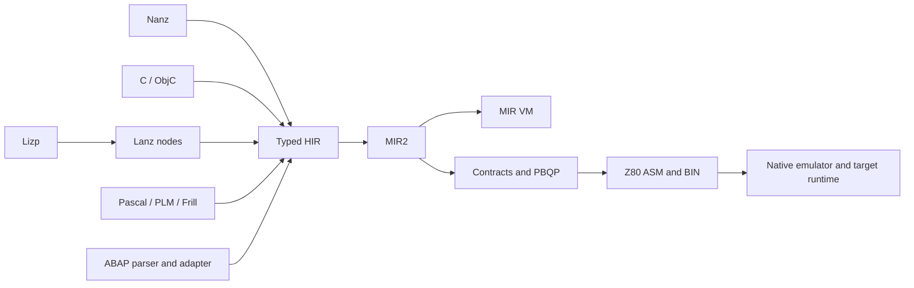
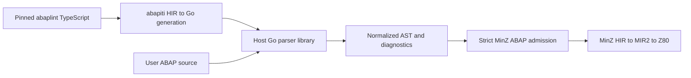

# C и остальные языки MinZ: текущий допуск и следующий hardening

**Срез main `936749f61`, 16 октября 2026 года.** Практический C уже полезен для
системных библиотек Z80. Nanz остаётся основным языком приложений и аппаратных
DSL. Остальные фронтенды имеют работающие подмножества и собственные проверки,
но одинаковый backend не делает их одинаково зрелыми.

Это сводка реализации, исполняемых доказательств и конкретных оставшихся задач.
Hardening здесь означает укрепление диагностики, типов, ABI и исполнения,
чтобы принимаемый исходник сохранял смысл, а неподдерживаемый не терял действия.
Она не задаёт процент соответствия языковым стандартам. Цель следующего этапа —
сохранить смысл принимаемой программы или дать ясный отказ, а не расширить список
языков и номеров стандартов.

## 1. Что означает «поддерживается»

Разделяем пять результатов: разбор исходника; правильный типизированный HIR;
исполнение MIR VM; исполнение собранного Z80; работу приложения с его runtime.
Есть также шестой полезный результат: ожидаемый диагностический отказ.

Например, правильный метод ObjC в VM не доказывает весь canvas-renderer на Z80.
Парсер ABAP на Go не доказывает ABAP arithmetic в MinZ. Собранный FatFs с extern
ссылками не доказывает файловую систему с реальным block-device runtime.
Исполняемые assertions считаются отдельно от файлов, которые только разобраны.



Обычный Z80-путь этого среза использует PBQP и межфункциональные контракты.
Grace и проверенные таблицы — отдельные доступные режимы; Z3 не требуется для
обычной компиляции. В старых приложениях Language Book встречается утверждение
«VIR/Z3 default»: оно не описывает этот main. Код выбора —
[pipeline](../minzc/pkg/pipeline/pipeline.go); CLI —
[main.go](../minzc/cmd/minzc/main.go). HIR/MIR входы полезны для инструментов,
но не добавляют доказательств семантики исходных языков.

## 2. Практический C: что уже можно использовать

### Модель цели

| Тип / свойство | Допуск Z80 |
|---|---|
| `char`, `signed char` | signed 8 бит |
| `unsigned char`, `uint8_t` | unsigned 8 бит |
| `short`, `int` | signed 16 бит |
| `unsigned short`, `unsigned int`, `size_t` | unsigned 16 бит |
| `long`, `unsigned long` | signed/unsigned 32 бит |
| `_Bool` | один байт, нормализация в 0/1 |
| Object/function pointers | 16 бит |
| Порядок байтов, обычное выравнивание | little-endian, target alignment 1 |
| Объекты / `sizeof` больше 65535 | диагностический отказ |

Последняя строка — предел представимости, а не обещание поместить объект такой
длины вместе с программой, стеком и runtime. Адреса C-объектов в VM не совпадают
с NULL; это сохраняется и при импорте C-файла только с данными в Nanz.
Низкоуровневый MIR сохраняет возможность явного обращения по адресу 0.

Модель зафиксирована в [C frontend](../minzc/pkg/c89/c89.go) и
[Nanz/C guide](../docs/Nanz_C_Interop.md). Наличие parser ABI-записей для float
или long long не означает допуск исполнения этих типов. Макрос
`__STDC_VERSION__=201710L` также не является доказательством C17 conformance.

### Проверенные семейства

| Семейство | Что подтверждено | Основное доказательство |
|---|---|---|
| Integer promotions, signedness, сравнения, shifts | 8/16/32-bit boundary cases; без использования signed-overflow UB как оракула | [Integer tests](../minzc/pkg/c89/integer_native_test.go) и [полная матрица](c89-good-enough/feature-matrix.md) |
| 32-bit arithmetic и CALL | multiply/divide/mod; живые значения caller вокруг wide CALL | [Wide CALL / scalar ABI](c89-good-enough/call-abi-and-cost.md) |
| Указатели и lvalues | stride, difference, однократное вычисление адреса для postfix/compound assignment | [Матрица C](c89-good-enough/feature-matrix.md) |
| Управление | if/while/for/do, continue, switch fallthrough/default/break, выбранные goto/cleanup paths | [Control closure](c89-good-enough/control-closure.md) |
| Выражения с эффектами | short circuit, conditional/comma, порядок событий | C expression/control suites в [матрице](c89-good-enough/feature-matrix.md) |
| Хранение | local/static/global, arrays, struct/union layout, initializers, адресуемые объекты | Storage/lifetime suites в [матрице](c89-good-enough/feature-matrix.md) |
| `volatile` | конкретные scalar/global/local/field/aggregate cases с byte access count/order | [Volatile return boundary](c89-good-enough/volatile-return-boundary.md) |
| Linking | private symbols, extern storage, C/C и Nanz/C imports, global relocations | [Global address initializers](c89-good-enough/global-address-initializers.md) |
| Function pointers | typed calls, forward declaration decay, четыре word/pointer аргумента в проверенном indirect ABI | [Hardening PR187](2026-10-16-system-c-hardening.md) |
| Strings/preprocessing | escapes, соседние literals, NUL, comments/header tokens, выбранные `#if`, `#`, `##` | [Source-safety tests](../minzc/pkg/c89/source_safety_native_test.go) |
| K&R / implicit int | выбранные определения и forward calls с target promotions | Language-admission suite в [матрице](c89-good-enough/feature-matrix.md) |

Это не означает все сочетания перечисленных возможностей. В частности,
вариативный вызов не следует из поддержки обычного function pointer.
Четыре word-аргумента тоже не означают произвольное число аргументов или slots:
пятый word в этом indirect-допуске получает отказ.

### Структуры действительно могут стать регистрами

Для безопасных небольших by-value структур реализовано разложение полей в
несколько аргументов/результатов. Проверенная scalar-граница — **четыре байта
суммарно**, с 1/2-byte полями, разными порядками и signed формами. Это не четыре
произвольных поля. Большие, адресуемые, вложенные и другие неподходящие случаи
сохраняют memory ABI; большие returns используют caller-owned storage.

Исходник C при этом остаётся C со структурой. Tuple — внутренний контракт,
не изменение исходного интерфейса языка. Должны сохраняться копия by-value,
порядок вычислений, lifetime и наблюдаемые volatile accesses.
[Граница ABI и проверки](c89-good-enough/aggregate-width-boundary.md) ·
[сравнение C и Nanz](2026-10-16-c89-nanz-aggregate-abi-audit.md).

Реализован и ограниченный проход «выходной указатель → scalar return».
Он рассматривает замкнутые direct calls, последний out-pointer на неубегающий
локальный объект, отсутствие чтения/escape out и наблюдений промежуточных stores.
Время вычисления правых частей сохраняется. Это не общее разрешение переписывать
любую функцию с `T *out`: [код условий](../minzc/pkg/hir/c_outparam_promote.go),
[измеренные примеры](2026-10-16-c89-output-contracts.md).

### Импорт C в Nanz уже работает

В [реальном interop-примере](../examples/system-c/interop/main.nanz) Nanz вызывает
C-функцию с 32-битным аргументом и результатом:

```nanz
import arith { step }

fun main() -> u32 {
    return step(65535)
}

assert main() == 65536 via z80
assert step(4294967295) == 0 via z80
```

Это source-module interop через общий HIR, без host C compiler и object linker.
C может применять MinZ-расширение `#import`; необходимые C prototypes и shared
object declarations всё равно должны быть написаны. Это не binary compatibility
с SDCC/sccz80. [Правила и запуск](../docs/Nanz_C_Interop.md).

## 3. Новые стандарты C: сохранить полезное, не обещать весь стандарт

| Возможность | Текущий вывод |
|---|---|
| C99 declarations in `for`, designated initializers, compound literals, `_Bool` | Проверены выбранные исполняемые формы; это полезное расширение практического C |
| C11 `_Static_assert` | Выбранные assertions, включая ожидаемый отказ ложного условия |
| C11 `_Generic` | Используется checked selected association; проверены pointer/struct compatibility, порядок associations, отсутствие исполнения controlling/unselected expressions |
| Anonymous fields | Есть подтверждённые случаи; не общий сертификат C11 |
| `typeof`, `auto`, sized enums | Есть отдельные подтверждённые формы в directed audit; не все ограничения новых стандартов |
| Digit separators | Поддержан кодовый случай; quoted literals/comments больше не переписываются regex-правилами |
| `#embed` | Проверенные файлы и literal options; отсутствующий файл/overflow дают отказ, inactive branch не должен ошибаться. `offset` — MinZ extension |
| Attributes | Выбранный синтаксис допускается; нельзя приписывать всем attributes семантический эффект |
| `_BitInt`, C23 `constexpr`, отдельный `nullptr` | Активные неподдерживаемые конструкции явно отклоняются после preprocessing |
| Atomics, threads, полный C23 / hosted libc | Не являются подтверждённым допуском |

Для этого отчёта повторён C-корпус: **23 файла = 20 исполняемых + 3 ожидаемых
C23 diagnostic refusals**. Он сообщил **294 VM и 40 Z80 assertions**.
Это 334 backend assertions названного набора, а не число покрытых правил ISO.
Нельзя сравнивать сумму с прежними 337 VM assertions как регрессию: изменились
допуск legacy-примеров и учёт dual assertions.

Отдельно и явно отвергаются проверенные runtime формы variadics/stdarg,
bitfields, floating-point types, long long и VLA. Неиспользуемый variadic
prototype может оставаться допустимым. Полный FP/64-bit runtime и bit-precise
arithmetic не нужны ради номера стандарта; реальная библиотека может поставить
собственную ограниченную задачу позже.
[Матрица C](c89-good-enough/feature-matrix.md) ·
[исторический аудит](2026-10-16-c-standards-objc-audit.md).

## 4. Что добавил последний C-hardening

PR [#187](https://github.com/oisee/minz/pull/187) **уже слит в main `936749f61`**.
Его compiler tree `7fe5805c` совпадает с финальным проверенным checkpoint.

- Preprocessing сохраняет quoted data, comments и header names; ошибки
  `#embed` не превращаются в пустой initializer.
- `_Generic` выбирается по результату C type checker, а не совпадению Kind.
- Неподдерживаемые новые конструкции дают явную диагностику.
- Corpus pipeline failures стали fatal, dual assertions считаются правильно.
- Исправлены four-word indirect callbacks, forward function-pointer decay,
  нулевой адрес первого C-объекта в VM, live-HL spill loads и quoted semicolon /
  backslash bytes в ассемблере. String byte-roundtrip покрывает все 256 байтов.

Неизменённые upstream **inih r62** и **heatshrink 0.4.1** прошли default/Size/Grace:
15 независимых GCC reference cases, **45 native и 90 raw/final VM checks**.
Сравниваются declared input/output regions и API traces, PC/SP. Это не сравнение
всех 64 КБ памяти после каждого вызова. Проверены string API inih и static
heatshrink decoder; file I/O, dynamic allocation, encoder и вся upstream suite
этим не подтверждены. [Исходники и воспроизведение](../research/system-c-validation/README.md),
[ASM/MIR/BIN и SHA256](system-c-hardening/artifacts/manifest.json).

Финальный CI прошёл **435 fast pipeline tests в трёх process shards**, библиотечную
матрицу и все required checks. Informational sweep показал пять разобранных
изменений: три C23 отказы, диагностику неподдерживаемого SDCC ASM и девять пар
PUSH/POP HL в FatFs ASM. Пять старых CLI profile/selector failures воспроизведены
на baseline/current с одинаковыми результатами; они не исправлены этой работой.
[CI](https://github.com/oisee/minz/actions/runs/38966952582).

## 5. Остальные фронтенды: полезность и границы

| Фронтенд | Что уже полезно | Где нужен следующий hardening |
|---|---|---|
| **Nanz / текущий `.minz` CLI** | Основной typed язык: 8/16/32-bit значения, pointers, arrays/structs, enum/ADT, methods/interfaces, loops/iterators, imports, assertions, compile-time metafunctions и typed hardware emit | Сочетания effects/aggregate/error ABI, времён жизни и imports; полный escape-capable closure ABI не следует из iterator captures |
| **Lanz** | Typed S-expression → HIR; `CompileNodes` позволяет структурную генерацию без склейки текста | Полные типы indirect/tuple/aggregate calls, lexical scopes и source provenance в композициях |
| **Lizp** | Desugar в Lanz nodes: defun/let/cond/progn/loops/structs/macros; last-form returns имеют regressions | Hygiene, capture, nested expansion, shadowing и ошибки arity; это не Common Lisp/Scheme runtime |
| **Pascal** | Procedures/functions, arrays/records, loops/case, typed decimal selection; выбранные native SORT/assert/aggregate cases | `var`/alias/lifetime, nested procedure environment, bounds/type admission и runtime вывода. Полный ISO/Turbo Pascal не подтверждён |
| **PL/M** | Byte-ориентированные procedures, corrected top-level entry, pointer indexing и CP/M console Hello | Зафиксированный внешний corpus с ожидаемыми отказами; MODULE/BASED/ADDRESS/runtime границы. Нынешний external parser sweep — информационный |
| **Frill** | Typed functional surface, pipes, let-in, tuples, assertions/properties и imports | Точные типы tuple components, effect order и lexical scope; см. конкретную u16-пробу ниже |
| **ABAP** | Reports/events, DATA/PARAMETERS, выбранные FORM/FUNCTION/method cases и host/SQL helpers | Строгий admission, отсутствие потери операторов, точные типы/строки/tables, native parser bridge; полный ABAP/SAP runtime не заявлен |
| **Objective-C** | Class/method/protocol/static dispatch и wrappers в выбранных примерах | Обычный object-typed source path, nil behavior, unsupported property/category diagnostics; ARC/Foundation/runtime ecosystem не подтверждены |

### Nanz: язык и DSL уже являются практическим путём

Компилируются реальные приложения: Tetris, banked Z-machine и self-Lanz components.
Typed hardware metafunctions генерируют HIR; data/address specialization, SMC
arguments и baked sprite procedures доступны на конкретных проверенных путях.
[Библиотека](../stdlib/hw/README.md) · [демо checkpoint](advanced-demos/release-0.25.4.md)
· [обзор компилятора](2026-10-11-092-grace-vm-z80-status.md).

Не требуется вручную писать всё на ASM, чтобы получить специализацию. Но
`@smc` предполагает writable code и соответствующий runtime contract; нельзя
автоматически объявить любую mutable переменную безопасным patch operand.
ROM/reentrancy/interrupt behavior должны входить в допуск конкретной операции.

Для errors есть enum/ADT data path и Z80 CY/A-интерфейс fallible calls с
`@error`, `@check`, `@propagate`. Уже существуют native error-model и API-parity
регрессии. Общий автоматический mapping произвольного Result ADT в CY этим не
доказывается. [Error validation](../minzc/pkg/pipeline/error_abi_validation_test.go),
[исходные native models](../minzc/pkg/pipeline/showcase_result_error_native_test.go).

Captures явно отражены в HIR и проверяются. Iterator inlining не равен полноценным
замыканиям, которые можно вернуть и хранить произвольное время.
[Capture contracts](../minzc/pkg/nanz/captures_test.go).
`range(0..n)` в iterator semantics намеренно выдаёт `n..1`;
[Language Book, глава 6](../docs/Nanz_Language_Book_v7.md). Это нужно сохранить
в оракулах, а не «исправлять» под привычную C-семантику.

### Lanz / Lizp: структурность есть, это не динамический Lisp

Lizp непосредственно передаёт desugared nodes в `lanz.CompileNodes`; между ними
не нужен serialize/parse roundtrip. Last-form returns, truth/boolean operations,
peek/poke, macro arity/recursion и выбранные ZX address examples имеют проверки.
[Реальный путь](../minzc/pkg/lizp/lizp.go),
[last-form suite](../minzc/pkg/lizp/last_form_test.go),
[macro/ZX regressions](../minzc/pkg/lizp/zx_memory_regression_test.go).

Следующая полезная матрица — новые имена/constant values/scopes при той же форме,
с вложенными expansions и mixed-width tuples. Наличие macro expansion не означает
полную hygiene, динамические объекты, GC или совместимость со стандартным Lisp.

### Pascal / PL/M: алгоритм и runtime проверяются отдельно

Pascal имеет самостоятельные [aggregate regressions](../minzc/pkg/pascal/aggregate_regression_test.go)
и [signed/unsigned decimal selection](../minzc/pkg/pascal/decimal_typed_test.go).
PL/M имеет [pointer indexing](../minzc/pkg/plm/pointer_index_regression_test.go)
и [CP/M console](../minzc/pkg/plm/cpm_console_test.go). Эти конкретные suites
сильнее, чем общий parse counter, но не покрывают все исторические dialects.

[PL/M external corpus test](../minzc/pkg/plm/corpus_test.go) прямо сообщает parse
failures через лог и не делает их test failures. Он полезен как разведка, но
не как green compatibility gate. В свежем worktree corpus submodule отсутствует,
поэтому этот тест SKIP. Следующий шаг — небольшой frozen admitted/rejected набор
из реальных исходников, затем native workload и отдельная console/runtime проверка.

### Objective-C: не смешивать три разных входа

CLI `.m` использует C/ObjC path; отдельный `pkg/objc` имеет свои unit tests;
canvas gallery также имеет VM rendering path. Пройденный один путь не доказывает
два остальных. Свежий C/ObjC corpus: **11 файлов, 98 source assertions**,
а отдельный `pkg/objc`: пять unit roots. Не все эти assertions native.

Directed audit выявлял отказ для `read_box(Box *p)` и отсутствие доказательства
nil message path; неиспользующая property программа проходила после пропуска
декларации. Эти ObjC-пункты не были исправлены C-hardening PR187. Их следует
перепроверить и либо закрыть для выбранного showcase, либо явно диагностировать.
Полный ARC/Foundation/category runtime ради названия Objective-C не нужен.
[Сохранённые пробы](2026-10-16-c-standards-objc-audit.md).

## 6. Два новых контрпримера: PASS пакета не означает закрытый язык

Ожидания и SHA исходников записаны [до исполнения](../research/frontend-hardening/freeze.json).
[Runner](../research/frontend-hardening/probe.go) сохраняет HIR/MIR/ASM и результат;
он собирает diagnostic records и завершает процесс успешно даже при найденном
расхождении. Его exit code не является acceptance gate.
[результаты и SHA256](frontend-hardening/artifacts/manifest.json).

### ABAP: потерянный CLEAR — приоритет P0

```abap
REPORT zclear.
DATA lv_x TYPE i VALUE 7.
FORM probe CHANGING result TYPE i.
  CLEAR lv_x.
  result = lv_x.
ENDFORM.
```

Сам этот REPORT не вызывает FORM: без `PERFORM probe` или внешнего вызова
`lv_x` должен оставаться **7**. Это fixture функции, а не самостоятельный
report-level сценарий исполнения.

В данной проверке вызов делает **Go runner**: для raw/final VM он явно выполняет
`vm.Call("probe", nil)`. На Z80 runner устанавливает PC на
`asm.Symbols["probe"]` и кладёт адрес возврата `F100` в стек — то есть запускает
FORM как внешний вызывающий код. Вызов не зависит от наличия PERFORM в исходнике.
[Выбор entry и вызов VM](../research/frontend-hardening/probe.go).

Поэтому ожидание **после этого внешнего вызова** — `lv_x=0`.
**Raw VM, final VM и assembled Z80 оставляют 7**;
native вызов вернулся с PC `F100`, SP `F000`. Проба смотрит значение глобального
объекта, не только return register. Здесь используется маленькое значение,
поэтому проблема не объясняется различием 16/32-bit integer ranges.
[Исходник](../research/frontend-hardening/abap-clear.abap),
[результат](frontend-hardening/artifacts/probes/abap-clear.abap.json),
[ASM](frontend-hardening/artifacts/probes/abap-clear.abap.a80).

В [ABAP adapter](../minzc/pkg/abap/parse.go) есть пути `convertStmt error → continue`
и аналогичное игнорирование control-conversion error. Ошибка исчезает до HIR;
строгий backend verifier уже не видит потерянный statement. Исправление должно
начинаться с диагностической границы adapter, затем можно добавлять семантику
CLEAR и других реально нужных операторов.

Есть и отдельный type-admission риск, подтверждённый чтением
[abapTypeToHIR](../minzc/pkg/abap/lower.go): ABAP `i` отображается в `u16`,
`int8` в `u8`, `f`/`p` — приблизительно в `u16`; неизвестный type тоже получает
`u16`. Это не заявленная полная ABAP type semantics. Требуется проверенный
Z80-профиль с явными ограничениями или точное lowering нужных типов. Эти mappings
здесь не объявлены новыми native-пробами; CLEAR — отдельное исполняемое доказательство.

### Frill: tuple теряет объявленный тип — приоритет P1

```text
let pair (x : u16) : (u16, u8) = (x, 7)
let probe (x : u16) : u16 = let (a, b) = pair x in a
```

Ожидаем `probe(300)=300`. В прямом вызове `hir.LowerModule` возникает panic:
`tuple call result 0 type u8, want u16`. Это **не** доказанный неверный native
результат: до native код в этом runner не доходит. Отдельный CLI diagnostic path этой
пробой не проверялся. Причина видна в tuple destructuring:
[parser](../minzc/pkg/frill/frill.go) назначает компонентам `TyU8` с TODO infer types.
Нужны вывод типов из tuple result contract и нормальная source diagnostic вместо
panic. [Исходник](../research/frontend-hardening/frill-wide-tuple.frl),
[результат](frontend-hardening/artifacts/probes/frill-wide-tuple.frl.json).

Первые варианты ABAP harness не имели callable entry либо использовали program
main вместо возвращаемой FORM; их локальные протоколы сохранены как исправления
стенда. В отчёт включён финальный callable FORM с проверенным PC/SP, без выдачи
тех предварительных запусков за native proof.

## 7. Нативный ABAP parser через abapiti / open-steamgate

**Идея технически обоснована, интеграции в MinZ ещё нет.** Для исследования
зафиксирован abapiti main `17ed93a9c60c8e0854f66b545ff33f8f92e8cdc7`;
[запись просмотренных источников](frontend-hardening/artifacts/abapiti-review.json).

Текущий MinZ запускает Node bridge с `@abaplint/core`. Lockfile фиксирует
**2.117.2**, хотя package.json содержит диапазон `^2`. ABAP parse results затем
преобразуются собственным Go adapter в semantic AST/HIR.
[Bridge](../minzc/pkg/abap/bridge/parse.mjs) ·
[Go adapter](../minzc/pkg/abap/parse.go).

В abapiti есть **TS → HIR → Go напрямую**. Документированная команда:
`abapiti abaplint -o out --target go`. Сгенерированный модуль использует Go
standard library и выдаёт CLI lint issue dump. Default scope включает full core;
`--scope zabapgit` — отдельный legacy pruned режим, который для нового parser
adapter не подходит.

В [README abapiti](https://github.com/oisee/abapiti/blob/17ed93a9c60c8e0854f66b545ff33f8f92e8cdc7/README.md)
опубликованы **11060/11060 Node-active tests** на TS-HG@Go, TS-HA@OSGO и SAP A4H
для pinned core **2.120.56**. 32 Node-skipped tests находятся вне denominator.
Это внешний опубликованный результат; весь этот suite в данной MinZ-проверке
заново не запускался. Он подтверждает конкретную транспиляцию abaplint,
но не новый MinZ adapter, Z80 lowering или общий TypeScript/ABAP compiler.
[Go target и ограничения](https://github.com/oisee/abapiti/blob/17ed93a9c60c8e0854f66b545ff33f8f92e8cdc7/docs/abaplint-cli.md).

### Предпочтительный production-путь



Большой parser работает на host, а не переносится на Z80. Сгенерированное Go
приложение нужно превратить в библиотечный/adapter API: например,
`ParseABAP(filename, source, options) → tree + diagnostics + source spans`.
Это предлагаемый контракт, не уже существующий экспорт abapiti.

Нужен wrapper вокруг Registry/MemoryFile/tree operations, включённый в full
closure. Текущий issue-dump CLI не заменяет serialization дерева, tokens,
структурных children и точных locations. На первом шаге можно сохранить
совместимый ParseResult DTO; далее typed adapter должен убрать текстовые догадки
и пропуск неизвестных nodes. Published full-core тесты снимают прежний риск
использовать только lint-scenario reachability, но новый AST entry всё равно
получает собственные probes, включая отсутствие coverage traps.

### Где полезен OSG gogen

Путь `abaplint TS → abapiti ABAP → OSG gogen → Go` тоже существует и имеет
проверенный host runtime. Его разумно использовать как второй reference или
при повторном использовании уже готовых ABAP компонентов. Для production parser
MinZ я предпочёл бы прямой TS-HG@Go: меньше промежуточных трансляций и runtime.
Это рекомендация по архитектуре, не сравнительный benchmark двух новых adapters.

OSG также может исполнять небольшие исходные ABAP fixtures как независимый
semantic reference. Типы/overflow/strings и I/O contract нужно согласовать:
правильный SAP/OSG ответ не автоматически равен 16-битному Z80-профилю.
Нельзя интегрировать OSG host services, SQL и SAP environment как будто это
небольшая Z80 libc.

### Практический порядок интеграции

1. Зафиксировать лицензии, core version, generated Go/runtime и recipe.
   Для dual-parser сравнения сначала выровнять версии: нынешний bridge 2.117.2
   и abapiti pin 2.120.56 — разные входы. Сделать контролируемый Node reference
   на нужной версии и frozen AST fixtures.
2. Добавить небольшой parser-only wrapper с source positions, tree/diagnostics,
   ошибками malformed source и unknown constructs. Без pruning под эти fixtures.
3. Сравнить Node и Go AST/diagnostics на строках/comments, declarations,
   FORM/FUNCTION/methods, events, control flow, errors и минимум одном новом файле,
   не участвовавшем в настройке wrapper.
4. Укрепить MinZ semantic adapter: неизвестное активное действие должно либо
   иметь lowering, либо давать source-located refusal. Закрепить CLEAR regression.
5. Зафиксировать ABAP type profile: signed width, int8/f/p refusal либо точная
   поддержка, C/STRING длины и initial values, CHANGING/reference semantics.
6. Для admitted fixtures сравнить независимый ABAP reference, raw/final VM,
   Z80 memory/events и PC/SP; затем включить host Go parser как обычный путь.
   Node оставить development reference, а не production requirement.

Таким образом native parser и semantic hardening помогают друг другу.
Переход на Go без шага 4 сделал бы сборку удобнее, но оставил бы найденный CLEAR bug.

## 8. Приоритеты: что закрывать следующим

| Приоритет | Работа | Проверяемый результат |
|---|---|---|
| **P0** | ABAP strict admission и CLEAR | Fixture больше не теряет действие: точный результат либо точная diagnostic; unknown/control nodes не исчезают |
| **P0** | ABAP type-admission policy | Ни один новый unsupported numeric type не получает приблизительный тип молча; pinned target profile |
| **P1** | ABAP Go parser seam | Node/Go tree и diagnostics parity на aligned core, full closure, source spans и heldout file |
| **P1** | Frill mixed-width tuple | `probe(300)=300` на raw/final VM и Z80; malformed type — source diagnostic, не panic |
| **P1** | Mixed-language ABI/lifetime | C↔Nanz↔другой frontend, 8/16/32-bit и struct/tuple, alias/volatile/indirect refusal cases |
| **P1** | PL/M admission corpus | Frozen внешние исходники + expected refusals; отдельный native/runtime gate для admitted subset |
| **P2** | Nanz/Lanz/Lizp composition | Capture escape boundaries, nested macro hygiene, aggregate/error/effect order; новые runtime closure формы только по реальной потребности |
| **P2** | Pascal runtime/type boundaries | `var` aliasing, nested scopes, records/arrays и полный stdout/console scenario |
| **P2** | ObjC выбранный showcase | Object-typed calls/nil и property diagnostics; без обещаний ARC/Foundation |
| **P2** | Documentation consistency | Стандартные macro values, старый VIR/Z3-default текст и parse-only counters не превращаются в support claims |

Первый мой выбор — **строгий ABAP adapter + native Go parser seam**, с небольшим
Frill tuple fix параллельной независимой задачей. Прежде всего запрещаем silent
wrong code; затем добавляем полезный допуск. Для C следующим реальным расширением
может стать ещё один тип API/workload: heap/decoder-error path, streaming parser
или callback-heavy library. Это отдельная задача с bounds/runtime договором,
а не обязательство полноценно реализовать весь C23.

## 9. Свежие проверки и воспроизведение

Дополнительные тесты этого отчёта запущены на неизменённом compiler tree main
`7fe5805c`. Package roots — имена верхнеуровневых Go tests, не language features
и не число native calls. Parser/HIR-only tests присутствуют в этих наборах.

| Набор | PASS roots | SKIP | Что именно означает |
|---|---:|---:|---|
| Nanz | 262 | 1 | Текущий short package suite; Z3-dependent import regression пропущен |
| Lanz | 45 | 0 | Собственный short package suite |
| Lizp | 34 | 0 | Собственный short package suite |
| Pascal | 34 | 0 | Собственный short package suite |
| PL/M | 27 | 1 | Внешний intel80tools corpus отсутствует; он и сам report-only |
| Frill | 19 | 0 | Package suite проходит, новый mixed-width контрпример отдельный |
| ABAP | 9 | 0 | Node bridge установлен через lockfile; выбранные parse/HIR/native procedure tests |
| Отдельный ObjC | 5 | 0 | Unit suite `pkg/objc`, отдельный от CLI `.m` |
| Interop | 3 | 0 | Unit suite resolver/merge |
| C/ObjC corpus | 2 suite roots | 0 | 23 C / 11 ObjC файла; диагностические и executable cases разделены выше |

Go 1.26.8, Node 18.19.1, npm 9.2.0. Для ABAP выполнен `npm ci --ignore-scripts`
по существующему lockfile, без изменения dependency policy. Группы запускались
в трёх независимых процессах. Никаких compiler fixes этим отчётом не сделано;
новые probes сохраняют найденные failures, а не делают общий PASS шире.
[Команды/summary](frontend-hardening/artifacts/test-summary.json),
[дополнительные suites](frontend-hardening/artifacts/additional-tests.json),
[полные JSONL logs и SHA](frontend-hardening/artifacts/manifest.json).

```sh
# Обычные frontend checks, из minzc:
go test -short -count=1 ./pkg/nanz ./pkg/lanz ./pkg/lizp ./pkg/pascal ./pkg/plm ./pkg/frill ./pkg/objc ./pkg/interop
npm ci --prefix pkg/abap/bridge --ignore-scripts --no-audit --no-fund
go test -short -count=1 ./pkg/abap
go test -short -count=1 ./pkg/c89 -run '^(TestCorpus_C99Examples|TestCorpus_ObjCExamples)$'

# Два named probes, из корня репозитория:
go -C minzc run ../research/frontend-hardening/probe.go ../research/frontend-hardening /tmp/frontend-hardening-probes
```

Локальные полные результаты, просмотренные pinned abapiti источники и исправления
предварительного harness сохранены в
`/home/alice/dev/minz-artifacts/grace-reports/2026-10-16/frontend-hardening/`.
На шару с playable releases эти research/CI файлы не копируются.
