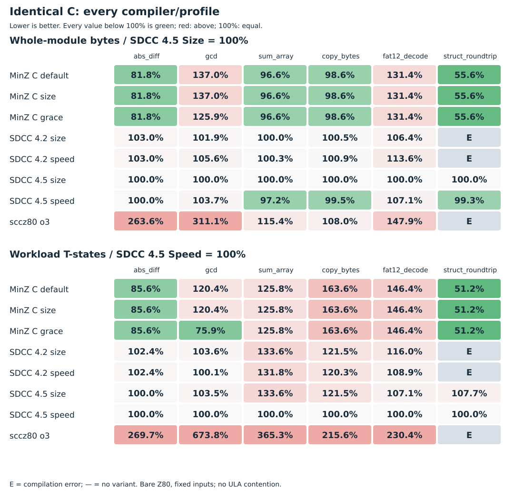
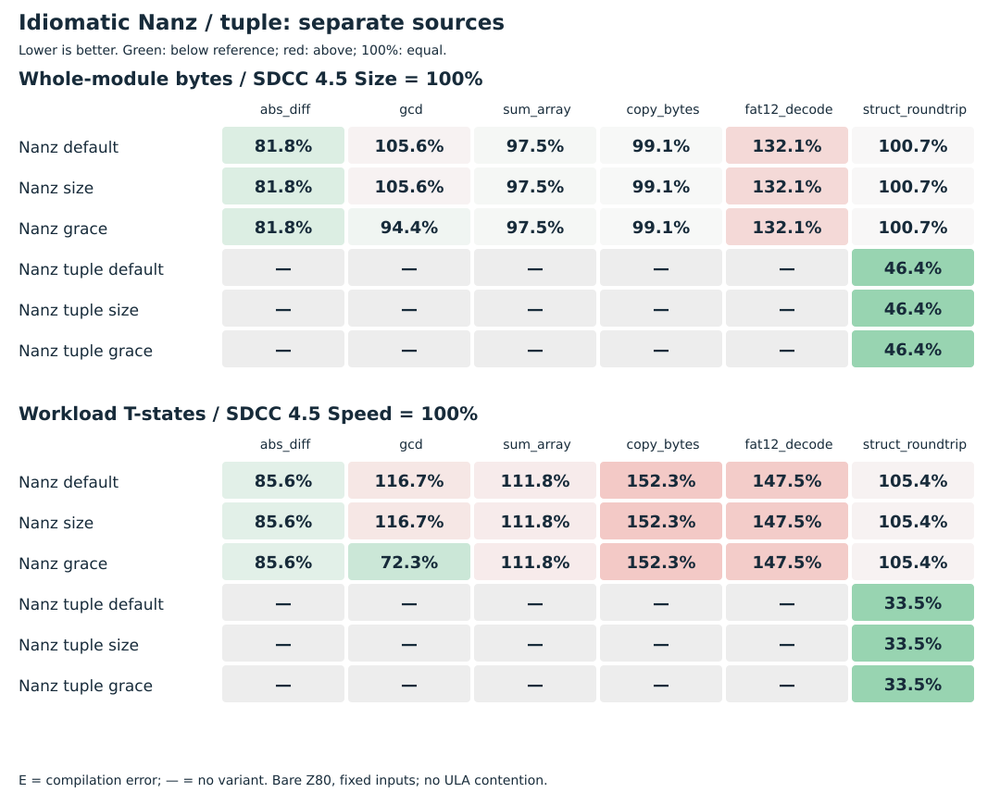

# Полный C/Nanz benchmark: что уже выжали из Z80

16 октября 2026 года. Актуальная матрица после byte narrowing, прямых byte loads
слияния CFG абсолютной разности и прямых word stores. Все исходники и режимы сохранены.

На неизменном C `abs_diff` MinZ теперь немного меньше и быстрее SDCC 4.5:
**27 байт / 220 904 T против 33 / 258 142**. Идиоматичный Nanz даёт тот же результат.
Grace заметно ускоряет gcd; C-декомпозиция маленькой структуры тоже полезна.
У копирования, FAT12 и sum_array остаются проигрыши актуальному SDCC Speed.
Это шесть небольших программ и фиксированные нагрузки, а не общий рейтинг компиляторов.

## Что именно улучшено

Здесь размеры относятся к полному измеряемому модулю: функция, execute(),
данные и подключённые helper routines. Поэтому пятибайтовое тело abs_diff даёт
27-байтовый модуль, а не «программу в пять байтов».

| Этап обычного MinZ C | abs_diff: байты / T | gcd: байты / T | sum_array: байты / T |
|---|---:|---:|---:|
| Замороженный baseline | 82 / 553 558 | 127 / 17 003 692 | 360 / 19 897 856 |
| Доказанные byte comparisons | 54 / 383 014 | 92 / 7 928 761 | 317 / 9 356 800 |
| Сужение byte arithmetic | 38 / 305 750 | 79 / 5 158 510 | 317 / 9 356 800 |
| Прямые byte loads | 36 / 289 366 | 77 / 5 142 126 | 317 / 9 356 800 |
| Целый CFG abs_diff | 30 / 253 672 | 77 / 5 142 126 | 317 / 9 356 800 |
| Прямая запись слова | **27 / 220 904** | 74 / 5 109 358 | 314 / 9 348 608 |

[Byte comparisons](2026-10-16-c89-byte-compare-asm.md) используют доказанные
диапазоны операндов после C integer promotions. [Byte arithmetic](2026-10-16-c89-byte-arithmetic.md)
сохраняет арифметику по модулю 256 там, где результат всё равно усекается и
старшие биты не наблюдаются. [Byte loads](2026-10-16-c89-byte-load-fusion.md)
убирают лишние пересылки в вызывающем execute().
[CFG fusion](2026-10-16-old-claims-new-evidence.md) заменяет сравнение и две
возвращающие ветки одним вычитанием с carry и условным NEG. Это правила по
форме и доказанным фактам; имена этих benchmark-функций в правилах не участвуют.
[Прямая запись слова](2026-10-16-c89-direct-word-store.md) затем убирает
одноразовую адресацию и пишет результат из DE одной инструкцией. Тело abs_diff
при этом остаётся пятибайтовым.

```asm
abs_diff:
    SUB C
    RET NC
    NEG
    RET
```

Четыре инструкции занимают **пять байтов**, потому что NEG — ED 44.
Эквивалентность проверена; глобальная оптимальность не заявляется.
[Полный C ASM](c89-full-benchmark/minz/default/abs_diff/program.a80) ·
[Nanz ASM](c89-full-benchmark/nanz/default/abs_diff/program.a80) ·
[SDCC 4.5 Size](c89-full-benchmark/sdcc45/size/abs_diff/program.asm) ·
[SDCC 4.5 Speed](c89-full-benchmark/sdcc45/speed/abs_diff/program.asm).

## Как читать таблицы

C-файлы побайтово одинаковы для MinZ, SDCC 4.2, SDCC 4.5 и sccz80.
Nanz — отдельный эквивалентный алгоритм с явными u8/u16; tuple-вариант структуры
показан отдельно. Для всех вариантов одного примера используются одинаковые входы.

«Байты» — объединение занятых адресов кода и принадлежащих программе данных,
включая неинициализированные глобальные данные и официальные compiler helpers.
«T» — сумма фактических тактов выполнения execute(), его CALL/RET и helper routines
на всей нагрузке. Внешний синтетический вызов исключён одинаково. Начальная установка
входов и загрузка программы не входят в такты. Между разными примерами суммы T
сравнивать нельзя: нагрузки различаются.

MinZ default — обычный backend; size — OptSize; grace — Grace MIR и HIR, отдельные опции,
без профильного поиска. В этом наборе size совпадает с default, но сохранён.
SDCC запускался с явными --opt-code-size и --opt-code-speed; sccz80 — -O3.
Размер и скорость двух SDCC-профилей могут отличаться независимо.

## abs_diff

Исходники: [C](../research/c89-benchmark/cases/abs_diff.c) · [Nanz](../research/c89-benchmark/nanz-cases/abs_diff.nanz). Нагрузка: **2 048 вызовов**; [точные входы](c89-full-benchmark/minz/default/abs_diff/workload.json).

| Компилятор и режим | Байты | T-states | Полученный код и замер |
|---|---:|---:|---|
| MinZ C default | 27 | 220 904 | [ASM](c89-full-benchmark/minz/default/abs_diff/program.a80) · [замер](c89-full-benchmark/minz/default/abs_diff/costs.json) · [raw](c89-full-benchmark/minz/default/abs_diff/raw.mir) / [final MIR](c89-full-benchmark/minz/default/abs_diff/final.mir) |
| MinZ C size | 27 | 220 904 | [ASM](c89-full-benchmark/minz/size/abs_diff/program.a80) · [замер](c89-full-benchmark/minz/size/abs_diff/costs.json) · [raw](c89-full-benchmark/minz/size/abs_diff/raw.mir) / [final MIR](c89-full-benchmark/minz/size/abs_diff/final.mir) |
| MinZ C grace | 27 | 220 904 | [ASM](c89-full-benchmark/minz/grace/abs_diff/program.a80) · [замер](c89-full-benchmark/minz/grace/abs_diff/costs.json) · [raw](c89-full-benchmark/minz/grace/abs_diff/raw.mir) / [final MIR](c89-full-benchmark/minz/grace/abs_diff/final.mir) |
| Nanz default | 27 | 220 904 | [ASM](c89-full-benchmark/nanz/default/abs_diff/program.a80) · [замер](c89-full-benchmark/nanz/default/abs_diff/costs.json) · [raw](c89-full-benchmark/nanz/default/abs_diff/raw.mir) / [final MIR](c89-full-benchmark/nanz/default/abs_diff/final.mir) |
| Nanz size | 27 | 220 904 | [ASM](c89-full-benchmark/nanz/size/abs_diff/program.a80) · [замер](c89-full-benchmark/nanz/size/abs_diff/costs.json) · [raw](c89-full-benchmark/nanz/size/abs_diff/raw.mir) / [final MIR](c89-full-benchmark/nanz/size/abs_diff/final.mir) |
| Nanz grace | 27 | 220 904 | [ASM](c89-full-benchmark/nanz/grace/abs_diff/program.a80) · [замер](c89-full-benchmark/nanz/grace/abs_diff/costs.json) · [raw](c89-full-benchmark/nanz/grace/abs_diff/raw.mir) / [final MIR](c89-full-benchmark/nanz/grace/abs_diff/final.mir) |
| SDCC 4.2 size | 34 | 264 286 | [ASM](c89-full-benchmark/sdcc/size/abs_diff/program.asm) · [замер](c89-full-benchmark/sdcc/size/abs_diff/costs.json) |
| SDCC 4.2 speed | 34 | 264 286 | [ASM](c89-full-benchmark/sdcc/speed/abs_diff/program.asm) · [замер](c89-full-benchmark/sdcc/speed/abs_diff/costs.json) |
| SDCC 4.5 size | 33 | 258 142 | [ASM](c89-full-benchmark/sdcc45/size/abs_diff/program.asm) · [замер](c89-full-benchmark/sdcc45/size/abs_diff/costs.json) |
| SDCC 4.5 speed | 33 | 258 142 | [ASM](c89-full-benchmark/sdcc45/speed/abs_diff/program.asm) · [замер](c89-full-benchmark/sdcc45/speed/abs_diff/costs.json) |
| sccz80 o3 | 87 | 696 320 | [ASM](c89-full-benchmark/sccz80/o3/abs_diff/program.asm) · [замер](c89-full-benchmark/sccz80/o3/abs_diff/costs.json) |

## gcd

Исходники: [C](../research/c89-benchmark/cases/gcd.c) · [Nanz](../research/c89-benchmark/nanz-cases/gcd.nanz). Нагрузка: **2 048 вызовов**; [точные входы](c89-full-benchmark/minz/default/gcd/workload.json).

| Компилятор и режим | Байты | T-states | Полученный код и замер |
|---|---:|---:|---|
| MinZ C default | 74 | 5 109 358 | [ASM](c89-full-benchmark/minz/default/gcd/program.a80) · [замер](c89-full-benchmark/minz/default/gcd/costs.json) · [raw](c89-full-benchmark/minz/default/gcd/raw.mir) / [final MIR](c89-full-benchmark/minz/default/gcd/final.mir) |
| MinZ C size | 74 | 5 109 358 | [ASM](c89-full-benchmark/minz/size/gcd/program.a80) · [замер](c89-full-benchmark/minz/size/gcd/costs.json) · [raw](c89-full-benchmark/minz/size/gcd/raw.mir) / [final MIR](c89-full-benchmark/minz/size/gcd/final.mir) |
| MinZ C grace | 68 | 3 222 405 | [ASM](c89-full-benchmark/minz/grace/gcd/program.a80) · [замер](c89-full-benchmark/minz/grace/gcd/costs.json) · [raw](c89-full-benchmark/minz/grace/gcd/raw.mir) / [final MIR](c89-full-benchmark/minz/grace/gcd/final.mir) |
| Nanz default | 57 | 4 953 966 | [ASM](c89-full-benchmark/nanz/default/gcd/program.a80) · [замер](c89-full-benchmark/nanz/default/gcd/costs.json) · [raw](c89-full-benchmark/nanz/default/gcd/raw.mir) / [final MIR](c89-full-benchmark/nanz/default/gcd/final.mir) |
| Nanz size | 57 | 4 953 966 | [ASM](c89-full-benchmark/nanz/size/gcd/program.a80) · [замер](c89-full-benchmark/nanz/size/gcd/costs.json) · [raw](c89-full-benchmark/nanz/size/gcd/raw.mir) / [final MIR](c89-full-benchmark/nanz/size/gcd/final.mir) |
| Nanz grace | 51 | 3 067 013 | [ASM](c89-full-benchmark/nanz/grace/gcd/program.a80) · [замер](c89-full-benchmark/nanz/grace/gcd/costs.json) · [raw](c89-full-benchmark/nanz/grace/gcd/raw.mir) / [final MIR](c89-full-benchmark/nanz/grace/gcd/final.mir) |
| SDCC 4.2 size | 55 | 4 398 206 | [ASM](c89-full-benchmark/sdcc/size/gcd/program.asm) · [замер](c89-full-benchmark/sdcc/size/gcd/costs.json) |
| SDCC 4.2 speed | 57 | 4 249 984 | [ASM](c89-full-benchmark/sdcc/speed/gcd/program.asm) · [замер](c89-full-benchmark/sdcc/speed/gcd/costs.json) |
| SDCC 4.5 size | 54 | 4 392 062 | [ASM](c89-full-benchmark/sdcc45/size/gcd/program.asm) · [замер](c89-full-benchmark/sdcc45/size/gcd/costs.json) |
| SDCC 4.5 speed | 56 | 4 243 840 | [ASM](c89-full-benchmark/sdcc45/speed/gcd/program.asm) · [замер](c89-full-benchmark/sdcc45/speed/gcd/costs.json) |
| sccz80 o3 | 168 | 28 596 874 | [ASM](c89-full-benchmark/sccz80/o3/gcd/program.asm) · [замер](c89-full-benchmark/sccz80/o3/gcd/costs.json) |

## sum_array

Исходники: [C](../research/c89-benchmark/cases/sum_array.c) · [Nanz](../research/c89-benchmark/nanz-cases/sum_array.nanz). Нагрузка: **512 вызовов**; [точные входы](c89-full-benchmark/minz/default/sum_array/workload.json).

| Компилятор и режим | Байты | T-states | Полученный код и замер |
|---|---:|---:|---|
| MinZ C default | 314 | 9 348 608 | [ASM](c89-full-benchmark/minz/default/sum_array/program.a80) · [замер](c89-full-benchmark/minz/default/sum_array/costs.json) · [raw](c89-full-benchmark/minz/default/sum_array/raw.mir) / [final MIR](c89-full-benchmark/minz/default/sum_array/final.mir) |
| MinZ C size | 314 | 9 348 608 | [ASM](c89-full-benchmark/minz/size/sum_array/program.a80) · [замер](c89-full-benchmark/minz/size/sum_array/costs.json) · [raw](c89-full-benchmark/minz/size/sum_array/raw.mir) / [final MIR](c89-full-benchmark/minz/size/sum_array/final.mir) |
| MinZ C grace | 314 | 9 348 608 | [ASM](c89-full-benchmark/minz/grace/sum_array/program.a80) · [замер](c89-full-benchmark/minz/grace/sum_array/costs.json) · [raw](c89-full-benchmark/minz/grace/sum_array/raw.mir) / [final MIR](c89-full-benchmark/minz/grace/sum_array/final.mir) |
| Nanz default | 317 | 8 308 684 | [ASM](c89-full-benchmark/nanz/default/sum_array/program.a80) · [замер](c89-full-benchmark/nanz/default/sum_array/costs.json) · [raw](c89-full-benchmark/nanz/default/sum_array/raw.mir) / [final MIR](c89-full-benchmark/nanz/default/sum_array/final.mir) |
| Nanz size | 317 | 8 308 684 | [ASM](c89-full-benchmark/nanz/size/sum_array/program.a80) · [замер](c89-full-benchmark/nanz/size/sum_array/costs.json) · [raw](c89-full-benchmark/nanz/size/sum_array/raw.mir) / [final MIR](c89-full-benchmark/nanz/size/sum_array/final.mir) |
| Nanz grace | 317 | 8 308 684 | [ASM](c89-full-benchmark/nanz/grace/sum_array/program.a80) · [замер](c89-full-benchmark/nanz/grace/sum_array/costs.json) · [raw](c89-full-benchmark/nanz/grace/sum_array/raw.mir) / [final MIR](c89-full-benchmark/nanz/grace/sum_array/final.mir) |
| SDCC 4.2 size | 325 | 9 929 216 | [ASM](c89-full-benchmark/sdcc/size/sum_array/program.asm) · [замер](c89-full-benchmark/sdcc/size/sum_array/costs.json) |
| SDCC 4.2 speed | 326 | 9 798 656 | [ASM](c89-full-benchmark/sdcc/speed/sum_array/program.asm) · [замер](c89-full-benchmark/sdcc/speed/sum_array/costs.json) |
| SDCC 4.5 size | 325 | 9 929 216 | [ASM](c89-full-benchmark/sdcc45/size/sum_array/program.asm) · [замер](c89-full-benchmark/sdcc45/size/sum_array/costs.json) |
| SDCC 4.5 speed | 316 | 7 433 216 | [ASM](c89-full-benchmark/sdcc45/speed/sum_array/program.asm) · [замер](c89-full-benchmark/sdcc45/speed/sum_array/costs.json) |
| sccz80 o3 | 375 | 27 157 248 | [ASM](c89-full-benchmark/sccz80/o3/sum_array/program.asm) · [замер](c89-full-benchmark/sccz80/o3/sum_array/costs.json) |

## copy_bytes

Исходники: [C](../research/c89-benchmark/cases/copy_bytes.c) · [Nanz](../research/c89-benchmark/nanz-cases/copy_bytes.nanz). Нагрузка: **130 вызовов**; [точные входы](c89-full-benchmark/minz/default/copy_bytes/workload.json).

| Компилятор и режим | Байты | T-states | Полученный код и замер |
|---|---:|---:|---|
| MinZ C default | 210 | 1 119 040 | [ASM](c89-full-benchmark/minz/default/copy_bytes/program.a80) · [замер](c89-full-benchmark/minz/default/copy_bytes/costs.json) · [raw](c89-full-benchmark/minz/default/copy_bytes/raw.mir) / [final MIR](c89-full-benchmark/minz/default/copy_bytes/final.mir) |
| MinZ C size | 210 | 1 119 040 | [ASM](c89-full-benchmark/minz/size/copy_bytes/program.a80) · [замер](c89-full-benchmark/minz/size/copy_bytes/costs.json) · [raw](c89-full-benchmark/minz/size/copy_bytes/raw.mir) / [final MIR](c89-full-benchmark/minz/size/copy_bytes/final.mir) |
| MinZ C grace | 210 | 1 119 040 | [ASM](c89-full-benchmark/minz/grace/copy_bytes/program.a80) · [замер](c89-full-benchmark/minz/grace/copy_bytes/costs.json) · [raw](c89-full-benchmark/minz/grace/copy_bytes/raw.mir) / [final MIR](c89-full-benchmark/minz/grace/copy_bytes/final.mir) |
| Nanz default | 211 | 1 041 950 | [ASM](c89-full-benchmark/nanz/default/copy_bytes/program.a80) · [замер](c89-full-benchmark/nanz/default/copy_bytes/costs.json) · [raw](c89-full-benchmark/nanz/default/copy_bytes/raw.mir) / [final MIR](c89-full-benchmark/nanz/default/copy_bytes/final.mir) |
| Nanz size | 211 | 1 041 950 | [ASM](c89-full-benchmark/nanz/size/copy_bytes/program.a80) · [замер](c89-full-benchmark/nanz/size/copy_bytes/costs.json) · [raw](c89-full-benchmark/nanz/size/copy_bytes/raw.mir) / [final MIR](c89-full-benchmark/nanz/size/copy_bytes/final.mir) |
| Nanz grace | 211 | 1 041 950 | [ASM](c89-full-benchmark/nanz/grace/copy_bytes/program.a80) · [замер](c89-full-benchmark/nanz/grace/copy_bytes/costs.json) · [raw](c89-full-benchmark/nanz/grace/copy_bytes/raw.mir) / [final MIR](c89-full-benchmark/nanz/grace/copy_bytes/final.mir) |
| SDCC 4.2 size | 214 | 831 090 | [ASM](c89-full-benchmark/sdcc/size/copy_bytes/program.asm) · [замер](c89-full-benchmark/sdcc/size/copy_bytes/costs.json) |
| SDCC 4.2 speed | 215 | 822 770 | [ASM](c89-full-benchmark/sdcc/speed/copy_bytes/program.asm) · [замер](c89-full-benchmark/sdcc/speed/copy_bytes/costs.json) |
| SDCC 4.5 size | 213 | 830 700 | [ASM](c89-full-benchmark/sdcc45/size/copy_bytes/program.asm) · [замер](c89-full-benchmark/sdcc45/size/copy_bytes/costs.json) |
| SDCC 4.5 speed | 212 | 683 930 | [ASM](c89-full-benchmark/sdcc45/speed/copy_bytes/program.asm) · [замер](c89-full-benchmark/sdcc45/speed/copy_bytes/costs.json) |
| sccz80 o3 | 230 | 1 474 590 | [ASM](c89-full-benchmark/sccz80/o3/copy_bytes/program.asm) · [замер](c89-full-benchmark/sccz80/o3/copy_bytes/costs.json) |

## fat12_decode

Исходники: [C](../research/c89-benchmark/cases/fat12_decode.c) · [Nanz](../research/c89-benchmark/nanz-cases/fat12_decode.nanz). Нагрузка: **64 вызовов**; [точные входы](c89-full-benchmark/minz/default/fat12_decode/workload.json).

| Компилятор и режим | Байты | T-states | Полученный код и замер |
|---|---:|---:|---|
| MinZ C default | 184 | 36 832 | [ASM](c89-full-benchmark/minz/default/fat12_decode/program.a80) · [замер](c89-full-benchmark/minz/default/fat12_decode/costs.json) · [raw](c89-full-benchmark/minz/default/fat12_decode/raw.mir) / [final MIR](c89-full-benchmark/minz/default/fat12_decode/final.mir) |
| MinZ C size | 184 | 36 832 | [ASM](c89-full-benchmark/minz/size/fat12_decode/program.a80) · [замер](c89-full-benchmark/minz/size/fat12_decode/costs.json) · [raw](c89-full-benchmark/minz/size/fat12_decode/raw.mir) / [final MIR](c89-full-benchmark/minz/size/fat12_decode/final.mir) |
| MinZ C grace | 184 | 36 832 | [ASM](c89-full-benchmark/minz/grace/fat12_decode/program.a80) · [замер](c89-full-benchmark/minz/grace/fat12_decode/costs.json) · [raw](c89-full-benchmark/minz/grace/fat12_decode/raw.mir) / [final MIR](c89-full-benchmark/minz/grace/fat12_decode/final.mir) |
| Nanz default | 185 | 37 088 | [ASM](c89-full-benchmark/nanz/default/fat12_decode/program.a80) · [замер](c89-full-benchmark/nanz/default/fat12_decode/costs.json) · [raw](c89-full-benchmark/nanz/default/fat12_decode/raw.mir) / [final MIR](c89-full-benchmark/nanz/default/fat12_decode/final.mir) |
| Nanz size | 185 | 37 088 | [ASM](c89-full-benchmark/nanz/size/fat12_decode/program.a80) · [замер](c89-full-benchmark/nanz/size/fat12_decode/costs.json) · [raw](c89-full-benchmark/nanz/size/fat12_decode/raw.mir) / [final MIR](c89-full-benchmark/nanz/size/fat12_decode/final.mir) |
| Nanz grace | 185 | 37 088 | [ASM](c89-full-benchmark/nanz/grace/fat12_decode/program.a80) · [замер](c89-full-benchmark/nanz/grace/fat12_decode/costs.json) · [raw](c89-full-benchmark/nanz/grace/fat12_decode/raw.mir) / [final MIR](c89-full-benchmark/nanz/grace/fat12_decode/final.mir) |
| SDCC 4.2 size | 149 | 29 184 | [ASM](c89-full-benchmark/sdcc/size/fat12_decode/program.asm) · [замер](c89-full-benchmark/sdcc/size/fat12_decode/costs.json) |
| SDCC 4.2 speed | 159 | 27 392 | [ASM](c89-full-benchmark/sdcc/speed/fat12_decode/program.asm) · [замер](c89-full-benchmark/sdcc/speed/fat12_decode/costs.json) |
| SDCC 4.5 size | 140 | 26 944 | [ASM](c89-full-benchmark/sdcc45/size/fat12_decode/program.asm) · [замер](c89-full-benchmark/sdcc45/size/fat12_decode/costs.json) |
| SDCC 4.5 speed | 150 | 25 152 | [ASM](c89-full-benchmark/sdcc45/speed/fat12_decode/program.asm) · [замер](c89-full-benchmark/sdcc45/speed/fat12_decode/costs.json) |
| sccz80 o3 | 207 | 57 952 | [ASM](c89-full-benchmark/sccz80/o3/fat12_decode/program.asm) · [замер](c89-full-benchmark/sccz80/o3/fat12_decode/costs.json) |

## struct_roundtrip

Исходники: [C](../research/c89-benchmark/cases/struct_roundtrip.c) · [Nanz](../research/c89-benchmark/nanz-cases/struct_roundtrip.nanz) · [Nanz tuple](../research/c89-benchmark/nanz-tuple/struct_roundtrip.nanz). Нагрузка: **2 048 вызовов**; [точные входы](c89-full-benchmark/minz/default/struct_roundtrip/workload.json).

| Компилятор и режим | Байты | T-states | Полученный код и замер |
|---|---:|---:|---|
| MinZ C default | 85 | 935 936 | [ASM](c89-full-benchmark/minz/default/struct_roundtrip/program.a80) · [замер](c89-full-benchmark/minz/default/struct_roundtrip/costs.json) · [raw](c89-full-benchmark/minz/default/struct_roundtrip/raw.mir) / [final MIR](c89-full-benchmark/minz/default/struct_roundtrip/final.mir) |
| MinZ C size | 85 | 935 936 | [ASM](c89-full-benchmark/minz/size/struct_roundtrip/program.a80) · [замер](c89-full-benchmark/minz/size/struct_roundtrip/costs.json) · [raw](c89-full-benchmark/minz/size/struct_roundtrip/raw.mir) / [final MIR](c89-full-benchmark/minz/size/struct_roundtrip/final.mir) |
| MinZ C grace | 85 | 935 936 | [ASM](c89-full-benchmark/minz/grace/struct_roundtrip/program.a80) · [замер](c89-full-benchmark/minz/grace/struct_roundtrip/costs.json) · [raw](c89-full-benchmark/minz/grace/struct_roundtrip/raw.mir) / [final MIR](c89-full-benchmark/minz/grace/struct_roundtrip/final.mir) |
| Nanz struct default | 154 | 1 925 120 | [ASM](c89-full-benchmark/nanz/default/struct_roundtrip/program.a80) · [замер](c89-full-benchmark/nanz/default/struct_roundtrip/costs.json) · [raw](c89-full-benchmark/nanz/default/struct_roundtrip/raw.mir) / [final MIR](c89-full-benchmark/nanz/default/struct_roundtrip/final.mir) |
| Nanz struct size | 154 | 1 925 120 | [ASM](c89-full-benchmark/nanz/size/struct_roundtrip/program.a80) · [замер](c89-full-benchmark/nanz/size/struct_roundtrip/costs.json) · [raw](c89-full-benchmark/nanz/size/struct_roundtrip/raw.mir) / [final MIR](c89-full-benchmark/nanz/size/struct_roundtrip/final.mir) |
| Nanz struct grace | 154 | 1 925 120 | [ASM](c89-full-benchmark/nanz/grace/struct_roundtrip/program.a80) · [замер](c89-full-benchmark/nanz/grace/struct_roundtrip/costs.json) · [raw](c89-full-benchmark/nanz/grace/struct_roundtrip/raw.mir) / [final MIR](c89-full-benchmark/nanz/grace/struct_roundtrip/final.mir) |
| Nanz tuple default | 71 | 612 352 | [ASM](c89-full-benchmark/nanz-tuple/default/struct_roundtrip/program.a80) · [замер](c89-full-benchmark/nanz-tuple/default/struct_roundtrip/costs.json) · [raw](c89-full-benchmark/nanz-tuple/default/struct_roundtrip/raw.mir) / [final MIR](c89-full-benchmark/nanz-tuple/default/struct_roundtrip/final.mir) |
| Nanz tuple size | 71 | 612 352 | [ASM](c89-full-benchmark/nanz-tuple/size/struct_roundtrip/program.a80) · [замер](c89-full-benchmark/nanz-tuple/size/struct_roundtrip/costs.json) · [raw](c89-full-benchmark/nanz-tuple/size/struct_roundtrip/raw.mir) / [final MIR](c89-full-benchmark/nanz-tuple/size/struct_roundtrip/final.mir) |
| Nanz tuple grace | 71 | 612 352 | [ASM](c89-full-benchmark/nanz-tuple/grace/struct_roundtrip/program.a80) · [замер](c89-full-benchmark/nanz-tuple/grace/struct_roundtrip/costs.json) · [raw](c89-full-benchmark/nanz-tuple/grace/struct_roundtrip/raw.mir) / [final MIR](c89-full-benchmark/nanz-tuple/grace/struct_roundtrip/final.mir) |
| SDCC 4.2 size | — | — | [отказ сборки](c89-full-benchmark/sdcc/size/struct_roundtrip/build.log) |
| SDCC 4.2 speed | — | — | [отказ сборки](c89-full-benchmark/sdcc/speed/struct_roundtrip/build.log) |
| SDCC 4.5 size | 153 | 1 968 128 | [ASM](c89-full-benchmark/sdcc45/size/struct_roundtrip/program.asm) · [замер](c89-full-benchmark/sdcc45/size/struct_roundtrip/costs.json) |
| SDCC 4.5 speed | 152 | 1 826 816 | [ASM](c89-full-benchmark/sdcc45/speed/struct_roundtrip/program.asm) · [замер](c89-full-benchmark/sdcc45/speed/struct_roundtrip/costs.json) |
| sccz80 o3 | — | — | [отказ сборки](c89-full-benchmark/sccz80/o3/struct_roundtrip/build.log) |

## Что подтверждено и что ещё проигрывает

На abs_diff MinZ C/Nanz выигрывает у обоих профилей SDCC 4.5 около 18,2% байтов
и 14,4% тактов. C gcd с Grace быстрее SDCC 4.5 Speed, но больше: 68 против 56 байтов.
Nanz gcd с Grace выигрывает у его Speed по обоим критериям: 51 / 3 067 013 против
56 / 4 243 840. Это конкретные измерения, а не обещание такого результата на любом gcd.

C sum_array меньше SDCC 4.5 Size и быстрее его, но Speed-вариант SDCC быстрее
но MinZ теперь на два байта меньше. Nanz sum_array быстрее нынешнего C, но тоже уступает
SDCC 4.5 Speed. Copy и FAT12 остаются понятными следующими местами для работы.

C struct_roundtrip: 85 / 935 936 против SDCC 4.5 Speed 152 / 1 826 816.
Существующая безопасная декомпозиция C aggregate ABI — основной источник выигрыша.
Nanz-структура пока значительно дороже C-структуры; tuple 71 / 612 352 сохранён
как отдельный способ выразить те же результаты. Это не доказательство, что любой
Nanz-параметр-структуру можно автоматически заменить C-передачей по значению.
SDCC 4.2 и sccz80 не собирают именно этот неизменённый C aggregate-пример;
отказы сохранены в таблице и не обобщаются на другие версии или формы исходника.

## Проверки и воспроизведение

Полная матрица: **69 сборок, 66 PASS, 3 COMPILE_ERROR**. Все успешные строки прошли
**75 350 native Z80 вызовов** с проверкой результата, заданных областей памяти,
входов/хвоста copy и возврата PC/SP. MinZ C/Nanz/tuple дополнительно прошли
**94 488 запусков raw/final MIR VM**. Независимый GCC-host oracle для неизменных
C-файлов подтвердил все **6850 ожиданий** ещё до оптимизаций:
[протокол](c89-optimization/baseline/host-oracle.json).

Для нового CFG abs_diff отдельно проверены переименованные C/Nanz-исходники:
393 216 native запусков и 786 432 raw/final VM запусков по всем парам байтов
в трёх режимах. MIR-тест проверяет четыре unsigned-предиката до/после и случаи,
которые преобразовывать нельзя. Это полный домен данной операции, не новое семейство
алгоритмов. Основные HIR/MIR2/C89/Nanz пакеты и 433 быстрые pipeline-проверки прошли
на checkpoint нового CFG. Полный дорогой release/nightly корпус здесь не объявлен PASS.

Предыдущие range-преобразования подтверждены на двух дополнительных замороженных
C-программах: in_interval 136 / 869 152 → 81 / 577 706; count_less
408 / 313 299 691 → 326 / 90 418 099. Эти heldout-исходники и независимые ожидания
описаны в [отчёте byte comparisons](2026-10-16-c89-byte-compare-asm.md).

Свежий повтор на совмещённом наборе правил сохранил прежние исходники и входы:
in_interval теперь **76 / 528 554**, count_less — **322 / 90 325 939**
во всех трёх профилях. Проверены 19 968 native и 39 936 raw/final VM вызовов;
GCC независимо подтвердил 6656 ожиданий. [Аудит и артефакты](2026-10-16-c89-optimization-completion-audit.md#свежий-heldout-на-той-же-совокупности-правил).

Стенд — голый Z80, без ULA contention, BDOS или полного trace всей 64-КБ памяти.
Проверка перечисленных областей памяти и PC/SP не заменяет такие проверки.
Чистый Speed остаётся допустимой целью, даже если размер увеличивается.

Измеренный compiler checkpoint: 3c097bcc (точный полный SHA в toolchains.json).
SDCC 4.2.0 #13081; SDCC 4.5.0 #15242; z88dk/sccz80 checkout
83383009c0e221e6d6fe955591058280510391c8. Это два разных C-компилятора:
SDCC и sccz80; z88dk предоставляет frontend/toolchain для последнего.
Все точные версии и SHA исходников/runner/helper archive находятся в
[toolchains.json](c89-full-benchmark/toolchains.json); [summary.json](c89-full-benchmark/summary.json)
содержит все 69 результатов. [Манифест](c89-full-benchmark/manifest.json) проверяет
опубликованные текстовые артефакты. Общие точные входы сохранены один раз на пример; в папке каждого варианта —
команды, исходник и ASM, для MinZ также raw/final MIR. Costs содержит число наблюдений
и SHA полного measurements.json. Подробные наблюдения, бинарники и полный исходный
набор сохранены локально в
/home/alice/dev/minz-artifacts/grace-reports/2026-10-16/c89-nanz-sdcc45/direct-word-store-full/.
SHA всех 69 подробных measurements.json сверен с опубликованными costs.json;
дополнительный совмещённый повтор — в соседней папке final-union-full/.

[Инструкция сборки внешних toolchains](../research/c89-benchmark/README.md).
После их установки из корня репозитория:

```sh
python3 research/c89-benchmark/run.py \
  --out /tmp/minz-c89-full \
  --sdcc-root /path/to/sdcc-4.2/root \
  --sdcc45-root /path/to/sdcc-4.5/root \
  --z88dk-root /path/to/z88dk-src \
  --include-nanz --jobs 2 --go /path/to/go
```

## Интеграция и следующий шаг

Byte comparisons, byte arithmetic и byte loads интегрированы в main через
PR #174–176. Выходной указатель → скалярный возврат интегрирован через
[PR #177](https://github.com/oisee/minz/pull/177); его три отдельные программы,
проверки aliasing и измерения изложены [здесь](2026-10-16-c89-output-contracts.md).
Они не подставлены в эту замороженную матрицу.
CFG abs_diff интегрирован через [PR #178](https://github.com/oisee/minz/pull/178),
коммит 71119f5b. Прямые word stores и G2 bool-storage fix интегрированы через
[PR #181](https://github.com/oisee/minz/pull/181), main checkpoint 8bf6054b.
Совместный compiler tree прошёл полный core, повтор матрицы и heldout:
[отчёт word stores](2026-10-16-c89-direct-word-store.md) и
[итоговый аудит](2026-10-16-c89-optimization-completion-audit.md).

Уже повторили [старые обещания, новые доказательства](2026-10-16-old-claims-new-evidence.md):
constant evaluation, условные возвраты и tailcalls подтверждены на всех 88
сборках исторического C с общей обвязкой. Прямые stores дали следующий выигрыш.
Согласование ABI-контрактов остаётся следующим кандидатом; его пользу проверяем
на фоне нового baseline. Ни один эвристический контракт не обязан выигрывать всегда. Новые выигрыши добавим сюда как следующие
checkpoint; исходный baseline останется доступен [отдельно](c89-optimization/baseline.md).

## Grace относительно default

В этой матрице default → Grace даёт 11 ничьих и два улучшения, оба на gcd.
Это 13 вариантов исходника/ABI из шести семейств, а не 13 независимых алгоритмов.

| Исходник | Default: байты / T | Grace: байты / T | Снижение тактов |
|---|---:|---:|---:|
| C gcd | 74 / 5 109 358 | 68 / 3 222 405 | 36,93% |
| Nanz gcd | 57 / 4 953 966 | 51 / 3 067 013 | 38,09% |

Режим benchmark `grace` включает одновременно HIR и MIR Grace. В CLI это
независимые `--hir-grace` и `--grace`; оба пока выключены по умолчанию.
`--Osize` задаёт цель размера, но не включает оба набора Grace целиком.
Исторический выигрыш abs_diff 82 → 27 байт уже есть в обычном default и не
должен приписываться включению Grace.

На этих входах Grace не ухудшает размер или такты. Для общего default нужны
отдельные измерения HIR off/on × MIR off/on, сочетание Grace с Size, более широкий
корпус и стоимость компиляции. Проверенные отдельные правила можно включать
автоматически; общий переключатель пока разумно оставить явным.

<!-- BEGIN GENERATED BENCHMARK CHARTS -->
## Кто где выигрывает: диаграммы всей матрицы

Каждая колонка — одна замороженная нагрузка. **Меньше — лучше**: 80% означает
на 20% меньше, 120% — на 20% больше. Верхняя панель показывает байты полного
модуля относительно **SDCC 4.5 Size**, нижняя — такты относительно **SDCC 4.5 Speed**.
Эти два эталона выбраны по критерию, поэтому их строки не обязаны быть лучшими
даже среди профилей самого SDCC. Проценты между разными программами не суммируем.

**Одинаковый C.** Все восемь compiler/profile-вариантов для каждого из шести
неизменных C-исходников; три отказа aggregate-сборки показаны как `E`.



**Идиоматичный Nanz — отдельные исходники.** Ожидаемые результаты и нагрузки те же,
но типы и способ выразить алгоритм отличаются от C. Nanz tuple измерен только для
struct_roundtrip; `—` означает отсутствующий вариант, а не проигрыш или ошибку.



Ниже — минимум **среди показанных успешных сборок**, отдельно по размеру и времени.
Все ничьи сохранены: разные критерии могут выбирать разные варианты.

| Нагрузка | Одинаковый C: меньше байтов | Одинаковый C: меньше тактов | Отдельный Nanz/tuple: меньше байтов | Отдельный Nanz/tuple: меньше тактов |
|---|---|---|---|---|
| abs_diff | MinZ C default/size/grace: **27** | MinZ C default/size/grace: **220 904** | Nanz default/size/grace: **27** | Nanz default/size/grace: **220 904** |
| gcd | SDCC 4.5 size: **54** | MinZ C grace: **3 222 405** | Nanz grace: **51** | Nanz grace: **3 067 013** |
| sum_array | MinZ C default/size/grace: **314** | SDCC 4.5 speed: **7 433 216** | Nanz default/size/grace: **317** | Nanz default/size/grace: **8 308 684** |
| copy_bytes | MinZ C default/size/grace: **210** | SDCC 4.5 speed: **683 930** | Nanz default/size/grace: **211** | Nanz default/size/grace: **1 041 950** |
| fat12_decode | SDCC 4.5 size: **140** | SDCC 4.5 speed: **25 152** | Nanz default/size/grace: **185** | Nanz default/size/grace: **37 088** |
| struct_roundtrip | MinZ C default/size/grace: **85** | MinZ C default/size/grace: **935 936** | Nanz tuple default/size/grace: **71** | Nanz tuple default/size/grace: **612 352** |

Таким образом, MinZ C берёт оба минимума на abs_diff и struct_roundtrip;
на gcd Grace выигрывает по тактам, SDCC 4.5 Size — по байтам. На sum_array
MinZ C меньше, SDCC 4.5 Speed быстрее; такая же развилка у copy. FAT12 здесь
выигрывает SDCC 4.5 по обоим критериям, но с разными профилями. Это результаты
этих шести программ.

Все значения ниже 100% выделены заметным зелёным, включая небольшие выигрыши.
Ничьи нейтральны; цвет насыщается при 50%/200%. Минимальная зелёная
подсветка не означает одинаковый выигрыш: точное округлённое отношение — в каждой
ячейке. Абсолютные цифры, ASM и ошибки сборки находятся в таблицах выше.
Статические SVG и эта таблица генерируются из [summary.json](c89-full-benchmark/summary.json)
командой `python3 research/c89-benchmark/plot_summary.py`. Генератор проверяет все
69 записей, SHA одинакового C, SHA общих нагрузок и число вызовов, прежде чем
строить картинки: [исходник генератора](../research/c89-benchmark/plot_summary.py).
Измерения — bare Z80 без ULA contention; размер — полный измеряемый модуль,
не только тело функции и не общий объём RAM/стека.
<!-- END GENERATED BENCHMARK CHARTS -->
