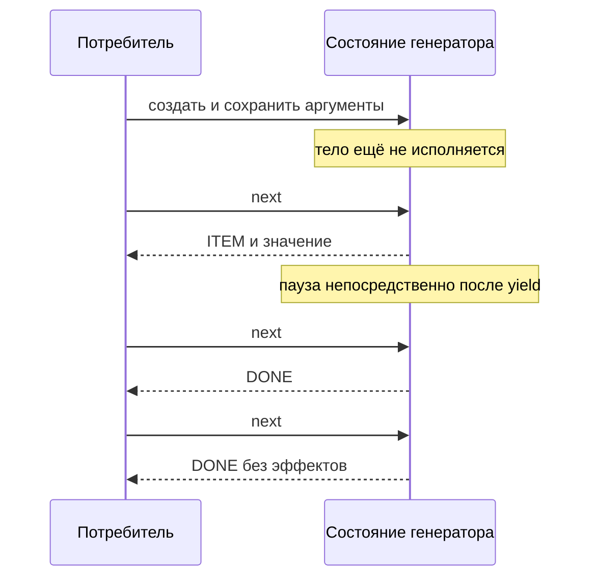
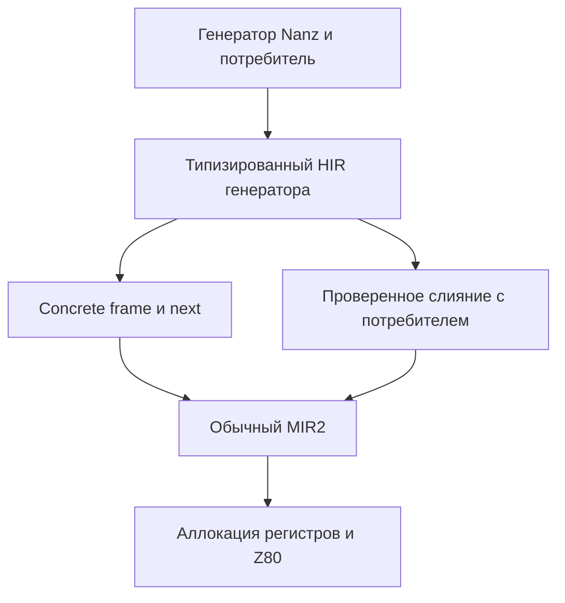

# Генераторы и ленивые потоки в Nanz для Z80

Дата: 18 октября 2026. Статус: проект языка и план проверки. `gen`, `yield`, `pull_next` и новый протокол итерации ниже — предлагаемые возможности, а не работающий синтаксис.

Для Nanz полезно добавить **генераторы с ленивым запросом следующего элемента**, явным состоянием в памяти вызывающего и возможностью слияния производителя с потребителем. Это позволяет читать и обрабатывать поток по одному значению, без промежуточного массива, отдельного стека на генератор и обязательного планировщика.

Первая реализация должна уметь сохранять и продолжать конкретный генератор. Слияние в обычный цикл будет оптимизацией с теми же наблюдаемыми эффектами. Тогда удобный синтаксис не связывает программу с единственным способом исполнения.

## Для чего это нужно

Ближайшие применения — декодирование упакованных данных, чтение байтов, выделение строк и разбор CSV. Производитель хранит позицию и отдаёт очередное значение только по запросу. Потребитель может остановиться после первого подходящего результата, не прочитав оставшийся файл.

Уже работающий [ABAP CSV и ALV на Spectrum](native-abap/2026-10-18-zx-trdos-csv-alv.md) даёт практический контекст для потоков. Сам ABAP frontend менять ради эксперимента с синтаксисом Nanz не требуется: сначала нужен самостоятельный Nanz workload с независимым эталоном.

Go frontend, исследуемый коллегами для Go → HIR abapiti → ABAP, относится к другому проекту. Здесь рассматриваются собственные Nanz → HIR → MIR2 → Z80 и возможности их оптимизации.

## Четыре разных механизма

| Механизм | Что делает | Где хранится состояние | Для чего нужен |
|---|---|---|---|
| Ленивый генератор | По запросу работает до следующего `yield` | Конкретный frame вызывающего | Последовательное чтение и преобразование |
| Слитый производитель и потребитель | Выполняет их в одном цикле | Обычные переменные и регистры | Устранение расходов на продолжение |
| Очередь фиксированной ёмкости | Сохраняет уже произведённые значения | Кольцевой буфер | Развязка во времени, например ISR и основной цикл |
| Кооперативная задача | Передаёт управление планировщику | Состояние задачи или её стек | Несколько независимо продвигающихся работ |

Генератор сам по себе не выполняется параллельно. Пока его не запрашивают, его тело стоит. Поэтому он не заменяет очередь клавиатуры или UART: данные могут прийти, пока потребитель занят. Итератор может читать такую очередь, но синхронизация остаётся свойством очереди.

Общая ленивая модель вычислений с мемоизацией выражений здесь также не предлагается. Генератор — одноразовый проход по последовательности; фабрика может создавать новые независимые проходы.

## Что уже есть в компиляторе

База аудита: main `5fff4123c12538d7cb046b4b5bf7bee6366fb7cd`, включающий PR #203. Ссылки ниже ведут к исходникам, а не служат утверждением, что новый дизайн уже выполнен.

| Возможность | Состояние на базе аудита | Исходник |
|---|---|---|
| Цепочки `map/filter` с `forEach`, `mapInPlace`, `fold`, `reduce` | Распознаются и понижаются в циклы; часть callback inlining зависит от формы тела | [HIR lowering](../minzc/pkg/hir/lower.go) |
| Именованные `pipe/trans` | Parser принимает `map`, `filter`, `use`; `.apply()` раскрывает стадии | [Parser](../minzc/pkg/nanz/parse.go), [native pipe tests](../minzc/pkg/nanz/pipe_e2e_test.go) |
| `for` | Диапазоны и срезы указателей; произвольный generator source предстоит добавить | [Parser](../minzc/pkg/nanz/parse.go) |
| `interface` и `impl` | Имена методов и UFCS; interface-typed dispatch требует единственного implementor в модуле | [Parser](../minzc/pkg/nanz/parse.go), [impl tests](../minzc/pkg/nanz/impl_test.go) |
| Несколько результатов и CPU flags | Есть инфраструктура HIR/MIR2; новый протокол `next` через неё ещё не проведён | [HIR](../minzc/pkg/hir/hir.go), [MIR2 contracts](../minzc/pkg/mir2/func.go) |
| `gen/yield` | Старое предложение, не реализованная возможность | [Январская спецификация](../docs/2026-01-03-303-Generator_Implementation_Spec.md) |

В частности, существующий `interface` ещё не является проверенным generic `Iterator<T>` с типом элемента и полной сигнатурой. Большая переработка traits не должна быть обязательным условием первого генератора: достаточно статически известного конкретного типа состояния и проверенной функции продолжения.

## Предлагаемый синтаксис

Ниже — эскиз объявления генератора, выдающего байты из пар «длина серии, значение». Такая RLE-подобная последовательность проверяет вложенные циклы и паузу внутри внутреннего цикла.

```nanz
// Предложение. Вход содержит pairs записей по два байта.
gen run_bytes(src: ^u8, pairs: u8) -> u8 {
    while pairs != 0 {
        var left: u8 = src[0]
        let value: u8 = src[1]
        src = src + 2
        pairs = pairs - 1

        while left != 0 {
            yield value
            left = left - 1
        }
    }
}
```

Вход `[3, 65, 0, 90, 2, 66]` выдаёт байты `65, 65, 65, 66, 66`. Пара с нулевой длиной не выдаёт значений. Предусловие примера — доступный входной буфер из `2*pairs` байтов; безопасный публичный reader должен принимать также проверяемую длину.

Два способа потребления должны иметь один смысл:

```nanz
// Предложение: немедленное потребление, кандидат на fusion.
for byte in run_bytes(source, count) {
    consume(byte)
}

// Предложение: frame живёт в scope вызывающего.
var it = run_bytes(source, count)
var byte: u8
while pull_next(&it, &byte) {
    consume(byte)
}
```

`pull_next` здесь — условное имя операции со статически разрешённым concrete callee. Точное написание `gen`, адресации и результата вывода остаётся частью проектирования; эти фрагменты нельзя копировать в нынешний компилятор как готовые примеры.

## Контракт ленивого исполнения

Создание генератора вычисляет и сохраняет аргументы один раз. Его тело до первого запроса не выполняется. Вызов `next` продолжает тело до одного `yield` либо завершения. После `yield` управление сразу возвращается потребителю; код после него ждёт следующего запроса.

После завершения `next` всегда сообщает отсутствие элемента, без новых эффектов. При неуспешном запросе выходное значение не изменяется. Два созданных экземпляра имеют независимое состояние. Выдаваемый scalar копируется; ссылки и временные views требуют отдельного lifetime-контракта.

`break` прекращает потребление, не выполняя продолжение производителя. Если `for` владеет временным генератором, его frame после выхода отбрасывается. Выход из ручного `while pull_next(&it, ...)` не завершает `it`: оставшийся в scope cursor можно продолжить следующим запросом. `continue` потребителя запрашивает следующий элемент; `continue` внутри производителя относится к его собственному циклу. Обычный `return` производителя завершает последовательность, а `return` из тела потребителя выходит из функции потребителя.

Создание, первый элемент, пауза и повторный запрос дают проверяемую последовательность эффектов:



Генератор может искать следующий элемент долго или бесконечно, если внутри нет достижимого `yield` или завершения. Гарантии времени одного `next` для ISR из этого контракта не следуют.

## Как опустить генератор на Z80

Предлагается сохранить структурированный generator body и явный `yield` до отдельного HIR-прохода. Он выделит точки продолжения и локальные значения, живые через паузу. После этого один и тот же контракт допускает два пути:



В pull-пути frame содержит continuation tag, сохранённые параметры и живые локальные значения. `next(frame, out)` использует обычные загрузки, stores, переходы и возврат. MIR2 VM не нужны специальные coroutine opcodes.

Frame принадлежит вызывающему: фиксированная локальная область или явно предоставленная память. Скрытый global frame сделал бы два экземпляра и повторный вход некорректными. Особенно важно не перенести сюда существующее поднятие некоторых локальных массивов в globals из общего lowering.

Для показанного `run_bytes` возможная логическая раскладка такова:

| Поле | Байты на Z80 |
|---|---:|
| Указатель входа | 2 |
| Оставшиеся пары | 1 |
| Оставшаяся длина текущей серии | 1 |
| Текущий байт | 1 |
| Метка продолжения и завершения | 1 |
| **Итого в эскизе** | **6** |

Это проектная оценка, не результат компиляции. Анализ может убрать поля или добавить служебные данные. Общий stack вызывающего и spill slots учитываются отдельно; «без отдельного стека на генератор» не означает «совсем без стека».

Невстроенный `CALL` и `RET` на обычном Z80 стоят вместе 27 T-states, ещё до доступа к frame, проверки результата и сохранения регистров. Поэтому стоимость на элемент существенна и её нужно измерять, а не обещать универсальную бесплатность `yield`.

## Владение состоянием и памятью

Для первого профиля предлагаются scalar yields, конкретный локальный frame, запрет его копирования и escape. Заимствованный источник должен жить дольше frame. До доказанной lifetime-проверки нельзя разрешать возвращать frame с указателем на локальную память из его создавшей функции.

`yield &local`, ссылки на поля переносимого frame, одновременное продолжение одного экземпляра через алиасы и неявные копии состояния следует отвергать. Позже можно отдельно определить move, borrowed views и resource-owning generators. Нынешний raw pointer сам по себе не продлевает жизнь данных и не даёт доказательства владения. Начальный admission принимает только статически установленные lifetime источника и границы доступа; неизвестное происхождение указателя отвергается. Отдельный unsafe-контракт возможен позднее, но здесь не подразумевается.

На первом этапе отказ от генератора просто прекращает его исполнение. Он не выполняет оставшееся тело. Поэтому генераторы, которые держат открытый файл, lock или другой ресурс через паузу, требуют явного `close` либо структурированного cleanup-контракта и не входят в первый профиль. Reader, принадлежащий внешнему scope, можно использовать только с определённым контрактом его заимствования.

## Протокол next и трейт

Базовый кандидат — конкретная функция `next(frame, out) -> bool`: `true` означает новый элемент, `false` — окончательное завершение. Frame и output не могут перекрываться; операция получает исключительный доступ к frame на время продолжения, а неучтённые алиасы запрещены. Это не обещание текущего синтаксиса pointer-to-output метода; сначала нужен полный frontend → VM → native proof.

Для reader с ошибками двух состояний мало. Предлагаемый результат — `ITEM`, `DONE` или `ERROR`, с отдельными выходами для значения и кода ошибки. Ошибка терминальна: последующие запросы возвращают тот же `ERROR` без повторного I/O. `DONE` также терминален. При `DONE/ERROR` item output остаётся неизменным. Точный surface syntax этого протокола остаётся открытым.

Нельзя молча присвоить carry flag обоим понятиям. [Существующий error ABI](../minzc/pkg/hir/error_abi.go) уже использует `FallibleCY` и ограничен определёнными `u8/void` single-return функциями. Доступность элемента и ошибка — разные части смысла; регистр или флаг для них выбирается позднее в backend.

Трейт полезен как проверяемый контракт для generated frame, ручного cursor и других источников. Но для этого интерфейсам понадобятся сигнатуры и тип элемента, а вызовам — выбор конкретной реализации на каждом месте использования. Начать можно с concrete methods и compiler-known protocol, сохранив статический dispatch и отказ при неоднозначности.

## Когда fusion законен и выгоден

При непосредственном `for` frame может оказаться ненаблюдаемым. Тогда compiler подставляет тело потребителя в точки `yield` и строит обычные циклы. Это требует сохранения порядка эффектов, целей `break/continue/return`, scope переменных и точки остановки при частичном потреблении.

Например, для `is_good(x) = x > 0` и `filter(is_good).take(2)` вход `[0, 0, 7, 8, 9]` должен дать `[7, 8]` и не запрашивать `9`. Ограничить исходный цикл первыми двумя элементами неверно. Стадии `map/filter` нельзя переставлять, если это меняет значения, исключения или I/O.

Нужно также учитывать уже существующее различие: обычный `for i in 0..n` идёт вверх, а текущий iterator source `range(0..n)` выдаёт `n, n-1, …, 1`. Совпадение суммы не доказывает совпадение порядка. Генераторы требуют тестов последовательности, а исторический range — отдельного решения совместимости.

Будущий generator pass сможет использовать Grace для выбора и выполнения ограниченных HIR-преобразований после проверки нужных effects, alias и liveness условий. Нынешние HIR facts дают консервативные сводки, а не общий proof engine владения или generator fusion. Профиль подсказывает выгодные места; он не доказывает отсутствие алиасов или законность изменения порядка I/O. Если корректность fusion не установлена, остаётся обычный pull-путь. Выбор speed/size делается после измерения native кода, включая frame, spills, helpers и увеличение числа специализаций.

## Очереди и прерывания

Для UART и клавиатуры отдельно полезна очередь фиксированной ёмкости: `try_push`, `try_pop`, политика переполнения и отсутствие скрытого ожидания. Она может предоставлять cursor для чтения уже накопленных элементов.

Пустая живая очередь означает «сейчас данных нет», а не постоянный `DONE`. Адаптер должен либо читать конечный snapshot, либо различать временное `PENDING` и закрытие источника. Вмешивать это четвёртое состояние в простой конечный iterator без отдельного контракта не стоит.

SPSC между ISR и основным кодом требует собственного протокола публикации и владения индексами. Однобайтовые индексы упрощают реализацию, но сами по себе не доказывают весь алгоритм. Общий 16-битный count или pointer не читается атомарно обычным Z80. Если нужны критические секции, они обязаны сохранять прежнее состояние разрешения прерываний. Возобновлять произвольный генератор из ISR в первый профиль не входит.

## План реализации и критерии приёмки

| Этап | Результат | Обязательная проверка |
|---|---|---|
| G0 | Контракт состояния, ошибки и lifecycle; аудит существующих iterators | Воспроизводимые примеры текущего порядка и source-located refusals |
| G1 | Scalar `gen/yield`, nested structured loops, несколько yield sites, concrete pull frame | Независимые экземпляры, partial consumption, отсутствие эффектов при создании |
| G2 | Immediate consumer fusion с правильным pull fallback | Совпадение ordered traces и output при fusion off/on |
| G3 | Реальный streaming workload, затем нужные protocol abstractions | Native Z80 bytes/T-states/RAM/stack и сравнение с ручным кодом |
| G4 | Отдельно bounded queue и ISR/main-loop adapter | Переполнение, публикация, вмешательство ISR, отсутствие busy wait |

Внутри G1 сначала полезен простой byte cursor, затем RLE с вложенными циклами и несколькими точками паузы. Первые G1 и G2 образуют вертикальный proof одного дизайна. Не следует объявлять общий генератор готовым, если работают только переписанные range-примеры или только fused consumption.

Корпус должен включать пустые и одноэлементные входы, длины 255/256, нулевые RLE-серии, вложенные циклы, несколько `yield`, два чередующихся экземпляра, неизменённый out при `DONE`, ранний `break`, consumer `return`, local/nested `continue`, повторное завершение, изменение доступного источника между запросами и направленные отказы по lifetime.

Для каждого случая сравниваются независимый reference, raw MIR2 VM, optimized MIR2 VM и собранный Z80. Проверять нужно значения, порядок и число эффектов, затронутую память, PC/SP и границы frame. Для будущих fallible readers отдельно проверяются EOF, ошибка, её повторное наблюдение без I/O и частичные эффекты перед ошибкой.

Замеры должны сравнить ручной fused loop, ручной pull cursor, generated pull и generated fused: bytes кода и данных, persistent RAM на экземпляр, peak stack, стоимость создания, первого элемента, очередного элемента и завершения. Для speed и size сохраняются оба результата; увеличение кода при fusion или специализации показывается явно. Измеренных выигрышей нового механизма пока нет.

## Проекты архитектурных решений

- [ADR 0048 — Stackless generators and caller owned state](../docs/adr/0048-nanz-stackless-generators.md): смысл `yield`, frame, владение и lifetime.
- [ADR 0049 — Concrete iteration protocol and typed interfaces](../docs/adr/0049-nanz-iteration-protocol.md): конкретный `next`, exhaustion, ошибки и развитие traits.
- [ADR 0050 — Demand preserving generator fusion](../docs/adr/0050-nanz-generator-fusion.md): сохранение эффектов и выбор по native costs.

## Независимые ревью и материалы

Codex Sol (`gpt-6.1-sol`, xhigh) и GLM‑5.3 (профиль `zai`, high) независимо прочитали parser, HIR lowering и ABI. Оба рекомендуют конкретное состояние, lazy pull semantics, отдельный fast path для immediate consumption и отказ от скрытых heap, стека и планировщика. Полноценный generic trait не должен блокировать первую реализацию.

| Вопрос | Sol xhigh | GLM 5.3 high | Выбор в проектах ADR |
|---|---|---|---|
| Где раскрывать генератор | Явное представление в HIR, затем два lowering пути | Раннее раскрытие frontend в обычный HIR | Предлагается общий generator HIR; проверить цену поддержки visitors на G0 |
| Первый workload | Nested RLE как проверка реальной паузы | Byte cursor, затем вложенные случаи | Byte cursor как промежуточный proof, RLE до заявления полного вертикального среза |
| Перемещение frame | Отложить до определения lifetime и interior pointers | Move-only cursor с недоступным старым именем | Сначала noncopyable/nonescaping; move — отдельное расширение |

Таким образом, рекомендация не выдаётся за единогласный готовый дизайн. Особенно открыты точный синтаксис, checked lifetime admission и цена generator-aware HIR passes. Ревью Sol самого черновика привело к явным условиям происхождения указателя, запрету перекрытия frame/output и уточнению возможностей Grace.

Ревью Claude не получено: API отказал из-за credit balance, а доступ через подписку сообщил недельный лимит. Ручной ASM-пример из ответа GLM исключён из количественных выводов: `OR B` меняет accumulator перед суммированием, а размер и timing `RET Z` подсчитаны неверно. Числа нового механизма появятся после сборки и исполнения эталонных вариантов.

[Запись ревью и SHA исходных ответов](nanz-generators-design/review-record.json) хранится в репозитории. Полный prompt, ответы и диагностические логи сохранены локально в `minz-artifacts/grace-reports/2026-10-18/nanz-generators-design/`. Ревью помогает выбрать дизайн, но не заменяет реализацию и differential gates.
