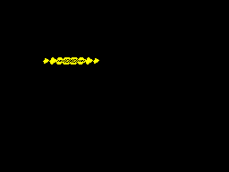

# Целый запечённый спрайт: пиксельные смещения X

15 октября 2026. Проверенный прототип в отдельной ветке; не входит в релиз 0.25.2.

`@zx_sprite` получает опцию `pixel_shifts`. Сохраняются единый тип, координаты,
`.stage()`/`.publish()` и сохранённое `.stage_previous_erase()`/`.erase_staged()`.
Каждая строка имеет восемь запечённых фаз маски и данных. Объект можно ставить
на любой пиксель X, а `.stage_shifted()` и конкретный `.stage_effect()` задают
смещения в пикселях. Без опции действующая библиотека сохраняет байтовые единицы.

[Полный компилируемый пример 16×8](source.nanz) содержит пиксели `#`, `_` и `.`.
Последние остаются прозрачными даже при пересечении границы экранного байта.
Строки, setters и геометрия экрана остаются внутри библиотеки.

При подготовке проверяются все строки. После допуска выбираются байтовые
адреса и фазы, патчатся destination-операнды. Публикация выбирает неизменяемый
kernel фазы: маски не сдвигаются в runtime и код процедуры не переписывается.
Сохранённое стирание копирует и адрес, и фазу старого спрайта; изменение
координат объекта после stage не меняет его положение очистки.

В этой первой реализации выбор фазы ещё происходит при публикации.
Это измеренный кандидат, а не заявление о минимальном числе инструкций.
Генерация фаз вынесена во внутреннюю метафункцию каждой строки, чтобы не
накапливать временные строки всех kernels в одной compile-time VM.

## Проверки на исходном main ee2802ab

- Вывод: 294 положения × два фона × три compiler-режима = 1764 native
  вызова и 3528 raw/final VM вызовов, PASS за 205,689 с.
- Сохранённое стирание: такая же матрица, 1764 native и 3528 VM вызовов,
  PASS за 204,577 с. Координаты объекта перед очисткой изменены намеренно.
- Знаковые смещения: 243 положения × три режима = 729 native и 1458 VM
  вызовов, PASS за 46,084 с. Проверены −128/−1/0/1/127, поздний отказ строки,
  края экрана, переходы сканлиний и третей, все 6912 экранных байтов.
- Короткий smoke: 168 native и 336 VM вызовов, PASS за 4,313 с.
  Проверяет все восемь фаз, края и последний scanline; полный корпус идёт
  в deep-профиль, короткий smoke — в PR-профиль.

Пиксельный оракул использует raster-координаты, а не таблицы генератора.
Матрицы вывода/стирания проверяют всю native RAM с точным ожидаемым состоянием
staging/SMC и ограниченной областью стековых записей; PC и SP при возврате.
Эти отдельные матрицы не доказывают ULA-кадры или IFF; для этого ниже
приведена самостоятельная полная сценическая проверка.

| Проверенная операция 16×8 | Ordinary BIN | Grace BIN | Максимум ordinary T |
|---|---:|---:|---:|
| Stage + publish | 10530 | 10529 | 7093 |
| Stage + cache previous erase + erase | 10555 | 10554 | 8464 |

Это весь тестовый модуль и полная операция с подготовкой и CALL/RET.
Размер включает доступные сгенерированные методы и обе пары kernels;
не является размером одного sprite kernel. Все восемь фаз стоят заметного
кода. Времена получены при параллельном исполнении матриц и не являются
сравнением скорости CI с предыдущими выпусками.

Прежние admission, cached erase и ByteWave/TV-проверки также прошли за
5,275 с. Byte TV-сцена сохранила ordinary 5241 байт и фазовые максимумы
26351/2819 T. Полные матрицы выше получены до интеграции PR #143;
после обновления baseline pixel smoke, admission, LUT-регрессии и старая
TV/ULA-сцена повторно прошли за 8,884 с. Исходник/ASM/BIN трёх режимов
сохранены локально в `pixel-shifted-artifacts`; размеры совпадают с
измеренными. [Измерения и SHA256](measurements.json).

## Пиксельная волна: полная сцена на Spectrum

[Исходник 64×8](scene/source.nanz) использует тот же ByteWave-объект и
единый API; `pixel_shifts` меняет единицу эффекта с байта на пиксель.
Адреса и фазы готовятся до HALT, после него работают erase/publish.
Сцена прошла 192 native Z80/ULA и 384 raw/final VM кадра. Проверены
все 6912 экранных байтов, отсутствие экранных записей при подготовке,
порядок 32 положений, PC/SP/IFF и ROM IY/INT. Все 64 фактически показанных
кадра каждого compiler-режима совпали с независимым raster-оракулом;
максимальная сумма двух фаз меньше бюджета кадра.

| Сборка | Полный BIN | Подготовка, max T | Erase + publish, max T | Сумма, max T |
|---|---:|---:|---:|---:|
| Ordinary | 13250 | 30204 | 5913 | 36117 |
| Grace Size | 13249 | 30204 | 5913 | 36117 |
| Grace Speed | 13249 | 30204 | 5913 | 36117 |

CALL/RET включены; HALT и ROM ISR не входят в суммы фаз. Отдельный
machine-run с настоящей ROM проверяет INT и каждый ULA-кадр.
[Полные сценические измерения](scene/measurements.json).

Запись сделана из прошедшего native snapshot через `mzx-headless` 0.25.2:
`--model 48k --snapshot running.sna --frames 64 --no-border --dump-frames DIR`.
`scripts/verify_zx_pixel_wave_capture.py` сверяет исходные PNG с независимым
пиксельным оракулом, порядок всех 64 позиций и каждый декодированный кадр
GIF по 20 мс. Интерполяции, ускорения и удаления повторов нет.
[Протокол записи и SHA256](scene/capture.json).

Это принадлежащая сцене чёрная область, а не доказательство сохранности
уложенных Tetris-клеток при деформации. Восемь фаз ещё требуют измеренного
уменьшения кода и стоимости dispatch; общий бюджет любой пользовательской
реализации эффекта не заявляем.

## Разделение неизменяемых kernels

Следующий проверенный вариант разделяет одинаковые соседние строки.
Draw-kernel можно разделить при полном совпадении пикселей; clear-kernel —
при совпадении непрозрачной маски, даже когда ink-данные различаются.
У каждой строки остаётся собственный SMC destination-wrapper. Общие
kernels принимают обычный указатель и не имеют изменяемых операндов.
Это переиспользование кода, не совместное владение подготовленным адресом.

Ordinary сцена уменьшилась **13250 → 11186 байт (−2064, −15,6%)**;
Grace — 13249 → 11185. Подготовка и публикация остались 30204/5913 T.
192 native/ULA и 384 raw/final VM сценических кадра снова прошли;
новая запись 64 последовательных кадров также совпала с оракулом.
GIF выше получен уже из snapshot этого меньшего варианта.

Дополнительные 336 native и 672 VM вызова проверяют одинаковые draw-строки
и строки с разными данными при общей маске, обе операции и все восемь фаз.
Проверяется actual code sharing, полная native RAM, ожидаемое staging/SMC,
границы стека и PC/SP. Нельзя объединить разные draw-данные только из-за
одинаковой маски. Программы прежних больших draw/erase матриц во всех
трёх режимах сохранили побайтно те же исходник, ASM и BIN.
[Результаты, SHA256 библиотек и параметры меньшей сцены](scene/shared-kernels.json).

## Дальше

Продолжить исследование специализации
допустимых фаз и прямой dispatch, чтобы эффект над Tetris не раздувал игру.
Сохранность уложенных клеток при деформации требует отдельного игрового
оракула; здесь она не объявляется доказанной. Обобщённые интерфейсы и
автоматический Speed/Size выбор также остаются работой общей цели.
