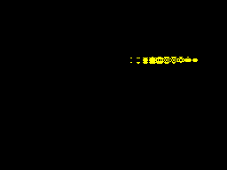

# Целый спрайт и композиция эффектов на Nanz

15 октября 2026. Кандидат для main; опубликованный релиз 0.25.1 остаётся
неизменным.



Спрайт задаётся один раз. Эффект — обычная Nanz-структура с методом
`offset(row) -> i8`. Генератор связывает конкретный тип эффекта со спрайтом
при компиляции. Пользователь работает с координатами и объектами; строки
вывода, маски очистки и SMC-адреса скрыты внутри `zx.sprite`.

```nanz
import zx.sprite
import zx.sprite_tv

@zx_sprite("Diamond") {
    size 64 8
    effect "TVSignal"
    erase
    // Здесь восемь полных строк: # — ink, _ — paper, . — прозрачность.
    // Все пиксели настоящей формы приведены в source.nanz.
}

global actor:Diamond=Diamond{x:32,y:56}
global tv:TVSignal

// До HALT: сохранить адреса старого спрайта и подготовить новый.
actor.stage_previous_erase()  // только после первого успешного stage
tv.wave.phase=frame
tv.noise=frame>>4
actor.stage_effect(&tv)

// После HALT: только точное стирание и вывод.
actor.erase_staged()
actor.publish()
```

Фрагмент показывает API; [полный компилируемый исходник](source.nanz)
содержит строки формы, проверки `bool`, первый кадр и управление INT.
Маска принадлежит спрайту. `.stage_previous_erase()` запоминает уже
подготовленные адреса, поэтому очистка убирает именно старое искажённое
изображение, даже когда фаза эффекта уже изменилась.

## Эффект — код Nanz, а не генератор ASM

```nanz
struct TVSignal {wave:ByteWave,noise:u8}

fun TVSignal.offset(self:^TVSignal,row:u8)->i8 {
    let shift:i8=self.wave.offset(row)
    if self.noise==0 {return shift}
    var hash:u8=(self.wave.phase*13+row*17)^0x5a
    hash=hash^(hash>>3)
    if (hash&3)==0 {return shift+1}
    if (hash&3)==1 {return shift-1}
    return shift
}
```

`TVSignal` содержит объект волны и добавляет ограниченный детерминированный
шум. Первые 16 положений показывают волну, следующие 16 включают шум.
Смещения заданы в байтовых столбцах: один шаг — восемь пикселей. Это
композиция изображения; игровых координат и collision-кода здесь нет.
Модуль `zx.sprite_tv` отделён от `zx.sprite_effect`, чтобы обычная волна
не получала дополнительный код шума.

Можно определить свой тип и метод в вызывающем Nanz-файле и указать его
в `effect`. Генератор создаёт типизированный `.stage_effect(&объект)` и
специализирует число строк. В полученном коде есть обычные прямые вызовы
Nanz-функций; runtime-vtable и диспетчер реализации не нужны. Это конкретная
специализация через метафункцию, а не заявление о законченных обобщённых
интерфейсах для любого числа реализаций.

При подготовке вычисляются смещения и проверяются границы всех строк,
затем патчатся адреса. До успешной проверки экран и операнды вывода не
меняются. Kernels компилируются один раз; кадр обновляет их адреса.

## Проверено и измерено

| Сборка | Полный BIN, байты | Подготовка, максимум T | Стирание + вывод, максимум T | Сумма двух фаз, T |
|---|---:|---:|---:|---:|
| Ordinary | 5241 | 26351 | 2819 | 29170 |
| Grace Size | 5240 | 26351 | 2819 | 29170 |
| Grace Speed | 5240 | 26351 | 2819 | 29170 |

CALL/RET включены. HALT и ROM ISR не входят в суммы фаз; отдельная проверка
с реальным ROM INT проверяет каждый фактически показанный кадр. Все 192
native Z80/ULA кадра и 384 последовательных raw/final VM кадра прошли:
все 6912 экранных байтов, порядок 32 положений, отсутствие записи в экран
при подготовке, PC/SP/IFF и ROM IY. Подготовка и публикация укладываются в
кадр этой сцены. Это не доказательство срока для любой пользовательской
реализации `offset`.

По сравнению с [чистой ByteWave](../typed-sprite-effects/README.md) композиция
добавляет 505 байт и до 10196 T подготовки в ordinary. Вывод остаётся таким
же. Три проверенные сборки различаются одним байтом; глобальная оптимальность
не заявлена. [Машинные результаты и SHA256](measurements.json).
Отдельный [кандидат с коротким циклом](https://github.com/oisee/minz/blob/21ac801e/reports/advanced-demos/sprite-effect-composition/loop-candidate.md)
прошёл ту же матрицу: 5022 байта и 27129 T подготовки. Он экономит 219 байт
ценой 778 T. Оба варианта недоминируемые; автоматический выбор между ними
по цели компиляции пока не подключён.

Проверка пользовательского типа `CustomShift` проходит в трёх native-режимах
и raw/final VM. Неверное имя, дубликат и отсутствие нужного метода
отклоняются. Диагностика отсутствующего метода пока сообщает несовместимость
`void` и `i8` в generated `.stage_effect`; её текст ещё можно улучшить.

Этот пример выявил три общие ошибки Nanz: вложенный доступ к полям при
наличии import, потерю типов вызывающего файла внутри generated-кода и
нулевую инициализацию literal-структур. Проверка адреса локальной структуры
также обнаружила неверный linker-symbol вместо её alloca-адреса.
Исправления и независимые регрессии выделены в
[PR #138](https://github.com/oisee/minz/pull/138) и
[PR #140](https://github.com/oisee/minz/pull/140).
Повторная совместная проверка `TestTetrisDirectTemporalMachine` и
`TestTetrisDirectMainMachine` после всех этих исправлений PASS за 53,236 с:
оба уровня скорости, ordinary/Grace Size/Grace Speed и показанные ULA-кадры.

## Запустить и воспроизвести

С новой сборкой: `mzx --demo sprite-tv`. С существующим эмулятором:

```sh
mzx --model 48k --no-audio --snapshot running.sna
```

[Snapshot](running.sna) содержит проверенный Z80. CLI BIN побайтно совпадает
с BIN native-теста. GIF состоит из 64 последовательных ULA-кадров по 20 мс,
без интерполяции; сохранённый GIF повторно сверяется с исходными PNG.
[Протокол записи](capture.json).

```sh
cd minzc
MINZ_SPRITE_COMPOSITION_EXPORT=/path/to/local/evidence \
  go test ./pkg/pipeline -run '^TestZXSpriteEffectCompositionMachine$' -count=1
cd ..
mzx --model 48k --snapshot /path/to/local/evidence/ordinary/running.sna \
  --frames 64 --no-border --dump-frames /path/to/local/frames
python3 scripts/verify_zx_sprite_tv_capture.py /path/to/local/frames \
  /path/to/local/verified-capture
```

Pillow нужен только для проверки и сборки GIF. ASM/BIN и подробные протоколы
остаются локально в `grace-reports/2026-10-14/tetris-direct/`.
На шару кладётся playable preview. Пример использует принадлежащий ему
чёрный фон; перенос шума на Tetris с сохранением уложенных клеток,
пиксельные X-сдвиги и физическое железо ещё требуют отдельных проверок.

Проверка будущих пакетов также проверяет PNG, полученный от окончательного
executable через `--demo sprite-tv --frames 120 --no-border`. Ожидаемые
пиксели положения 22 сверены независимым оракулом; точный SHA PNG записан
в provenance образа. Это обязательная проверка новых TV/ByteWave сцен
на каждом native host при подготовке пакетов; сами шесть обновлённых
пакетов пока ещё не собраны.

Локальный пакет `0.25.2-local-smoke-linux-amd64` прошёл исполнение
окончательного GUI-executable на X11: восемь демо, точные пиксельные кадры
двух эффектов, возобновление сессии Zork I, SAVE и fresh-machine RESTORE
Zork II с сохранением диска. Исходники трёх декларативных сцен в ZIP
проверяются по provenance образов. Это локальная проверка пакета;
шестиплатформенный релиз ожидает native-сборок и интеграции в main.
