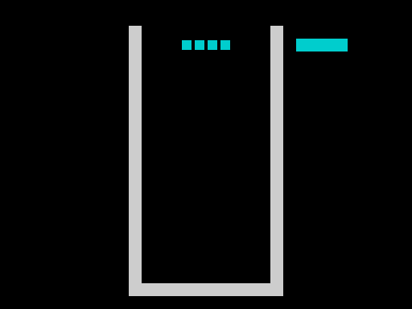

# Пиксельный Tetris: библиотека стала игровым showcase

14 октября 2026 года. Исследовательская ветка `feat/advanced-demos`.
Продолжение [проверки целых кадров](temporal-shadow.md).

Tetris теперь использует запечённые Nanz-спрайты в настоящем игровом `main`:
фигура падает по пикселям, управление учитывает её физическое положение,
а экран получает подготовленные полосы из теневого bitmap. Собран playable SNA,
который продолжает автоматическое падение после повторной загрузки. Этот снимок
подключён как кандидат встроенного демо `mzx --demo tetris` в этой ветке.
Опубликованный релиз 0.25.0 пока содержит предыдущую версию.



Анимация получена из 300 кадров эмулятора Spectrum 48K: 81 изменившийся экран,
шесть секунд аппаратного времени. Это иллюстрация отдельного запуска без ввода;
проверки ниже используют сам framebuffer ULA и независимые ожидания.

## Что пишет пользователь библиотеки

Форма целого спрайта задаётся один раз: размеры и строки пикселей. `#` означает
установленный пиксель, `_` — сброс, `.` — прозрачность. Из описания получается
типизированный Nanz-объект. Простое рисование выглядит как `Ship{x:x,y:y}.draw()`;
двухфазное размещение — `stage_on(base)` и `publish()`. Строки, адреса Spectrum
и изменяемые операнды инструкций находятся внутри сгенерированных методов.

Для Tetris одна форма клетки переиспользуется четырьмя независимыми экземплярами:

```nanz
import zx.sprite
@zx_sprite_instances("FallingBlock") {
    instances 4
    size 8 8
    pixels "........"
    pixels ".######."
    pixels ".######."
    pixels ".######."
    pixels ".######."
    pixels ".######."
    pixels ".######."
    pixels "........"
}
```

Игровой слой объединяет их в `FallingPose{kind,rotation,x,y,phase}`. Его
`stage_into(base)` размещает все четыре клетки; `publish()` выводит целую фигуру.
Данные клеток запечены в машинных инструкциях. Геометрия семи тетромино остаётся
таблицей игрового слоя, а экранные адреса и перенос между сканлиниями — библиотекой.

## Физика между клетками

`cur_y` — прежняя логическая строка, `pixel_phase` — смещение 0..7 пикселей.
После восьмого шага строка увеличивается, фаза возвращается к нулю. В клетке 8×8
заняты шесть внутренних сканлиний: при фазе 1 тело ещё помещается в прежнюю
строку; начиная с фазы 2 требуется свободное место в следующей строке.

Повороты и горизонтальные движения проверяют этот зазор. При контакте фигура
фиксируется при попытке следующего пиксельного шага. Hard drop фиксирует её
сразу; hold начинает новую фигуру с нулевой фазой и расходует единственное
разрешённое удержание до следующей фиксации. Уже прошедшее время не применяется
повторно к только что появившейся после hard drop/hold фигуре.

Ввод и физика отделены от вывода:

```nanz
let now:u8=zx_peek(0x5c78)
let elapsed:u8=now-clock_seen
clock_seen=now
game_step(read_input(),elapsed)
if render_smooth()==false {game_over=1}
```

IM2 увеличивает младший байт FRAMES по адресу `0x5C78`. Физика получает число
принятых прерываний, а не число вызовов renderer. Байтовая разность учитывает
переход 255→0. При длительном DI аппаратный INT может быть пропущен: это счётчик
принятых прерываний, а не обещание точного времени при любых длительных секциях.
После Game Over launcher получает обычный возврат, восстанавливает SP и остаётся
в явном цикле HALT. Возврата по случайному адресу больше нет.

## Что доказано проверками

`TestTetrisPixelPhysicsNativeVM` независимо рисует все 28 форм, выводит
столкновения из занятых пикселей и удаляет линии фильтрацией строк. Он не читает
PIECE_DX/DY программы и не вызывает её проверки размещения для ожиданий.
1 596 сценариев в каждом из трёх режимов проходят собранный Z80, сырой MIR2 VM
и оптимизированный MIR2 VM: 14 364 исполнения. Проверены движение, повороты,
soft/hard drop, hold, контакт, очистка четырёх линий, заблокированное появление,
переполнения счётчиков и Game Over. Все игровые переменные и 200 клеток доски
сверяются с моделью; на Z80 дополнительно сверяются полные 64 КБ, кроме точных
достижимых spill-объектов и ограниченных 128 байт стека. PC/SP обязательны.

`TestTetrisSmoothMainMachine` исполняет неизменённый игровой исходник через
настоящий launcher, ROM, клавиатурную матрицу, IM2 и renderer. Последовательная
модель не переинициализируется из результатов игры. Она проверяет значения
аргументов клавиатуры/таймера, каждое состояние после физики, весь bitmap поля
и теневую копию, атрибуты и previews после вывода. Каждый завершённый кадр поля,
считанный ULA после первого вывода, обязан совпасть с целой ожидаемой сценой.
Подготовка старта до первого завершённого вывода в эту метрику не входит.

| Режим | Байты с launcher | Шаги игры | Пиксельные позы | Полные считанные кадры поля | Смешанные |
|---|---:|---:|---:|---:|---:|
| Обычный | 32 012 | 39 | 24 | 359 | 0 |
| Grace Speed | 31 139 | 39 | 24 | 359 | 0 |
| Grace Size | 31 139 | 39 | 24 | 359 | 0 |

В каждом запуске прошло 10 фиксаций; достигнут Game Over, возвращён исходный SP.
Минимальный SP — `0xFCAF`. Обработчик сохраняет регистры и flags. Полные запуски
заняли 425/421/421 кадров, включая начальную подготовку и финальное мигание бордюра.
Ранее сохранённый отрицательный контроль renderer действительно обнаруживает
смешанные кадры; после подключения игры его проверка повторена.

Отдельные проверки всех фаз actor, ghost landing и temporal renderer снова PASS.
Быстрый pipeline — 394/394 PASS в трёх процессных шардах с двумя workers.
Его main-тест проверял игровую модель и экранную память; после усиления проверкой
считанных кадров весь main-тест отдельно повторён в трёх режимах, тоже PASS.
Каталог содержит 750 проверок: 394 fast и 356 deep.
Полный глубокий корпус в этом этапе не запускался. Физическая машина пока не
проверялась: аппаратное исполнение здесь означает собранный Z80 в модели Spectrum.

## Запуск кандидата и раскладка

Артефакты checkpoint сохраняются в:

`/mnt/safe/minz/grace/2026-10-14/tetris-smooth-gameplay/`

Графический кандидат Linux:

```sh
/mnt/safe/minz/grace/2026-10-14/tetris-smooth-gameplay/tools/mzx-linux-amd64 --demo tetris
```

Либо открыть `playable/tetris.sna` в `mzx` или совместимом Spectrum 48K эмуляторе.
O/P — движение, Q — поворот, A — soft drop, Space — hard drop, H — hold.
Escape в `mzx` возвращает в меню.

Воспроизводимая сборка — `scripts/build_zx_tetris_demo.sh`. Код начинается
с `0x6000`; обычная сборка заканчивается на `0xDD0C`, до частного bitmap
`0xE000..0xF7FF`. Стек launcher — `0xFCE0`, таблица IM2 расположена выше.
Скрипт отвергает пустой BIN и пересечение кода с теневым буфером до загрузки.

## Что ещё остаётся

Подготовка всё ещё дороже одного кадра. Полный вывод поля требует около
749 тысяч T с ожиданием, маленькое изменение — порядка 145 тысяч T.
Пиксельная физика работает, но эта версия ещё не обещает 50 FPS: нужно сократить
размещение и восстановление dirty-полос, сохранив те же проверки.

Следом — ускорение подготовки, проверенная интеграция в main и обновлённые
пакеты шести платформ. Другие advanced demos, TV-эффекты и развитие композиции
DSL остаются следующими направлениями. Этот checkpoint не закрывает цель.

### Обновление подготовки

В следующем checkpoint обычный Nanz pointer walk ускорил восстановление поля
на 54,6%, а максимальный полный renderer — на 28,0% на той же матрице.
Обновлён встроенный кандидат. [Код, варианты, измерения и запуск](native-preparation.md).
Числа и путь к SNA выше относятся к первоначальному игровому checkpoint.
