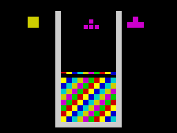
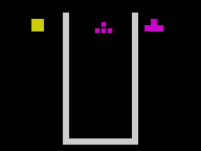

# Целые кадры из запечённых Nanz-спрайтов

14 октября 2026 года. Продолжение [подготовительного checkpoint](shadow-renderer.md).

Новый compositor собирает изображение в частной RAM, а затем переносит на
Spectrum только полосы старого и нового следа фигуры. В каждой полосе сначала
публикуются её атрибуты, затем восемь сканлиний bitmap. Пользовательская форма
остаётся типизированным Nanz-объектом с `stage_on(base)` и `publish()`;
строки, SMC-операнды и вычисление экранных адресов скрыты внутри библиотеки.

```nanz
import zx.pixel_bands
@pixel_bands("field_pixels") {
    rows 20
    attributes 1
}
```

Дескрипторы полос содержат источник bitmap, экранное назначение, ширину и
источник атрибутов. Это подготовленные указатели на неизменяемые до завершения
публикации данные. Kernel получает их через HL, DE, B и IX. Он сохраняет только
временно необходимые адреса, копирует атрибуты и выполняет восемь коротких LDIR.
SP не подменяется. Альтернативный AF используется как scratch; publisher
исключает INT. Общая реентерабельность и обработка NMI не заявлены.

## Луч важнее суммарного бюджета

Публикация сразу после HALT работала на маленьких изменениях, но новая проверка
почти полностью изменившегося поля поймала смешанные кадры. Даже interleaved
вариант, укладывающийся примерно в один полный кадр, может отстать от луча:
на запись каждой следующей строки доступно лишь время до её считывания ULA.

Поэтому маленькие обновления начинаются сразу после INT. Если затронуто больше
четырёх полос, renderer ждёт, пока луч покинет последнюю изменяемую сканлинию
поля, и использует нижний бордюр плюс верхний бордюр следующего кадра. Это
специальный контракт Spectrum 48K для поля на строках 16..175, а не общий
переносимый vsync. Задержка исполняется в RAM без contention и проверена вместе
с фактически показанными кадрами. INT уже запрещены, чтобы следующий interrupt
не менял этот участок тайминга; после публикации они включаются.

Проверенная раскладка: код с `0x6000` заканчивается до `0xE000`, частный bitmap
лежит в `0xE000..0xF7FF`, стек launcher — `0xFCE0`, IM2 trampoline/table выше.
Тест отвергает пересечение кода и буфера, контролирует 128 байт обычного стека и
полный PC/SP. Обработчик IM2 сохраняет регистры.

## Что измерения заставили исправить

Сканирование каждого байта теневого bitmap перед переносом занимало до
1,55 млн T. Оно заменено геометрией старого и нового следа: иногда дешевле
перенести небольшую неизменившуюся полосу, чем заново сравнивать все её байты.
Полная подготовка всё ещё дорогая, особенно восстановление всего поля.
Этот renderer пока нельзя описывать как игру на 50 FPS.

Байтовый индекс формы и координаты уменьшили стоимость размещения. Границы
проверяет сгенерированный `stage_on`; сложение координаты и размера выполняется
в 16 бит, чтобы не скрыть переполнение.

PUSH-кандидат с циклом по парам оказался медленнее LDIR. Его сохраняем как
исследовательский артефакт; в рабочем publisher остаётся измеренный LDIR.
Переезд буфера из contended RAM сам по себе не устранил смешанные кадры.

## Исправления backend

Новая ветка выбора тайминга выявила реальный miscompile: OpCallCond использовал
исходный предикат, хотя генератор сравнения уже переставил операнды. Условный
вызов должен учитывать фактически установленные flags, включая AND A для нуля
и составные условия C-or-Z / NC-and-NZ.

Следующая проверка обнаружила второй сбой: peephole превращал CALL в условный,
несмотря на промежуточную метку с другим путём входа. Такой rewrite теперь
отвергается. Независимая матрица из 336 native Z80 и VM вызовов проверяет шесть
предикатов, их инверсии, пороги 0/127 и значения по обе стороны порога. Она
покрывает сравнения с операндом в A и вне A; проверяются эффект вызова и PC/SP.

## Проверки и следующий шаг

Новый стенд проверяет O/T, все восемь фаз вертикального движения, горизонтальное
перемещение, смену preview/hold и изменение почти всего поля. Экранный оракул
строится по растровым координатам и самостоятельной геометрии. Сравниваются
полные 64 КБ, кроме точных изменяемых дескрипторов, SMC-слов, spill-объектов и
ограниченного стека. Теневая поверхность тоже обязана совпасть с оракулом.

Каждый фактически считанный ULA кадр обязан быть целиком предыдущей или новой
сценой; кадр завершения обязан уже показать новую сцену. Ранний старт оставлен
отрицательным контролем: он должен показать смешанные кадры. Прежний renderer
и отдельный actor также повторно проверяются. Полная матрица полос и поверхностей
перенесена в deep-профиль, чтобы не увеличивать время каждого PR.

Игровой main пока продолжает прежнюю отрисовку. Следующий шаг — подключить
пиксельную гравитацию и физический зазор при поворотах/перемещениях, уменьшить
подготовку, собрать настоящий playable showcase в новой раскладке и проверить
его целиком. Затем интеграция в main и релиз; цель ещё активна.

### Результат checkpoint

| Режим | Байты с launcher | Показанные кадры | Смешанные кадры |
|---|---:|---:|---:|
| Обычный | 31 778 | 67 | 0 |
| Grace Speed | 30 905 | 67 | 0 |
| Grace Size | 30 905 | 67 | 0 |
| Отрицательный контроль, ранний вывод | 31 768 | 64 | 2 |

Максимум подготовки вместе с ожиданием и публикацией — 749 064 T;
публикация — 65 712 T. Маленький шаг занимает около 145 тысяч T вместе с
ожиданием. Это подтверждение целостности выбранных кадров, а не 50 FPS.
Подготовка отдельного actor теперь 48 666 T вместо 54 618 T в предыдущем
checkpoint; его публикация остаётся 3653 T.

Полный MIR2 — PASS. Быстрый pipeline — 393/393 в трёх независимых процессах;
полный каталог содержит 748 записей, оставшиеся 355 относятся к deep-профилю.
Отдельная глубокая проверка полос завершилась PASS: 1827 native-вызовов,
включая атрибуты, generated publisher, поверхности и границы в трёх режимах.
Полный deep-корпус в этом checkpoint не запускался.

Фактически считанный ULA кадр перехода к очищенному полю:

| Ранний вывод, смешанный кадр | Вывод после прохождения поля |
|---|---|
|  |  |

Исправления условного CALL и peephole: `72ca40b1`.

### Следующий checkpoint: игровая интеграция

Пиксельная гравитация, управление и новый renderer теперь подключены к настоящему
main. Проверены последовательная игровая модель и 1077 фактически считанных кадров
поля. Новый playable SNA подключён в исследовательской ветке.
[Изменения, проверки и запуск](smooth-gameplay.md). Указание о прежнем main выше
относится к историческому checkpoint этого отчёта.
