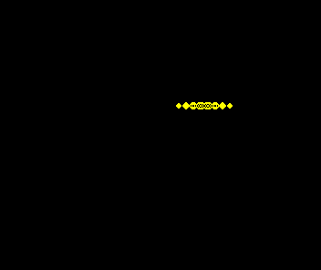

# Целый спрайт и подготовленная Nanz-сцена

15 октября 2026. Один `Diamond` заменяет ручные вызовы row-setters и
вычисление экранных адресов в движущемся compiled-demo.
[Полный исходник](source.nanz) описывает размеры, все пиксельные строки
и парную очистку через `@zx_sprite`. `#` — ink, `_` — paper.



```nanz
global actor:Diamond=Diamond{x:32,y:56}

fun prepare_frame(frame:u8)->bool {
    if actor_visible {if actor.stage_erase()==false {return false}}
    actor.x=(4+(frame&15))*8
    actor.y=56+(frame>>4)*8
    return actor.stage()
}
```

Подготовка запоминает старое положение для очистки, затем размещает новое.
Сами процедуры запечены один раз при компиляции; каждый кадр меняет только
их операнды. После EI/HALT сцена делает DI, вызывает `erase_staged()` и
`publish()`, затем EI. Методы возвращают bool; окно INT принадлежит сцене,
а не библиотечному вызову. Нет bitmap shadow или полной очистки каждый кадр.
PUSH-очистка нужна один раз при старте.

Обычный режим, Grace Size и Grace Speed прошли один и тот же независимый
image oracle: 64 последовательных native main-сцены и реальные ULA-кадры
на режим, 32 позы дважды без повторов или пропусков. До публикации вся
экранная память сохраняется. Проверяются 6912 байт bitmap/attributes,
PC/SP, IFF, отсутствие принятого INT в публикации и правильный IY ROM ISR.
Raw/final VM отдельно исполняют по 64 prepare/draw шага на режим:
384 VM-сцены суммарно. Неподготовленная публикация отказывается без записи
в экран и без изменения INT в native-проверке. Полный тест проходит за 1,304 с
и включён в fast profile; прежние ULA negative controls не изменены.

| Режим | Модуль, байт | Подготовка, T ≤ | Публикация, T ≤ | Busy, T ≤ |
|---|---:|---:|---:|---:|
| Обычный | 2784 | 5723 | 2819 | 8542 |
| Grace Size | 2783 | 5723 | 2819 | 8542 |
| Grace Speed | 2783 | 5723 | 2819 | 8542 |

CALL/RET включены; HALT wait и ROM ISR не входят в эти две фазы.
Порядок фактически показанных кадров проверяется независимо от этого замера.
CLI/default-contract BIN побайтно совпадает с исполненным ordinary BIN.
[Машиночитаемые результаты и SHA256](measurements.json).

Прежний dirty sprite-chain также уже показывает целые кадры, но его
compiled draw-frame тратит до 15 248 T на размещение и вывод. Здесь тот же
рисунок и траектория: размещение перенесено до HALT, порядок строк фиксирован,
а очистка выполняется перед новым рисунком. Runtime-перестановка строк
не повторяется каждый кадр. Сравнение не объявляет один kernel быстрее
при одинаковой работе и не сравнивает размеры mixed compiled/PUSH модуля
с этой единственной стратегией. PUSH-demo остаётся отдельным примером.

Запуск из checkout:

```sh
scripts/play_zx_typed_sprite.sh
scripts/play_zx_typed_sprite.sh --headless --frames 100
```

С готовым эмулятором на Linux/macOS/Windows:

```sh
mzx --model 48k --no-audio --snapshot running.sna
```

На Windows команда называется `mzx.exe`; нужен [running.sna](running.sna)
из этой папки. Snapshot продолжает уже запущенный native-код. Проверен и
его отдельный повторный запуск; физический Spectrum/NMI не входят в proof.
Артефакты и логи локально: `tetris-direct/typed-sprite-scene/` в хранилище
отчётов 2026-10-14. Релизные пакеты 0.25.1 этим кандидатом не заменяются.
