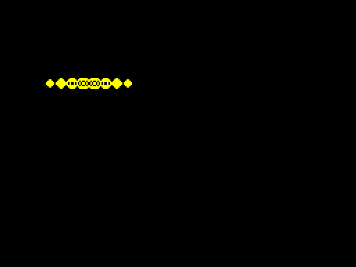

# Patchable sprite chains: implementation checkpoint

**14 October follow-up:** [dirty rendering and baked full-clear measurements](../advanced-demos/README.md) are being developed in `feat/advanced-demos`. They remove the old per-frame bitmap clear and add actual ULA-frame checks. This follow-up is not yet in main; the dated publication evidence below describes the original checkpoint.

October 13, 2026. **Integrated into main** through [PR #90](https://github.com/oisee/minz/pull/90), merge `201146cf`. All required checks and advisory checks succeeded. A clean main checkout repeated the complete chain suite: PASS 4.487 s, and PUSH headless launcher: 100 video frames, exit 0.

[Readable article with Nanz and Z80 examples](../2026-10-13-134-moving-sprites-smc-push.md).

Source/report/snapshots match main. 509 machine and 82 cost SHA entries were verified on the share, alongside source, logs and CI reports. Current publication and completion evidence supersede the dated implementation checkpoints below.

`import hw.sprite_chain` provides `@sprite_chain("actor")` with the existing
sprite destination/region/hex rows and `via "compiled"` or `via "push"`.
PUSH requires even byte width, opaque masks and explicit `irq "disabled"`.
The caller must keep maskable interrupts disabled throughout PUSH execution;
NMI/reentry is not supported. Both forms require owned writable code/data RAM.

Generated API: `actor()`, `actor_set_row_N(address)`, `actor_set_next_N(code_address)`,
`actor_set_entry(code_address)`, `actor_row_N_address()`, `actor_done_address()`.
Compiled row addresses point at the first byte; PUSH row addresses are end+1
(modulo 65536). Helpers accept raw addresses: runtime memory ownership, valid
acyclic continuations and atomic patch/draw scheduling belong to the caller.

Each row owns an address immediate and a mutable JP continuation. JP opcodes are
emitted as DB 195 / DW target because the current text peephole removes adjacent
JP instructions; direct emission protects their mutable locations. Native tests
exercise the instructions and patch words after optimization and assembly.

PUSH saves AF/BC/DE/HL on the ordinary stack, records that SP in a restore
immediate, then uses row destination SP and reversed LD DE / PUSH DE pairs.
The final section restores ordinary SP before popping registers and RET.
It does not change interrupt enable state. The code is nonreentrant.

First native checkpoint: 108 executions (two primitives × three modes × three
positions × six orders/subsets), plus two Nanz main setter/draw scenarios.
Independent full-RAM comparisons permit only the exact eight-byte save frame
and PUSH saved-SP immediate; exact return PC/SP and registers are checked.
The initial log is retained on the share, outside Git. This initial positive matrix uses opaque four-byte rows;
mixed masks, rejection tests and full IRQ/ULA proof remain outstanding.

Expanded checkpoint: 768 masked executions (256 backgrounds × three modes)
repatch the same compiled code repeatedly, with independent mask/full-RAM
oracles. Twelve invalid descriptors and five invalid names reject. Combined
chain suite PASS 0.486 s. Full Spectrum/IRQ/demo and comparative cost remain open.

## Full Spectrum checkpoint

Both primitives × ordinary/Grace Size/Grace Speed passed actual main on the
48K Spectrum model with ROM IM1 IRQ and ULA contention: 64 completed screens
per run, 189 accepted ROM IRQ, 192 video frames. Independent image math checks
all 6912 screen bytes; draw return PC/SP and ROM IRQ register preservation hold.
PUSH entry requires IFF1=false and its return keeps it false; the caller uses
DI around patch/draw and EI afterwards. No IRQ is accepted during PUSH.
See demo/source.nanz and the machine test. Snapshots resume running RAM code.

Run `scripts/play_zx_sprite_chain.sh` or `scripts/play_zx_sprite_chain.sh --push`.
Windowless: append `--headless --frames 100 --screenshot build/sprite.png`.
The PUSH launcher completed 100 video frames. Partial video captures can show
an in-progress next draw; exact screens are checked at completed draw boundaries.
Physical hardware, NMI, and tear-free presentation are not established.

Two differently named invocations of the same top-level metafunction initially
collided in source provenance. Generated source-unit names now include invocation
position; a regression verifies both generated functions and deterministic hashes.

Machine exports and logs are retained on `/mnt/safe/minz/grace/2026-10-13/`.
At that checkpoint comparative cost and publication were still pending. Both are now complete; see measured results and current main status above.

## Measured move + draw

Eight opaque rows; x/y are runtime globals, and position() calculates the same
ZX row addresses. Pointer stores addresses in data and draws specialized ordinary
Nanz; compiled/PUSH patch immediate addresses. Natural links are initialized once.
The following is ordinary mode at x=4,y=56:

| Width (bytes) | Strategy | Move T | Draw T | Total T | Module bytes |
|---|---|---:|---:|---:|---:|
| 4 | pointer | 3884 | 602 | 4486 | 867 |
| 4 | compiled | 3859 | 728 | 4587 | 945 |
| 4 | PUSH | 4091 | 630 | 4721 | 976 |
| 8 | pointer | 3884 | 1114 | 4998 | 963 |
| 8 | compiled | 3859 | 1240 | 5099 | 1041 |
| 8 | PUSH | 4091 | 966 | 5057 | 1040 |
| 16 | pointer | 3884 | 2138 | 6022 | 1155 |
| 16 | compiled | 3859 | 2264 | 6123 | 1233 |
| 16 | PUSH | 4091 | 1638 | 5729 | 1168 |

81 checks cover three widths × three strategies × three compilation modes ×
three runtime positions, including ZX row-boundary crossings. Each checks pixels
and exact PC/SP. Counts include RET, exclude external CALL, DI/EI, ROM IRQ and ULA;
module bytes include position code and helper accessors, not the demo. Relinking
cost is measured separately in the initial native matrix. This cost benchmark
compares natural traversal, not a dynamically reordered pointer algorithm.

PUSH wins full move+draw on width16 here (~4.9% T), but loses on width4 and width8.
Compiled chains buy dynamic traversal/masks and are not a universal speed win.
A stationary sprite amortizes moving costs. No automatic selector is added.
Exact source, ASM/BIN and measurements are exported by
MINZ_HW_CHAIN_COST_EXPORT; the retained packet is on the share.

Exact row-entry PC traces additionally confirm permutations and subsets in all
108 native executions. Full Nanz/HIR/MIR2: PASS 20.735/33.953/99.807 s at
checkpoint preceding this trace-only assertion. Final full sprite family PASS
7.084 s; added row-order trace PASS 0.190 s.
