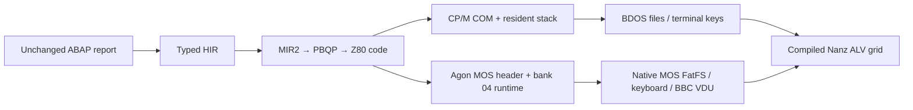

# One ABAP report: F4 → CSV → typed table → ALV on CP/M and Agon

The same 1,875-byte [ABAP report](../../examples/abap/zfleet_csv_alv.abap)
(source SHA256 `50a48e0726154b3d37115bfdcd09d4f6222c7c2e3380293128cb489c75fb7979`)
executes through the complete interactive path on both native emulators.
This is a bounded compiler-known frontend/SALV subset, not a general SAP GUI or
ABAP object runtime. Final independent review and publication receipts accompany
this report; their exact scope and artifact identities remain authoritative.



The report opens the F4 file picker, selects FLEET.CSV, calls GUI_UPLOAD, splits
CSV rows into declared fields, converts seats to signed i32, appends typed rows,
and binds/displays the current table using named CL_SALV_TABLE FACTORY/DISPLAY.
The checked result is Atlas/North/40 and Beacon/South/32, two rows, total72.
Factory performs no display or table copy; later table mutations are visible.

## Native products and memory

| Measurement | CP/M | Agon |
|---|---:|---:|
| File size | 40,257 bytes | 45,652 bytes |
| Entry / image end | 0100 / 9E41 | logical0045 / B254, physical bank040000 |
| Resident short stack | 1,024 bytes | 1,024 bytes |
| Image budget | measured TPA topFE00 | image end ≤F000 |
| Remaining address space to that bound | 24,511 bytes | 15,788 bytes |
| Native product SHA256 | `2de170d533831fe6dc8a6a4db273a200eed4d61f4ef51f45be6bfc3f908a6617` | `02512a48a64143224b44a5d4021b19569224d4ce3f42a4bc51d0f393e7abd302` |

CP/M measured grid stack use is92bytes with the resident canary and caller return
preserved. The wrapper checks actual TPA/incoming stack before using its stack;
this is not a claim about every CP/M machine. Agon checks its whole-bank budget
and both stack domains. Its filesystem mode requires the pinned MOS long-stack
contract: entry SPL0BFE00..0BFFFF, at least3,584bytes aboveBF000. The research-only
earlier filesystem-report probe sampled760bytes below entry SPL0BFE64; this is tested-path
measurement, not a maximum proof for arbitrary firmware or filesystem inputs.

The Agon product has a real MOS header (mode0), executes generated16-bit code on
the eZ80 and uses native24-bit MOS bridges. Full IX/IY, caller stack spans,
short/long SP and mixed return mode are checked. The successful run executes a
following real MOS command. Fault runs preserve explicit status and reach the
MOS error prompt. No physical-hardware execution is claimed.

## Verification and limits

- Independent pinned ABAP runtime2.14.8 validates semantic table/numeric excerpts.
  It does not execute the unchanged interactive report. The independent80×24
  project model specifies the retro grid; it is not an SAP GUI pixel golden.
- Raw MIR2, optimized MIR2 and native Z80 checks cover live table bindings,
  signed32 endpoints, all256 text-byte values, clipping, scrolling, empty rows,
  repeated display, admission refusals and five meaningful mutants.
- Actual MZE executes F4→FLEET→grid, cancel→EXTRA, missing file, capacity and bad
  integer cases. X11 pixels and original timing supply the CP/M GIF.
- Actual Fab eZ80, pinned MOS/full VDP and raw SD SPI execute the Agon scenario;
  host filesystem interception is disabled. SDL key input and texture captures
  are genuine. The final keyed image exercises PageDown/Home/PageUp/End/F3.
- Separate native resource cases cover cancel, missing file, capacity7, integer4,
  directory scan limit and disk read error at the45,553-byte pre-keyfix identity.
  Labeled research derivatives of that image cover active-screen failure
  (45,555bytes) and corrupted FIL canary (45,557bytes). Only keyboard mapping
  changed later. None are relabeled as final45,652-byte image replays.
- Directed compiler review caught and corrected resource cleanup on the caller
  stack at the admittedF000 boundary, and missing native SALV navigation keys.

The grid uses compiled Nanz layout/format/scroll logic. CP/M emits terminal
control sequences; Agon uses BBC VDU viewport/cursor commands. At the captured
Agon mode,80×24 at8×8 occupies the top640×192 of a640×480 framebuffer.
The final Agon capture is checked against both the independent cell model and
actual VDP font pixels. GIFs retain sampled native frames and observed timing;
identical adjacent frames may merge with summed duration. Capture metadata
states sample cadence, debugger pauses and final-frame timing limits.

## Reproduce and find the evidence

From a checkout containing this integration, with mz on PATH:

```sh
mz examples/abap/zfleet_csv_alv.abap -t cpm --asserts=none -o FLEET.COM
mz examples/abap/zfleet_csv_alv.abap -t agon -b z80 --runtime=agon-z80 --asserts=none -o FLEET.BIN
```

Use the unchanged [CSV fixtures](../../examples/abap/fleet/). Agon native recipes
pin emulator, MOS, VDP, raw FAT32 image, actual key plan and mixed-mode return
observations; MZE's Agon stub is not used as native proof. The source-matched
helper preserves HIR/raw/final MIR and asserts identical assembly to the public
CLI. A fresh durable integration CLI reproduces both exact native binaries.

Curated original sources, genuine screenshots/GIFs and product identities are
saved locally at:
`/home/alice/dev/minz-artifacts/grace-reports/2026-10-18/f4-csv-alv-e2e/`.
The complete raw inputs, frames, firmware provenance, SD images, source patches,
IR dumps, tests and independent review receipts are archived under:
`/home/alice/dev/minz-artifacts/grace-reports/2026-10-17/abap-f4-alv/continuation/gates/`.
Their manifests retain historical failed attempts and prototype identities.
