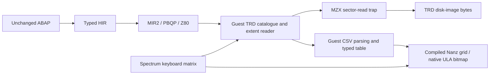

# Unchanged ABAP: TRD catalogue → CSV → ALV in MZX

[The same ABAP report](../../examples/abap/zfleet_csv_alv.abap), previously
verified on CP/M and Agon, now executes on Spectrum 48K and Pentagon 128K in
MZX. Source SHA256:
`50a48e0726154b3d37115bfdcd09d4f6222c7c2e3380293128cb489c75fb7979`.
No external DOS implementation was imported. The demonstration selects a
blank system ROM and uses the project's existing MIT-licensed code.

The catalogue is read through sector calls. Descriptor bytes 8..10 carry `CSV`
using the three-character-extension convention; those bytes never choose a
load destination. Names and filters are matched in the guest. Standard TRD
logical tracks are converted individually to the existing emulator adapter's
head-grouped coordinates, so files crossing a track/head boundary remain valid.
The [three-character extension convention](https://www.zxpress.ru/en/ezines/think/47/detecting-three-character-file-extensions-in-tr-dos-z80-assembly-procedure-for-proper-file) preserves the original `FLEET.CSV` name.
The runtime only requests read operation 5. It introduces no disk writes.

## Native result and capture

*MZX headless CLI, Pentagon 128K, blank ROM. Original 352×304 framebuffer;
500 original PNG/SCR frames retained, every fifth frame sampled at 50 Hz for
10 seconds of emulated time. Identical frames merge losslessly into 12 encoded
GIF frames. No crop, scaling, compositing or speed-up. This is an offline
emulated-time capture, not a wall-clock recording or performance benchmark.*

[Media identities and capture metadata](media/zx-trdos-csv-alv/manifest.json).
Raw binary SHA256:
`2d52a6a2ce7d6dbd57fbfe7b8e6e3b4a26b19edb9bc7d30e88b0a126b74edc74`.

F invokes the ABAP value-request event, 2 chooses FLEET.CSV, Enter selects it,
and the next Enter runs the report. The grid contains Atlas/North/40 and
Beacon/South/32; the typed total is 72. Q returns through a native launcher,
which records status and changes the border to white before halting.
There is no DOS shell in this demonstration.

The viewport is 32×24. NAME and ROUTE use eight display cells, while their
20-character stored values remain intact. SEATS retains eleven cells for the
full signed i32 range. PC arrows map to native Caps Shift+6/7; F3/F4 remain
emulator controls. The final two-row scene stays at scroll position zero.

## Memory and verification

Final image: 34,847 bytes, origin 0x6000, end 0xE81F,
including a 1,024-byte resident stack. The admitted image bound is 0xF000;
2,017 bytes remain to that bound. The native launcher occupies RAM
below the image at 0x5B00. The output snapshot contains 48 KiB RAM plus its
27-byte header. No bank switching is needed by this report.

The automated native checks cover:

- The unchanged report on both 48K and 128K emulator models, plus the packaged
  SNA produced by the standard assembler formatter.
- Full typed row contents and total, all 6,144 bitmap bytes against a separate
  layout model and frozen project font, and all 768 attribute bytes.
- The initial parameter prompt and an unexpected value-help key during ALV.
- A CSV spanning standard logical track1/sector15 → track2/sector0, independent
  of the emulator trap's legacy mapping.
- A changed CSV producing 73 instead of 72, invalid numeric input returning
  error4, and invalid extent metadata returning error8.
- Caller SP, IX/IY, returned status, resident-stack canary and launcher return.
  Measured minimum SP: 0xE7C1 (94 bytes used below stack top); no ROM instructions execute in that run.
- Sector bounds, buffer wrap and whole-transfer rejection before RAM/disk
  modification; existing legacy coordinates and writeback tests remain covered.

The integration exposed a general Z80 codegen defect: a word comparison whose
byte RHS occupied H/L overwrote that RHS while staging the word in HL, then
subtracted HL from itself. Snapshotting the operands before staging fixes this.
A directed native matrix covers six unsigned predicates, both orientations,
H/L allocation, runtime byte operands and word boundary values.

These are emulator execution checks. They do not establish physical Beta Disk
compatibility, FDC timing or full TR-DOS API emulation. Some old trap operations
remain stubs; the new runtime depends only on the checked sector-read boundary.
The 1 KiB stack is a tested workload budget, not a proof for all possible source
programs. No performance improvement is inferred from the animation.

## Reproduce and retain

[Build and launch instructions](../../examples/abap/fleet-zx/README.md) produce
FLEET.a80, the raw binary, a runnable FLEET.sna, a normal-format FLEET.trd,
native keyboard transitions, a blank ROM and a SHA256 manifest. The source
report and CSV fixtures are copied unchanged.

Local evidence, including raw/final MIR, HIR, exact binaries, disk images,
original frame PNG/SCR files, final snapshot and test logs:
`/home/alice/dev/minz-artifacts/grace-reports/2026-10-18/abap-zx-trdos/`.
