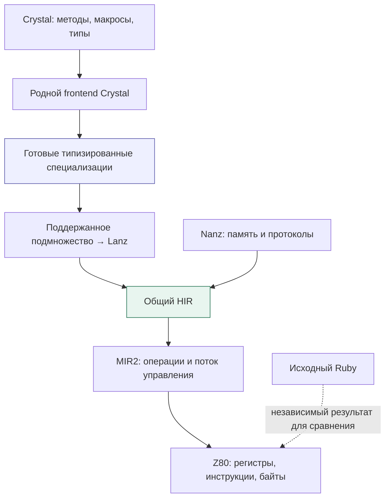
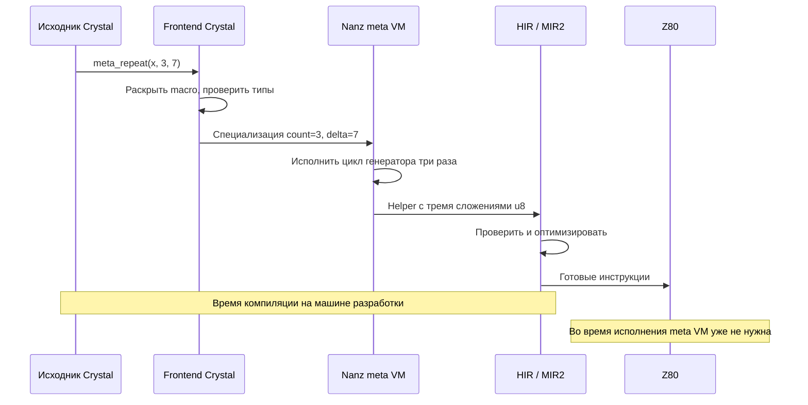
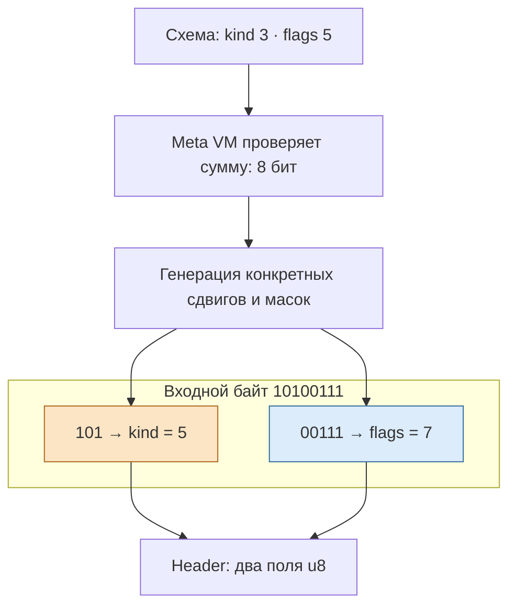
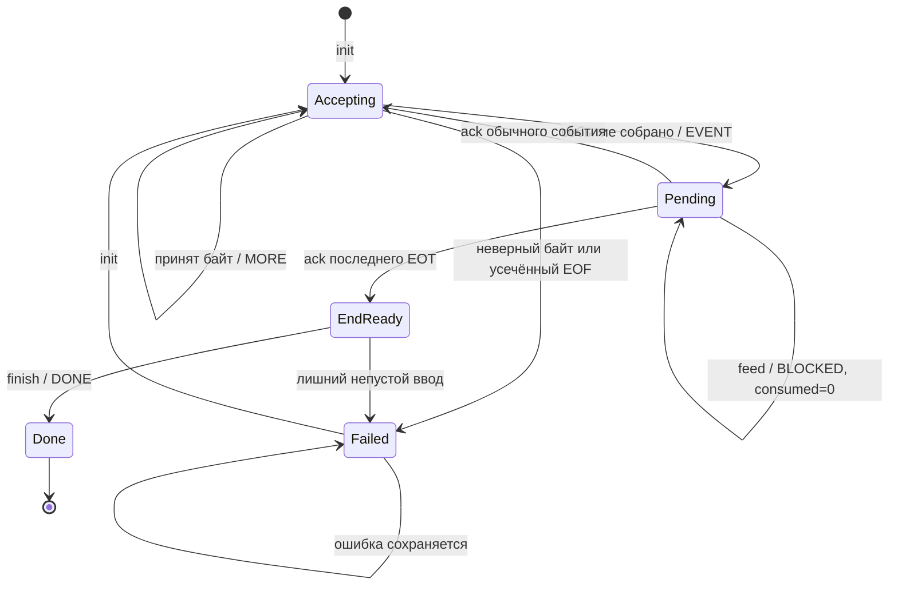
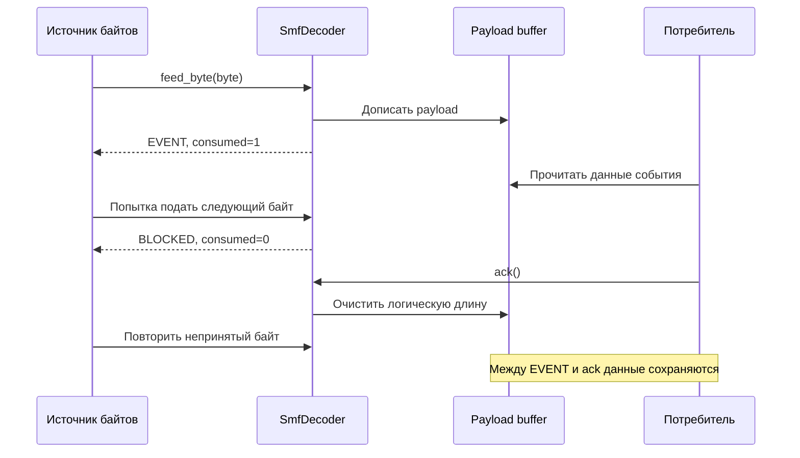
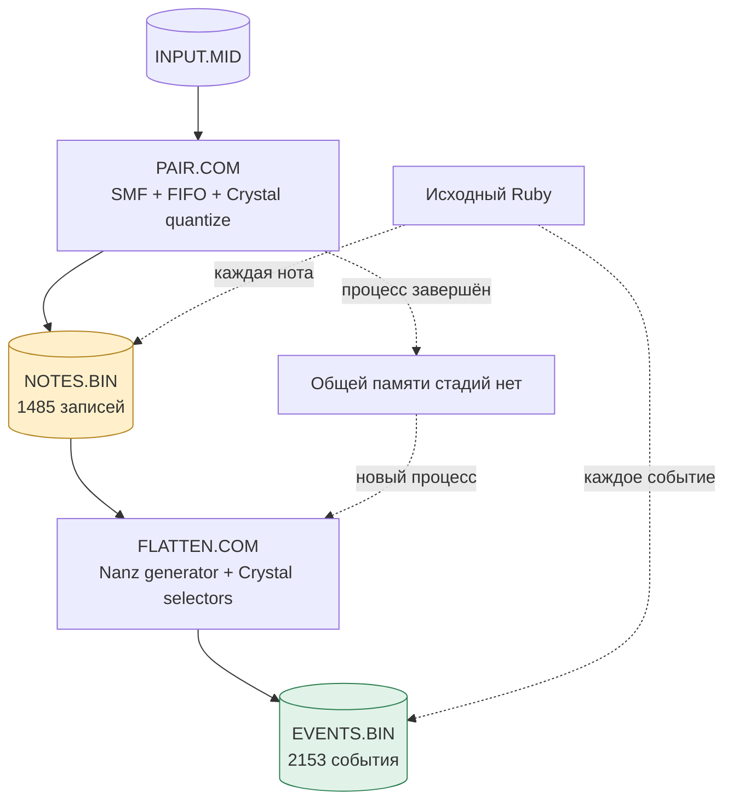

# Ruby умеет рассказывать. Z80 умеет считать. Как дать им общий язык

*26 октября 2026 года. Первая часть дневника MinZ: Crystal, метапрограммирование, двоичные потоки и идеи Erlang. Срез основного репозитория — `a716ff184`.*

[Все три статьи](README.md) · [Часть 2: мелодия между двумя файлами](02-melody-between-two-files.md) · [Часть 3: что заимствовать у экосистем](03-borrowing-without-a-runtime.md)

В MIDI-файле нет нот в привычном музыканту смысле. Там встречаются сообщения: нажали клавишу, отпустили клавишу, поменяли инструмент, прошло некоторое количество тиков. Чтобы получить ноту с началом и концом, нужно связать два события. Чтобы получить строку трекера, нужно ещё перевести время в другую сетку. А затем выяснить, что делать с несколькими одновременно звучащими нотами.

На Ruby эту работу удобно описывать через объекты, коллекции и небольшие выразительные преобразования. На Z80 каждый такой объект сразу вызывает вопросы: сколько байтов он занимает, кто владеет памятью, переживёт ли ссылка следующий прочитанный сектор? Между этими способами думать есть немалое расстояние.

Сегодня в MinZ через него уже проходит вполне осязаемая цепочка. Две отдельные программы CP/M читают и записывают файлы: `PAIR.COM` превращает MIDI Chronos в **1485 парных нот**, а `FLATTEN.COM` получает из них **2153 события** трёх выходных каналов. Ноты и события сверены с исходным Ruby. Программы запускаются отдельными процессами эмулятора, поэтому между стадиями действительно остаётся файл, а не спрятанная таблица в памяти теста. Подробности и ограничения зафиксированы в [доказательстве файловой цепочки](../../autosiril-native/file-flatten/README.md).

До полного нативного MIDI→VT2/VTX-конвертера ещё остаются музыкальные стадии и конечный формат. Но уже полученный результат позволяет обсудить более интересный вопрос: какие свойства современных языков помогают маленькой машине — и где именно должна происходить работа, чтобы они ей помогали?

## Красота Ruby здесь имеет практическую функцию

В проверяющем коде есть такой фрагмент. Это настоящий Ruby из [oracle.rb](../../autosiril-native/midi/oracle.rb), запускающего классы исходного Autosiril:

```ruby
paired = track.events.select do |event|
  event.respond_to?(:note) && event.respond_to?(:off) && event.off
end
next if paired.empty?

paired.each do |event|
  note = VNote.new(event.note, event.time_from_start,
                  event.off.time_from_start, 15)
  notes << {start: note.start, off: note.off,
            pitch: note.note, source: source}
end
```

В нескольких строках видны предметные понятия: дорожка, событие, завершённая нота, время, источник. Такая запись хороша ещё и тем, что её удобно оставить независимым эталоном. Мы не переводим этот Ruby в Go, а потом не сравниваем две версии собственного пересказа. Проверка загружает исходные `Setup` и `VNote`, использует `midilib` и получает результат привычным для оригинала способом.

Это существенно для старого музыкального инструмента. Его поведение состоит из алгоритма и накопившихся особенностей. Например, при окончании дорожки незакрытые ноты в выбранном Ruby-пути получают синтетические note-off с унаследованной последней дельтой времени. Для нескольких оставшихся нот эта дельта применяется последовательно. Соблазн «очевидно исправить» завершение на одну общую отметку времени привёл бы к другому результату.

Нативная стадия сохраняет эту особенность явно. Корпус проверяет обычное завершение, частично записанные окончания перед переполнением строки и переполнение синтетического 32-битного времени. Это хороший пример того, как читаемый высокоуровневый оригинал помогает низкоуровневой реализации: он сохраняет смысл, который легко потерять за масками, смещениями и границами массивов.

Ruby в этой истории исполняется на машине разработки. На Z80 работают скомпилированные Nanz и небольшие функции Crystal. Само это распределение обязанностей оказалось продуктивной частью архитектуры.

## Crystal приносит уже принятое решение о типах

Crystal особенно интересен рядом с Ruby: знакомые `def`, блоки, выразительные методы, но решение о конкретных типах можно получить до исполнения целевой программы. Для MinZ было бы дорого заново реализовывать чужие перегрузки, вывод типов и правила раскрытия макросов. Поэтому исследовательский frontend использует библиотеку настоящего компилятора Crystal.

Путь проходит через `Crystal::Compiler` с отключённой генерацией машинного кода: нормализацию, семантический анализ и cleanup. Экспортёр обходит достижимые специализации вызовов, уже разрешённые Crystal, и переводит поддержанное подмножество в Lanz — текстовое представление для передачи в общий HIR. Это описано в [итерации native frontend](../../crystal-hir/ITERATION1.md); точки входа находятся в [native_frontend.cr](../../crystal-hir/native_frontend.cr) и [typed_export.cr](../../crystal-hir/typed_export.cr).



В [specialize.cr](../../crystal-hir/specialize.cr) достаточно написать:

```crystal
def twice(x)
  x &+ x
end

def flavor(x : UInt8)
  x &+ 3_u8
end

def flavor(x : UInt16)
  x &+ 300_u16
end

def byte_demo(x : UInt8)
  twice(flavor(x))
end

def word_demo(x : UInt16)
  twice(flavor(x))
end

byte_demo(10_u8)
word_demo(1000_u16)
```

Crystal выбирает нужный `flavor` и создаёт конкретные варианты `twice` для `UInt8` и `UInt16`. Адаптер получает уже эти решения. Оператор `&+` здесь важен: он явно задаёт арифметику с переполнением по разрядности. Случайное превращение «обычного числа» в байт было бы скрытой сменой семантики.

Общий HIR позволяет разным frontend'ам пользоваться одной работой над вызовами, структурами, циклами и генерацией кода. Если проблема обнаруживается в общем понижении поля структуры, её исправление может помочь и Nanz, и Crystal. Такие случаи уже случились в экспериментах с буферами и borrowed views.

Границы остаются конкретными. Это семейство проверяемых экспортёров и мостов в `research/crystal-hir`, а не обещание скомпилировать любой Crystal-проект для Z80. Возможности добавлялись отдельными итерациями: скаляры, записи и указатели, представления срезов, итерация, буферы, кольца, генераторы. Перенос всего объектного runtime, GC и произвольной стандартной библиотеки из этого не следует.

## Маленький мост должен знать, что именно он соединяет

В музыкальной стадии Crystal отвечает, например, за перевод тика в строку. Вот реальная функция из [music.cr](../../autosiril-vm/music.cr):

```crystal
def crystal_quantize(tick : UInt32, ppqn : UInt32,
                     per_beat : UInt32) : UInt32
  whole = (tick // ppqn) &* per_beat
  fraction = ((tick % ppqn) &* per_beat) &+ (ppqn // 2_u32)
  whole &+ (fraction // ppqn)
end
```

Она отделяет целые доли от остатка и округляет дробную часть. Nanz вызывает её через объявленный скалярный интерфейс. До вызова проверяются PPQN, число строк на долю и предельный tick: конечная строка должна поместиться в `u16`, а промежуточная `UInt32`-арифметика не должна незаметно обернуться. В [pair.nanz](../../autosiril-native/midi/pair.nanz) предел вычисляется до квантизации:

```nanz
tick_limit = (u32(65536) * ppqn - 1 - ppqn / 2) / per_beat
if tick > tick_limit { fault = 202
    return 0 }
return u16(crystal_quantize(tick,ppqn,per_beat))
```

Это фрагмент существующей функции `paired_row`; `ppqn`, `per_beat`, `tick_limit` и `fault` определены её окружающим кодом.

Проверка интерфейса тоже оказалась содержательной работой. Manifest утверждает, что функция принимает три `u32` и возвращает `u32`. Однако утверждение в JSON ещё ничего не гарантирует о настоящем теле: оно может иметь другую сигнатуру, неожиданные зависимости, операции с памятью или иной способ возвращать ошибку.

Особенно тонкая проблема обнаружилась с именами. Импортированное тело могло сослаться на неизвестный ему `fault`. После присоединения к Nanz-модулю имя вдруг находило одноимённую глобальную переменную. Так предполагаемая независимая функция получала доступ к чужому состоянию.

Теперь выбранный экспорт проверяется отдельно, до разрешения имён в принимающем окружении. [VerifyClosedNames](../../../minzc/pkg/hir/verify.go) требует явных локальных объявлений и проверяет также адресные ссылки. Мост дополнительно проверяет настоящую ABI, эффекты и ABI ошибок. Тестовые мутации с чтением, записью и `(addr fault)` отвергаются. Проверки лежат рядом с [MIDI runner](../../../minzc/cmd/autosiril-midi-native/main_test.go).

Это небольшая, но важная граница доверия. Функция остаётся понятным компонентом, когда её зависимости перечислены в интерфейсе и действительно соответствуют телу. При этом общий режим проверки HIR сохраняет прежнюю совместимость Nanz; строгая проверка имён включается явно для таких мостов.

## Две метапрограммы встречаются до запуска Z80

Crystal-макрос получает узлы синтаксического дерева при компиляции и порождает код. Это прямо описано в [официальной документации macros](https://crystal-lang.org/reference/1.21/syntax_and_semantics/macros/index.html). Nanz тоже умеет выполнять метафункции во время компиляции, в своём MIR2 VM, и строить типизированный HIR.

Отсюда возникла занятная возможность: написать удобное выражение на Crystal, а специализированное тело получить настоящим Nanz-генератором.

```crystal
macro meta_repeat(value, count, delta)
  minz_meta_repeat({{value}}, {{count}}, {{delta}})
end

def three_iterations(x : UInt8)
  meta_repeat(x, 3_u8, 7_u8)
end
```

Это код из [meta_showcase.cr](../../crystal-hir/meta_showcase.cr). `minz_meta_repeat` — явный маркер согласованного протокола. Для нативного Crystal у него есть обычное тело с циклом: эталон по-прежнему можно исполнить независимо. Целевой импортёр распознаёт маркер и вызывает bridge, который запускает Nanz `fun @repeat`.



В [repeat.nanz](../../../minzc/internal/crystalmeta/repeat.nanz) генератор действительно строит узлы HIR. После разбора compile-time аргументов его основная часть выглядит так:

```nanz
let input: u16 = hir_caller_ref(c"value", c"u8")
let temp: u16 = hir_ref(c"meta_result", c"u8")
let block: u16 = hir_block()
hir_append(block, hir_var(c"meta_result", c"u8", input))
i = 0
while i < count {
    hir_append(block, hir_assign(temp,
        hir_binary(c"+", temp, hir_int(u16(delta), c"u8"))))
    i = i + 1
}
hir_append(block, hir_assign(input, temp))
emit_hir(block)
```

Цикл здесь исполняется компилятором. Для `count=3` он создаёт три сложения; дальнейшие проходы могут их упростить. По одному вызову такой системы рано делать вывод о выгоде любого макроса: разворачивание увеличивает размер кода, и на Z80 это тоже расход. Зато теперь выбор сделан в месте, где известны число повторений и тип операции.

[Проверка моста](../../crystal-hir/ITERATION2.md) охватывает 1792 набора входов на каждом из четырёх исполнителей: native Crystal, raw MIR2, optimized MIR2 и Z80. Есть повторное использование специализации и конфликтующее имя параметра `meta_result`. Runtime-значение вместо compile-time count отвергается. Этот мост пока имеет узкий протокол; универсальный доступ метафункции ко всему исходному Crystal AST не реализован.

Следующая итерация добавила более полезный источник специализации — **раскладку целевой структуры**. В [MetaArena](../../crystal-hir/meta_arena_showcase.cr) поле `marker` находится по смещению 20 на 64-битном host и по смещению 7 на Z80. Host-указатель занимает восемь байтов, целевой — два. Нельзя узнать offset у нативного Crystal и механически вставить его в программу Z80.

Импортёр сначала строит целевые типы. Затем настоящая Nanz-метафункция получает target offset, размер структуры и ширину указателя и генерирует чтение нужного байта. [Тесты layout bridge](../../crystal-hir/ITERATION4.md) сравнивают поведение, включая копию структуры и одноимённое поле двух разных типов. Конкретный marker-протокол пока ограничен; сам принцип уже проверен: машинные детали должны появляться после выбора машины.

## DSSL, DSL и маленький язык из двух слов

Название «DSSL» требует оговорки: в этом срезе репозитория отдельная технология с таким именем не определена. Здесь точнее говорить **DSL**, domain-specific language, — небольшой язык для конкретной задачи. В MinZ такие задачи разные: [описание hardware-операций](../../../reports/structured-hardware-emit/README.md), [правила преобразований компилятора](../../../docs/adr/0032-dsl-landscape.md), схемы двоичных полей. У этих направлений разный статус; старые планы backend DSL не следует считать списком сегодняшних работающих возможностей.

Для двоичного потока уже есть маленький язык, который легко прочитать целиком:

```nanz
import stream.bit_fields

@bit_fields("Header") {
    bits "kind" 3
    bits "flags" 5
}
```

Первые три старших бита — `kind`, следующие пять — `flags`. Реальная [метафункция bit_fields](../../../stdlib/stream/bit_fields.nanz) проверяет имена и ширины, а затем создаёт структуру с байтовыми полями и функцию `Header_decode(raw:u16, dest:^Header)`.



В этой схеме важна даже последняя коробка: результат занимает два байтовых поля, а не становится автоматически упакованным однобайтовым объектом. Мы описали разбор входного представления. Получившаяся структура выбирает удобное представление для последующей обработки.

Пример использования соответствует существующему тесту:

```nanz
fun header_kind(raw:u8) -> u8 {
    var decoded:Header
    Header_decode(u16(raw), &decoded)
    return decoded.kind
}
```

Полная схема и функция выше образуют Nanz-пример. Сам механизм проверяется [TestBitFieldMetaNative](../../../minzc/pkg/nanz/stream_decoder_test.go): все 256 входных байтов для двух полей, дополнительные 16-битные случаи и ошибочные схемы. Поддерживаются поля шириной 1–8 бит, не более восьми полей, общая ширина ровно 8 или 16 бит. Это небольшой реализованный контракт, который удобно расширять после новых проверок.

## Что в этой идее от Erlang

В Erlang разбор битов давно является выразительной частью языка. Например, следующую строку можно выполнить в Erlang shell:

```erlang
<<Kind:3, Flags:5, Length:16/little-unsigned-integer,
  Payload:Length/binary, Rest/binary>> = <<16#A7, 2, 0, 85, 204, 255>>.
```

Она связывает `Kind=5`, `Flags=7`, `Length=2`, выделяет двухбайтовый payload и оставшийся байт. Здесь декларация формы двоичных данных сразу участвует в сопоставлении. Размер следующего фрагмента может зависеть от уже прочитанного поля. Это пример Erlang bit syntax; его правила описаны в [официальном руководстве](https://www.erlang.org/doc/system/bit_syntax.html).

Битовый DSL MinZ берёт из этой идеи компактное описание полей. Полного Erlang bit syntax, произвольных bitstring patterns и подобного зависимого разбора в нём пока нет. Для переменной длины сейчас существует отдельный [PacketDecoder](../../../stdlib/stream/packet.nanz), написанный обычным Nanz. Он разбирает пример протокола `prefix:u8, length:u16 little endian, payload:length` по частям.

Именно здесь заканчивается простота красивой строки. В файле данные могут закончиться посреди длины. Следующий кусок может прийти через секунду. Потребитель может ещё не обработать предыдущий пакет. Эти ситуации требуют сохраняемого состояния и правил владения буфером.

В MinZ они представлены явно. Это делает хороший следующий шаг для DSL вполне понятным: научить декларацию порождать проверенный автомат с теми же правилами. Пока такой общий генератор автоматов остаётся идеей; готовый код состоит из битовой метасхемы и переиспользуемых написанных вручную декодеров.

## OTP полезно понимать до разговора об акторах

OTP — Open Telecom Platform — вырос из экосистемы Erlang и Ericsson. Это библиотеки, компоненты и принципы построения систем; Elixir использует эту уже существующую платформу. История и назначение кратко изложены на [сайте Erlang/OTP](https://www.erlang.org/about), а её использование из Elixir — в [официальном руководстве Mix и OTP](https://elixir.hexdocs.pm/main/introduction-to-mix.html).

Особенно полезна идея behaviours: отделить общий механизм сервера или автомата от обработчиков конкретной задачи. `gen_server`, `gen_statem` и supervisor формализуют разные роли. Дерево supervision описывает, кто наблюдает за рабочими процессами и что перезапускает при отказе. Эти понятия объясняет [руководство OTP Design Principles](https://www.erlang.org/doc/system/design_principles.html).

Такое разделение вдохновляет и на маленькой машине. У декодеров разные форматы, но одинаковые вопросы: какой байт принят, есть ли готовое событие, кому сейчас принадлежат данные, как обозначается окончание, что происходит после ошибки?

Действующий SMF-декодер отвечает на них без фонового исполнения. Приложение вызывает `feed_byte`, получает результат и само решает, когда продолжать. Нет отдельного actor runtime, почтовых ящиков, вытесняющего scheduler или supervision tree. Состояние хранится в структуре, переходы выполняются обычными вызовами. Полезное сходство с OTP здесь относится к устройству интерфейса и явному протоколу компонента.



Это схема внешнего протокола, а не полный граф внутренних фаз SMF. Внутри есть чтение заголовка, длины дорожки, VLQ, статуса, данных и payload. Внешнему потребителю достаточно знать, можно ли подавать следующий байт и когда освобождать предыдущий результат.

Будущий кооперативный планировщик мог бы обслуживать несколько таких автоматов. Тогда потребуются отдельные решения: сколько работы разрешено за один шаг, как ограничены очереди, кто владеет буферами при переключении, где допустимы прерывания. Само наличие `feed` и структуры состояния ещё не отвечает на эти вопросы. Для текущего файлового преобразования явного синхронного управления уже достаточно.

## Самая полезная операция — иногда «ещё не принимай байт»

В [stdlib/midi/smf.nanz](../../../stdlib/midi/smf.nanz) результат `feed_byte` упакован в `u16`: старший байт сообщает, принят ли входной байт, младший — статус. Если событие готово, оно сохраняется до `ack`. До подтверждения следующий ввод получает `BLOCKED` и `consumed=0`.

Так потребитель управляет темпом обработки, а декодеру не нужна растущая очередь. Meta/SysEx payload находится в предоставленном буфере. Пока событие выдано, его данные доступны потребителю; после `ack` буфер разрешено использовать для следующего события.



Это протокол временного пользования буфером, а не доказательство lifetime на уровне системы типов. Вызывающий код обязан держать дескрипторы и backing storage живыми и не накладывать их на неподходящие области памяти. Тем не менее явный срок действия ссылки гораздо легче проверить, чем неоговорённое «этот указатель пока работает».

Важна и разница между пустым куском и концом файла. Пустой кусок ничего не сообщает о будущем. Для EOF существует `finish()`: он подтверждает завершение после EOT всех дорожек или выдаёт ошибку усечения. Иначе случайная пауза источника могла бы выглядеть как корректное окончание музыки.

В простом [потребителе MIDI](../../binary-stream/midi_notes.nanz) обработка события помещается в небольшой фрагмент:

```nanz
let result:u16 = parser.feed_byte(byte,&message)
let status:u8 = u8(result & 255)
if status == SmfStatus.EVENT {
    let kind:u8 = message.status & 240
    if kind == 144 {
        if message.data2 != 0 { note_ons = note_ons + 1 }
        else { note_offs = note_offs + 1 }
    }
    if kind == 128 { note_offs = note_offs + 1 }
    last_tick = message.tick
    parser.ack()
}
```

Это часть реальной функции `midi_byte`; её глобальные счётчики и буферы объявлены в том же файле. Нулевую velocity потребитель трактует как note-off. Декодер при этом сохраняет исходный wire status. Разделение позволяет независимо проверить точность разбора и музыкальную интерпретацию.

События SMF поступают в порядке дорожек файла. Их слияние в общий хронологический поток для воспроизведения — отдельная задача. Наличие `tick` и успешного парсинга не означает готовый MIDI-плеер.

## Где заканчивается красивая идея и начинается доказательство

У [базового бинарного эксперимента](../../binary-stream/README.md) уже был серьёзный внешний корпус: четыре MIDI-файла, 28 724 события, сравнение всех полей и полного payload в raw MIR2, optimized MIR2 и Z80. На каждом событии проверялось поведение при неподтверждённом выходе. Отдельные тесты перебирали разбиения короткого потока на куски, перенос кольцевого буфера, EOF и повреждённые заголовки.

Следующая [MIDI pairing-веха](../../autosiril-native/midi/README.md) добавила музыкальное состояние: FIFO для одинаковой высоты на одном канале, разделение каналов, стабильное удаление из активного списка, закрытие в EOT и квантизацию. Её 38 случаев исполняются с кусками 1, 7 и 256 байтов на трёх целевых вариантах — 342 исполнения. Вместе с результатами независимо заданы ожидаемые ошибки, число принятых байтов, событий, источников и активных нот.

Затем появились файлы и две `.COM`-программы. Здесь доказательство меняет форму: уже недостаточно правильно вычислить массив в памяти. Нужно сохранить формат, закрыть файл, распознать усечение, не спутать физическое заполнение последней записи CP/M с дополнительными данными и не принять частичный результат после ошибки I/O.



Оба образа включают полную арену нот размером 12 288 байт: это учтённая память. `PAIR.COM` занимает 30 914 байт загруженного образа, `FLATTEN.COM` — 22 750. Эти две величины не нужно складывать как одновременно живущую программу: стадии последовательно заменяют друг друга. Выходные события записываются через 128-байтовый буфер, а не накапливаются целиком.

В этой же точке полезно остановить воображение раньше, чем оно превратит эксперимент в готовый продукт. Это CP/M-цепочка в эмуляторе, с конкретным профилем Chronos и ещё ограниченной конфигурацией. Обработка аранжировки, echo/mix и конечный VT2/VTX не завершены. Измеренные пики стека относятся к выполненному корпусу; они не являются автоматически доказанной верхней границей для любой будущей программы.

На момент написания в отдельном незакоммиченном Spectrum-прототипе локально прошли 60 случаев на трёх вариантах исполнения — 180 проверок первой стадии. Там исследуются TRD, секторный ввод и страничная память. Эти результаты ещё не входят в данный срез `main` и не являются испытанием на физическом Spectrum. Подробности платформенного пути относятся ко второй статье; языковая архитектура от этого разделения только выигрывает: алгоритм, файловый адаптер и способ доступа к памяти можно проверять по отдельности.

## Что можно попробовать самому

Все команды ниже запускаются из корня репозитория. Это существующие проверки, а не результаты нового прогона при написании статьи.

Битовые схемы и двоичные автоматы доступны без Ruby-корпуса:

```sh
go -C minzc test ./pkg/nanz \
  -run '^(TestBitFieldMetaNative|TestPacketDecoder.*Native|TestSMF.*Native)$' \
  -count=1 -v
```

Мост макросов требует установленного Crystal с библиотекой компилятора, Go и Python:

```sh
python3 research/crystal-hir/verify_meta.py
python3 research/crystal-hir/verify_meta_records.py
```

Замороженный MIDI-корпус воспроизводит проверенные Ruby/Crystal-продукты без установки этих языков; fresh gate строит их заново и использует отдельный checkout Autosiril:

```sh
go -C minzc test ./cmd/autosiril-midi-native -count=1

python3 research/autosiril-native/midi/verify.py \
  --autosiril /path/to/autosiril --out /tmp/minz-native-midi-proof
```

Свежий прогон нужен, когда меняется смысл эталона или экспортируемой функции. Замороженный replay нужен, чтобы обычный CI не зависел от установленного Ruby, Crystal и внешних MIDI-файлов. Их связывают hashes исходников, входов и результатов; это разные способы поддерживать одно проверяемое утверждение.

У этой истории остаётся вполне конкретное продолжение. Можно дать автору протокола более выразительный язык состояний, сохранив текущие контракты `feed`, `ack`, EOF и ограниченного буфера. Можно расширить мост метапрограммирования, сохранив целевой layout и явные зависимости. Можно соединять следующие музыкальные стадии, измеряя полную память каждой.

Самый интересный результат уже виден в сегодняшнем коде: читабельный исходник и явный машинный бюджет становятся совместимыми, когда компилятор получает достаточно информации заранее. Ruby помогает удержать музыкальный смысл. Crystal разрешает типы и специализации. Nanz описывает память, протоколы и генерацию. А Z80 получает программу, у которой можно посчитать байты и проверить каждый переход на настоящих входных данных.
