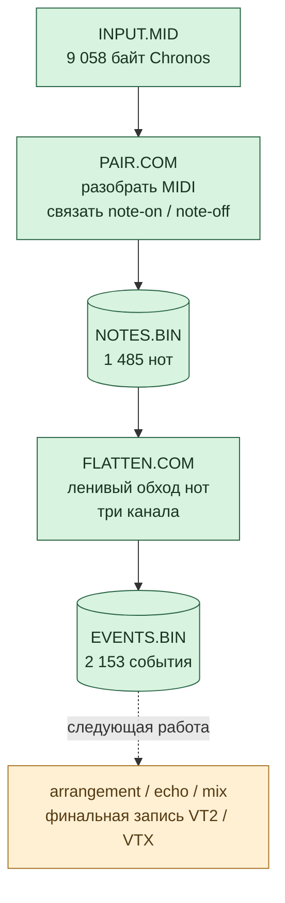
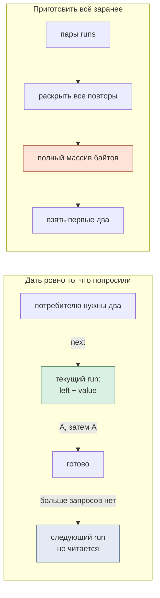
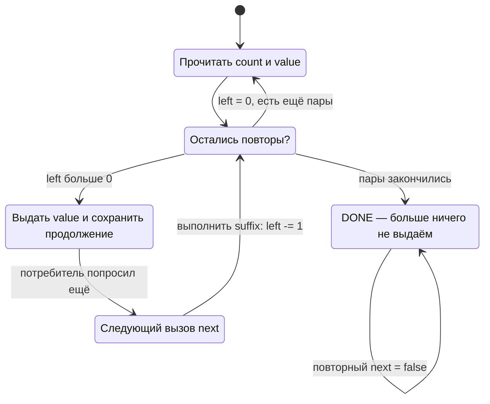
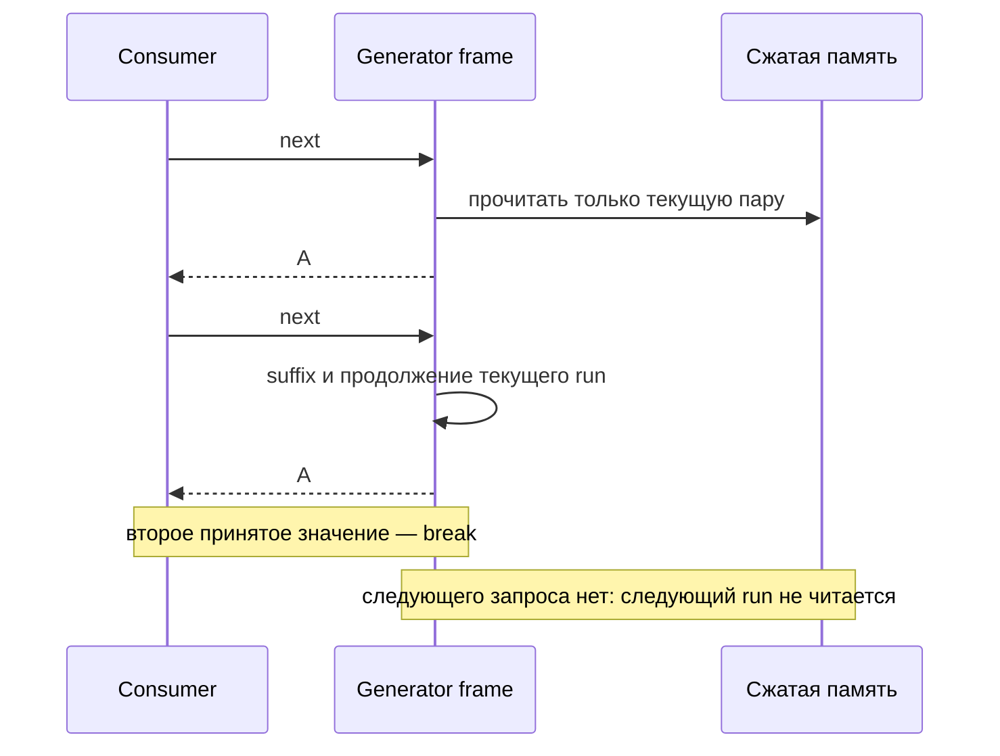
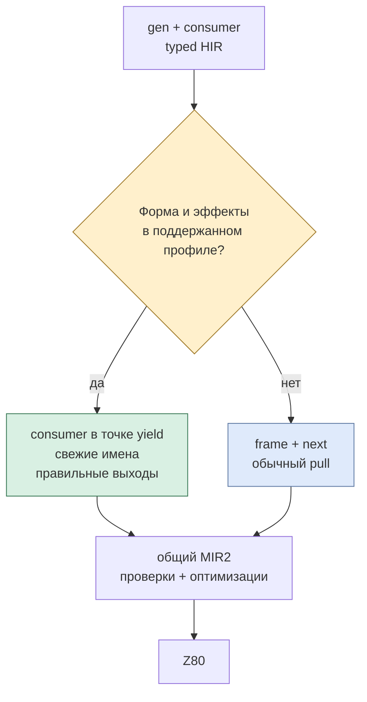
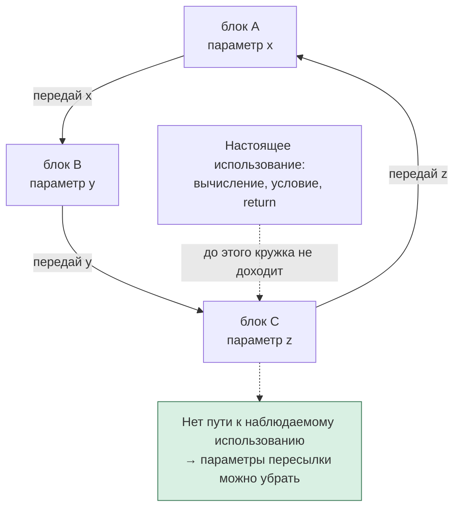

# Мелодия между двумя файлами

## Как ленивость, генераторы и 64 байта RLE приблизили Autosiril к Z80

*26 октября 2026 · День из жизни MinZ, часть 2*\
[Все три статьи](README.md) · [Часть 1: языки и идеи](01-languages-and-ideas.md) · [Часть 3: чему учиться у экосистем](03-borrowing-without-a-runtime.md)


У сегодняшнего дня есть довольно осязаемый результат: одну программу можно завершить, её память освободить, запустить другую — и мелодия продолжит своё путешествие.

Это не многозадачность и не спрятанный за красивым синтаксисом огромный runtime. Это две небольшие нативные утилиты, обычные файлы и Z80, который действительно исполняет полученный машинный код в эмуляторе. Первая читает MIDI и связывает начала и окончания нот. Вторая читает записанные ноты и превращает их в события трёх каналов.

Но самое интересное произошло раньше, по дороге к этим двум файлам. Чтобы они стали возможны, пришлось изменить вопрос. Вместо «как уместить весь результат в память?» мы стали спрашивать: **«какую следующую вещь уже действительно попросил потребитель?»**

На этой маленькой перемене держится большая часть истории: ленивые вычисления, генераторы, fusion, аккуратное обращение с банковой памятью и неожиданно симпатичный RLE-декодер.

## Сначала — честная фотография дня

На момент этой статьи в `main` уже вошли [PR #262](https://github.com/oisee/minz/pull/262) и [PR #263](https://github.com/oisee/minz/pull/263). Их самостоятельная файловая цепочка выглядит так:



Утилиты запускаются по очереди в отдельных процессах `mze -t cpm`. Первая не передаёт второй заранее готовую арену из host-кода. После её завершения остаётся файл. Следующая утилита сама открывает его через BDOS, читает, проверяет и работает с данными на target.

Все **1485 нот и 2153 события** Chronos совпали с оригинальным Ruby Autosiril. Новая вторая стадия прошла **201 исполнение**: 67 случаев в raw MIR2, оптимизированной MIR2 и собранном Z80. Отдельно повторены прежние 342 MIDI-исполнения и 147 проверок файлового producer. Это число запусков, а не число песен: в корпусе есть границы ёмкостей, пустые входы, испорченные записи и ошибки ввода-вывода. [Точный состав и receipts](../../autosiril-native/file-flatten/README.md).

Полный нативный Autosiril пока не готов. Сегодняшний результат — проверенные первые стадии; последующие музыкальные преобразования и окончательный tracker-файл ещё предстоит довести до такого же состояния. Именно поэтому правая часть схемы выделена другим цветом.

## Ruby умеет рассказывать, что мы хотим

Ruby прекрасен тем, что обработку коллекции легко записать почти как предложение. Например, такой учебный декодер раскрывает пары `[сколько, какое значение]`:

```ruby
runs = [[3, 65], [0, 90], [2, 66]]
bytes = runs.flat_map { |count, value| [value] * count }
# => [65, 65, 65, 66, 66], то есть "AAABB"
```

Здесь хорошо виден смысл. Нулевой run ничего не добавляет, три буквы A сменяются двумя B. Но конкретно эта запись создаёт промежуточные массивы и готовит весь результат. Для настольного скрипта это часто совершенно разумная цена за ясность.

На Z80 нам хочется сохранить ясность, а стоимость выбрать иначе. Если потребитель просит только два байта, незачем сначала создавать пять. Если поток длиннее доступной памяти — весь результат вообще может не существовать одновременно.

Ruby тоже умеет выдавать элементы по запросу: `Enumerator` и `lazy` позволяют строить такие программы. Учебный вариант выше нужен для контраста двух способов выполнения, а не для противопоставления языков. И сам экспериментальный RLE ниже — отдельный тест компилятора; мы не утверждаем, что нашли именно такой `flat_map` внутри оригинального Autosiril.

На уровне замысла оба подхода говорят о той же последовательности. Различается момент, когда появляется очередной элемент.



## Генератор — маленькая машина с закладкой

В Nanz проверенный RLE producer записан так. Это отформатированная версия реального [исходника измеряемого ядра](../../generator-fusion/rle/sum.nanz):

```nanz
gen runs(src:^u8, pairs:u8)->u8 {
    while pairs != 0 {
        var left:u8 = src[0]
        let value:u8 = src[1]
        src = src + 2
        pairs = pairs - 1
        while left != 0 {
            yield value
            left = left - 1
        }
    }
}
```

`yield` здесь означает: «вот следующий байт; продолжение пока подождёт». Нужно помнить, где остановились, сколько повторов осталось и какое значение выдавать. Для этого общее HIR lowering строит конкретный frame состояния и функцию `next`.

Отдельный стек для каждого генератора не требуется. Frame — данные; `next` — обычный вызов, который читает эти данные, проходит до следующего yield и сохраняет продолжение. Где именно хранить frame, решает окружающая программа и lowering. Это не обещание, что произвольный генератор всегда занимает несколько байтов: живые переменные и захваченные зависимости имеют реальную стоимость.



У Crystal уже есть узнаваемая запись той же идеи — метод с блоком и `yield`. Ниже сокращённая форма проверенного RLE-примера; полный корпус дополнительно ведёт trace-счётчики:

```crystal
def rle_stream(src : Pointer(UInt8), pairs : UInt8, &)
  while pairs != 0_u8
    left = src[0_u16]
    value = src[1_u16]
    src = src + 2_u16
    pairs = pairs &- 1_u8
    while left != 0_u8
      yield value
      left = left &- 1_u8
    end
  end
  nil
end
```

Bridge переводит поддержанную форму Crystal producer в те же HIR `YieldStmt` и generator-функцию, которыми пользуется Nanz. Значит, frame lowering, исправления завершения и дальнейшие общие оптимизации не нужно придумывать второй раз для Crystal. Это пока проверенный subset одностороннего yield, а не импорт всей стандартной иерархии Crystal Iterator. [Реальный пример и границы](../../crystal-hir/ITERATION8.md).

## Ленивость — обещание о событиях, а не только о памяти

У ленивого producer есть более тонкая обязанность, чем экономить массив. Он не должен заранее выполнять работу, которую никто не запросил.

Пусть следующий run читается из аппаратного порта. Или переключает страницу памяти. Или содержит ошибку, до которой программа по своему смыслу вообще не доходит. Тогда лишний `next` — наблюдаемое изменение поведения.

Возьмём обычный Nanz consumer:

```nanz
var accepted:u8 = 0
var total:u16 = 0
for value in runs(&data, 8) {
    if value == 0 { continue }
    total = total + u16(value)
    accepted = accepted + 1
    if accepted == 2 { break }
}
```

Мы просим два **принятых** значения. Нулевых значений producer может выдать больше; consumer их пропускает. Но после второго принятого элемента дальнейшие пары читать нельзя. Более того, `break` должен остановить producer до его следующего suffix. А `continue` consumer, наоборот, должен выполнить producer suffix и только потом запросить новый элемент. Иначе декодер может бесконечно выдавать один и тот же байт.



Именно поэтому наши тесты сравнивают не только сумму в конце. Они проверяют полную упорядоченную трассу: проверки условий, чтения, yield, тело consumer и suffix. Отдельные нативные read heatmaps подтверждают, что после раннего break последующие пары не были прочитаны. Это уже контракт вычисления. [Семантические проверки RLE](../../generator-fusion/rle/README.md).

## Fusion: убрать конвейерную ленту, сохранив порядок действий

Генератор с frame удобен, когда producer нужно сохранять между отдельными запросами. Но иногда весь маршрут виден компилятору: вот producer, вот единственный немедленный consumer.

Тогда вызовы `next`, запись выходного слота и часть состояния можно убрать. На месте yield оказывается тело consumer. Это и есть generator fusion в нашем ограниченном HIR-профиле.


Схематически сумма становится обычными вложенными циклами. Следующий фрагмент объясняет преобразование, а не претендует на дословный HIR dump:

```nanz
while pairs != 0 {
    var left:u8 = src[0]
    let value:u8 = src[1]
    src = src + 2
    pairs = pairs - 1
    while left != 0 {
        total = total + u16(value) // consumer на месте yield
        left = left - 1
    }
}
```

Сложность спрятана в сохранении смысла `break`, `continue`, `return`, порядка вычисления аргументов и имён локальных переменных. Если consumer хочет выйти из всего producer, одного выхода из внутреннего `while` недостаточно: преобразование должно завершить и внешний. Если потребитель меняет backing memory, нельзя без доказательства заранее прочитать следующую пару.

Текущий pass поэтому допускает конкретные формы, включая этот двухуровневый RLE, и отказывает остальным. Он включается через `--fuse-generators`; это не общий автоматический fusion любой цепочки. Сложный Autosiril producer с ручным pull пока не сливается этим pass. [Условия допуска и fallback](../../generator-fusion/README.md).



Ленивость отвечает на вопрос **«когда вычислять?»**. Fusion — **«нужны ли для этого отдельные вызовы и frame?»**. Можно иметь ленивый неслитый generator. Можно выполнить весь поток через слитые циклы. Экономия памяти и удаление накладных расходов связаны, но это разные решения.

## Получилось ли красивое машинное продолжение?

На одном конкретном измеряемом RLE-ядре — да. Входные восемь пар загружаются во время исполнения; они раскрываются в 13 байтов с суммой 1362. Это не компиляция заранее известного ответа.

| Вариант того же RLE-ядра | Код | Z80 T-states | Стек ниже входа |
|---|---:|---:|---:|
| Обычный pull | 311 байт | 16 201 | 19 байт |
| Первый двухуровневый fusion | 73 байта | 3576 | 4 байта |
| Fusion + удаление мёртвой пересылки | **64 байта** | **3253** | **4 байта** |

Все helper-функции входят в размер кода; только 16 входных байтов исключены. Последний вариант даёт полный linked binary 80 байт. Стек указан без начального двухбайтного адреса возврата. T-states измерены CPU-эмулятором, не физической платой. Это результат данного ядра, не обещание пятикратного ускорения любого Ruby-подобного кода. [Измерения и исходники](../../generator-fusion/dead-params/README.md).

Последние девять байтов исчезли благодаря довольно забавной находке. В MIR2 три block-параметра пересылали друг другу значение, которым больше никто не пользовался. Каждый выглядел «использованным», потому что передавался соседу. Получился маленький бюрократический кружок: три кабинета передают друг другу пустую папку.



Анализ теперь начинает с настоящих использований и распространяет живость назад по переходам. Закрытый forwarding-only цикл без такого корня исчезает. Этот cleanup работает на общем MIR, а не только на RLE и не только на одном frontend. При этом он не получает права удалять чтения, вызовы, traps или записи просто потому, что их результат не нужен.

Так удобный генератор неожиданно помог найти улучшение, полезное всему компилятору. Вот более интересный смысл «обогатить HIR/MIR», чем добавить специальную инструкцию «быстро распакуй RLE».

## А при чём здесь трансдьюсеры?

Трансдьюсер удобно понимать как преобразование шага обработки: «пропусти неподходящие значения», «измени принятое значение», «остановись после нужного числа результатов». В Clojure этот механизм отделён от конкретного источника и приёмника и позволяет композицию без промежуточных коллекций. [Короткое определение и API](https://clojure.org/reference/transducers).

У нас есть родственная инженерная цель: отделить смысл последовательности от того, лежит ли она в массиве, приходит из generator или читается с диска. Но текущий Nanz generator fusion не является реализацией Clojure transducer protocol. И fluent-запись `runs(...).filter(...).take(2)` в приведённом примере пока не добавлена: проверенный consumer записан явным циклом.

Это полезная граница. Нам уже доступен выигрыш от композиции и ограничения спроса; красивый универсальный API можно растить поверх доказанного поведения. Тогда синтаксис будет опираться на работающие правила остановки, а не скрывать неизвестный порядок эффектов.

## MIDI — это ещё и бухгалтерия времени

RLE показывает идею на байтах. MIDI добавляет музыку и несколько видов времени.

Файл содержит события с delta-time, running status и границами дорожек. Note-on и note-off ещё нужно связать. Тики нужно превратить в строки. А затем определить, что конкретно должен делать tracker-канал в каждой строке: начать ноту, продолжить её, отпустить или выбрать одну из нескольких.

Поэтому **2984 MIDI-события, 1485 связанных нот и 2153 flatten-события — разные сущности**. Их числа не должны совпадать. Это не потерянная половина файла, а последовательные представления музыки.

Вот реальный Crystal kernel, которым пользуется Nanz-часть:

```crystal
def crystal_cell_action(mask : UInt8) : UInt8
  return 0_u8 if mask == 0_u8
  return 0_u8 if mask == 2_u8
  return 4_u8 if mask == 4_u8
  1_u8
end
```

Биты означают start=1, continue=2, release=4. Продолжение без нового события не требует вывода, release-only выдаёт отпускание, остальные непустые комбинации приводят к запуску/перезапуску. Это сохранение поведения оригинального конвертера, а не новое правило MIDI. [Все музыкальные kernels](../../autosiril-vm/music.cr).

Nanz producer уже умеет выдавать очередную запись по запросу:

```nanz
// Фрагмент реального flattened из lazy_flatten.nanz.
gen flattened(source:u8, mode:u8)->u16 {
    // ... найти следующую значимую строку и обновить active[] ...
    // ... получить action и выбрать pitch ...
    yielded = yielded + 1
    yield_row = row
    yield u16(pitch) | (u16(action) << 8)
    // ... убрать завершённые handles, сохранив порядок ...
}
```

Это иллюстративная вырезка, не самостоятельная компилируемая функция: [полное тело](../../autosiril-vm/lazy_flatten.nanz) существенно богаче. Оно хранит handles активных нот и двигается между значимыми границами. Ленивая выдача помогает не строить заранее весь выход; сами связанные входные ноты нынешняя нативная стадия всё ещё хранит в ограниченной арене.

Отсюда важное ограничение: «ленивый pipeline» не означает «в памяти никогда нет всей песни». Мы убираем материализацию там, где это уже проверено. Новое устройство остальных стадий ещё требует работы.

## Два файла — способ сделать память снова свободной

У первого совместного in-process образа MIDI → pairing → три flatten-канала получилось **40 626 байт**. Это полезный работающий маршрут: никакой host не передаёт готовые ноты между фазами. Но несколько следующих стадий уже не обязаны помещаться в ту же картину памяти.

Здесь особенно хороша предложенная Alice Unix-подобная мысль: пусть каждый инструмент делает одну стадию, а граница между ними будет явной. Для этого не нужны Unix pipes или одновременное выполнение процессов. На CP/M команды могут просто запускаться по очереди.

| Утилита | Полный образ | Из него globals | Статические spills | Максимум стека ниже входа |
|---|---:|---:|---:|---:|
| PAIR.COM | 30 914 байт | 15 063 | 440 | 66 байт |
| FLATTEN.COM | 22 750 байт | 14 380 | 165 | 63 байта |

Оба образа уже включают резерв арены 12 288 байт. Эти два размера не складываются при последовательном запуске: первая программа закончилась, прежде чем загрузили вторую. Стек приведён отдельно и не включает начальный адрес возврата. [Полная раскладка](../../autosiril-native/file-flatten/README.md).

Файл между стадиями стоит дополнительных обращений к диску. Зато код, временные таблицы и локальное состояние предыдущей программы больше не обязаны занимать RAM следующей. В будущем часть маршрута можно заменить resident dispatcher/overlay или прямым вызовом, когда доказаны их правила загрузки и lifetime. Общая форма записей позволяет менять это решение без переписывания музыкальных правил.

## Конец файла оказался интереснее, чем ожидалось

В CP/M физическая запись занимает 128 байт. Полезные данные редко заканчиваются точно на её границе. Поэтому бинарному pipeline нужен собственный логический конец.

Для ASIR v1 мы записываем заголовок с версией и шириной payload, DATA-записи и завершение:

```text
ASIR | version | kind | width | flags | metadata | reserved
01   | полезная запись
01   | полезная запись
...
FF   | count:u32 little endian | "END!"
00... физическое заполнение последнего блока
```

Ненулевой END и подпись после count нужны не ради красоты. Первоначальный нулевой terminator у пустого потока нельзя было надёжно отличить от нулевого заполнения. Теперь потерянное завершение не превращается в удачный пустой результат только потому, что сектор дополнен нулями.

Нельзя также считать любой `0x1A` текстовым EOF: внутри MIDI это может быть обычный байт. Для SMF логический конец определяется самим форматом; CP/M-адаптер отдельно проверяет остаток последнего блока. В inter-stage файле логический END и padding тоже проверяются отдельно. Дополнительная целая физическая запись не считается безобидным заполнением.

И ещё один неожиданно музыкальный край: ровно 1024 выходных события и «было бы 1025, но буфер кончился» — разные результаты. Утилита проверяет дополнительный pull. В первом случае она завершает generator и пишет корректный END; во втором возвращает ошибку переполнения вместо успешной усечённой песни.

## Почему всё это особенно к месту на Z80

Дело не в том, что Z80 внезапно получил большой компьютер внутри. Мы стали лучше описывать работу, которая ему действительно нужна.

Генератор хранит продолжение вместо полного результата. Fusion убирает отдельный протокол там, где его существование уже не нужно. Скалярные handles переживают смену банков лучше, чем случайно сохранённый near pointer. Явный record format переживает смену утилиты лучше, чем дамп native struct. Ограниченный buffer позволяет отказаться от неограниченного роста heap — при условии, что его переполнение действительно проверяется.

С такими средствами в восьмидесятые было бы удобнее описывать распаковку картинок, чтение бинарных протоколов, проходы по нотам, выборку кадров или выдачу очередного тайла. Не потому, что исчезают ограничения: становятся видны места, где программисту действительно нужно решить вопрос памяти, порядка и остановки.

Сегодня CP/M-цепочка уже в `main`. Отдельный локальный Spectrum/Scorpion эксперимент успел пройти 180 запусков первого MIDI → TRD этапа, включая ошибки секторов и границы каталога; это ещё экспериментальная ветка, не интегрированная здесь поддержка physical TR-DOS ROM. Остальные музыкальные стадии остаются следующим большим участком пути.

А самый приятный итог дня, пожалуй, такой: запись программы становится ближе к тому, как мы о ней думаем. «Дай следующую ноту». «Пропусти пустое». «Этого достаточно». Компилятор учится превращать эти просьбы в обычные циклы, память и переходы — и иногда оставляет от всей красивой конструкции всего 64 байта.

## Где потрогать руками

Начать можно с небольшого RLE gate; для музыкального gate нужен локальный checkout оригинального Autosiril и Ruby с его зависимостями:

```sh
python3 research/generator-fusion/dead-params/verify.py \
  --out /tmp/minz-rle-proof

PYTHONDONTWRITEBYTECODE=1 python3 research/autosiril-native/file-flatten/verify.py \
  --autosiril /path/to/autosiril --out /tmp/minz-file-chain
```

Ссылки для дальнейшего чтения: [ограниченный HIR fusion](../../generator-fusion/README.md), [RLE и спрос](../../generator-fusion/rle/README.md), [удаление мёртвой пересылки](../../generator-fusion/dead-params/README.md), [Crystal yield → общий generator](../../crystal-hir/ITERATION8.md), [связанные файлы и все границы](../../autosiril-native/file-flatten/README.md), [отдельный in-process путь](../../autosiril-native/linked/README.md), [ADR 0053 о последовательных утилитах](../../../docs/adr/0053-staged-utilities-and-stream-transports.md).
