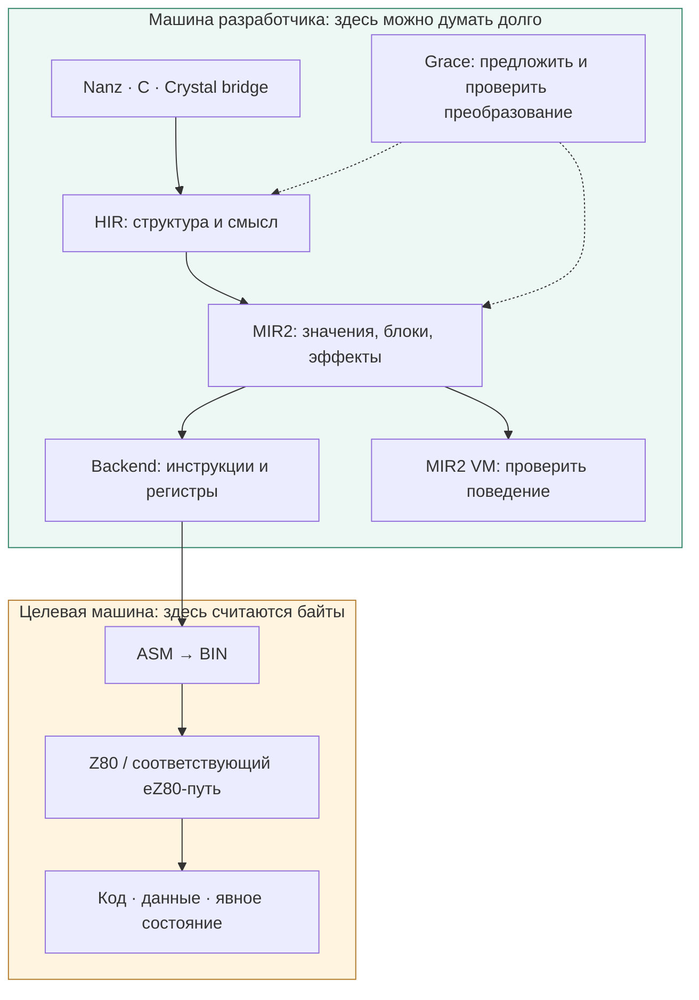
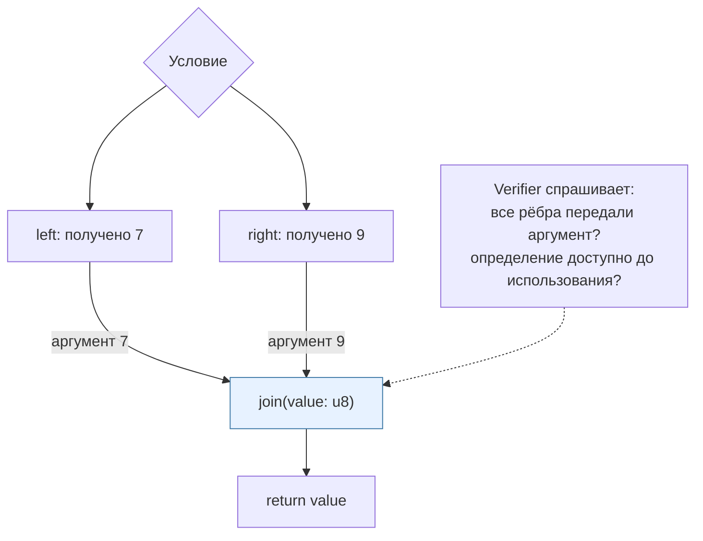
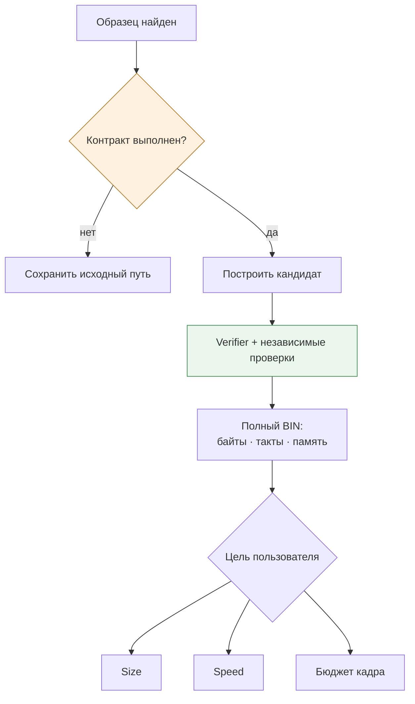
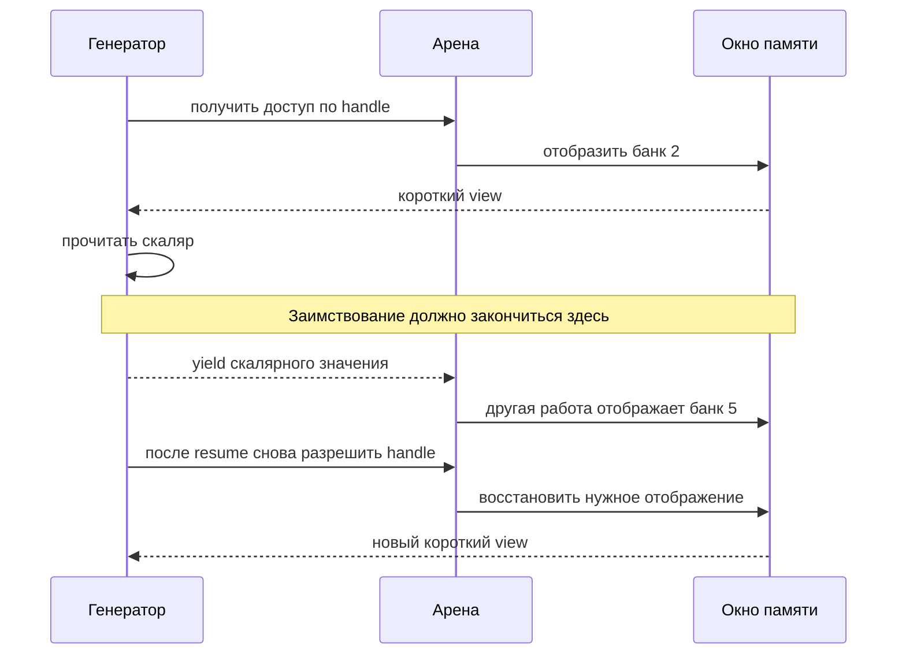
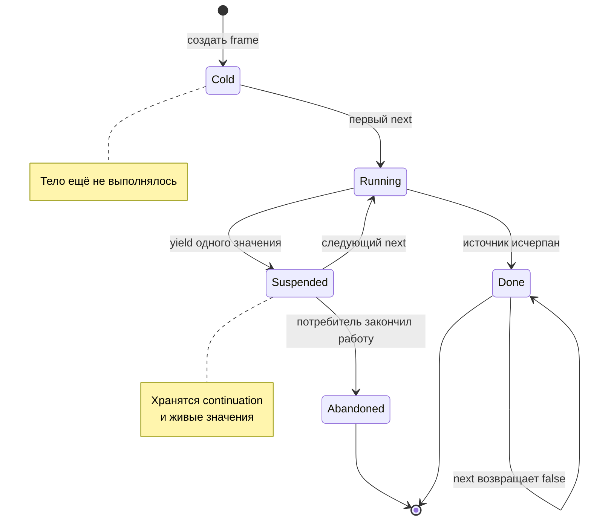
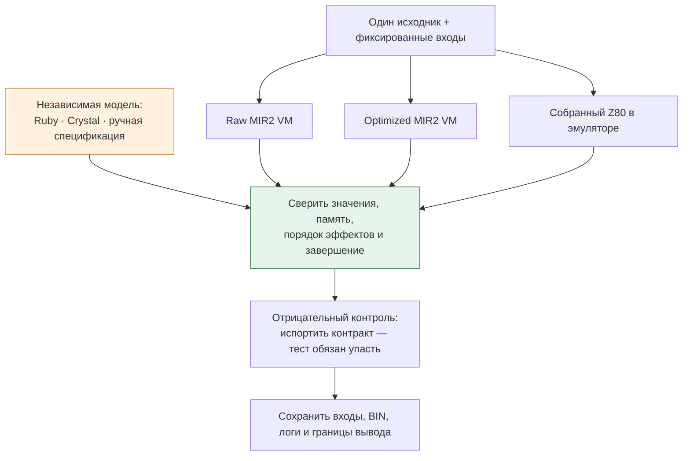

# Чемодан без виртуальной машины: что MinZ стоит привезти из LLVM, .NET и BEAM

*День компилятора, 26 октября 2026. Третья статья: идеи больших экосистем, которые помещаются в маленький компьютер.*

[Все три статьи](README.md) · [Часть 1: языки и идеи](01-languages-and-ideas.md) · [Часть 2: мелодия между двумя файлами](02-melody-between-two-files.md)

Представим, что разработчик MinZ отправляется на конференцию языков программирования. LLVM предлагает ему строгий промежуточный язык. Cranelift — аккуратный инструмент для описания машинных правил. C# показывает работу с памятью без обязательной копии. Kotlin достаёт генератор состояний. Erlang объясняет, как пережить отказ одного компонента.

На обратном пути возникает проблема: у нашего компьютера может быть 64 килобайта адресного пространства. Весь сувенирный магазин не увезти.

Но привезти можно другое: способ думать о программе. Проверки, выполняемые на машине разработчика, не обязаны превращаться в инструкции на Z80. Удобная конструкция языка не обязана тащить сборщик мусора. Даже идея из многозадачной виртуальной машины может превратиться в обычный `switch`, несколько байтов состояния и ясный договор между функциями.

У MinZ уже есть подходящий фундамент: общий HIR, MIR2, интерпретатор MIR2, Z80 backend и независимые проверки собранного машинного кода. А последние эксперименты с Crystal, генераторами и музыкальным конвейером дают возможность обсуждать заимствования на настоящих программах. Ниже **«работает» означает конкретный реализованный путь; «предлагаем» — следующий архитектурный шаг**. Срез репозитория для статьи — `a716ff184`.

## Сначала разберёмся, кто вообще приехал на конференцию

В одном разговоре легко назвать LLVM, JVM и BEAM «виртуальными машинами». Для архитектуры компилятора такое сокращение опасно.

LLVM — компиляторная инфраструктура с собственным IR. Cranelift — backend, принимающий IR и выпускающий машинный код; Wasmtime использует его и для JIT, и для AOT. CLR и JVM относятся к средам исполнения. Kotlin и C# — языки со своими компиляторами и библиотечными экосистемами. BEAM — среда исполнения Erlang, а OTP добавляет организационные принципы и библиотеки. [О Cranelift](https://cranelift.dev/), [LLVM IR](https://www.llvm.org/docs/LangRef.html).

Grace в этой статье — **собственная инфраструктура переписывания MinZ**, а не одноимённый язык и не отдельная машина исполнения. Она сопоставляет структурные образцы, проверяет условия и вызывает преобразования. Её место — внутри компилятора.



Это главный способ экономии: выполнить сложную работу заранее. Анализ времени жизни может остаться на host. Отбор специализации — тоже. На target попадёт выбранная программа и только та поддержка, которую требует её контракт.

Сегодня обычный путь MinZ — HIR → MIR2 → Z80. VIR служит офлайн-исследованиям; возвращать удалённый LIR ради красивой диаграммы не требуется. Эту границу фиксируют [обзор компилятора](../../../reports/2026-10-11-092-grace-vm-z80-status.md) и [ADR о переносе полезных преобразований](../../../docs/adr/0044-lir-retirement-and-rule-migration.md).

## LLVM: одолжить точность договора

Самая ценная черта хорошего IR — возможность объяснить, почему преобразование законно.

Рассмотрим учебный пример:

```text
x = read_port()
y = x * 0
return y
```

Умножение можно заменить нулём. Вызов `read_port()` исчезать не должен: он может подтверждать аппаратное событие. Другой пример:

```text
a = load(p)
select_bank(3)
b = load(p)
```

Одинаковый численный адрес здесь ещё не означает одинаковый объект. Между чтениями могла измениться видимая память.

LLVM документирует SSA, требования к корректному IR и правила `volatile`; синтаксически допустимая инструкция не обязательно образует корректную программу. Для MinZ полезен именно подход: у каждого преобразования должны быть явные предпосылки. Переносить весь набор LLVM-семантики, включая его сложные правила неопределённых значений, только ради сходства незачем. [LLVM Language Reference](https://www.llvm.org/docs/LangRef.html).

В MinZ это уже имеет материальную форму. В [HIR facts](../../../minzc/pkg/hir/facts.go) существуют `ReadsMemory`, `WritesMemory`, `DoesIO`, `MayTrap`, `UnknownEffect`; неизвестный внешний вызов остаётся консервативно неизвестным. В [MIR2 instruction](../../../minzc/pkg/mir2/inst.go) есть `Volatile` и информация о последовательных байтовых доступах. Слово «консервативно» означает полезную вещь: если компилятор не знает достаточно, он сохраняет операцию.

**Предлагаемое развитие** — уточнять эффекты там, где это открывает измеримую оптимизацию. Например, отдельно обозначать смену банка, сброс арены, доступ к конкретному региону. Тогда запрет на перенос чтения через переключение памяти станет свойством операции, а не негласным знанием автора оптимизатора.

Не нужен сразу идеальный анализ всех указателей. Нужен первый контракт, который закрывает реальный контрпример и позволяет безопасно ускорить соседний случай.

### SSA уже приехал; теперь надо беречь его паспорт

SSA даёт каждому вычисленному значению одно определение. Анализ def-use связывает это определение с местами использования. Отсюда возникают практические вопросы: действительно ли результат больше никому не нужен? Можно ли перенести инструкцию? Какие значения должны пережить вызов?

На слиянии ветвей MIR2 использует **параметры блоков**, а не phi-инструкции. Это уже видно в коде, а не только в плане. Учебная запись:

```text
left:  jump join(7)
right: jump join(9)
join(value: u8):
    return value
```



В MLIR значения также могут приходить через аргументы блоков. Заимствовать полезно дисциплину работы с этой формой: изменение параметра требует согласованного изменения входящих рёбер. [MLIR Language Reference](https://mlir.llvm.org/docs/LangRef/#blocks).

[MIR2 verifier](../../../minzc/pkg/mir2/verify.go) уже проверяет доминирование определений, завершённость блоков и число аргументов на рёбрах. Но он не выполняет универсальную строгую проверку типов каждого ребра: некоторые числовые преобразования сохраняют существующий VM-контракт. [HIR verifier](../../../minzc/pkg/hir/verify.go) тоже прямо ограничивает свои обещания: структурная корректность не доказывает эквивалентность, безопасность захватов или возврат на всех путях.

Именно такое описание границ хочется перенять у зрелых инфраструктур. Verifier — турникет на входе в следующий проход. Он не заменяет доказательство, что поезд едет туда же.

## Cranelift и Grace: правила должны быть читаемыми, а разрешения — строгими

ISLE в Cranelift — типизированный язык правил lowering. Правила компилируются в код, сопоставляющий образцы; общие части сопоставления могут разделять работу. Это хороший пример того, как вынести знание об инструкциях из гигантской россыпи условных операторов. [ISLE в репозитории Bytecode Alliance](https://github.com/bytecodealliance/wasmtime/blob/main/cranelift/isle/README.md).

У MinZ есть собственный механизм. Вот настоящее правило из [constant_if.grace](../../../minzc/pkg/hir/rules/constant_if.grace):

```lisp
(grace hir-constant-if 10
  (match (block ?b (term-kind "hir.block")))
  (where (hir-has-constant-if ?b))
  (action (custom "hirSelectBranch" ?b)))
```

Выглядит коротко, но важная часть находится за `where`. Адаптер допускает именно литеральное логическое условие; действие сохраняет структурный блок и лексические связи. Нельзя взять произвольное «условие, которое вроде всегда истинно» и выбросить его вычисление вместе с побочными эффектами.

[HIR Grace](../../../minzc/pkg/hir/grace.go) работает с бюджетом переписываний; после изменения проверяются HIR и пониженный MIR2. Сложные изменения выполняет Go-код. [MIR2 Grace](../../../minzc/pkg/mir2/grace_runner.go) описывает CFG-образцы и специальные предикаты. Поэтому декларативная запись делает правило обозримым, но не превращает реализацию действия в автоматически доказанную теорему.

Что стоит перенять дальше? Разделить три вопроса, которые часто слипаются:

1. **Узнали ли мы форму?** Например, индексный проход по массиву.
2. **Разрешено ли преобразование?** Нет ли опасного alias, переполнения адреса, лишнего чтения или изменения спроса?
3. **Выгодно ли оно на этой машине?** Сколько осталось байтов, тактов, пересылок и сохранений?



Это контур разработки и измеренного отбора кандидатов, а не утверждение, что обычная компиляция автоматически повторяет все независимые native-тесты.

На Z80 последнее особенно существенно. Удобное выражение может вынудить allocator сделать лишние пересылки. Два хороших локальных решения могут столкнуться за A или HL. Поэтому правило не должно само назначать себе медаль за уменьшение числа узлов IR.

Grace, PBQP и PFCCO решают разные задачи: преобразования, размещение значений и согласование вызовов. Проверенная таблица назначений — ещё один источник кандидатов. Их композиция оценивается на конечном коде, с ценой границ между частями. Это уже направление MinZ; заимствование из Cranelift помогает сделать его яснее, а не требует заменить весь backend.

## C#/.NET: указатель с длиной — хороший билет, но не бессрочный

`Span<T>` полезен как урок устройства API: программа получает представление непрерывной памяти без обязательного выделения нового массива. В C# семейство `ref`, `ref struct` и правила безопасной области ограничивают, куда может уйти ссылка. `Span<T>` может представлять разные источники памяти; сам выбор такого типа не отменяет GC во всей программе и не делает произвольный внешний указатель безопасным. [Microsoft: ref safety и работа с памятью](https://learn.microsoft.com/en-us/dotnet/csharp/write-safe-efficient-code).

Для MinZ это очень узнаваемая задача. Byte view можно представить как адрес и длину. Crystal bridge уже связан с общей Nanz-библиотекой Buffer/View, а кольцевой FIFO выдаёт два borrowed segments. В исследовательских проверках переносимого дескриптора различаются layout target и host: например, описанный borrowed view занимает 4 байта на проверенном Z80-пути и 16 байт в native host-модели. [Итерация 7](../../crystal-hir/ITERATION7.md), [общая byte-библиотека](../../crystal-hir/ITERATION10.md).

Но красивый дескриптор пока отвечает лишь на вопрос «где и сколько». Остаются другие:

- кто владеет памятью и когда её можно переиспользовать;
- может ли изменение владельца инвалидировать view;
- разрешён ли второй изменяющий доступ;
- может ли view пережить `yield` или смену банка.

Учебный псевдокод будущего API:

```text
view = arena.borrow(handle)
yield view[0]
use(view[1])   // после возобновления это окно могло сменить банк
```

Здесь нет ошибки сложения адресов. Ошибка находится во времени.



[ADR 0051](../../../docs/adr/0051-region-handles-and-banked-arenas.md) предлагает именно такое разделение: долговечный handle и короткий доступ к отображённому фрагменту. Первое направление — библиотека и симулятор, не готовая общая система адресных пространств и не доказанная работа с аппаратными прерываниями.

Самая важная оговорка уже записана в [ADR генераторов](../../../docs/adr/0048-nanz-stackless-generators.md): нынешний G1 принимает некоторые сырые указатели на источник **без доказательства его времени жизни**. Ограничения на frame не доказывают, что память под указателем переживёт очередное возобновление. Называть это законченным borrow checker было бы ошибкой.

У Rust полезно позаимствовать требование обосновывать действительность ссылок и совместимость изменяющих доступов. Но символ `&` сам ничего не проверяет: нужны анализ происхождения, модель aliasing, обработка вызовов и понятная граница unsafe. [Rust Book: references and borrowing](https://doc.rust-lang.org/book/ch04-02-references-and-borrowing.html).

Для MinZ разумный первый шаг — ограниченный проверяемый профиль: регион, известный владелец, короткое заимствование, запрет переноса через инвалидирующее действие. Такой профиль проще объяснить и испытать на контрпримерах, чем обещание «Rust для Z80».

## JVM и Kotlin: контракт на входе, автомат состояний на выходе

У JVM есть ценный архитектурный урок: принимаемое представление проверяют до исполнения. Спецификация bytecode verification описывает ограничения на инструкции, типы и состояния исполнения. MinZ может развивать такую культуру вокруг HIR, импортов и ABI, не принимая формат `.class` и его объектную модель. [JVM Specification, verification](https://docs.oracle.com/javase/specs/jvms/se25/html/jvms-4.html#jvms-4.10).

Особенно показателен Crystal bridge. В нём уже используется настоящий semantic frontend Crystal: нормализация, типизация, разрешение перегрузок, готовые специализации и раскрытие macro. Поддержанный результат затем экспортируется в общий HIR. Это гораздо содержательнее, чем «узнать похожий синтаксис», но область допуска всё равно ограничена. [Semantic bridge, итерация 1](../../crystal-hir/ITERATION1.md).

Заимствование здесь — **принимать проверенную специализацию вместе с контрактом**. Типы аргументов, результаты, ошибки, layout и допустимые эффекты должны согласоваться с принимающей стороной. Мономорфизация сама по себе не стирает GC-зависимости произвольной программы. Можно принять закрытую scalar-функцию; из этого не следует перенос всей библиотеки Crystal.

У Kotlin второй полезный урок: приостанавливаемая функция превращается в автомат состояний с сохранёнными локальными значениями. Это описано в спецификации coroutine lowering. [Kotlin: coroutine state machine](https://kotlinlang.org/spec/asynchronous-programming-with-coroutines.html).

В MinZ scalar `gen/yield` уже понижается в frame вызывающей стороны и обычную функцию `next(frame, out) -> bool`. Сохранять нужно значения, живые **через** точку приостановки. Временное значение, вычисленное и полностью использованное до `yield`, не обязано становиться постоянным полем frame.



Диаграмма не подразумевает планировщик. `next` вызывается обычным кодом. Завершение сохраняется; отказ потребителя продолжать работу не должен исполнять оставшийся хвост производителя.

Сегодня есть и ограниченная opt-in fusion: `--fuse-generators` допускает проверенные формы непосредственного потребителя, включая описанный RLE-профиль. В его измеренном kernel 311 байт и 16 201 T превратились в 73 байта и 3 576 T. Это результат конкретного теста; ручные курсоры и неподдержанные формы сохраняют pull-путь. [ADR 0050 и границы fusion](../../../docs/adr/0050-nanz-generator-fusion.md).

Главная опасность fusion — нарушить спрос. Для `filter(x > 0).take(2)` над `[0, 0, 7, 8, 9]` потребитель должен получить `7, 8`; элемент `9` ему уже не нужен. Если чтение источника наблюдаемо, лишний запрос меняет программу, даже когда итоговый массив совпал. Поэтому оптимизировать нужно последовательность значений **и эффектов**.

## Типы и формы: заимствовать способ исключать ошибки

Kotlin sealed-иерархии полезны возможностью знать закрытый набор вариантов и проверять полноту `when`. Для маленького target эта идея может жить в компактном теге и payload, без динамической иерархии объектов. [Kotlin: sealed classes](https://kotlinlang.org/docs/sealed-classes.html).

У Nanz уже есть enum/ADT и проверка случаев в поддержанном синтаксисе; актуальную форму надо смотреть в [парсере](../../../minzc/pkg/nanz/parse.go). Старый [ADR 0035](../../../docs/adr/0035-algebraic-types-and-exhaustive-matching.md) содержит более широкое проектное описание, которое нельзя автоматически считать реализованным layout всех ADT.

Полезное продолжение — точные типы протоколов. Например, источник данных может вернуть `Item`, `End` или `Error`. Живая пустая очередь требует отдельного `Pending`: временное отсутствие элемента не равно окончательному исчерпанию. Это архитектурный эскиз, не заявление о новом готовом API.

Другой вид информации — форма данных: длина фиксирована, шаг известен, набор вариантов закрыт, эффект выбран при компиляции. Такие факты позволяют статически специализировать алгоритм. Но каждое размножение специализаций съедает код. Для Z80 важно учитывать не только исчезнувший виртуальный вызов, но и десяток новых тел функций.

Хорошая система типов помогает выбрать маленькое представление. Хорошая политика специализации не позволяет этой экономии незаметно превратиться в переполненный BIN.

## BEAM/OTP: взять жизненный цикл компонента

У OTP работники выполняют работу, supervisors следят за ними и могут перезапускать. Повторяющиеся схемы организации выделяются в behaviours. Это урок о границах ответственности, полезный далеко за пределами Erlang. [OTP Design Principles](https://www.erlang.org/doc/system/design_principles.html).

Для MinZ интересен минимальный вопрос: что компоненту нужно, чтобы начать, обработать очередное событие, сообщить ошибку и закончить? Если ответы явные, его можно сделать обычным конечным автоматом с фиксированным состоянием.

Это особенно видно в уже выполненной CP/M-цепочке:

```text
INPUT.MID --PAIR.COM--> NOTES.BIN --FLATTEN.COM--> EVENTS.BIN
```

Две независимые программы передают данные через настоящий файл. В проверенном Chronos-профиле 1 485 paired notes дают 2 153 события; результат сверяется с Ruby. Target исполняет музыкальную обработку, host предоставляет файловый BDOS I/O и проверку. Это ограниченные стадии, не весь MIDI → VT2 конвертер. [Протокол и воспроизведение](../../autosiril-native/file-flatten/README.md).

Связь с OTP здесь — наша архитектурная аналогия, а не перенос Erlang. У каждой стадии есть входной контракт, предел ёмкости, явное завершение и ошибки. Перезапуск такой утилиты мыслим потому, что промежуточный файл задаёт границу работы; безопасный повтор и атомарная публикация результата потребовали бы собственного протокола.

Переносить автоматически следом scheduler, процессы, почтовые ящики и GC не нужно. Даже на маленькой машине можно получить большую часть ясности от явных состояний и сообщений фиксированного формата. Но изоляция по соглашению функций не равна защищённой памяти процессов: ошибочная запись через сырой указатель по-прежнему может испортить соседа.

## Что положить в чемодан первым

Самое выгодное заимствование — связать архитектурную идею с проверкой, которая умеет её опровергнуть.



Здесь native означает исполнение собранных Z80-инструкций в эмуляторе. Физическое железо, его периферия и точное поведение прерываний требуют отдельной проверки.

Согласие двух реализаций полезно; независимое ожидание полезнее, когда обе могли унаследовать одну ошибку. А проверка неправильного варианта показывает, что сам стенд способен заметить проблему.

Для следующего этапа MinZ я бы выбрал такую последовательность:

| Очередь | Заимствование | Конкретный выигрыш |
|---|---|---|
| 1 | LLVM/JVM: проверяемый контракт IR и импорта | Ошибка обнаруживается у границы, где возникла |
| 2 | C#/Rust: ограниченные правила времени жизни | View и generator frame не обещают больше, чем доказано |
| 3 | Cranelift: обозримые правила и строгие условия | Оптимизацию можно ревьюить по одному преобразованию |
| 4 | Kotlin: liveness и автоматы состояний | Frame хранит необходимое; fusion сохраняет спрос |
| 5 | OTP: явный жизненный цикл стадий | Ошибка и исчерпание становятся частью протокола |

Эта таблица — предложение приоритетов, не объявление реализованного roadmap.

Полезная абстракция на восьмибитной машине проходит два экзамена. Сначала она должна объяснить автору, какую программу тот написал. Затем — объяснить компилятору, какие затраты можно убрать, а какие являются частью смысла.

В этом и состоит хороший багаж из больших экосистем: точные обещания, проверяемые границы, небольшие состояния и достаточно информации, чтобы сделать работу заранее. За столом остаются LLVM, Cranelift, CLR, JVM и BEAM. На Z80 отправляется программа, которая знает, за что отвечает каждый её байт.
