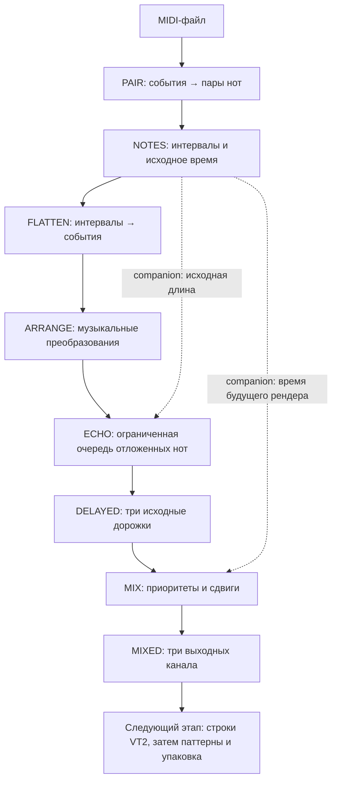
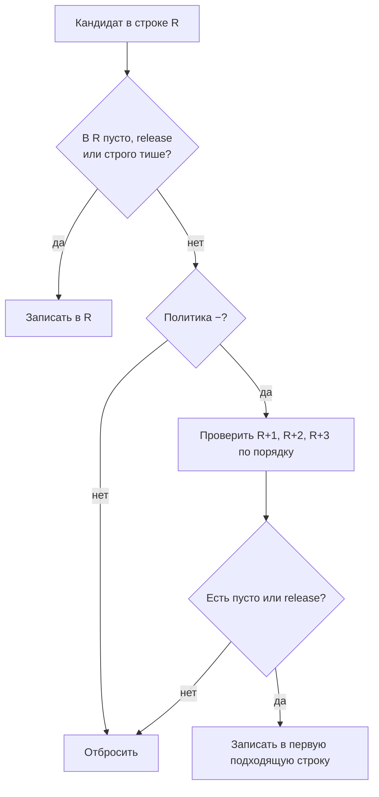
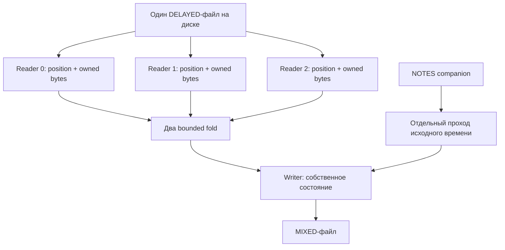
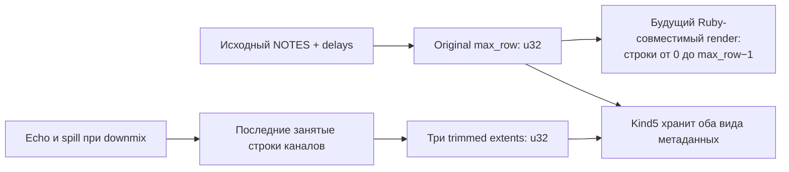

# Четыре строки для мелодии

*Продолжение дневника, 27 октября 2026 года. Как Ruby downmix стал пятой потоковой стадией для Z80.*

> Статус рукописи: fresh CI и аудит его артефактов прошли; отдельный frozen CI и merge [PR #270](https://github.com/oisee/minz/pull/270) ещё ожидаются. Перед выпуском новой редакции книги этот блок должен быть заменён окончательным статусом интеграции. Первая редакция книги остаётся историческим снимком 26 октября.

Вчера у нас были две программы и файл между ними. Сегодня программ уже пять. Они умеют выделять пары MIDI-нот, разворачивать музыкальные события, делать arrangement, добавлять echo и сводить исходные дорожки в три выходных канала.

Последний глагол кажется скромным: «свести». Однако именно здесь встретились выразительность Ruby, дисциплина потокового алгоритма и очень материальная память Z80. Нельзя просто взять массивы оригинального Autosiril и надеяться, что они поместятся. Нужно понять, какую часть прошлого алгоритму действительно необходимо помнить.

Ответ оказался неожиданно маленьким: четыре ожидающие строки на один шаг слияния. Сама программа, конечно, занимает больше четырёх строк и четырёх ячеек: у неё есть код, парсеры, файловые буферы, заголовки и состояние. Но музыкальное будущее каждого слияния удалось ограничить четырьмя позициями.

## Песня путешествует по файлам

Большой конвертер удобно представить как мастерскую. Каждый станок делает одну работу, передаёт изделие следующему и освобождает своё рабочее место.



Это последовательный файловый pipeline. Одновременные процессы, каналы ОС и scheduler ему не обязательны. На CP/M каждая стадия может быть отдельной `.COM`: сначала запускается одна, затем другая. Промежуточный файл переживает завершение программы и становится удобной точкой проверки.

В текущем эксперименте исполняется настоящий собранный Z80. Эмулятор обслуживает файловые системные вызовы через API traps. Это проверяет код программы и её протокол с диском; физический ROM TR-DOS, контроллер дисковода и загрузка на реальном Spectrum требуют отдельной проверки.

## Что именно решает downmix

В выбранном профиле есть три исходные дорожки и три группы назначения. Размеры групп лежат от нуля до трёх, а сумма равна трём. Например, `3, 0, 0` отправляет все источники в первый выходной канал; `1, 1, 1` оставляет каждому свой.

Тонкость оригинального Ruby: значения элементов групп не выбирают источники по номеру. Источники берутся последовательно, а группы задают их количество. Совместимость требует сохранить и это поведение.

Для каждой входной дорожки задана политика `+` или `-`. Сначала обе действуют одинаково: новая нота занимает текущую строку, если там пусто, release или строго более тихая нота. Равная громкость сохраняет ранее обработанный источник.

Если место не досталось, `+` отбрасывает кандидата. Политика `-` пробует ближайшие три следующие строки, но только пустые позиции или release. Если все заняты — тоже отбрасывает.



У Ruby есть ещё историческая особенность: дополнительные сравнения громкости в spill-ветках снова смотрят на исходную строку R. После неудачи первого сравнения они уже не могут дать новую победу. Нативная реализация сохраняет получающееся правило, а не «улучшает» его до сравнения с каждой будущей строкой.

Например, в R уже стоит нота громкости 15, а приходит другая, тоже громкости 15. При `+` останется старая. При `-`, если R+1 свободна, новая переедет туда. Она не вытеснит ноту из занятой R+1 только потому, что та тише.

Это отличается от echo: специальный приоритет original-start из предыдущей стадии сюда не переносится. Похожая форма алгоритма ещё не означает одинаковые правила коллизий.

## От массива к ограниченному горизонту

Исходный Ruby работает с массивами. Он может обращаться к строкам R, R+1, R+2 и R+3 напрямую. На маленькой машине важно заметить другое: дальше R+3 этот кандидат всё равно не заглянет.

Из этого рождается потоковый fold. Он сливает уже обработанный поток с очередным источником. В начале обработки кандидата надо знать четыре потенциальные позиции. Всё, что окончательно осталось раньше текущей входной строки, можно выдать потребителю и забыть.


Ячейки помечены абсолютными номерами строк. Одного `row % 4` недостаточно: одинаковое место в кольце может означать разные моменты песни. Проверка tag не даёт незаметно перепутать далёкие строки.

Для группы из трёх источников используются два последовательных fold. Поэтому общий музыкальный budget — до восьми pending-ячеек, двух голов ранее сведённых потоков и трёх входных голов. «Четыре» относится к одному слиянию, а не ко всей программе.

В Nanz существенная часть размещения выглядит так; это сокращённый фрагмент реального `mix_place`:

```nanz
fun mix_place(unit:u8,row:u32,source:u16) {
    if fault != 0 { return }
    if row > 65535 { fault = 980
        return }
    let slot:u16 = u16(unit)*4 + u16(row)%4
    if mix_live[slot] != 0 && mix_rows[slot] != u16(row) {
        fault = 981
        return
    }
    // Далее: отметить slot, скопировать все поля, записать row.
}
```

Сложение выполняется в u32. Сначала проверяется допустимость, и только потом номер строки сужается до u16. Иначе нота после 65535 могла бы «перепрыгнуть» в начало песни.

Обе fold-функции сгенерированы отдельно. Рекурсивная композиция здесь была бы неудобна для выбранной модели статических spill frames. Отдельные функции делают хранение каждого уровня явным. Это небольшой предметный генератор кода, а не обещание, что compiler уже умеет автоматически превращать любые Ruby-массивы в такие потоки.

## Три читателя — это три состояния

DELAYED хранит сначала один канал, затем второй, затем третий. Но слияние должно смотреть в несколько дорожек независимо. Один файловый offset нельзя честно выдать за три курсора.

У каждого CP/M-читателя поэтому собственные FCB, непрочитанные байты, позиция и счётчик. Общий DMA-буфер копируется в owned buffer читателя до возврата. Выходной файл имеет отдельное состояние. Запись результата не должна уничтожать байты, которые другой читатель ещё не потребил.

У TRD аналогично три логических курсора и три owned sector buffers. Общий scratch-сектор остаётся транспортной деталью. При повторном открытии входа проверяется и состояние writer: чужое чтение каталога не должно молча заменить захваченные free-position/free-count.



Есть дополнительный полный проход для проверки и переноса definitions в начало результата. После него открываются выбранные читатели. Мы платим повторными чтениями ради малого и предсказуемого рабочего набора. Низкая RAM сама по себе не означает минимальное число дисковых обращений.

Здесь нет near pointer, который переживает смену банков или переоткрытие и притворяется неизменным адресом. Музыкальные записи хранятся в принадлежащих читателю буферах; долговременное положение задаётся состоянием курсора.

## У песни оказалось два разных конца

Самая интересная ошибка могла возникнуть даже при совершенно правильных нотах. У канала есть последняя занятая строка. У оригинального рендера есть глобальное `$set.max_row`. Это разные величины.

Echo может продлить канал. Downmix может сдвинуть ноту ещё на три строки. Но Ruby `render_into_text` проходит `max_row.times`, а не максимальную длину получившихся массивов.

Если восстановить длину будущего рендера из mixed extents, мы изменим результат оригинала. Если прибавить единицу «для удобства», тоже изменим. Пустой NOTES даёт original max_row = 0; используемая echo базовая длина при этом равна 1.

Поэтому kind5 сохраняет отдельно:

| Данные | Смысл |
|---|---|
| Definitions | Все ornament fragments без перенумерации |
| Cells | Все поля LNote; после слияния меняются канал и при необходимости строка |
| Три channel extents | 0 для пустого канала, иначе последняя строка + 1 |
| Original render rows | Исходное глобальное время из NOTES и конфигурации delays |

Метаданные времени — u32, даже когда DATA row ограничен u16. Нельзя автоматически считать, что длина и индекс обязаны иметь одинаковый диапазон.



Эта скромная строка в wire contract спасает будущий этап. Совместимость иногда живёт не в самой сложной формуле, а в правильно сохранённой границе цикла.

## Как доказывали, что музыка не изменилась

Сначала вызвали настоящий `downmix` оригинального Autosiril и сравнили его с фиксированной host-моделью. Получили 119 совпадений: реальные сохранённые native echo streams, варианты групп и политик, коллизии, release, spill и границы. Отдельно 119 случаев прошла ленивая композиция.

Только после этого появились target kernel и файловые программы. Каждый содержательный случай исполняется на raw MIR2, final MIR2 и собранном Z80. Oracle остаётся оригинальным Ruby; музыкальные решения на target не подменяются host callbacks.

В полном fresh-прогоне downmix — 1923 исполнения:

| Группа | Исполнений |
|---|---:|
| Target kernel | 408 |
| CP/M | 561 |
| TRD | 384 |
| TRD I/O | 72 |
| Каталог TRD | 102 |
| Повреждённые данные | 210 |
| Вариант common byte API | 48 |
| Состояние при reopen | 12 |
| Две матрицы независимых курсоров | 126 |

Дополнительно выполняются шесть защитных native mutants. Они пытаются записать в запрещённые места с последующим восстановлением, нарушить paging или IRQ. Итоговая память могла бы выглядеть правильной; профиль CPU-записей и событий всё равно должен отвергнуть такой запуск.

Все двадцать upstream-цепочек учтены. Девятнадцать дают допустимый DELAYED; двадцатая намеренно падает раньше на выходе за диапазон строки. CP/M оставляет пустой made file, а на TRD нет опубликованного DELAYED. Это отрицательная цепочка, а не незаметно выкинутый пример.

Fresh gate пересобирает Ruby/Crystal reference и предыдущие стадии. Frozen gate использует закреплённые reference-данные и реально созданные frozen echo files, но заново компилирует и исполняет target. После CI архивы скачиваются, их SHA-256 сверяется с GitHub, а файлы, диски, native images, asm и связи между стадиями проверяются отдельно.

## Сколько это стоит

| Измерение пятой стадии | CP/M | TRD / private Scorpion API traps |
|---|---:|---:|
| Linked image | 23 446 B | 28 538 B |
| Code + bootstrap/stub | 20 890 B | 25 297 B |
| Globals | 1 952 B | 2 504 B |
| Static spills | 604 B | 737 B |

Это размеры разных transport images, не полный RAM budget. У TRD отдельно зарезервирован целый 16-КБ bank8 bounce bank, из которого запись разрешена только в первые 256 байт. Нужны также стек и системные области. Частный образ с origin 0x4000 занимает области, которые обычный Spectrum использует иначе; его нельзя объявлять готовой программой для стандартного ROM-loader.

Для canonical Chronos TRD-выход имеет 54 897 логических байт, занимает 215 data sectors и требует 1130 sector API calls. В этом запуске измерено 1 325 269 810 T-states. Это показатель эмулируемого кода данного профиля, не обещание realtime-конвертации и не полное время физического диска.

CP/M-проверки доходят до файлов размером 156 800 физических байт. Они заметно больше 64 КБ, но программа читает и пишет их частями. TRD имеет отдельный предел 255 секторов на файл: успешная граница проверяется, следующий случай обязан завершиться ошибкой без ложного успешного результата. Два больших допустимых CP/M-входа явно отмечены как непредставимые TRD-входы.

Поддерживаются до 3072 входных cells на дорожку, 9216 суммарно, до 64 definitions и 4096 развёрнутых байт. Все 9216 выходных cells могут оказаться в одном канале. Старые ограничения предыдущих producers не были тайком увеличены, чтобы пройти новые тесты.

## Что стало проще — и что ещё впереди

Мы не построили язык, автоматически помещающий любую программу в Spectrum. Мы нашли структуру конкретного алгоритма и выразили её через общие средства: фиксированные структуры, owned buffers, pull-композицию и явный I/O.

Эти средства доступны не только музыкальному конвертеру. Такой же приём подходит декодеру бинарных пакетов, потоковому преобразованию RLE или конечному автомату, которому нужен небольшой lookahead. Сначала определяем горизонт зависимости, затем храним именно его.

Crystal остаётся удобным местом для семантически проверенных функций и metaprogramming. Nanz позволяет явно записать ограниченное состояние и транспортный код. HIR/MIR2 соединяют их с одним target. В этой вехе сам downmix реализован на Nanz; существующие Crystal exports предыдущих стадий сохранены и продолжают исполняться на Z80.

Следующая естественная задача — `render_into_text`: выбрать общую envelope-ноту, сохранить историю форм и напечатать три канала точно как Ruby. Затем понадобятся паттерны, play order и окончательный формат. Наличие MIXED-файла ещё не означает готовый VT2/VTX.

Но у истории уже появился хороший ритм: небольшой музыкальный этап, независимый oracle, исполняемый target, проверяемый файл и новая глава дневника.

Исходники и точные границы: [план и доказательства downmix](../../autosiril-native/mix/README.md), [kind5 wire contract](../../autosiril-native/mix/WIRE.md), [target kernel](../../autosiril-native/mix/kernel.nanz), [полный fresh gate](../../autosiril-native/mix/verify.py), [frozen gate](../../autosiril-native/mix/replay.py).
