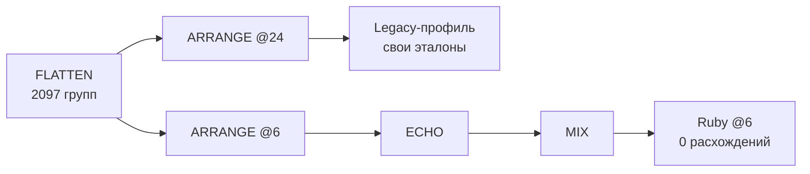
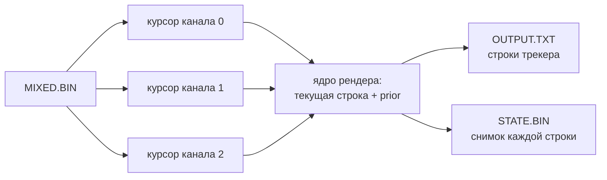
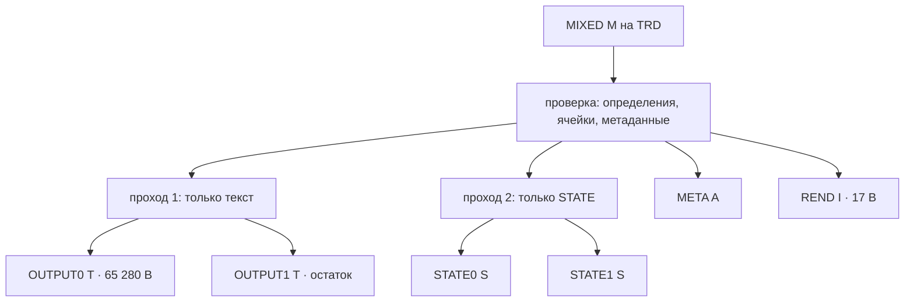

# Две страницы для одной песни

*Продолжение дневника, вечер 27 октября 2026 года. Как сведённые каналы Autosiril превращаются в строки трекера и почему на дискете Spectrum песне понадобилось две страницы.*

> **Статус.** Каноничный профиль `max_offset 6` в main: [PR #272](https://github.com/oisee/minz/pull/272) слит как `f5c6cc42e` после 12 зелёных проверок; скачанные fresh/frozen артефакты canonical6 сверены (`MIXED.BIN` `8aa9cfa2…`, ноль расхождений на границах). Рендер живёт в draft [PR #275](https://github.com/oisee/minz/pull/275): CP/M checkpoint 6 (162/162 исполнения) и TRD checkpoint 1 (75/75). В main рендера пока нет. Полного MIDI → VT2/VTX на Z80 ещё нет.

После пятой стадии у нас был файл `MIXED.BIN`: три выходных канала, в каждом ноты с номерами строк. Это уже музыка, но ещё не трекер. Оригинальный Autosiril в этом месте вызывает Ruby-функцию `render_into_text`. Она проходит по строкам песни и печатает каждую так, как её покажет Vortex Tracker: ноту, сэмпл, огибающую, орнамент и громкость в трёх колонках.

Шестая стадия делает то же самое кодом для Z80. Дорожка нот на входе, текст на выходе, и ни одного массива на всю песню в памяти.

## Сначала разобраться, что такое «правильно»

Прежде чем рендерить, нужно было закрыть долг предыдущего дня. В нативной цепочке и в Ruby получалось 62 разные ячейки p-канала. Их число росло по стадиям: 31 после arrangement, 62 после echo и столько же после mix. Расхождение, которое растёт по стадиям, похоже на ошибку кодогенерации. На деле ошибки не было.

Нативная цепочка собиралась с `max_offset 24`, а каноничный запуск Ruby использует `max_offset 6`. Это два разных, одинаково законных музыкальных профиля. Flatten у них совпадал полностью (2097 групп), а дальше профили честно расходились. Поэтому профиль 24 оставлен со всеми своими эталонами, а canonical6 стал отдельным явным профилем. Теперь ARRANGE@6 → ECHO → MIX дают ноль расхождений на каждой границе: 2097 групп, 3215 ячеек, 1352 строки рендера, `MIXED.BIN` на 54 880 логических байт.

Урок дня: когда два исполнителя расходятся, сначала проверь, что они решают одну и ту же задачу. Первой под подозрение попадает конфигурация, а не компилятор.

У этого PR нашлись ещё две приземлённые проблемы. `MIX.COM` в каноничном профиле честно отрабатывал до конца за 1,32 миллиарда тактов, а общий лимит эмулятора был 700 миллионов. На CI выход обрывался на 20 352 байтах из 54 912. Лимит подняли только для этого шага и записали измеренное значение рядом с ним.

Вторая проблема поучительнее. В «отпечаток исходников» замороженных проверок echo и mix входит файл `ci.yml`. PR менял workflow, и все замороженные эталоны устарели разом. Обновлять их руками, подставляя новые хеши, было бы подделкой. Их взяли из fresh-прогона того же CI: он собран на Linux, без локальных обходов, и перед копированием сверено, что его исходники совпадают с веткой.

## Рендер как поток

Песня Chronos — это 3215 ячеек, 1352 строки и 67 600 байт текста. В 64 КБ адресного пространства Z80 вся песня целиком не нужна. Нужны три «головы» каналов, текущая строка из трёх нот, предыдущее состояние огибающей и два небольших пакета: строка текста на 52 байта и снимок состояния на 82 байта.

У каждого из трёх читателей свой FCB, свой буфер и своя позиция в одном и том же файле. Урок пятой стадии повторился: курсор, которым владеешь сам, не равен общему черновику. Если бы курсоры делили один DMA-буфер, чтение одного канала портило бы данные другого.

`STATE.BIN` нужен не трекеру, а нам. Для каждой строки он записывает то, что Ruby видит в своих локальных переменных после её обработки. Так проверка сравнивает не только итоговый текст, но и всю историю рендера.

## Пять дыр в приёмке

Ядро рендера к утру было проверено на 203 случаях. Но ядро не читает файлы. Файловая обёртка CP/M проходила 114 исполнений и при этом пропускала то, чего пропускать нельзя. Ревью насчитало пять дыр.

**Определения и фрагменты.** Орнаменты хранятся в `MIXED.BIN` как определения, порезанные на фрагменты по 8 байт. Профиль допускает 64 определения и 4096 байт данных в сумме. Обёртка же хранила сырые фрагменты по 16 байт и не больше 256 штук. Легальный вход на 4096 байт отвергался. При длинах 1, 1, … и одном определении на 4033 байта получается 568 фрагментов, это тоже отвергалось.

Хуже того, ссылки орнаментов проверялись по числу фрагментов, а не определений. Два определения в трёх фрагментах — и ссылка на несуществующее определение номер 2 проходила проверку.

Исправление: хранить смысл, а не упаковку. 4096 байт данных и 64 длины, а каноничные фрагменты для `META.BIN` собираются заново при записи. Это возможно, потому что формат однозначен: проверка уже требует строгий порядок, точные длины и нулевое заполнение.

**Независимый декодер.** Python-проверка тоже считала сырые фрагменты как определения. Теперь у неё свой декодер, который отдельно проверяет номера, порядок фрагментов и суммарный лимит.

**Кеш, который нельзя чинить молча.** В каждой ячейке хранится вычисленное поле `enote`. В Ruby его считает конструктор `LNote`: для огибающей `enote = note + ENV_OFFSETS[note]`, иначе −1. Заодно для огибающей выставляются сэмпл 2 и форма по громкости. Обёртка пересчитывала эти поля сама. Испорченный файл тихо превращался в правильный и рендерился как ни в чём не бывало.

Теперь несовпадение с конструктором — это отказ 986. Последняя находка оказалась самой неприятной: ячейка с ненулевым резервным байтом не отвергалась, а просто пропадала из песни. Теперь это отказ 987.

**17, а не 21.** Файл `REND.INF` — это `RINF`, версия и три u32, итого 17 байт. Документация говорила 21. Драйвер всегда проверял 17, ошибались только текст и аудит.

**Каноничный вход.** `MIXED.BIN` из профиля canonical6 стал отдельным случаем, на котором заново запускается свежий Ruby.

| Новый тест | Старая обёртка | Новая |
|---|---|---|
| 4096 байт определений | отвергала (985) | рендерит |
| 568 фрагментов | отвергала (985) | рендерит |
| незаконченное определение | **принимала** | 985 |
| ссылка на неопределённый орнамент | **принимала** | 985 |
| испорченный `enote`, сэмпл, огибающая | **принимала** | 986 |
| ненулевой резервный байт | **молча выбрасывала ячейку** | 987 |

Тест ценен, когда падает на старом коде. Поэтому каждый новый случай прогнали против прежней обёртки: все шесть строк таблицы действительно ловили настоящие ошибки. Ещё три защиты (65-е определение, 4097 байт, переставленные фрагменты) старый код и так держал. Они остались как регрессионные. Итог checkpoint 6: 162 исполнения из 162 (54 случая на сырой MIR2 VM, на финальной MIR2 VM и на собранном Z80).

## Четыре программы подряд

Чтобы доказать, что стадии действительно стыкуются, каноничную цепочку запустили как отдельные `.COM` под эмулятором CP/M, одну за другой, через файлы:

| Программа | Выход | Тактов Z80 |
|---|---|---|
| `ARRANGE.COM` (@6) | `ARRANGE.BIN` | 136 152 180 |
| `ECHO.COM` | `DELAYED.BIN` | 402 847 454 |
| `MIX.COM` | `MIXED.BIN` | 1 323 934 662 |
| `RENDER.COM` | `OUTPUT.TXT` и др. | 620 692 108 |

Каждый промежуточный файл совпал с уже проверенной цепочкой, а текст на выходе — со свежим Ruby. Первые две стадии (PAIR и NOTES) в этом прогоне заново не запускались: их выходы взяты готовыми, и это записано в receipt. На 3,5 МГц четыре программы шли бы около 12 минут. Медленно, но для конвертера, который запускают один раз на песню, терпимо.

## Песня длиннее файла

На TR-DOS всё оказалось теснее. Файл не может быть длиннее 255 секторов, то есть 65 280 байт. Текст Chronos занимает 67 600 байт, `STATE.BIN` ещё больше. Кроме того, TRD-обвязка предыдущих стадий умеет писать только один файл за раз: каталог и счётчик свободного места публикуются в момент закрытия.

Решение получилось почти бумажным. Рендер проходит песню дважды. В первом проходе пишется только текст, во втором только `STATE`. Каждый поток режется на страницы по 255 секторов: `OUTPUT0 T`, `OUTPUT1 T`, `STATE0 S`, `STATE1 S`. Правило проверки простое: склейка страниц должна совпасть с CP/M-потоком байт в байт, а каждая страница, кроме последней, должна быть ровно 65 280 байт.

Два прохода стоят времени: Chronos на TRD занимает до 2,29 миллиарда тактов. Зато не нужен второй одновременный выход, и обвязку прошлых стадий трогать не пришлось.

Логику проверок при этом не дублировали. Разбор `MIXED`, проверки и кодировщики `META`/`REND` вынесены в общий `common.nanz`. CP/M- и TRD-адаптеры поставляют только ввод-вывод. После рефакторинга CP/M по-прежнему проходит все 162 исполнения.

Последней задачей была память. В TRD-схеме программа живёт между 0x4000 и границей стека, а выше 0xC000 во время дисковых вызовов подключается чужой банк. Первый образ занимал 35 783 байта при окне 30 656.

Размерный режим компилятора не помог. Помогли две вещи. Первая: 32-битные операции, которые на Z80 стоят дорого, переписаны побайтово; одна запись u32 занимала 826 байт ради четырёх записей байта. Вторая: под стек было отведено 2 КБ, а измеренный максимум — 60 байт. Граница стека поднята до 0xBF00, бюджет теперь 254 байта, и проверка выхода за неё осталась.

Итог TRD checkpoint 1: 75 исполнений из 75, на всех 25 настоящих TRD-дисках стадии mix, включая нативный Scorpion с проверками 16 банков памяти. Образ 32 235 байт, запас 213. Заодно CP/M-образ похудел с 29 346 до 25 798 байт.

## Что дальше

Шесть стадий уже стоят в ряд, но песня ещё не готова к трекеру.

- **TRD-защиты:** отказы секторов посреди записи страниц, переполнение диска, битые входы и граничные профили на засеянных дисках.
- **VT2/VTX:** запись модуля Vortex Tracker нативным кодом. Сейчас для этого есть только модель на хосте и черновик ядра.
- **CI:** подключить доказательства рендера к обязательным проверкам, как подключены стадии 1–5.

Самое интересное в этом дне — не новые цифры, а то, какие ошибки нашлись. Ни одна не была ошибкой компилятора. Все сидели на границе: между двумя профилями, между фрагментом и определением, между вычисленным полем и сохранённым. Модель поведения Ruby оказалась точнее нашего описания этого поведения. Доказательства и нужны, чтобы находить такие места раньше пользователя.
