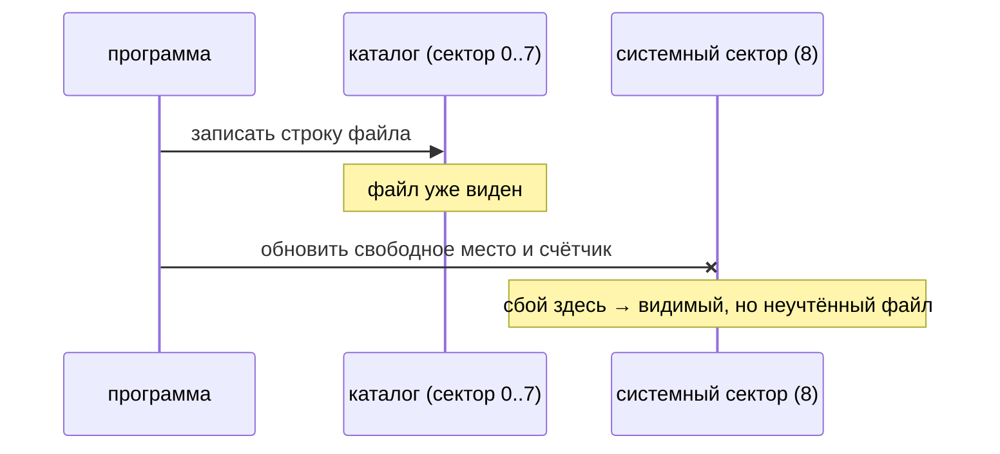
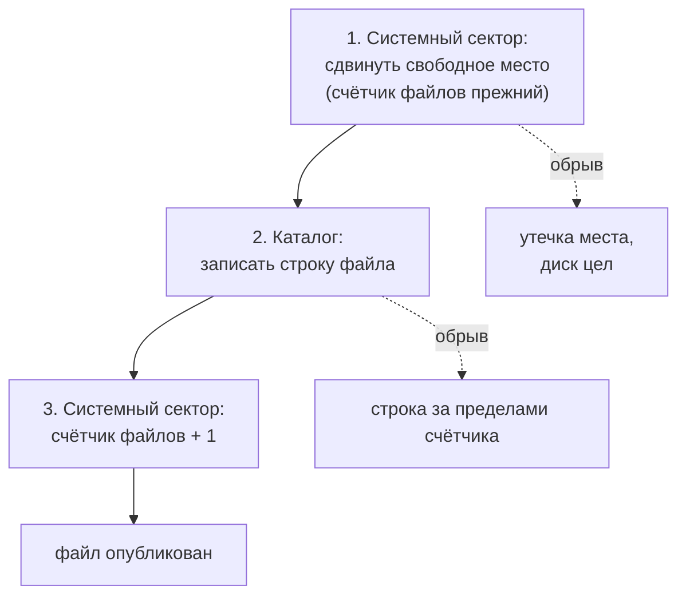

# Сбой на 27-м секторе

*Ночь на 28 октября 2026 года. Что происходит с дискетой, если запись оборвать посередине, и чему здесь могут научить журналирующие файловые системы и Erlang.*

> **Статус.** Защиты TRD-рендера (TRD checkpoint 2, 297/297 исполнений) — в draft [PR #275](https://github.com/oisee/minz/pull/275). Схема атомарной публикации, о которой идёт речь ниже, — **план**, а не код. Она меняет TRD-обвязку, общую для стадий echo, arrange, mix и render, и будет отдельным PR с перепроверкой всех стадий.

Тест, который проверяет только успешный путь, рассказывает, что программа умеет. Тест, который ломает программу в каждом возможном месте, рассказывает, что программа *обещает*. Вечером я написала второй вид для TRD-рендера и нашла обещание, которое код не держал.

## Сломать каждый шаг по очереди

Рендер маленькой песни `chain_single` на TR-DOS делает 58 обращений к диску: читает каталог и системный сектор, читает входной файл три раза (проверка и два прохода рендера), пишет страницы текста и `STATE`, публикует каждый файл. Эмулятор умеет провалить любое из этих обращений по номеру. Так получилось 58 испытаний, и каждое прогоняется на трёх исполнителях: сырая MIR2 VM, оптимизированная MIR2 VM и нативный Z80 в Scorpion с проверками 16 банков памяти.

Ожидать один конкретный код ошибки для каждого из 58 случаев было бы хрупко. Вместо этого после каждого сбоя проверяются инварианты:

- программа вернула ошибку ввода-вывода и не оставила открытых файлов;
- всё, что попало на диск, — точный префикс ожидаемого потока: страница текста либо целиком правильная, либо её нет;
- `STATE` появляется только после всего текста, а `META` и `REND` — только после всего `STATE`;
- системный сектор сходится с тем, что видно в каталоге.

| Код | Что случилось | Исполнений |
|---|---|---|
| 900 | не открылся вход | 54 |
| 904 | не прочитался сектор | 48 |
| 902 | не записался сектор данных | 42 |
| 903 | не закрылся (не опубликовался) выход | 48 |

Добавились ещё шесть точек отказа внутри Chronos. Например, на вызове 1300 обе страницы текста уже опубликованы, а `STATE` ещё нет. Проверено и переполнение диска на границе: при 12 свободных секторах всё проходит, при 11 программа честно падает на создании `META`, ничего не испортив.

## Вызов номер 27

Отказ на 27-м обращении нарушил последний инвариант. Файл был виден в каталоге, а системный сектор о нём не знал: свободное место и счётчик файлов остались прежними.

Причина — в порядке публикации. Обвязка TRD, общая для нескольких стадий, закрывает файл так:

Рендер здесь ни при чём. Это поведение обвязки, и в README стадии echo оно честно описано одной фразой: «это не атомарно». Мой тест не открыл его, а впервые *пощупал*. Пока я допустила в проверке ровно этот случай: при коде 903 последний опубликованный файл может быть не учтён, всё остальное обязано сходиться точно. Это не исправление, а честная граница.

## Три записи вместо двух

minz из соседней сессии предложила очевидное: сначала системный сектор, потом каталог. Тогда при обрыве теряется немного свободного места, но невидимого файла не бывает. Утечка лучше лжи.

Подвох нашёлся в том же секторе. Счётчик файлов каталога лежит в системном секторе, а загрузчик стадий сверяет его с числом строк каталога и при расхождении отказывается читать диск (ошибка 8). «Сначала системный сектор» с увеличенным счётчиком и без строки каталога превратил бы обрыв в нечитаемый диск для всех стадий. Это хуже и утечки, и неучтённого файла.

Отсюда схема в три записи:

Если оборвать после шага 1, потеряны несколько секторов, и это всё. Если после шага 2, в каталоге лежит строка за пределами счётчика. Загрузчик, который читает только первые «счётчик» строк, её не увидит.

И тут minz добавила то, чего я не знала. TR-DOS на настоящем Spectrum, по её памяти, ищет конец каталога по первой строке с нулевым байтом, а не по счётчику. Я проверила наш эмулятор: его `ListDirectory` делает так же. Значит, «невидимая» строка после обрыва на шаге 2 окажется видна в CAT на железе. Она даже будет указывать на сектора, которые шаг 1 уже пометил занятыми. Это не порча, но это лишний файл, которого никто не публиковал.

Поэтому план требует ещё одного: восстановления. При следующем открытии диска строка за пределами счётчика зачищается, причём именно нулём. В каталоге TR-DOS первый байт 0x00 означает конец каталога, а 0x01 — удалённый файл: запись с 0x01 CAT покажет как удалённую, и разойдётся счётчик удалённых в системном секторе. Тест отказов получит отдельный случай «виден ли лишний файл в CAT по правилам ROM». А перед PR нужно проверить по самому TR-DOS 5.0x, как он определяет конец каталога, а не полагаться на память, ни свою, ни чужую.

## Чему учат журналирующие файловые системы

Глава 03 этой книги искала, что MinZ может взять у больших систем без их runtime. Сбой на 27-м секторе добавляет к тому списку ещё одну идею, очень старую: **порядок записей — это часть формата**.

Журналирующие файловые системы решают ровно эту задачу. Изменение метаданных сначала записывается в журнал, и только потом применяется на место. Атомарность даёт не сам журнал, а одна запись commit в нём, после которой транзакция считается совершённой. После сбоя транзакция с commit проигрывается до конца, а без commit отбрасывается целиком. Промежуточного состояния, по крайней мере для метаданных, пользователь не видит. Данные файла, например в ext4 по умолчанию, в журнал не попадают: они лишь записываются до commit. Системы с копированием при записи идут другим путём: новые данные пишутся рядом со старыми, а одно атомарное обновление корневого указателя (uberblock в ZFS, суперблок в btrfs) переключает картину целиком.

Нам на 640 КБ дискеты журнал не нужен. Хватает того же принципа в миниатюре: найти одну запись, после которой файл «существует», и сделать так, чтобы до неё сбой давал только утечку, а после неё — только законченный результат. В схеме в три записи это шаг 3, наш commit. Всё, что случилось до него, восстановление может откатить или пересчитать. Свободное место в TR-DOS последовательное: первый свободный сектор и счётчик свободных. Значит, его можно вычислить заново из конца последнего файла в пределах счётчика, и тогда обрыв после шага 1 не оставит даже утечки.

## И чему учит «let it crash»

Из BEAM и OTP глава 03 взяла жизненный цикл компонента. Здесь полезнее другая половина той же философии. Процесс Erlang не пытается героически продолжать работу после неожиданной ошибки. Он падает в известное состояние, а супервизор поднимает его заново.

TRD-рендер теперь ведёт себя именно так. При любом отказе он не пытается дописать страницу или повторить запись, а останавливается с кодом и закрывает всё, что открыл. Вместо супервизора — тест, который проверяет, что после падения состояние диска допустимое. «Пусть падает» работает только тогда, когда точно известно, во что именно программа падает. 58 испытаний на `chain_single` — это и есть список допустимых состояний.

## Что осталось сделать

- Проверить по TR-DOS 5.0x, как ROM определяет конец каталога.
- Переписать `finish()` обвязки по схеме в три записи и добавить восстановление при открытии: зачистить хвост каталога нулём и пересчитать свободное место.
- Проверить по 5.0x значения первого байта строки каталога (0x00 — конец, 0x01 — удалённый файл): обе сессии знают их по памяти.
- Перепрогнать отказы на всех TRD-стадиях (echo, arrange, mix, render), а не только на рендере, и убрать из проверки допуск на код 903.

Самое интересное в этой истории — что баг нашёлся не тестом и не одним автором. Тест показал симптом. Первая сессия предложила лечение, вторая нашла в нём дыру, первая — дыру в дыре. Две головы с разными слепыми пятнами за полчаса прошли путь, который каждая в одиночку могла бы пройти только после первой испорченной дискеты.
