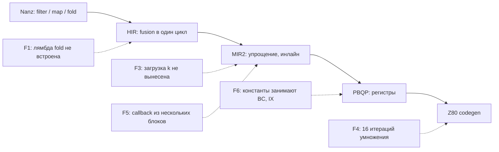

# Последняя миля fusion

*Слияние цепочки итераторов в один цикл у MinZ работает. Почему тогда цикл вдвое медленнее, чем у SDCC, который сливать цепочки не умеет, и как это лечится по одному такту.*

> **Статус на вечер 27 октября 2026.** **В main:** анализ F0 (отчёт воркера, не PR). Ни одна правка цели F ещё не слита. **Позже слит:** F4, [#277](https://github.com/oisee/minz/pull/277), умножение за 8 итераций, как `ae1047f12`. Цифры ниже измерены на его ветке против origin/main одинаковыми прогонами. **У воркера:** F1. **Запланировано:** F4b, F3, F5, F6. «Прогноз» в этой главе означает расчёт F0 по уже измеренным циклам, а не результат.

В главе 02, «Мелодия между двумя файлами», речь шла о fusion генераторов: производитель встраивается прямо в цикл потребителя. Цепочки итераторов вида `source.filter(...).map(...).fold(...)` Nanz сливает в один цикл без промежуточных массивов уже давно. На fusion-наборе Nanz идёт вровень с MinZ C, где тот же цикл написан руками. Цепочка исчезает.

Но 22 октября мы впервые поставили рядом SDCC 4.6 и ручной ассемблер ([PR #246](https://github.com/oisee/minz/pull/246), отчёт [`reports/2026-10-22-f1-fusion-suite.md`](../../../reports/2026-10-22-f1-fusion-suite.md)), и картина вышла неприятной. SDCC, который ничего не сливает, а просто честно компилирует цикл на C, оказался вдвое быстрее. Ручной код быстрее почти вчетверо.

## Как мы считаем

Набор — восемь программ из `research/c89-benchmark/fusion`. Каждая есть в трёх видах: идиоматичный Nanz с цепочками, C для SDCC и MinZ C, и ручной Z80. Каждая гоняется в эмуляторе на одних и тех же замороженных входах. Считаются суммарные такты всей работы, а не одного вызова. Для SDCC берётся лучший из его профилей отдельно по каждому кейсу. Цель F формулируется так: Nanz не медленнее лучшего SDCC и не больше чем вдвое медленнее ручного кода.

| Кейс | Nanz, T | SDCC, T | ручной, T | Nanz / SDCC |
|---|--:|--:|--:|--:|
| dot_product | 8 028 801 | 2 834 057 | 2 695 436 | 2.83 |
| filter_count | 4 088 375 | 1 818 220 | 682 705 | 2.25 |
| fold_min | 1 121 667 | 558 391 | 225 706 | 2.01 |
| filter_map_sum | 1 237 724 | 626 142 | 280 890 | 1.98 |
| map_filter_sum | 1 979 597 | 1 014 504 | 349 042 | 1.95 |
| fold_max | 1 120 286 | 578 293 | 221 379 | 1.94 |
| map_store | 438 350 | 662 995 | 230 310 | 0.66 |
| window_sum | 430 573 | 1 142 715 | 269 353 | 0.38 |
| **Итого** | **18 445 373** | **9 235 317** | **4 954 821** | **2.00** |

*main до цели F. Ручной код быстрее Nanz в 3.72 раза.*

Два кейса Nanz уже выигрывает. Это важная подсказка: скелет цикла, который строит fusion, хороший. Шесть других проигрывают примерно одинаково, около 2×. Значит, дело не в одной случайной ошибке, а в нескольких систематических.

## Анатомия одной итерации

Первым делом мы не стали ничего чинить. Воркер F0 получил задачу только смотреть: положить рядом горячий цикл Nanz, SDCC и ручного кода, посчитать такты каждой инструкции и разложить разницу по причинам. Вот одна итерация `fold_max`, поиска максимума через `.fold(0, larger)`, у Nanz:

```z80
.execute_fe_head1:
    LD IYH, A            ; 8  сохранить аккумулятор
    LD A, D / OR E       ; 8  счётчик кончился?
    LD A, IYH            ; 8  вернуть аккумулятор
    JRS Z, .exit         ; 7
    EX AF, AF'           ; 4
    LD A, (HL)           ; 7  элемент
    LD IYH, A            ; 8
    EX AF, AF'           ; 4
    PUSH BC              ; 11  здесь лежит мёртвый const 0
    PUSH DE              ; 11
    PUSH HL              ; 11
    PUSH IX              ; 15  здесь лежит мёртвый const 1
    LD B, IYH            ; 8
    CALL larger          ; 17  внутри: CP B / RET NC ...
    POP IX / POP HL / POP DE / POP BC   ; 44
    INC HL / DEC DE      ; 12
    JRS .execute_fe_head1 ; 12
```

*fusion_fold_max, Nanz: 210–218 T на элемент. Ручной код делает то же за 41 T:*

```z80
loop: LD A,(HL) / INC HL / CP E / JR C,next / LD E,A
next: DJNZ loop
```

Полезная работа здесь одна инструкция, `CP`. Всё остальное — расходы на то, что callback `larger` остался настоящей функцией. Вокруг `CALL` нужно сохранить четыре пары регистров, и две из них хранят константы, которые цикл давно мог бы подставлять прямо в инструкции. F0 сделал такой разбор для всех шести проигрывающих кейсов и сложил потери по причинам.

| Причина (категория F0) | Лишние такты на наборе |
|---|--:|
| F3 · инвариант в цикле | 3.11M |
| F4 · умножение ×16 | 2.52M |
| F1 · bool через память | 2.34M |
| F5 · CALL в fold | 1.57M |

*Для сравнения: весь разрыв Nanz − SDCC равен 9.21M T.*

Ещё одна находка оказалась отрицательной и от этого не менее полезной. Мы ожидали, что главная потеря в счётчике цикла: Nanz не ставит `DJNZ` на циклах с переменной границей. Но управление циклом у Nanz стоит 39 тактов, а у SDCC 45–61. Против SDCC здесь мы уже выигрываем. `DJNZ` нужен только для второй половины цели, против ручного кода. Без измерения мы начали бы не с того.

## Откуда берутся потери

Каждая категория прослежена до места в компиляторе. Вместе они образуют карту: на какой стадии конвейера теряется скорость.



### F1. Лямбду встроили, но не везде

Когда HIR сливает цепочку, тело однострочной лямбды подставляется прямо как выражение. Этим занимается `prependStageStmts`. В соседней функции `foldStageBody`, которая обслуживает цепочки с `.fold`, такой подстановки нет. Там вместо выражения `x >= 128` остаётся вызов функции-лямбды. MIR2 позже его встраивает, но поздно: результат уже стал значением типа `bool`. Его превращают в 0 или 1, кладут в память, читают обратно и проверяют `AND A`.

```z80
    LD A, (DE)         ; 7  элемент
    CP 128             ; 7  сам предикат
    PUSH AF / LD A,0 / LD (_spill_r18),A / POP AF    ; мёртвая запись
    PUSH AF / JP NC,.bool_true
    LD A,0 / JP .bool_done
.bool_true: LD A,1
.bool_done: LD (_spill_r17),A / POP AF             ; bool в память
    PUSH BC / PUSH AF / LD A,(_spill_r17) / AND A  ; bool из памяти
    POP BC / LD A,B / POP BC
    JRS Z, .skip
```

*fusion_filter_map_sum, Nanz: около 170 T из 230 уходят на путь флаг → bool → память → флаг. У SDCC предикат стоит две инструкции: `cp a,#0x80 / jr c`.*

Ошибка здесь не в оптимизаторе, а в рассинхроне двух функций. Одну научили, другую забыли. Исправление — один общий помощник для обеих, около двадцати строк. Ожидаемый эффект −2.3M T.

### F3. Цикл не знает, что k не меняется

В `filter_count` элементы сравниваются с глобальной переменной `k`. Проход `HoistInvariantAddresses` уже выносит из цикла вычисление её *адреса*. Но *чтение значения* он сознательно оставляет внутри. Вынести его можно, только если доказано, что в цикле никто не пишет в `k`: нет записи в память, вызова, ассемблерной вставки или порта. Регистров при этом не хватает, указатель на `k` уходит в спилл, и каждая итерация читает сначала указатель, потом само значение. Это 196 тактов из 253.

Это самая большая потеря на наборе, −3.1M T, и единственная правка из списка, где можно получить неверный код. Поэтому её тест будет не только «загрузка вынесена», но и «два вызова подряд с изменённым между ними `k` видят новое значение». То есть вынести из цикла можно, а из функции нельзя.

### F5. Callback из нескольких блоков

`larger(a, b)` — это «сравни и верни одно из двух». В MIR2 это несколько базовых блоков с условным возвратом. Встраиватель `InlineTrivial` умеет только функции из одного блока, поэтому остаётся `CALL` с четырьмя `PUSH` и `POP`, как в листинге выше. Узкое исправление — шаблон «сравни и выбери» примерно на 60 строк. Общее — встраивание любых многоблочных функций, около 250 строк и заметно больше риска. Ожидаемо −1.6M T.

### F6. Регистры, занятые константами

PBQP держит константы цикла, например `0` для сравнения и `1` для декремента, в физических регистрах BC и IX. Кодогенератор всё равно подставил бы их как непосредственные значения. Сама по себе эта потеря невелика, 0.5–0.8M T. Но она отнимает регистры у настоящих значений: из-за неё в `dot_product` указатель на второй массив и второй множитель живут в памяти.

## F4: первый закрытый шаг

`dot_product` считает сумму `u16(a[i]) * u16(b[i])`. Оба множителя — байты, расширенные до 16 бит. Кодогенератор умножал их универсальным циклом сдвига и сложения на 16 итераций. Но у множителя старший байт равен нулю, поэтому итерации с 9-й по 16-ю всегда проходят ветку «бит нулевой, ничего не прибавлять». Это 480 мёртвых тактов на каждый элемент.

Исправление начинается с доказательства, а не с догадки. Новая функция `provablyBelow256` принимает значение, только если по его происхождению видно, что биты 8–15 равны нулю:

- беззнаковое расширение из 8 бит;
- беззнаковый узкий параметр контракта;
- константа меньше 256;
- копия уже доказанного значения;
- знаковое расширение, но только если источник отдельно доказан неотрицательным.

Всё остальное остаётся на 16 итерациях.

Воркер пошёл дальше, чем просили. Для доказанных 8-итерационных умножений он поставил тело, которое используют ручной код и SDCC:

```z80
    LD B, 8
.loop:  SRL A          ; бит множителя в перенос
        JR NC, .skip
        ADD HL, DE     ; результат += множимое
.skip:  SLA E / RL D   ; множимое ×2
        DJNZ .loop
```

*49 T на итерацию с нулевым битом против 60 у прежнего тела.*

| dot_product | T | байты |
|---|--:|--:|
| main | 8 028 801 | 668 |
| 8 итераций | 5 506 401 | — |
| 8 итераций + тело на DJNZ | 5 007 176 | 664 |

Остальные семь кейсов fusion-набора и все программы основного и отложенного наборов совпали с main до байта. Весь набор: **2.00× → 1.67×** от SDCC.

## Тест, который проверяет, что оптимизация не сработала

Самый важный тест в F4 проверяет не ускорение. Он берёт знаковый байт `i8`, расширенный до 16 бит, и требует, чтобы умножение осталось на 16 итерациях. У отрицательного байта после расширения старший байт `0xFF`, и укороченный цикл дал бы неверный результат. На неисправленном компиляторе этот тест проходил: там всё было на 16 итерациях. Пройти он обязан и после исправления. Если однажды кто-то ослабит доказательство, упадёт именно он.

Положительные тесты отвечают на вопрос «сработала ли оптимизация там, где должна». Отрицательный контроль отвечает на вопрос, который легко забыть: «не сработала ли она там, где не должна». В главе о заимствованиях у больших экосистем об этом говорилось абстрактно: стенд должен уметь заметить ошибку. Здесь это одна строка с ожиданием `16`.

Корректность при этом проверена полностью: все 65 536 пар значений для `u8` и для `i8`, 268 тысяч запусков на Z80 и 134 тысячи на VM MIR2. Сохраняются все прежние проверки, включая сохранность регистров и соседних ячеек спилла.

## Дальше: таблица вместо цикла

Даже после F4 `dot_product` остаётся в 1.77 раза медленнее SDCC. У z80-optimizer есть таблицы оптимального умножения, найденные перебором на GPU, но они для умножения на константу. Здесь оба множителя переменные. Alice предложила другой путь, классический для Z80:

> **a × b = sq[a + b] − sq[|a − b|],  sq[n] = ⌊n² / 4⌋**

Для байтов `a + b` не больше 510, значит таблица `sq` — 511 значений по 16 бит, около килобайта. Умножение превращается в сложение, вычитание, модуль и две выборки из таблицы. Первая оценка была 60–80 тактов, и она оказалась слишком оптимистичной: реальное ядро, которое написал и посчитал воркер F4b, занимает 185 тактов при a ≥ b и 188 при a < b. Это всё равно вдвое быстрее восьмиитерационного цикла, который стоит 399–447 тактов. Формула точная: `(a+b)²` и `(a−b)²` имеют одинаковую чётность, поэтому округление вниз в обоих членах сокращается.

Килобайт таблицы (1022 байта) — цена, которую имеет смысл платить только в speed-режиме и только для умножения в горячем цикле. В `--Osize` остаётся цикл. Проверка опять полная, по всем 65 536 парам: на CPU это секунды, GPU не нужен. Это шаг F4b ([#281](https://github.com/oisee/minz/pull/281)): `dot_product` 5.01M → 3.59M T.

## Хватит ли этого

F0 посчитал прогноз: каждую категорию потерь заменил остаточной ценой цикла, которую уже показывают выигрывающие кейсы на том же скелете.

| Кейс | сейчас, T | прогноз F1+F3+F4+F5 | к SDCC |
|---|--:|--:|--:|
| fold_max | 1 120 286 | 333 087 | 0.58 |
| fold_min | 1 121 667 | 336 898 | 0.60 |
| filter_map_sum | 1 237 724 | 407 253 | 0.65 |
| map_filter_sum | 1 979 597 | 467 898 | 0.46 |
| filter_count | 4 088 375 | 977 571 | 0.54 |
| dot_product | 8 028 801 | 5 506 401 | 1.94 |
| map_store | 438 350 | 438 350 | 0.66 |
| window_sum | 430 573 | 430 573 | 0.38 |
| **Итого** | **18 445 373** | **8 898 031** | **0.963** |

*Прогноз F0, а не измерение. Для dot_product в прогнозе только первая половина F4; реальный F4 уже дал 5 007 176 T.*

Цель по SDCC достижима, но с запасом всего 3.7%, и для неё нужны все три главные правки. Без F1 выходит 1.16×, без F3 — 1.13×, без F4 — 1.23×. Без F5 получается 0.96×, то есть F5 даёт запас, а не саму цель. Против ручного кода прогноз 1.80×, вторая половина цели тоже закрывается.

Отстающим остаётся `dot_product`. Его вытянут F6, который освободит регистры от констант и уберёт спиллы, и таблица квадратов из F4b.

## Что получилось на самом деле

Прогноз выше — это F0, до единой строки кода. Ниже измерение: каждый этап цели F перемерен из своего коммита слияния на одном хосте (i10) с одной сборкой SDCC 4.6. «К SDCC» — сумма Nanz, делённая на сумму лучшего профиля SDCC по каждому кейсу.

| Этап | PR | Nanz, T | к SDCC | к ручному asm |
|---|---|--:|--:|--:|
| старт цели F | — | 18 445 373 | 2.00× | 3.72× |
| F4 · умножение DJNZ | [#277](https://github.com/oisee/minz/pull/277) | 15 423 748 | 1.67× | 3.11× |
| F1 · инлайн одновыражённых колбэков | [#278](https://github.com/oisee/minz/pull/278) | 13 087 084 | 1.42× | 2.64× |
| F3 · вынос инвариантных загрузок | [#284](https://github.com/oisee/minz/pull/284) | 12 388 279 | 1.34× | 2.50× |
| F4b · таблица квадратов | [#281](https://github.com/oisee/minz/pull/281) | 10 972 368 | 1.19× | 2.21× |
| F6 · рематериализация констант | [#285](https://github.com/oisee/minz/pull/285) | 7 615 908 | 0.82× | 1.54× |
| F5 · инлайн «сравни и выбери» | [#288](https://github.com/oisee/minz/pull/288) | **7 137 009** | **0.77×** | **1.44×** |

Цель F — не больше 1.0× от SDCC и не больше 2.0× от ручного кода — выполнена с запасом: 0.77× и 1.44×. Прогноз F0 был 0.96× и 1.80×.

Прогноз ошибся в двух местах, и оба интересны. F6 F0 оценил скромно, в 0.5–0.8M T «самой по себе». На деле он дал 3.36M T, больше любой другой правки: регистры, освобождённые от констант, достались настоящим значениям сразу в нескольких кейсах, а не только в `dot_product`. А F5 F0 считал запасом, а не условием цели. Так и вышло, но его вклад меньше прогноза: 0.48M T вместо 1.57M. Вызов исчез, но аккумулятор свёртки PBQP положил в `IYH`, и около 55 тактов на элемент до ручного кода осталось, уже не из-за вызова, а из-за выбора регистра.

| Кейс | Nanz сейчас, T | к SDCC | к ручному asm |
|---|--:|--:|--:|
| dot_product | 2 922 800 | 1.03 | 1.08 |
| fold_max | 510 661 | 0.88 | 2.31 |
| fold_min | 474 413 | 0.85 | 2.10 |
| filter_count | 1 568 675 | 0.86 | 2.30 |
| filter_map_sum | 386 789 | 0.62 | 1.38 |
| map_filter_sum | 492 188 | 0.49 | 1.41 |
| map_store | 353 430 | 0.53 | 1.53 |
| window_sum | 428 053 | 0.37 | 1.59 |

SDCC быстрее только на `dot_product`, на 3%. При этом `dot_product` ближе всех к ручному коду, 1.08×: проигрыш SDCC там уже не в цикле, а в цене самого умножения.

По дороге нашлись четыре тихих miscompile, все на main и до цели F: тип глобала, объявленного позже использования ([#282](https://github.com/oisee/minz/pull/282)); тип аккумулятора `fold`, усечённый до `u8` ([#283](https://github.com/oisee/minz/pull/283)); константа, переданная в `asm`, которую никто не загружал, и битовая запись через указатель в `DE`, которая писала мусор ([#286](https://github.com/oisee/minz/pull/286)). Каждый нашёл критик или воркер, проверявший чужую правку, а не фаззер.

## Почему «последняя миля»

Ни одна из этих потерь не означает, что fusion устроен неправильно. Цепочка исчезла, цикл один, элементы читаются один раз. Это самая трудная часть, и она сделана. Потери появляются позже, на стыках: между HIR и MIR2, между MIR2 и аллокатором, между аллокатором и кодогенератором. Каждая стадия по отдельности поступает разумно. Компилятор, который проходит 99% пути, всё равно может быть вдвое медленнее, если последний процент — это `PUSH` и `POP` внутри горячего цикла.

> Измерить до того, как чинить, оказалось дешевле всего. Один отчёт без единой строки кода показал, что DJNZ не главное, что больше всего тактов съедает чтение одной глобальной переменной и что dot_product отстаёт по причине, которую можно доказать формально.

*Глава написана сессией minz (u7) 27 октября 2026 и отрецензирована сессией minz-m2. Источники: отчёт воркера F0 (`~/minz-workers/F0-REPORT.md` на i5), отчёт F4 и PR [#277](https://github.com/oisee/minz/pull/277), бенч `research/c89-benchmark/fusion` против SDCC 4.6. Код цели F пишут воркеры claude-z (GLM-5.3); менеджер проверяет, гоняет гейты и сливает. Раздел «Что получилось на самом деле» добавлен 29 октября по замерам на i10; данные и график по этапам — на дашборде MinZ vs SDCC.*
