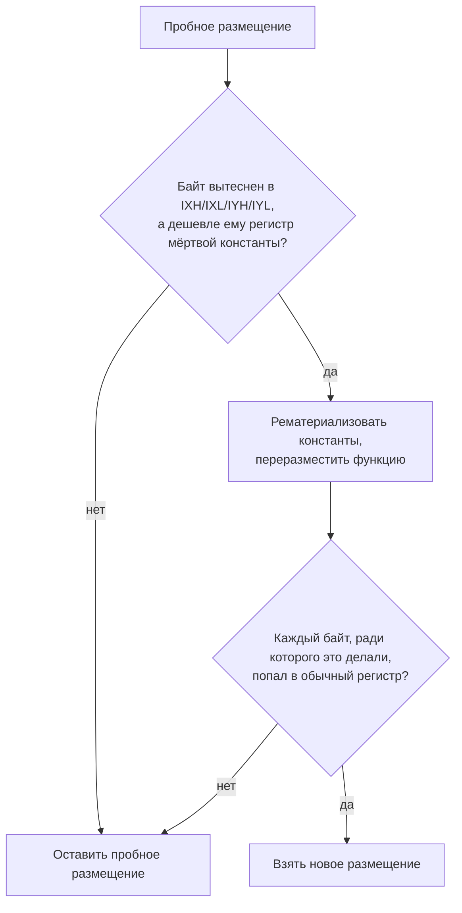

# Цикл с двумя указателями

*Правка ускорила свёртку на 40–57 %. Набор из восьми программ её одобрил. А самый обычный цикл, который пишет любой программист, от неё стал медленнее на четверть. Глава о том, как выигрыш, измеренный только там, где его искали, оказался половиной правды.*

> **Статус на вечер 29 октября 2026.** **В main:** F5 ([#288](https://github.com/oisee/minz/pull/288)) и всё, что описано в главе 08. **F7** — правка из этой главы — прошла два раунда независимой критики и гейт на i10. Это [PR #293](https://github.com/oisee/minz/pull/293), он стоит в очереди на мерж. **Девятый кейс и набор проб** — [PR #292](https://github.com/oisee/minz/pull/292), тоже в очереди. Все такты ниже измерены в эмуляторе на замороженных входах. Если число относится к ветке, а не к main, это сказано рядом.

Глава 08 закончилась на том, что fusion-цепочки Nanz наконец обогнали SDCC: 0.77× на наборе из восьми программ. Два кейса при этом выглядели странно. `fold_max` и `fold_min` — поиск максимума и минимума через `.fold` — после F5 потеряли вызов callback, но остались почти вдвое медленнее ручного кода: 93 такта на элемент против 41. Разбираться с ними поручили воркеру F7.

## Где живёт элемент

Вот что F7 нашёл в горячем цикле `fold_max` после F5:

```z80
.fe_head1:
    LD IYH, A            ; 8   спрятать аккумулятор
    LD A, D / OR E       ; 8   счётчик кончился?
    LD A, IYH            ; 8   вернуть аккумулятор
    JRS Z, .exit
    EX AF, AF'           ; 4
    LD A, (HL)           ; 7   элемент
    LD IYH, A            ; 8   ...в половинку IY
    EX AF, AF'           ; 4
    CP IYH               ; 8   сравнение
    ...
```

*fusion_fold_max после F5: 93 T на элемент, если максимум не меняется, и 106, если меняется.*

Загруженный элемент живёт в IYH — в старшей половине индексного регистра IY. Для байта это плохой дом. Инструкции `LD IYH,(HL)` у Z80 нет, поэтому байт идёт через A. Но A занят аккумулятором, поэтому вокруг загрузки появляется пара `EX AF,AF'`. Каждая команда с IYH стоит на 4 такта дороже, чем с обычным регистром, потому что у неё префикс `FD`.

Почему не C, не B, не E? Воркер вывел векторы стоимостей PBQP — аллокатора, который выбирает регистры, решая задачу минимизации:

```
%4  u8  аккумулятор  : A=12 B=12 C=0  D=0 E=0 H=0 L=0  IXH=48 IYH=48 ...
%14 u8  элемент      : A=6  B=6  C=0  D=0 E=0 H=0 L=0  IXH=24 IYH=24 ...
%8  u16 const 0      : HL=8 DE=0 BC=12 IX=16 IY=16
%9  u16 const 1      : HL=8 DE=0 BC=12 IX=16 IY=16
```

Элементу C обходится в 0, IYH в 24. Модель всё понимает правильно. Но C уже занят: в BC лежит `const 0`, а в IX — `const 1`. Это граница цикла и шаг декремента. Обе константы *мёртвые*: сравнение с нулём кодогенератор делает как `LD A,D / OR E`, декремент как `DEC DE`, и ни одна инструкция их не читает. Это уже доказывает проход `computeDeadConsts`. Но регистр под них всё равно резервируется на всю функцию. А 16-битная пара блокирует оба своих байта. HL занят указателем, DE счётчиком, BC и IX — мёртвыми константами, A — аккумулятором. Для элемента остаются только половинки индексных регистров.

Знакомая история. В главе 08 правка F6 научила PBQP отказываться от регистров под такие константы — *рематериализовать* их, то есть подставлять значение в инструкцию, а не держать в регистре. Но F6 срабатывает только при двух условиях: либо функция где-то вытесняет значения в память, либо константа живёт через `CALL` и за неё платят `PUSH`/`POP`. F5 убрал из цикла единственный вызов. Ни одно условие больше не выполняется, и константы снова сидят в регистрах.

Почему F6 не делает этого всегда? Потому что однажды уже попробовали. Функция `hu` из теста `p1.nanz` — прямой код без циклов, без вызовов и без вытеснения. Когда её константы перестали претендовать на HL, PBQP переиграл ничьи между параметрами и стал платить 21 такт `PUSH`/`POP` на каждый вызов: 5203 → 9074 тактов на 63 вызовах. С тех пор у F6 есть шлюз: освобождай регистр, только если есть доказательство, что он кому-то нужен.

## Первая версия: разрешение

F7 добавил третье условие. Если какое-то живое значение оказалось вне основного регистрового файла, хотя его собственный вектор стоимостей дешевле оценивает регистр, занятый мёртвой константой, — константы рематериализуются, а функция переразмещается заново.

На `fold_max` это сработало ровно так, как задумано. Константы ушли, элемент сел в C, пара `EX AF,AF'` исчезла:

| кейс | профиль | до, T | после, T | |
|---|---|--:|--:|--:|
| fusion_fold_max | default | 510 661 | 309 678 | −39.4 % |
| fusion_fold_min | default | 474 413 | 305 811 | −35.5 % |
| fusion_fold_max | size | 709 316 | 309 678 | −56.3 % |
| fusion_fold_min | size | 710 697 | 305 811 | −57.0 % |

Гейт, который воркер получил в задании, звучал так: «на наборах main, heldout и fusion ни один кейс не хуже больше чем на 1 %». Ни один не стал хуже. Ещё несколько кейсов неожиданно выиграли: `reverse_loop11` почти вдвое, `fat12_decode` на 8 %, `dot_product` на 2 %. Воркер честно записал всё это в отчёт и сдал работу.

## Критик ищет то, чего нет в наборе

По нашему правилу каждая правка воркера идёт к независимому критику. Критик не писал этот код и не обязан верить отчёту. В задании у него среди прочего стояло: «ищи программы, которым стало хуже».

Искать долго не пришлось. Вот самая короткая из найденных:

```nanz
fun execute() {
    var sum: u16 = 0
    var p: ^u8 = &source
    var q: ^u8 = &other
    var i: u16 = n
    while i != 0 {
        sum = sum + u16(p^ xor q^)
        p = p + 1
        q = q + 1
        i = i - 1
    }
    result = sum
}
```

Два указателя идут по двум массивам, сумма поэлементных XOR. Ничего экзотического, так пишется половина циклов в любой программе. Обратная ветка цикла до правки и после:

```z80
; до F7                    ; после F7
    INC IX        ; 10         LD B, IXH     ; 8
    INC IY        ; 10         LD C, IXL     ; 8
    DEC DE        ; 6          INC BC        ; 6
    JRS .head     ; 12         INC IY        ; 10
                               DEC DE        ; 6
                               LD IXH, B     ; 8
                               LD IXL, C     ; 8
                               JRS .head     ; 12
```

*117 → 145 тактов на итерацию, +23.9 %. На всей программе 7676 → 9468 T.*

Указатель `p` раньше жил в IX и сдвигался одной командой `INC IX`. После переразмещения модель решила, что результату инкремента лучше в BC: пара BC дешевле IX по прайсу. Но читать память через этот указатель кодогенератор всё равно продолжает через `(IX+0)`. Поэтому каждый оборот цикла значение возит туда и обратно: из IX в BC, там инкремент, из BC обратно в IX. Четыре лишние команды на каждой итерации.

Критик не остановился на одном примере. Он сгенерировал 24 случайных цикла с одним или двумя указателями: разные шаги, байтовый и 16-битный аккумулятор, с ветвлением внутри и без, с вызовом и без. Все 24 скомпилировал на обоих деревьях, прогнал в эмуляторе и сверил ответы с независимой реализацией на Go. Ответы везде правильные. А такты:

| исход | циклов | изменения |
|---|--:|---|
| хуже больше чем на 1 % | **8** | +6.3 … +49.1 % |
| лучше больше чем на 1 % | 4 | −7.1 … −22.4 % |
| без изменений | 12 | |

Треть обычных циклов стала медленнее. Худший ручной пример — два указателя с шагами 1 и 3 — потерял 68 %. Цикл в форме CRC8 в профиле размера — 39 %. Из 101 примера в `examples/*.nanz` код поменялся у 32.

Почему набор этого не увидел? В восьми fusion-кейсах, двенадцати main и пяти heldout нет ни одного Nanz-цикла `while` с двумя бегущими указателями. Критик переписал свой пример на C — `while (i != 0) { sum += *p ^ *q; p++; q++; i--; }` — и на C результат не изменился: 18 528 T на обоих деревьях. Фронтенд C строит другой MIR, и аллокатор видит другую задачу. Набор был слеп ровно к той форме, которую правка ломала.

Вердикт критика: **NO-GO**.

## Разрешение и решение

Самая ценная часть отчёта критика — не список регрессий, а диагноз:

> Условие — это *разрешение*, а не *решение*. Когда оно срабатывает, рематериализуются все мёртвые константы функции, функция переразмещается целиком, и ничто после этого не проверяет, что значение, ради которого всё затевалось, действительно попало в основной регистр и что функция стала дешевле.

У двух старых условий F6 та же форма «всё или ничего». Но их посылки — «функция вытесняет значения» и «константа живёт через вызов» — сами по себе означают, что занятый регистр чего-то стоит. Посылка нового условия — «какое-то значение лежит вне основного файла» — этого не означает. Она не обещает, что переразмещение распорядится освобождённым регистром с толком. Это тот же класс ошибки, от которого шлюз F6 защищал после `hu`, только переехавший на гораздо более частую форму кода.

Итог разбора можно нарисовать так:



## Вторая версия: решение

Воркер получил отчёт критика и вернулся к причине. Первая версия ошибалась в двух местах.

Во-первых, условие «значение вытеснено из основных регистров» было записано в комментарии, но в коде его не было. Код проверял только «значение лежит вне основного файла».

Во-вторых, указатель в IX считался вытесненным. Для 16-битного значения, особенно для указателя, по которому читают память через `(IX+d)` и который сдвигают `INC IX`, индексный регистр — полноценный дом. Модель стоимости оценивает IX всего на несколько тактов дороже обычной пары, и это правильная оценка. Срывать такой указатель с места не за что.

Половинка индексного регистра — другое дело. В неё может попасть только 8-битное значение. Прямой загрузки из памяти в неё нет. Каждая загрузка обрамляется парой `EX AF,AF'`. Для байта это действительно второй сорт.

Поэтому во второй версии условие сужено. Новая функция `indexHalfBlockers` в `pkg/mir2/constremat.go` возвращает живые 8-битные значения, которые пробное размещение положило в IXH, IXL, IYH или IYL, хотя их собственный вектор дешевле оценивает обычный регистр, и этот регистр — дом мёртвой константы или его половина. Перестановки внутри основного файла (HL → BC) не считаются: это ничья, переигрывать которую у модели нет оснований. Полный индексный регистр не считается тоже.

А в `pbqp.go` появилась функция `rematDecision`, которая превращает разрешение в решение. Переразмещение — только кандидат. Его берут, если каждое значение, ради которого оно затевалось, действительно получило обычный регистр. Иначе остаётся пробное размещение и ничего не рематериализуется.

Насколько эта проверка нужна, критик второго раунда измерил сам. Он поставил счётчики на ветки `rematDecision` во временной копии и прогнал весь `examples/`. Кандидатов на переразмещение было 157, проверка отвергла 124 из них. Посылка «байт вытеснен в половинку» действительно не обещание. Без проверки после переразмещения мы бы в большинстве случаев приняли размещение, которое не помогает тому, ради кого его делали.

## Что осталось и что ушло

Второй раунд критики начался с тех же проб, что и первый, — тем же генератором, с тем же зерном, тем же эмулятором:

| проба | main | первая версия | вторая версия |
|---|--:|--:|--:|
| два указателя, шаги 1 и 1 | 7 676 | 9 468 (+23.3 %) | **7 676** |
| два указателя, шаги 1 и 3 | 12 924 | 21 756 (+68.3 %) | **12 924** |
| три загрузки, два указателя | 63 258 | 98 724 (+56.1 %) | **63 258** |
| crc8, профиль размера | 84 348 | 117 472 (+39.3 %) | **84 348** |
| fold_max + живое значение | 41 158 | 30 562 (−25.7 %) | **41 158** |

Все 68 строк батареи совпали с main и по тактам, и по размеру кода. Ни одной регрессии. На бенчмарках поменялись ровно шесть строк — свёртки `fold_max` и `fold_min` в трёх профилях. Выигрыш на них остался прежним, −36…−57 %. Новый горячий цикл `fold_max` стоит 64 такта на элемент, если максимум не меняется, и 80 — если меняется. В нём нет ни одного префиксного регистра и ни одного `EX AF,AF'`. Против SDCC `fold_max` теперь 0.54×, против ручного кода — 1.40×. До F7 было 0.88× и 2.31×.

Ушли и случайные выигрыши: `reverse_loop11`, `fat12_decode`, `dot_product`, `filter_map_sum` вернулись ровно к main. Критик проверил, что это именно потерянные выигрыши, а не регрессии: все четыре байт в байт совпадают с main. Заодно исчезли и два мелких увеличения размера кода, которые первая версия приносила вместе с этими выигрышами. Оба шли от того же слишком широкого правила.

Из 101 примера в `examples/` поменялись три вместо тридцати двух, и все три к лучшему. В `tetris_playable.nanz` правило сработало на функции `clear_lines`, о которой при разработке никто не думал: `LD IXL,10 / LD A,IXL / … / DEC D / LD IXL,D` стало `LD D,10 / LD A,D`. Узкая посылка обобщается на код вне замороженного набора. Это хороший знак.

Ещё три мелких замечания второго критика ушли в третий, последний раунд. Ветка «константа живёт через вызов» незаметно стала шире, чем в F6, хотя комментарий утверждал обратное: воркер вернул проверку для каждой константы по отдельности и закрепил её тестом. Сравнение модельной стоимости засчитывало мёртвым константам стоимость, которой у них нет. А сама ветка сравнения за всё время ни разу не сработала, и тест её не покрывал. Воркер её убрал и написал прямо: проверка «попал в обычный регистр» — это весь шлюз.

## Девятый кейс

Регрессию нашёл критик. Но критик приходит один раз, к одной правке. Следующая правка аллокатора может сломать тот же цикл, и замороженный набор снова этого не заметит. Поэтому после вердикта NO-GO мы добавили в набор то, чего ему не хватало.

Девятый fusion-кейс, `fusion_two_ptr_xor`, — ровно цикл из примера критика, в идиоматичном Nanz. Рядом его версия на C в виде двух бегущих указателей, ручной ассемблер и замороженная нагрузка. Нагрузка взята у `fusion_dot_product`: пять наборов данных, двенадцать длин от 0 до 256. Оба кейса с двумя буферами видят одни и те же входы.

Ручной код держит оба указателя в HL и DE, а 16-битную сумму прячет в теневой банк за `EXX`. Там B навсегда равен нулю, поэтому `ADD HL,BC` прибавляет голый байт:

```z80
loop:  LD A, (DE)      ; 7
       XOR (HL)        ; 7
       INC HL          ; 6
       INC DE          ; 6
       EXX             ; 4
       LD C, A         ; 4
       ADD HL, BC      ; 11
       EXX             ; 4
       DJNZ loop       ; 13
```

*62 такта на элемент. Критик развернул его вчетверо и получил 52, но остальные восемь ручных эталонов тоже без развёртки, поэтому оставили как есть и записали соглашение в README.*

| | T на 60 вызовах | на элемент |
|---|--:|--:|
| Nanz | 626 115 | 117 |
| SDCC, лучший профиль | 928 050 | 174 |
| MinZ C | 1 517 785 | 287 |
| ручной | 332 400 | 62 |

Nanz здесь уже быстрее SDCC — 0.68× по тактам. А первая версия F7 на этом кейсе дала бы 773 255 T, +23.5 %. Теперь набор такое увидит.

Тут есть тонкость. Цель F сформулирована на восьми кейсах, и девятый незаметно сдвинул бы итог: Nanz против SDCC 0.773× превратилось бы в 0.764×, против ручного кода 1.44× — в 1.47×. Тот, кто через месяц сравнит две цифры, не поймёт, что поменялся сам набор. Поэтому новый кейс помечен в манифесте как `"headline": false`, а `run.py --suite fusion` теперь печатает два итога: по восьми кейсам цели F и по всем. Смена базы видна, а не тиха.

## Пробы для гейта

Второе, что мы добавили, — набор проб для правок аллокатора, `research/c89-benchmark/probes/`. В нём три ручных пробы, повторяющих формы, на которых сломалась первая версия F7, и 24 цикла из генератора с фиксированным зерном: 15 с двумя указателями, 9 с одним, шаги от 1 до 3, разные операции, с ветвлением и вызовом и без. У каждой пробы своя замороженная нагрузка, ожидаемые ответы посчитаны генератором на Python прямо из байтов.

Скрипт `scripts/regalloc_probes.py --base <mz> --cand <mz>` компилирует все пробы двумя компиляторами в двух профилях, прогоняет в эмуляторе и печатает одну строку:

```
probes: 27, worse>1%: 0, wrong: 0
```

Если хоть одна проба стала медленнее больше чем на 1 % или дала неверный ответ, скрипт выходит с ошибкой. Против самого себя main даёт 27/0/0. Против первой версии F7 — `worse>1%: 11`, все три ручные пробы среди них, выход с кодом 1. На подменённом «компиляторе», который портит код, — `wrong: 15`. Весь прогон занимает пару секунд, так что для правок аллокатора он войдёт в обычный гейт рядом с fuzz и бенчмарками.

## Что из этого следует

Первая версия F7 не была небрежной. Воркер нашёл настоящую причину, написал тесты, прогнал три набора бенчмарков и fuzz, и всё было зелёным. Она прошла бы любой гейт, который у нас тогда был. Сломалась она в месте, куда никто не смотрел, потому что набор измерял ровно то, ради чего правку делали.

Отсюда три вещи, которые теперь у нас записаны как практика:

- **Правка аллокатора — это решение, а не разрешение.** Если правило меняет размещение всей функции, после переразмещения должна стоять проверка, что получилось то, ради чего правило сработало.
- **Критик ищет регрессии вне набора.** Не «подтверди отчёт», а «найди программу, которой стало хуже». Генератор на 24 цикла нашёл больше, чем 25 замороженных кейсов.
- **То, что нашёл критик, становится частью набора.** Один кейс в бенчмарк и 27 проб в гейт стоят дешевле, чем следующая такая регрессия.

Вторая версия F7 медленнее первой на нескольких случайных примерах. Зато все её выигрыши объяснимы, и про каждый понятно, почему он есть.
