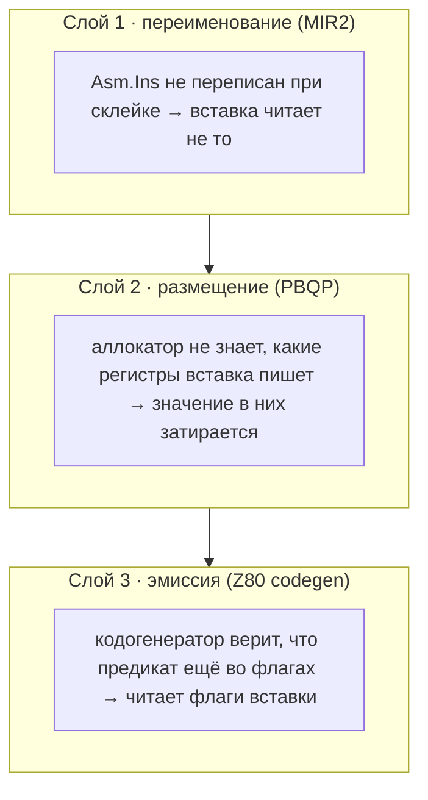

# Что портит ассемблерная вставка

*Маленькая правка в переименовании регистров потянула за собой нитку. На другом конце оказалось, что почти половина программ с ассемблерными вставками считается неверно, а в одном из примеров, написанном задолго до этого, всё это время сидел настоящий баг.*

> **Статус на вечер 29 октября 2026.** **В main:** P1, [PR #291](https://github.com/oisee/minz/pull/291), смержен как `01bb6d806` после трёх раундов работы, двух раундов независимой критики и зелёного гейта на i10: fuzz 2000 + 500 знаковых + 300 свёрнутых, матрица assert без изменений, бенчмарки main и heldout без изменений. Все «было/стало» ниже — это `e2ceb6169` против ветки P1, на одних и тех же программах в эмуляторе.

Nanz разрешает вставить в функцию кусок ассемблера:

```nanz
asm z80 (in acc) (ret A) { ADD A, 1 }
```

`(in acc)` — переменная, которую нужно положить туда, где вставка её ждёт. `(ret A)` — откуда забрать результат. Что вставка портит, компилятор определяет сам: таблица `z80effects` знает для каждой инструкции, какие регистры и флаги она пишет. Можно объявить это и явно, `(clob A)` или `(clob all)`.

Работа P1 началась не со вставок. В плане цели F стоял пункт «PreallocCoalesce должен переименовывать операнды ассемблерных вставок». Пустяк на полчаса. Он занял три раунда.

## Слой первый: забытое имя

`PreallocCoalesce` — проход перед размещением регистров. Он склеивает виртуальные регистры, которые можно хранить в одном месте. Например, параметр заголовка цикла и значение, которое в него приходит по обратной ветке. Склеив `%r3` с `%r1`, проход переписывает все упоминания `%r3` на `%r1`. Все, кроме одного: списка входов ассемблерной вставки, `Asm.Ins`.

Воркер начал с проверки корректности MIR2: «каждый регистр в `Asm.Ins` где-то определён». На немодифицированном дереве она сразу упала:

```
dangling asm operands after PreallocCoalesce:
    loop_carried: execute: asm Ins=%r3 undefined (in loop_body2)
    loop_carried_two: execute: asm Ins=%r4, %r6 undefined (in loop_body2)
    block_param_after_call: execute: asm Ins=%r18 undefined (in cmpsel4_c)
```

Висячий операнд — это не только некрасиво. Использование `acc` во вставке пропадает из счётчиков, и аллокатор спокойно кладёт `acc` в A — ровно туда, куда вставка пишет `ADD A, 1`:

```nanz
fun execute() {
    let acc: u8 = 5
    let i: u16 = 0
    while i < n {
        asm z80 (in acc) (ret A) { ADD A, 1 }
        acc = acc + 1
        i = i + 1
    }
    result = u16(acc)
}
```

| дерево | MIR2 VM до оптимизаций | после | Z80 |
|---|--:|--:|--:|
| main | 8 | 8 | **11** |
| P1, первый раунд | 8 | 8 | 8 |

Результат вставки отброшен, значит `acc` должен закончиться на 8. VM это знает: для неё вставка — пустая операция. А Z80 получает 11, потому что вставка трижды прибавила единицу прямо к `acc`.

Воркер нашёл все проходы, которые переименовывают регистры, научил их переписывать `Asm.Ins` и сдал работу. Тесты зелёные, fuzz зелёный, корпус не изменился.

## Критик считает

Критик первого раунда не стал проверять три примера из отчёта. Он написал генератор: 400 программ, в которых значения живут через ассемблерную вставку. Пять форм: прямой код, `while`, `for` по диапазону, вставка после встроенного «сравни и выбери» и так далее. Оракул — MIR2 VM, для которой вставка ничего не делает. Каждую программу он прогнал на обоих деревьях:

| | main | P1, первый раунд |
|---|--:|--:|
| неверно на Z80 | **176 / 400 (44 %)** | 104 / 400 (26 %) |
| исправлено веткой | | 123 |
| **сломано веткой** | | **51** |

Ветка исправляет 123 программы и ломает 51, которые на main работали. Вот одна из сломанных, без всякого встраивания:

```nanz
fun execute() {
    let v0: u8 = 5
    let v1: u8 = 9
    let i: u16 = 0
    while i < n {
        asm z80 (in v0, v1) (ret A) { LD B, A }
        v0 = v0 + 2
        v1 = v1 + 2
        i = i + 1
    }
    result = u16(v0) + u16(v1)
}
```

main даёт правильные 26, ветка — 17. Теперь, когда операнды вставки честно видны аллокатору, он кладёт входы туда, где их ждёт соглашение вставки: первый в A, второй в B. Но вставка пишет B, а аллокатору никто не сказал, что B она портит. Поэтому `v1` затирается на каждой итерации.

На main эта же программа работала случайно: из-за висячего операнда `v1` вообще не связывался со вставкой и попадал в другой регистр. Первая правка не создала ошибку, а сняла с неё маскировку.

Главная находка критика — даже не 51 регрессия, а 176 программ из 400, неверных на main. Ассемблерная вставка в цикле со значением, живым через неё, в 44 % случаев давала неверный код задолго до P1.

## Слой второй: что пишет шаблон

Критик назвал это предсуществующим дефектом F1: аллокатор ничего не знает о том, что портит вставка. Хотя знание уже есть — `Asm.Clobbers` вычисляет фронтенд по таблице эффектов. Просто PBQP на него не смотрит. По нашему правилу ветку с 51 новой ошибкой не мержат. Во втором раунде воркер получил задание чинить причину, а не следствие.

Новый файл `pkg/mir2/pbqp_asm_clobber.go` делает три вещи.

`asmClobberAvoid` идёт по каждому блоку с конца, как обычный анализ живости, и для каждого значения, живого через вставку, запоминает классы регистров, которые вставка пишет. Входы вставки без результата считаются входами-выходами и освобождаются от запрета. Это нужно, например, для `16_rotate_sled.nanz`: там вставка нарочно меняет свой вход на месте.

`applyAsmClobberCosts` выставляет таким значениям бесконечную стоимость в регистрах, которые вставка портит. Для PBQP это жёсткий запрет.

`locHomesClobbers` решает, опасно ли конкретное место. Абсолютная память опасной не бывает: шаблон не может случайно попасть в ячейку вытеснения. Поэтому блок с `(clob all)` остаётся размещаемым — живые значения просто уходят в память.

Тот же запрет консультирует и `canRecolor` при склейке, чтобы склейка не вернула значение туда, откуда PBQP его только что убрал. Плюс одна функция `Inst.ReplaceUse`, которую теперь вызывают все проходы переименования, вместо четырёх копий одного цикла. И три места, которые аудит первого раунда пропустил: терминаторы `TermCondRet` и `TermDJNZ` и таблицы последовательных адресов в `PreallocCoalesce`.

Батарея критика на 378 содержательных программах: было 176 неверных, стало **0**.

Тот же прогон по всему корпусу из 488 файлов поменял ровно один: `examples/conway.minz`, «Жизнь» Конвея. Критик посмотрел, что именно поменялось:

```z80
.main_if_join20:
    ld hl, (attr_addr)     ; ← ассемблерная вставка из примера
    ld a, (value)
    ld (hl), a
    LD BC, 1
    ADD HL, BC             ; ← это должен был быть счётчик цикла
    JRS .main_loop_head16
```

На main счётчик цикла жил в HL. Вставка, которую автор примера написал руками, загружает в HL адрес атрибута. Дальше компилятор прибавляет единицу — но уже к адресу, а не к счётчику. Этот пример много месяцев компилировался, собирался и выглядел нормально. На ветке счётчик уходит в память на время вставки, а программа становится на 128 байт меньше, потому что исчезает обвязка `PUSH`/`POP` и `EX AF,AF'` вокруг байтовых загрузок.

## Слой третий: флаги

Второй раунд критики начался с той же батареи. Затем критик добавил шестую форму, `boolasm`: логическое значение получено сравнением *до* вставки, а используется *после* неё.

```nanz
while i < n {
    let go: bool = ga < gc          // ga=200, gc=100 → всегда false
    asm z80 (in acc) (ret A) { ADD A, C }
    if go { acc = acc + 1 }
    i = i + 1
}
```

| форма | main, неверно | P1, второй раунд, неверно |
|---|--:|--:|
| все 600 программ | 287 | 18 |
| из них `boolasm` | 69 | 18 |

287 → 18 — огромный шаг. Но две программы, которые на main работали, на ветке сломались. А 17 других `boolasm` неверны и там, и там. Вот что кодогенератор делает с программой выше:

```z80
    CP D                  ; ga < gc  → предикат во флаге C
    PUSH AF
    JP C, .bool_true_1    ; bool честно сохранён в память
    ...
    ADD A, C              ; ← вставка, выставляет CY по-своему
    LD C, 0
    PUSH AF
    JP C, .bool_true_2    ; ← ветвление по CY вставки
```

Логическое значение, полученное сравнением, на Z80 естественно живёт во флагах. Кодогенератор держит это знание в поле `pendingFlagReg`: «предикат для этого регистра всё ещё лежит во F». Вставка `ADD A, C` переписывает флаги, а `pendingFlagReg` об этом не узнаёт. Следующее `if go` проверяет флаг переноса, который оставила вставка.

Здесь видно, почему второй слой эту ошибку не поймал. Он работает в аллокаторе: запрещает значению место, которое вставка портит. А здесь значение ни в каком месте не живёт. Оно живёт в уверенности кодогенератора, что флаги ещё не тронуты. Ни один вектор стоимостей до этого не дотягивается. MIR2 для этой программы на main и на ветке совпадает байт в байт, разное только то, что делает эмиттер.



Критик предложил два места для исправления, оба в кодогенераторе. Воркер получил третий раунд — последний по нашему правилу «не больше двух возвратов».

Исправление занимает восемь строк. У `AsmExtra` появился метод `WritesFlags()`. Он смотрит на объявленные клобберы, а если объявление уже настоящих записей, — на эффекты каждой инструкции шаблона. Это ловит случай, когда программист написал `(clob A)` для шаблона, который на самом деле пишет и F. Перед такой вставкой кодогенератор вызывает уже существующий `materializePendingFlag`: если предикат ещё кому-то нужен, он сохраняется в свободный регистр или в память, и последующие чтения идут туда. Вставка, которая флаги не трогает (`NOP`), идёт старым путём.

| | main | P1, третий раунд |
|---|--:|--:|
| 600 программ, неверно | 287 / 570 | **0 / 570** |
| правильно → неверно | | **0** |
| 44 ручные пробы, падают | 18 | 1 |

Единственная оставшаяся проба — шаблон критика с несбалансированным `PUSH HL`. Он не возвращается ни на одном дереве, потому что сам портит стек. Сам критик тоже записал его как «не ошибка компилятора».

## Что не вошло

Третий раунд я смотрела сама, по правилу: на третий раз — без критика, но с проверкой качества кода. Правка маленькая и бьёт в корень. Один побочный эффект я записала в журнал решений. Заодно со флагами запись SP теперь означает класс `ClassStack`. Поэтому через блок `(clob all)` живое значение больше не может жить в ячейке стекового кадра, только в абсолютной памяти. Это осторожнее, чем раньше, и корпус от этого не изменился.

В список дальнейшей работы ушли четыре вещи:

- **Контракт вход-выход.** Если вставка без результата меняет свой вход, это работает потому, что самым дешёвым домом для входа оказался A. Никто этого не закрепляет. Явный `(out <переменная>)` сделал бы контракт записанным, а не случайным.
- **`Asm.Outs`.** `asmClobberAvoid` его пока не учитывает. Сейчас его не заполняет ни один фронтенд.
- **`markFlagsOnly`.** В переписывании Grace у него нет защиты от `OpAsm`. До него сейчас ничего не доходит, но защита в глубину не помешает.
- **Неизвестный операнд.** `asm z80 (in ga)`, где `ga` — глобальная переменная, роняет компилятор паникой вместо понятной ошибки.

## Что из этого следует

Задача была «переименовать операнды». Если бы мы приняли первый раунд, у нас была бы правка, которая чинит 123 программы и ломает 51. И мы бы об этом не узнали: на корпусе и в тестах всё было зелёным. Узнали благодаря генератору на 400 программ и правилу, что новую ошибку не мержат, даже если старых стало меньше.

Три слоя одной ошибки — переименование, размещение, эмиссия — лежат в трёх разных частях компилятора. Каждый следующий проявлялся только после того, как починили предыдущий. Остановиться можно было на любом из них с хорошими цифрами. Остановились, когда батарея показала ноль.

А Конвей, наверное, теперь правильно красит клетки. Проверять глазами мы пока не стали.
