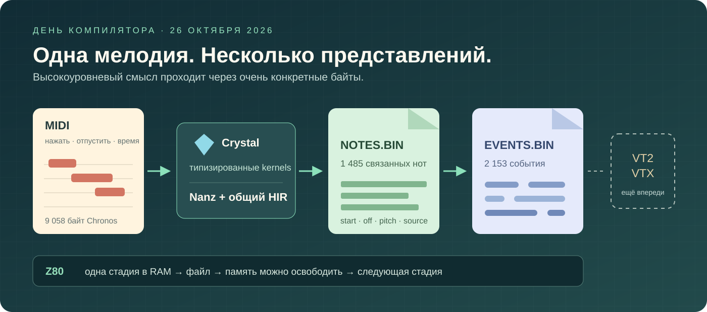

# Дни из жизни компилятора MinZ

**Четыре русские главы: Ruby и Crystal, битовые потоки, генераторы, музыка на Z80 и идеи больших экосистем.**



Началось с вопроса «а можно взять frontend Crystal?», а привело к общим генераторам, метафункциям, битовым схемам и двум нативным CP/M-утилитам. Здесь история с объяснениями, реальными примерами и схемами: зачем это понадобилось и что стало проще.

**[Открыть иллюстрированную HTML-версию →](index.html)** — все схемы уже отрисованы, есть интерактивная модель ленивого RLE. HTML не требует внешних CDN или JavaScript-библиотек при чтении. Его можно открыть локально; GitHub показывает `.html` как файл, а Markdown ниже читает прямо с Mermaid.

1. **[Ruby умеет рассказывать. Z80 умеет считать. Как дать им общий язык](01-languages-and-ideas.md)** · [HTML](01-languages-and-ideas.html)\
   Настоящий Crystal frontend, закрытый HIR-мост, дружба macro и meta, target layout, предметные DSL, битовые схемы, Erlang и смысл OTP. Зачем языковая выразительность полезна маленькой машине.

2. **[Мелодия между двумя файлами](02-melody-between-two-files.md)** · [HTML](02-melody-between-two-files.html)\
   Что такое ленивость, как генератор хранит продолжение, когда fusion убирает frame, почему RLE стал проще и откуда взялись 64 байта. MIDI/Autosiril, ранний break, handles и две самостоятельные `.COM` вместо огромного общего образа.

3. **[Чемодан без виртуальной машины](03-borrowing-without-a-runtime.md)** · [HTML](03-borrowing-without-a-runtime.html)\
   Что MinZ может взять у LLVM, Cranelift/ISLE, своей Grace, .NET/C#, JVM/Kotlin, Rust и BEAM. Что уже есть, какие идеи стоит проверить дальше и почему полезная идея не требует переносить весь runtime.

Две главы подготовлены совместно с Astra; примеры, текущие результаты и границы сверены с кодом и receipts. Статьи можно читать независимо. В первой редакции Markdown — 18 Mermaid-схем; в HTML — готовые SVG, две отдельные векторные иллюстрации и небольшая поясняющая модель спроса.

4. **[Четыре строки для мелодии](04-four-rows-for-a-melody.md)** · [HTML](04-four-rows-for-a-melody.html)\
   Продолжение 27 октября: native downmix, два bounded fold, owned cursors, исходное время рендера и проверки CP/M/TRD. PR #270 смержен как b58fba0c6 после 12 зелёных проверок; скачанные fresh/frozen артефакты независимо проверены.

5. **[Две страницы для одной песни](05-two-pages-for-one-song.md)** · [HTML](05-two-pages-for-one-song.html)\
   Вечер 27 октября, черновик: шестая стадия — рендер в строки трекера. Каноничный профиль `max_offset 6`, пять дыр приёмки, четыре COM подряд под эмулятором, TR-DOS-страницы по 255 секторов. Рендер пока в ветке, не в main.

## Книга для отправки на читалку

- [EPUB — четыре главы — редакция 27 октября](output/epub/minz-compiler-day-2026-10-26.epub)
- [PDF A5 — 93 страницы — редакция 27 октября](output/pdf/minz-compiler-day-2026-10-26-A5.pdf)

В PDF текст и схемы векторные; широкие схемы вынесены на альбомные страницы A5. EPUB адаптируется к размеру экрана; схемы включены как PNG, внешние сервисы не нужны. В обоих форматах есть оглавление и ссылки на исходники.

## Исторический статус первой редакции, 26 октября

**В main:** CP/M MIDI → файл нот → файл flatten-событий; 1485 нот и 2153 события Chronos совпали с Ruby. Генераторы и ограниченный opt-in fusion уже работают. [PR #262](https://github.com/oisee/minz/pull/262) и [PR #263](https://github.com/oisee/minz/pull/263) смержены после CI.

**Отдельный локальный эксперимент:** Spectrum/Scorpion MIDI → TRD, 180 исполнений первого этапа. На дату написания это ещё не интегрированный в main transport и не проверка physical TR-DOS ROM/железа.

**Следующая работа и предложения:** нативные arrangement/echo/mix и конечный VT2/VTX; общий анализ lifetime и более широкий fusion; идеи из других экосистем. Статьи не выдают их за завершённые возможности.

История использует фундамент Crystal-итераций 25 октября и результаты 26 октября; это не утверждение, что каждый упомянутый механизм написан за один день. Срез описанного `main`: `a716ff184`. Точные числа — из конкретных эмуляторных проверок, а не универсальные benchmarks языков.

## Пересобрать HTML

Список глав, даты и snapshots для ссылок задаются в `edition.json`. Каждая историческая глава сохраняет свой исходный snapshot; новые главы добавляются в список. Исходники — Markdown рядом. `build.py` использует Pandoc и Mermaid CLI; SVG включены в HTML как data URI, поэтому каждый HTML содержит собственные иллюстрации. Внутренние ссылки на код ведут к описанному commit на GitHub.

```sh
# Инструменты можно установить вне checkout; Chromium используется только при сборке.
PUPPETEER_SKIP_DOWNLOAD=1 npm install --prefix /tmp/minz-article-tools \
  @mermaid-js/mermaid-cli@12.0.0

python3 research/daily/2026-10-26/build.py \
  --mmdc /tmp/minz-article-tools/node_modules/.bin/mmdc \
  --chrome /path/to/chrome
```

Нужны Python 3, Node.js, Pandoc и Chrome/Chromium. Сборка проверяет все Mermaid, локальные ссылки и незаполненные вставки, создаёт HTML и `manifest.json`. Для чтения инструментов не нужно. Интерактивный RLE в браузере — объясняющая модель, не эмулятор Z80 и не измеритель производительности.

## Пересобрать EPUB и PDF A5

Сначала соберите HTML. Затем установите зависимости в отдельное окружение:

```sh
python3 -m venv /tmp/minz-book-venv
/tmp/minz-book-venv/bin/pip install reportlab==5.1.0 pypdf==6.21.2
/tmp/minz-book-venv/bin/python research/daily/2026-10-26/build_books.py \
  --chrome /path/to/chrome \
  --node-modules /tmp/minz-article-tools/node_modules
```

Сборка использует Pandoc, Chrome и уже отрисованные SVG. По умолчанию шрифты Arial берутся из `/System/Library/Fonts/Supplemental` на macOS; в другой системе передайте `--font-dir` с файлами `Arial.ttf` и `Arial Bold.ttf`. LaTeX не требуется. `output/books.json` фиксирует число страниц, иллюстраций и форматы. Побайтовая воспроизводимость PDF не обещается: браузер и PDF-библиотеки добавляют метаданные сборки.

Проверка выпуска: все 74 страницы первой редакции отрисованы Poppler, текст не выходит за границы страниц; визуально просмотрены обложка, код, таблицы и схемы. HTML проверен при ширине 1440 и 390 пикселей: изображения загрузились, общего горизонтального переполнения нет, интерактивная модель RLE проверена для спроса 0, 2 и 4.

## Новая редакция, 27 октября

[PR #270](https://github.com/oisee/minz/pull/270) завершил пятую native стадию Autosiril. Новая глава описывает эту веху: четыре главы, 23 схемы, 93 страницы A5. Входящий [CI run](https://github.com/oisee/minz/actions/runs/40488033663) и скачанные артефакты проверены отдельно от сборки книги. Исторические главы1–3 сохраняют свой snapshot; глава4 ссылается на интегрированный `b58fba0c6`.

[Выпуски EPUB/PDF](https://github.com/oisee/minz/releases) · [первая редакция 26 октября](https://github.com/oisee/minz/releases/tag/book-compiler-day-2026-10-26). Новый выпуск публикуется после интеграции этой редакции книги через отдельный PR.
